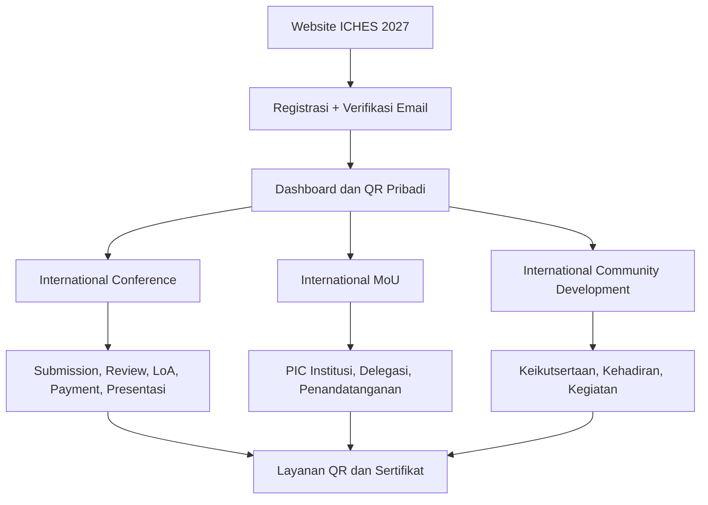

# ICHES UNISYA 2027 — Product Blueprint

> **STATUS: DOKUMENTASI PERANCANGAN · BELUM IMPLEMENTASI**  
> **The 6th ICHES 2027** — sistem konferensi dan kegiatan internasional UNISYA.  
> Disusun untuk diskusi dan pemaparan kepada pimpinan, termasuk Warek I.  
> **Tanggal baseline:** 26 Oktober 2026. **Bukan** proposal pengadaan yang telah disahkan pimpinan.

## 📍 Mulai dari sini

**➡️ [Buka presentasi visual untuk Warek I](docs/00-PRESENTASI-WAREK-I.md)**  
**➡️ [Baca analisis TOR resmi dan perubahan aplikasi](docs/10-ANALISIS-TOR-DAN-REBASELINE-2027.md)**

Diagram di dalam dokumen menggunakan **Mermaid** sehingga muncul langsung sebagai bagan pada tampilan GitHub; tidak perlu perangkat lunak diagram tambahan.

## Apa yang akan dibangun?

**Acuan TOR Warek I:** Konferensi **5 Januari 2027** (hybrid); Pembinaan/MoU/Parallel Session pada hari yang sama; Pengabdian dan Studi Destinasi **6 Januari 2027** (onsite). TOR menetapkan **lima kegiatan** dan **sembilan kategori biaya**. Ketentuan yang masih ambigu dicatat di audit TOR.

Satu aplikasi terpadu, satu profil, dan satu QR pribadi untuk berbagai jalur kegiatan:

| Jalur | Fungsi utama |
|---|---|
| **International Conference** | Presenter dan Participant; abstrak, review, LoA, pembayaran, full paper, presentasi, sertifikat |
| **Pembinaan Riset dan PKM** | Sesi pembinaan, registrasi peserta, jadwal, check-in khusus jika diperlukan |
| **International MoU** | Satu pendaftaran per institusi, PIC, delegasi terverifikasi, kehadiran, penandatanganan |
| **International Community Development (ICD)** | Pendaftaran kegiatan, pembagian kelompok PKM, kehadiran, dan penyelesaian jika dipersyaratkan |
| **Studi Internasional Destinasi Berkelanjutan** | Pendaftaran/bundle, rombongan, titik kegiatan dan check-in lapangan |
| **Operasional acara** | Check-in, pos pelayanan, konsumsi, kit, hak fasilitas, pemindaian QR |
| **Dokumen publik** | Sertifikat PDF unik per penerima dengan URL dan verifikasi publik |

**Batasan utama:** ICHES UNISYA ini adalah **sistem khusus satu event (ICHES 2027)**, bukan pengelolaan banyak edisi atau platform OJS.

## Peta dokumen

| Dokumen | Isi |
|---|---|
| [00 — Presentasi Warek I](docs/00-PRESENTASI-WAREK-I.md) | Ringkasan eksekutif, bagan utama, skenario penggunaan, keputusan |
| [01 — Produk dan alur pengguna](docs/01-PRODUK-DAN-ALUR-PENGGUNA.md) | Cakupan, aktor, skenario, perjalanan pengguna |
| [02 — Registrasi dan keikutsertaan](docs/02-AKUN-REGISTRASI-KEIKUTSERTAAN.md) | OTP/Magic Link, profil, multi-aktivitas, QR personal |
| [03 — Submisi akademik](docs/03-SUBMISSION-REVIEW-AKADEMIK.md) | Metadata, teks + PDF, screening, review, LoA, pembayaran, full paper |
| [04 — MoU dan ICD](docs/04-MOU-DAN-ICD.md) | Institusi, PIC, undangan delegasi, verifikasi, kehadiran |
| [05 — QR dan fasilitas](docs/05-QR-ABSENSI-DAN-FASILITAS.md) | Hybrid scanner, pos, petugas, konsumsi per slot, rights override |
| [06 — Sertifikat publik](docs/06-SERTIFIKAT-PUBLIK.md) | Semua penulis, publikasi massal, distribusi, URL unik, verifikasi |
| [07 — UI/UX dan arsitektur](docs/07-DESAIN-UI-DAN-ARSITEKTUR.md) | Vue/Inertia, shadcn-vue, putih–hijau, batas modul |
| [08 — Audit referensi repo lama](docs/08-AUDIT-REPO-LAMA.md) | Apa yang dipakai, dirancang ulang, atau ditinggalkan |
| [09 — Register keputusan](docs/09-KEPUTUSAN-DAN-ISU-TERBUKA.md) | Disepakati / usulan / masih perlu keputusan |
| [10 — Analisis TOR Warek I](docs/10-ANALISIS-TOR-DAN-REBASELINE-2027.md) | Lima kegiatan, tanggal resmi, sembilan biaya, rundown, konflik operasional, prioritas MVP |

## Ringkasan alur terpadu

## Aturan dokumentasi

- **DISETUJUI**: kebijakan yang telah dipilih secara eksplisit dalam diskusi pemilik produk.
- **BASELINE REPO LAMA**: keputusan yang terdokumentasi di repository lama; belum otomatis menjadi keputusan baru bila bertentangan.
- **USULAN**: solusi desain yang masih memerlukan persetujuan.
- **TERBUKA**: keputusan yang belum dipilih.
- **BELUM DIBANGUN**: tidak boleh dipresentasikan sebagai fitur sudah berjalan.

Repository rujukan: [akhmadafnan/international-conference-platform](https://github.com/akhmadafnan/international-conference-platform), terutama branch `develop`.

## Status pengerjaan

**Tahap saat ini: discovery, dokumentasi, dan presentasi rancangan.** Tidak ada aplikasi Laravel yang diinisialisasi, database, deployment, data peserta, atau pengembangan fitur dalam repository ini. Dokumen dapat diperbarui ketika pimpinan atau panitia memutuskan perubahan kebijakan.

---

*Dokumen kerja ICHES UNISYA. Diagram dan contoh data di sini merupakan rancangan, bukan pelaksanaan yang telah terjadi.*
