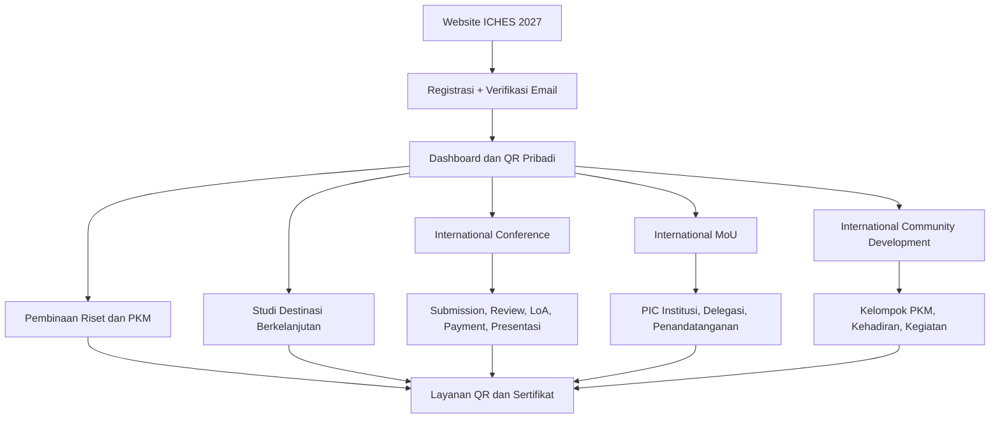

# ICHES UNISYA 2027 — Product Blueprint

> **STATUS: DOKUMENTASI PERANCANGAN · BELUM IMPLEMENTASI**  
> **The 6th ICHES 2027** — sistem konferensi dan kegiatan internasional UNISYA.  
> Disusun untuk diskusi dan pemaparan kepada pimpinan, termasuk Warek I.  
> **Tanggal baseline:** 26 Oktober 2026. **Bukan** proposal pengadaan yang telah disahkan pimpinan.

## 📍 Mulai dari sini

**➡️ [Buka presentasi visual untuk Warek I](docs/00-PRESENTASI-WAREK-I.md)**  
**➡️ [Baca analisis TOR resmi dan perubahan aplikasi](docs/10-ANALISIS-TOR-DAN-REBASELINE-2027.md)**  
**➡️ [Lihat keputusan terbaru: Co-Host, reviewer self-claim, Full Paper](docs/11-KEPUTUSAN-OPERASIONAL-26-OKT-2026.md)**  
**➡️ [Buka alur pembayaran Co-Host Rp3 juta per institusi](docs/12-PEMBAYARAN-COHOST-PER-INSTITUSI.md)**  
**➡️ [Tahap 18A: Role, Permission, Navigasi Admin](docs/18A-ROLE-PERMISSION-DAN-NAVIGASI-BACKOFFICE.md)**  
**➡️ [Tahap 18B: Android Scanner Offline dan Keamanan](docs/18B-00-ANDROID-OFFLINE-QR-RELIABILITY-DAN-KEAMANAN.md)**  
**➡️ [Tahap 18B: International Conference — Detail CRUD](docs/18B-02-CRUD-INTERNATIONAL-CONFERENCE-SUBMISSION.md)**  
**➡️ [Tahap 18B: Review, Decision, Full Paper & Session UAT](docs/18B-03-CRUD-REVIEW-DECISION-FULLPAPER-SESSION-DAN-UAT.md)**  
**➡️ [Tahap 18B: Co-Host Institutions, 5 Seats & 5 Papers](docs/18B-04-CRUD-COHOST-INSTITUSI-LIMA-PAPER.md)**  
**➡️ [Tahap 18B: Paket Program Internasional — Personal Dashboard](docs/18B-05-CRUD-PAKET-INTERNASIONAL-DASHBOARD-PESERTA.md)**  
**➡️ [Tahap 18B: Finance Manual, Invoice, Verifikasi & 30 UAT](docs/18B-06-CRUD-FINANCE-INVOICE-PEMBAYARAN-VERIFIKASI.md)**  
**➡️ [Tahap 18B: Kasus Pembayaran & Rekonsiliasi Manual — 28 UAT](docs/18B-07-FINANCE-EXCEPTIONS-REKONSILIASI-DAN-UAT.md)**  
**➡️ [18B-07A: Draft Kebijakan Pelunasan, Refund & Tenggat — 16 UAT](docs/18B-07A-DRAFT-KEBIJAKAN-PELUNASAN-REFUND-DAN-TENGGAT.md)**  
**➡️ [18B-08: Invoice PDF, Bukti Lunas & Notifikasi — 32 UAT](docs/18B-08-CRUD-INVOICE-BUKTI-LUNAS-NOTIFIKASI-DAN-UAT.md)**  
**➡️ [18C-01: DRAFT Arsitektur Database & 4 ERD — Menunggu Review](docs/18C-01-DRAFT-DATABASE-ARCHITECTURE-ERD.md)**  
**➡️ [18C-01A: DRAFT Kamus Data, Constraints, Migration & 36 UAT](docs/18C-01A-DRAFT-DATA-DICTIONARY-CONSTRAINTS-MIGRATIONS-UAT.md)**  
**➡️ [18B-09: DRAFT Full Paper ala OJS, Revisi Pascapresentasi, Handoff](docs/18B-09-DRAFT-FULLPAPER-OJS-LIKE-POSTPRESENTATION-PUBLICATION.md)**  
**➡️ [18C-01B: DRAFT ERD Extension Metadata & Publication OJS](docs/18C-01B-DRAFT-FULLPAPER-PUBLICATION-ERD-DATA-DICTIONARY.md)**  
**➡️ [18C-02: DRAFT Laravel Backend Architecture, Business Actions & 40 UAT](docs/18C-02-DRAFT-LARAVEL-BACKEND-ARCHITECTURE-BUSINESS-LOGIC.md)**

**KEPUTUSAN FINANCE 27 OKTOBER 2026:** satu rekening resmi ICHES (bank belum dipilih) dikelola langsung Superadmin; transfer manual tanpa gateway, upload JPG/PNG/PDF, Finance cocokkan mutasi. Co-Host **harus VERIFIED sebelum fitur 5 anggota/5 paper aktif**, tanpa lima tagihan Conference pribadi; Paket Internasional Rp1 juta **VERIFIED sebelum empat akses aktif**. WNA pada kategori internasional TOR membayar USD dan menanggung semua biaya transfer. Presenter reguler baru ditagih setelah ACCEPT diumumkan, Full Paper tidak menunggu pembayaran. [Finance 18B-06](docs/18B-06-CRUD-FINANCE-INVOICE-PEMBAYARAN-VERIFIKASI.md).

Diagram di dalam dokumen menggunakan **Mermaid** sehingga muncul langsung sebagai bagan pada tampilan GitHub; tidak perlu perangkat lunak diagram tambahan.

**Keputusan akademik terbaru:** tidak ada lagi *administrative screening* pasca-Submit. Form + server memvalidasi naskah wajib (termasuk teks abstrak dan PDF), lalu submission valid **langsung** tampil di Reviewer Index untuk self-claim. **Co-Host** tetap satu tagihan **Rp3.000.000/institusi** (maks. lima orang); disarankan PIC menghubungkan anggota melalui undangan email/Magic Link. **Detail mekanisme undangan masih usulan.** [Buka diagram](docs/13-LINK-COHOST-DAN-SUBMISSION-TANPA-SCREENING.md).

**KEBIJAKAN PEMBIAYAAN DAN KOLABORASI:** Co-Host **Rp3.000.000/institusi (maks. 5 orang)** **khusus paper International Conference**, sementara paket program **MoU + Pembinaan + International PKM + Studi Destinasi berbiaya Rp1.000.000 per orang** bagi yang mengikutinya. Institusi Co-Host mendapat **pengakuan sebagai mitra penyelenggara ICHES 2027**; akses program pendamping **tidak otomatis diberikan** kepada anggota Co-Host. [Lihat diagram dan contoh](docs/14-CAKUPAN-COHOST-DAN-PROGRAM-PENDAMPING.md).

**FINAL:** Paket Program Internasional **Rp1 juta/orang merupakan SATU paket empat program**, dibeli sendiri di **Dashboard Peserta**, terpisah sepenuhnya dari menu PIC/invoice Co-Host Rp3 juta. [Alur dan diagram](docs/15-PAKET-INTERNASIONAL-DASHBOARD-PESERTA.md).

> **KEPUTUSAN FINAL 27 OKTOBER 2026:** Co-Host **Rp3.000.000/institusi = lima perwakilan + lima paper International Conference**, masing-masing perwakilan submit **satu paper sendiri melalui akun masing-masing**. **Deadline Paket Program Internasional Rp1 juta dibuat CRUD pada Admin**, sehingga tanggal/jam dapat diubah sewaktu diperlukan. **International Conference, MoU, Upgrading, PKM, Destinasi, serta seluruh pengaturan operasional dan website dikelola lewat Backoffice Admin**; bukan tanggal/nilai hardcoded. Reviewer/Finance/Moderator tetap melaksanakan perannya. [Paper Co-Host](docs/16-COHOST-LIMA-PAPER-PERWAKILAN.md) · [Matriks Admin CRUD](docs/17-ADMIN-CRUD-DAN-PENGATURAN-ACARA.md).

## Apa yang akan dibangun?

**Keputusan produk terbaru:** Co-Host **Rp3.000.000** (mengganti Rp450.000 pada TOR tertulis) dan maksimal **5 peserta per institusi**; review melalui **filter topik + claim mandiri**, dimulai setelah setiap abstrak valid disubmit; Full Paper berdasarkan **ACCEPT yang diumumkan**, bukan tanggal kaku. **Biaya ini satu kali per institusi, mencakup maksimal lima peserta.**

**Acuan TOR Warek I:** Konferensi **5 Januari 2027** (hybrid); Pembinaan/MoU/Parallel Session pada hari yang sama; Pengabdian dan Studi Destinasi **6 Januari 2027** (onsite). TOR menetapkan **lima kegiatan** dan **sembilan kategori biaya**. Ketentuan yang masih ambigu dicatat di audit TOR.

Satu aplikasi terpadu, satu profil, dan satu QR pribadi untuk berbagai jalur kegiatan:

| Jalur | Fungsi utama |
|---|---|
| **International Conference** | Presenter dan Participant; abstrak, review, LoA, pembayaran, full paper, presentasi, sertifikat |
| **Pembinaan Riset dan PKM** | Sesi pembinaan, registrasi peserta, jadwal, check-in khusus jika diperlukan |
| **International MoU** | Satu pendaftaran per institusi, PIC, delegasi terverifikasi, kehadiran, penandatanganan |
| **International Community Development (ICD)** | Pendaftaran kegiatan, pembagian kelompok PKM, kehadiran, dan penyelesaian jika dipersyaratkan |
| **Studi Internasional Destinasi Berkelanjutan** | Pendaftaran/bundle, rombongan, titik kegiatan dan check-in lapangan |
| **Operasional acara** | Check-in, pos pelayanan, konsumsi, kit, hak fasilitas, pemindaian QR |
| **Dokumen publik** | Sertifikat PDF unik per penerima dengan URL dan verifikasi publik |

**Batasan utama:** ICHES UNISYA ini adalah **sistem khusus satu event (ICHES 2027)**, bukan pengelolaan banyak edisi atau platform OJS.

## Peta dokumen

| Dokumen | Isi |
|---|---|
| [00 — Presentasi Warek I](docs/00-PRESENTASI-WAREK-I.md) | Ringkasan eksekutif, bagan utama, skenario penggunaan, keputusan |
| [01 — Produk dan alur pengguna](docs/01-PRODUK-DAN-ALUR-PENGGUNA.md) | Cakupan, aktor, skenario, perjalanan pengguna |
| [02 — Registrasi dan keikutsertaan](docs/02-AKUN-REGISTRASI-KEIKUTSERTAAN.md) | OTP/Magic Link, profil, multi-aktivitas, QR personal |
| [03 — Submisi akademik](docs/03-SUBMISSION-REVIEW-AKADEMIK.md) | Metadata, teks + PDF, validasi submit, review self-claim, LoA, pembayaran, full paper |
| [04 — MoU dan ICD](docs/04-MOU-DAN-ICD.md) | Institusi, PIC, undangan delegasi, verifikasi, kehadiran |
| [05 — QR dan fasilitas](docs/05-QR-ABSENSI-DAN-FASILITAS.md) | Hybrid scanner, pos, petugas, konsumsi per slot, rights override |
| [06 — Sertifikat publik](docs/06-SERTIFIKAT-PUBLIK.md) | Semua penulis, publikasi massal, distribusi, URL unik, verifikasi |
| [07 — UI/UX dan arsitektur](docs/07-DESAIN-UI-DAN-ARSITEKTUR.md) | Vue/Inertia, shadcn-vue, putih–hijau, batas modul |
| [08 — Audit referensi repo lama](docs/08-AUDIT-REPO-LAMA.md) | Apa yang dipakai, dirancang ulang, atau ditinggalkan |
| [09 — Register keputusan](docs/09-KEPUTUSAN-DAN-ISU-TERBUKA.md) | Disepakati / usulan / masih perlu keputusan |
| [10 — Analisis TOR Warek I](docs/10-ANALISIS-TOR-DAN-REBASELINE-2027.md) | Lima kegiatan, tanggal resmi, sembilan biaya, rundown, konflik operasional, prioritas MVP |
| [11 — Keputusan terbaru](docs/11-KEPUTUSAN-OPERASIONAL-26-OKT-2026.md) | Tarif Co-Host Rp3 juta per institusi, reviewer claim mandiri, Full Paper setelah ACCEPT diumumkan |
| [12 — Pembayaran Co-Host per institusi](docs/12-PEMBAYARAN-COHOST-PER-INSTITUSI.md) | Satu tagihan Rp3 juta per institusi, maksimal lima peserta, validasi Finance, kaitan dengan kategori lain |
| [13 — Linking peserta dan tanpa screening](docs/13-LINK-COHOST-DAN-SUBMISSION-TANPA-SCREENING.md) | Skema undangan lima peserta Co-Host; validasi form; reviewer langsung claim |
| [14 — Cakupan Co-Host dan Program Pendamping](docs/14-CAKUPAN-COHOST-DAN-PROGRAM-PENDAMPING.md) | Co-Host Rp3 juta khusus paper konferensi; paket pendamping Rp1 juta/orang; pengakuan institusi Co-Host |
| [15 — Paket Program Internasional mandiri](docs/15-PAKET-INTERNASIONAL-DASHBOARD-PESERTA.md) | Dashboard peserta: beli sendiri satu paket Rp1 juta untuk empat akses; tidak melalui Co-Host |
| [16 — Lima perwakilan/lima paper](docs/16-COHOST-LIMA-PAPER-PERWAKILAN.md) | Co-Host 5 wakil, masing-masing satu paper di akun sendiri |
| [17 — Admin CRUD seluruh ICHES](docs/17-ADMIN-CRUD-DAN-PENGATURAN-ACARA.md) | Admin bisa mengatur deadline dan seluruh modul konferensi, program dan website |
| [18A — Role, Permission, Navigasi Backoffice](docs/18A-ROLE-PERMISSION-DAN-NAVIGASI-BACKOFFICE.md) | Struktur peran dan scope, matriks akses, menu Personal/PIC/Backoffice, alur reviewer, keamanan |
| [18A — Simulasi Operasional dan UAT](docs/18A-ALUR-OPERASIONAL-DAN-UAT-PERAN.md) | Alur lintas peran, diagram, 25 skenario pengujian untuk tahap implementasi nanti |
| [18B-00 — QR Android, Offline dan Security](docs/18B-00-ANDROID-OFFLINE-QR-RELIABILITY-DAN-KEAMANAN.md) | Arsitektur Android offline-first, sinkronisasi, SOP konflik, ketahanan server dan keamanan berlapis |
| [18B-01 — CRUD Scanner & Sync](docs/18B-01-CRUD-ADMIN-SCANNER-DAN-SINKRONISASI.md) | Field/table Admin device, assignment, monitoring, conflict reconciliation, UAT |
| [18B-02 — Conference Settings, Tracks & Abstract](docs/18B-02-CRUD-INTERNATIONAL-CONFERENCE-SUBMISSION.md) | Spesifikasi field Admin dan Author: pengaturan, 8 track, form Text+PDF, paper, Co-Host 5 paper, validasi |
| [18B-03 — Reviewer hingga Presentasi](docs/18B-03-CRUD-REVIEW-DECISION-FULLPAPER-SESSION-DAN-UAT.md) | Reviewer Index/Claim, Academic Decision/Publish, LoA, Full Paper, Sessions, Moderator, 28 UAT |
| [18B-04 — Co-Host 5 Anggota & 5 Paper](docs/18B-04-CRUD-COHOST-INSTITUSI-LIMA-PAPER.md) | Field-level Admin/PIC: institusi, 5 slot, 5 paper, invoice Rp3 juta, pengakuan institusi, 18 UAT |
| [18B-05 — Paket Personal Rp1 Juta / 4 Program](docs/18B-05-CRUD-PAKET-INTERNASIONAL-DASHBOARD-PESERTA.md) | Field-level Admin/Dashboard: satu order pribadi, CRUD deadline, empat akses, Finance handoff, 24 UAT |

## Ringkasan alur terpadu

## Aturan dokumentasi

- **DISETUJUI**: kebijakan yang telah dipilih secara eksplisit dalam diskusi pemilik produk.
- **BASELINE REPO LAMA**: keputusan yang terdokumentasi di repository lama; belum otomatis menjadi keputusan baru bila bertentangan.
- **USULAN**: solusi desain yang masih memerlukan persetujuan.
- **TERBUKA**: keputusan yang belum dipilih.
- **BELUM DIBANGUN**: tidak boleh dipresentasikan sebagai fitur sudah berjalan.

Repository rujukan: [akhmadafnan/international-conference-platform](https://github.com/akhmadafnan/international-conference-platform), terutama branch `develop`.

## Status pengerjaan

**TAHAP TERBARU — 18C-02 (27 Oktober 2026):** pengguna menilai arah 18C-01 dan Full Paper/OJS-like sudah **OKE UNTUK DILANJUTKAN**; pola bisnis inti diterima, tetapi **desain tabel final dan detail teknis masih DRAFT untuk direview**, bukan keputusan migrasi. [18C-02 Backend Architecture & 40 UAT](docs/18C-02-DRAFT-LARAVEL-BACKEND-ARCHITECTURE-BUSINESS-LOGIC.md) berisi arsitektur modular monolith Laravel, Action/Policy/FormRequest, transaksi idempotent untuk invoice+entitlements, penilaian Full Paper pascapresentasi, publication OJS profile, queue afterCommit dan boundary akses. **Belum coding/test/deploy.**

**PEMBARUAN REVIEW 18C-01 (27 Okt 2026, BELUM FINAL):** pengguna menambahkan **Full Paper input menyerupai OJS**, penilaian reviewer pascapresentasi dengan **revisi bersyarat/tanpa revisi**, pemilihan jalur Proceedings atau jurnal, dan kebutuhan **ekspor metadata+naskah ke OJS**. Abstract Submission **tetap alur ICHES lama tanpa screening**. Repo lama telah dikaji: reusable canonical metadata, paper file versions, Final ACC, outlet/handoff; namun tidak boleh menyalin obsolete admin screening atau menjanjikan Native XML universal. TOR menyebut artikel terpilih di jurnal, **bukan daftar 10 jurnal**; 10 outlet adalah permintaan konfigurasi pengguna, belum daftar yang diverifikasi panitia. **38 kandidat tabel awal + 15 kandidat ekstensi publication = 53 untuk diskusi**, belum final dan boleh disederhanakan. [Workflow DRAFT 18B-09](docs/18B-09-DRAFT-FULLPAPER-OJS-LIKE-POSTPRESENTATION-PUBLICATION.md) · [Data model DRAFT 18C-01B](docs/18C-01B-DRAFT-FULLPAPER-PUBLICATION-ERD-DATA-DICTIONARY.md).

**TAHAP SAAT INI — 18C-01 DRAFT, BELUM FINAL (27 Okt 2026):** rekomendasi **satu database relasional, 38 kandidat tabel, 4 ERD, kamus data, rancangan constraint & migration, dan 36 skenario UAT** sudah didokumentasikan. Ini **MENUNGGU REVIEW DAN REVISI PENGGUNA**; tidak ada skema yang dikunci, coding Laravel, migration, database nyata atau UAT yang dijalankan. [Buka ERD](docs/18C-01-DRAFT-DATABASE-ARCHITECTURE-ERD.md) · [Kamus data](docs/18C-01A-DRAFT-DATA-DICTIONARY-CONSTRAINTS-MIGRATIONS-UAT.md).

**Tahap 18B-07A/08 (27 Okt 2026):** tersedia **draft rekomendasi kebijakan pembayaran kurang/lebih/ganda, refund dan due date** (belum final) serta **spesifikasi invoice PDF, bukti lunas hanya setelah Finance VERIFIED, dan notifikasi**. Total tambahan **16 + 32 skenario UAT rencana**, belum dieksekusi. [Draft kebijakan](docs/18B-07A-DRAFT-KEBIJAKAN-PELUNASAN-REFUND-DAN-TENGGAT.md) · [Invoice/Receipt/Notifikasi](docs/18B-08-CRUD-INVOICE-BUKTI-LUNAS-NOTIFIKASI-DAN-UAT.md).

**Tahap 18B-07:** alur pembayaran kurang/lebih/ganda, bukti salah, refund request, keterlambatan dan rekonsiliasi mutasi **telah disusun sebagai USULAN sederhana**, bukan keputusan final refund/top-up/tenggat. [Dokumen 18B-07](docs/18B-07-FINANCE-EXCEPTIONS-REKONSILIASI-DAN-UAT.md).

**Tahap saat ini: discovery, dokumentasi, dan presentasi rancangan.** Tidak ada aplikasi Laravel yang diinisialisasi, database, deployment, data peserta, atau pengembangan fitur dalam repository ini. Dokumen dapat diperbarui ketika pimpinan atau panitia memutuskan perubahan kebijakan.

---

*Dokumen kerja ICHES UNISYA. Diagram dan contoh data di sini merupakan rancangan, bukan pelaksanaan yang telah terjadi.*
