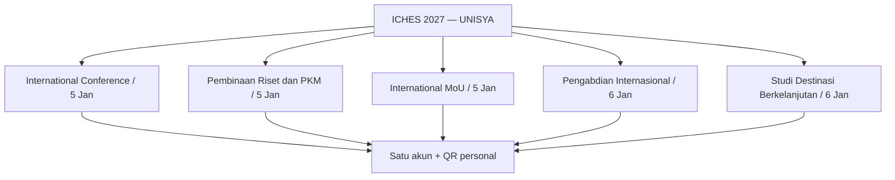
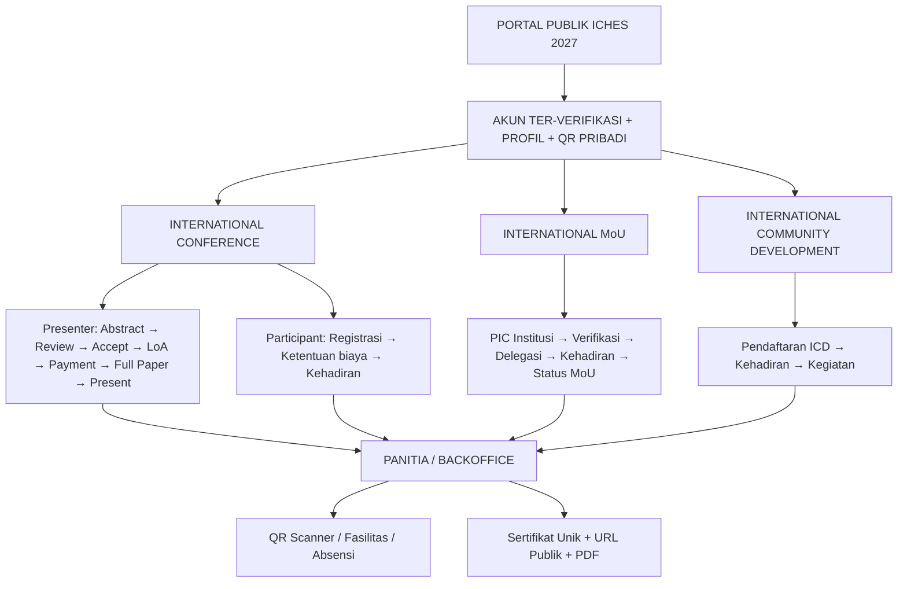
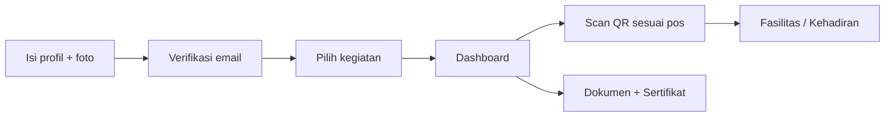
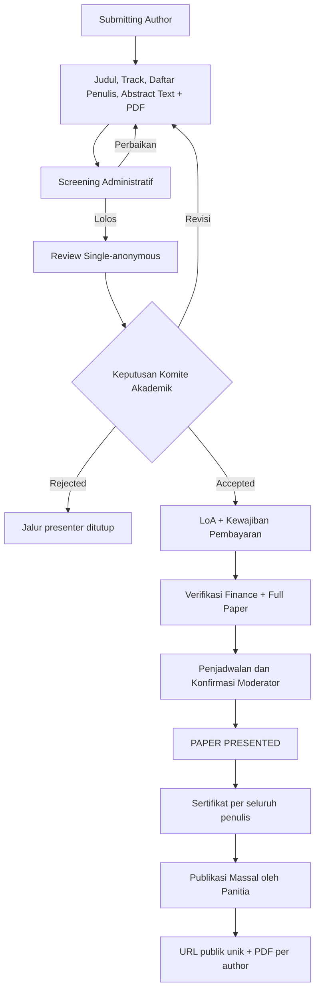
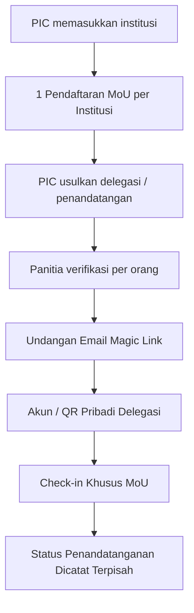
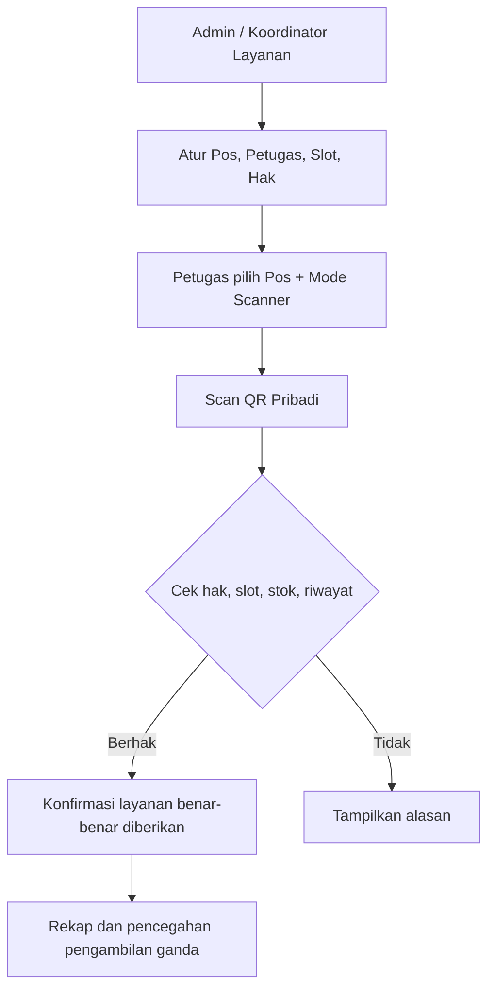
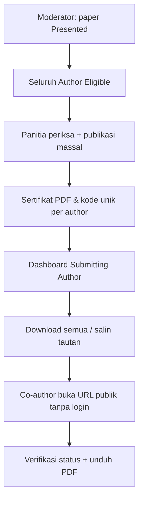
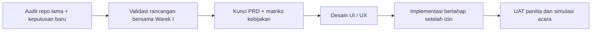

# Paparan Rancangan Sistem ICHES UNISYA 2027

> **Bahan presentasi untuk Wakil Rektor I — 26 Oktober 2026**  
> **Status:** konsep produk dan alur operasional untuk masukan/arah kebijakan; **belum** aplikasi operasional, belum pengesahan formal.
>
> **Gagasan utama:** satu portal konferensi, satu akun, satu QR pribadi, **lima rangkaian kegiatan menurut TOR**, dan layanan panitia yang fleksibel.

## REBASELINE: Temuan TOR Warek I (dibaca terlebih dahulu)

**Dokumen sumber:** `TOR ICHES 6 UNISYA 2027.docx` (9 halaman). **Acuan acara:** 5 Januari 2027 Conference hybrid; 6 Januari 2027 Pengabdian dan Destinasi onsite. Tema resmi **Islamic Values in a Changing World: Education, Accountability, and Social Resilience for Inclusive Development**.

**TOR memuat lima rangkaian kegiatan, bukan hanya tiga jalur awal:**

**Jadwal kunci:** Abstrak 1–20 Desember; hasil 22 Desember; full paper 23–28 Desember; registrasi/pembayaran 24–28 Desember; prosiding ditargetkan 28 Januari 2027.

**Konflik kebijakan/operasional yang wajib dijelaskan pada Warek I:**
- Full paper mulai **23 Desember** sedangkan pembayaran baru **24 Desember** → rekomendasi proses paralel setelah ACCEPT, bukan menunggu VERIFIED untuk membuka upload.
- **MoU/Pembinaan 13.00–17.15** dan **Parallel Panel 13.15–16.30** pada 5 Januari **beririsan** → butuh peringatan benturan jadwal, verifikasi hadir khusus, dan pengganti presenter/delegasi jika diperlukan.
- Ada **sembilan tarif** pada TOR, termasuk tarif **Co-Host IDR 450.000**, dan **bundle MoU+Pembinaan+PKM+Destinasi IDR 1.000.000**. Unit tarif dan kuota Co-Host (TOR menyebut maks. 5 peserta) masih perlu konfirmasi.
- Research Coaching/Pembinaan Riset dan **Studi Destinasi** bukan lagi modul opsional dalam cakupan acara menurut TOR; desain pendaftaran tetap sederhana.

**➡️ [Audit TOR dan matriks perubahan selengkapnya](10-ANALISIS-TOR-DAN-REBASELINE-2027.md)**

> **Catatan pembacaan:** Diagram tiga jalur pada bagian di bawah adalah **ilustrasi rancangan PRA-TOR**. Setelah TOR, konfigurasi produk perlu mencakup **lima rangkaian** di atas. Ketentuan ambiguitas tidak dianggap diputuskan.

---

## 1. Masalah yang ingin diselesaikan

Penyelenggaraan konferensi internasional mencakup registrasi peserta, seleksi abstrak, institusi mitra, delegasi, kegiatan pengabdian, pembayaran, distribusi fasilitas, absensi, dan sertifikat. Jika dikelola terpisah dengan banyak form/file, panitia sulit memperoleh data yang konsisten; peserta pun mengulang identitas.

**Solusi yang diajukan:** satu platform ICHES 2027 dengan dashboard sesuai tugas dan satu sumber data identitas. Sistem tidak menggantikan OJS, sistem keuangan bank, atau perjanjian hukum.

## 2. Peta produk dalam satu gambar

**Prinsip:** Conference, MoU, dan ICD dapat dipilih bersama atau terpisah tanpa membuat akun/QR baru. Hak fasilitas tidak sama dengan keikutsertaan akademik.

## 3. Contoh perjalanan peserta

- Peserta membuat akun melalui email OTP/Magic Link **tanpa password peserta**, mengisi nomor WhatsApp dan foto profil (maks. 2 MB, crop 1:1).
- Dashboard hanya memperlihatkan kegiatan yang diikuti, statusnya, dokumen, dan **Next Action**.
- Peserta yang ikut Conference + MoU + ICD memakai **QR yang sama** tetapi hak dan kehadiran tiap kegiatan dibedakan.

## 4. Alur akademik dari abstrak ke sertifikat

- **Disepakati:** teks abstrak **dan** PDF wajib; format file abstrak **PDF saja**.
- **Disepakati:** pemilik submission adalah akun *Submitting/Corresponding Author*; ia tidak harus First Author. Co-author tidak wajib membuat akun.
- **Disepakati:** pembayaran presenter baru setelah keputusan **ACCEPT**; LoA bukan bukti lunas.
- **Baseline repo lama:** reviewer abstrak default **1**, jumlah dapat diatur; single-anonymous; satu putaran revisi normal; keputusan final oleh Komite Akademik.
- **Belum final:** batas kata, jumlah keyword, ukuran PDF, jumlah reviewer operasional ICHES.
- **Disepakati baru:** ketika paper benar-benar dipresentasikan, **seluruh penulis** berhak memperoleh *Presenter Certificate*, walaupun tidak semuanya tampil secara fisik.

## 5. International MoU adalah pendaftaran institusi

Delegasi yang hanya mengikuti MoU **tidak otomatis** memperoleh status Conference Presenter, hak mengikuti ICD, atau Conference Kit. Panitia dapat memberikan fasilitas tertentu melalui pengecualian individual tanpa memalsukan status keikutsertaan.

## 6. Operasional acara dan QR scanner

- **Model C hybrid:** pos tetap teridentifikasi, scanner dapat berpindah sesuai penugasan petugas.
- **Absensi hybrid:** check-in umum dan check-in khusus untuk MoU, ICD, atau sesi akademik yang memerlukan pembuktian.
- **Konsumsi bersama:** satu orang **hanya sekali** per slot konsumsi (contoh Lunch Hari 1), meskipun ikut tiga kegiatan.
- Hak fasilitas: **Default / Grant / Revoke**, dapat diubah segera oleh Admin dan Koordinator sesuai layanan. Penyerahan lampau tidak dihapus hanya karena hak berubah.
- Scan tidak otomatis berarti barang diserahkan, peserta hadir pada sesi, atau paper sudah dipresentasikan; diperlukan konfirmasi pelayanan/Moderator.

## 7. Sertifikat publik seperti pola verifikasi Codepolitan

**Contoh URL ilustratif:** `https://<domain-iches>/c/<kode-acak-unik>`. Tautan dicetak pada PDF serta diwujudkan dalam QR sertifikat. Data pribadi (email/WhatsApp, pembayaran) tidak muncul pada halaman verifikasi. Dokumen yang dicabut/digantikan harus ditandai tidak valid.

## 8. Peran dan dashboard

| Aktor | Yang dikerjakan |
|---|---|
| Peserta / Submitting Author | Profil, kegiatan, abstrak, revisi, pembayaran, dokumen, sertifikat |
| PIC MoU | Pendaftaran institusi, pengusulan delegasi |
| Reviewer | Menilai abstrak yang ditugaskan |
| Komite Akademik | Screening, reviewer, keputusan, full paper, jadwal |
| Moderator | Konfirmasi pelaksanaan presentasi, bukan memutuskan ACCEPT |
| Finance | Memeriksa bukti pembayaran |
| Admin & Koordinator | Hak fasilitas, pos, slot, petugas, koreksi operasional |
| Petugas scanner | Memindai dan mengonfirmasi layanan sesuai penugasan |
| Admin Sertifikat | Pratinjau, publikasi massal, koreksi/reissue |

**Desain:** Laravel + Inertia + Vue 3 + Tailwind + shadcn-vue; Backoffice dominan **putih dan hijau polos, tanpa gradient**, responsif dan mobile-first. Referensi UI Shadcn Vue Admin. Preset visual yang diberikan: `b3G0JXXL04` (asal Next.js; hanya acuan desain, bukan template kode Vue yang langsung dipasang).

## 9. Yang dipakai dari repository terdahulu

Repository referensi: [international-conference-platform — develop](https://github.com/akhmadafnan/international-conference-platform/tree/develop).

| Dipertahankan sebagai baseline | Dirancang ulang | Belum menjadi fitur aplikasi |
|---|---|---|
| Metadata ilmiah, review, LoA, file versi, prinsip verifikasi | Multi-edition → single-event | Submission akademik, review, MoU institusional |
| Laravel/Vue/Inertia, kontrol akses, payment manual | Paket tetap → multi-keikutsertaan | Scanner hak fasilitas & slot konsumsi |
| UUID, storage privat, kode QR Event Pass | Password → Magic Link; QR personal | Sertifikat publik massal untuk seluruh author |

**Penting:** repo lama sampai **Phase 02 Registration + Payment**; spesifikasi akademik tersedia terutama sebagai dokumen, bukan bukti fitur akademik sudah berjalan.

## 10. Keputusan pimpinan yang masih diperlukan

| Area | Perlu arahan |
|---|---|
| Academic policy | Batas kata/keyword, template PDF, reviewer default 1 vs 2, siklus revisi final |
| Full paper & publikasi | Validasi pra-acara dan penilaian pasca-presentasi, kebijakan prosiding/jurnal |
| Keuangan | Tarif presenter: per paper atau per peserta; kategori participant Free/Paid |
| Fasilitas | Conference Kit sekali per orang; souvenir MoU per institusi atau per orang; kuota delegasi |
| Sertifikat | Apakah MoU Delegate dan ICD memiliki sertifikat tersendiri; aturan kelayakan |
| Jadwal | Tanggal, slot konsumsi, paralel session, batas submission dan pembayaran |
| Identitas visual | Logo, template resmi, finalisasi token warna/font |

## 11. Usulan tahapan kerja (belum coding)

**Inti paparan kepada pimpinan:** satu sistem yang menyatukan pengalaman peserta dan pekerjaan panitia; kegiatan tetap independen; keputusan akademik, keuangan, kehadiran, hak fasilitas, dan sertifikat tidak dicampur; fitur operasional bisa dikelola panitia melalui CRUD yang mudah.

---

*Dokumen ini adalah visualisasi rancangan yang telah dibahas, bukan klaim bahwa aplikasi sudah diproduksi atau dipakai. Komponen berlabel “belum final” tidak boleh diperlakukan sebagai kebijakan yang telah disetujui.*
