# Paparan Rancangan Sistem ICHES UNISYA 2027

> **Bahan presentasi untuk Wakil Rektor I — 26 Oktober 2026**  
> **Status:** konsep produk dan alur operasional untuk masukan/arah kebijakan; **belum** aplikasi operasional, belum pengesahan formal.
>
> **Gagasan utama:** satu portal konferensi, satu akun, satu QR pribadi, **lima rangkaian kegiatan menurut TOR**, dan layanan panitia yang fleksibel.

> **KEPUTUSAN TERBARU:** *Administrative Screening* setelah Submit dihapus. Author wajib lolos validasi form **dan** server; naskah yang resmi Submitted langsung tersedia di Reviewer Abstract Index untuk self-claim. **Co-Host Rp3 juta per institusi/maksimal 5 peserta sudah final**. Mekanisme menghubungkan anggota via PIC + undangan email/Magic Link adalah **rekomendasi desain**, belum keputusan final. Lihat [rancangan 13 — linking Co-Host dan submission tanpa screening](13-LINK-COHOST-DAN-SUBMISSION-TANPA-SCREENING.md).

## TAMBAHAN DRAFT — FULL PAPER ALA OJS & PUBLIKASI

Pengguna menegaskan **alur Abstract tetap seperti ICHES**; **Full Paper** menyerupai input OJS dan **assessment pascapresentasi** menghasilkan jalur `No Revision` (langsung pemeriksaan final) atau `Revision Required` (author unggah berkas versi baru + response). Sesudah **Final ACC**, tim penerbitan memilih jalur Proceedings atau Selected Journal, lalu menyiapkan **metadata snapshot dan file final** untuk ekspor OJS sesuai profile/version target. **SEPULUH calon jurnal** perlu diisi Admin; TOR tidak memuat nama/angka jurnal tersebut. Keputusan editor jurnal tetap terpisah dari seleksi ICHES. **Hanya DRAFT, belum final.**

[18B-09 Full Paper/OJS Workflow](18B-09-DRAFT-FULLPAPER-OJS-LIKE-POSTPRESENTATION-PUBLICATION.md) · [18C-01B Metadata/Publication ERD](18C-01B-DRAFT-FULLPAPER-PUBLICATION-ERD-DATA-DICTIONARY.md).

---

## TAHAP 18C-01 — DRAFT ARSITEKTUR DATABASE (MENUNGGU REVIEW)

**Hanya rekomendasi arsitektur; tidak final dan belum dibuat database/migration.** Saya mengusulkan **satu database relasional** dengan **38 kandidat tabel** di delapan domain dan **empat ERD**. Keputusan bisnis telah dipertahankan: Co-Host VERIFIED sebelum lima seat/paper aktif dan tanpa tagihan Conference kedua; Paket pribadi Rp1 juta VERIFIED untuk empat hak; Published ACCEPT membuka Full Paper; seluruh listed author paper Presented eligible sertifikat setelah batch panitia.

**Untuk dibahas sebelum coding:** apakah tabel perlu dipangkas, strategi identitas authors, satu invoice lintas domain, PostgreSQL/MySQL, BIGINT/ULID, serta index/locking pada QR dan pembayaran. Rekomendasi ini tidak menciptakan refund dan deadline baru. [DRAFT 18C-01 ERD](18C-01-DRAFT-DATABASE-ARCHITECTURE-ERD.md) · [DRAFT 18C-01A Kamus Data/36 UAT](18C-01A-DRAFT-DATA-DICTIONARY-CONSTRAINTS-MIGRATIONS-UAT.md).

---

## TAHAP 18B — FINANCE, CO-HOST & PAKET INTERNASIONAL (KEPUTUSAN 27 OKTOBER)

**Satu rekening resmi, transfer manual, bukti JPG/PNG/PDF, Finance Verified; tanpa payment gateway.** Bank aktual masih akan dipilih (BRI/BNI/Mandiri/BCA/BSI); **Superadmin** mengubah nomor rekening langsung tanpa approval kedua. Invoice kategori WNA internasional memakai USD sesuai TOR, biaya transfer internasional seluruhnya pada peserta.

**Co-Host:** registrasi institusi → **satu invoice Rp3 juta** → Finance VERIFIED → **aktif 5 anggota/5 paper Conference**. Sebelum VERIFIED, fitur Co-Host belum aktif. **Tidak ada lagi invoice presenter personal** untuk kelima paper sponsor, termasuk setelah ACCEPT. **Paket Program Internasional:** pembelian pribadi **satu Rp1 juta** → Finance VERIFIED → **empat akses aktif**. Anggota Co-Host hanya membayar paket bila secara pribadi ikut paket.

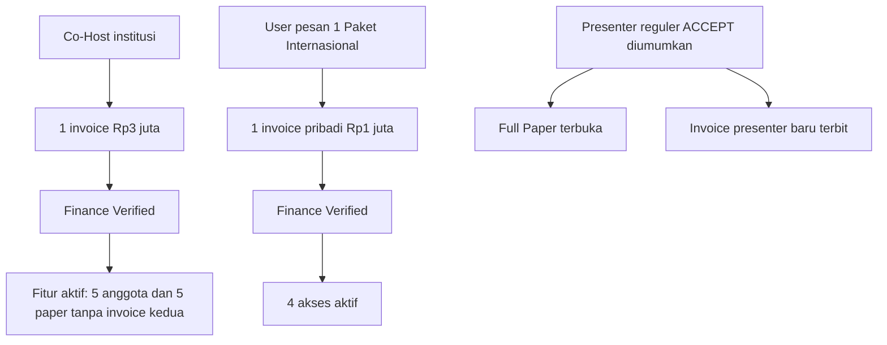

**Detail field/UI dan 30 UAT rencana:** [18B-06 Finance](18B-06-CRUD-FINANCE-INVOICE-PEMBAYARAN-VERIFIKASI.md) · [Co-Host 18B-04](18B-04-CRUD-COHOST-INSTITUSI-LIMA-PAPER.md) · [Paket 18B-05](18B-05-CRUD-PAKET-INTERNASIONAL-DASHBOARD-PESERTA.md). Bank, refund, selisih transfer, dan kategori belum ada di TOR **masih TERBUKA**.

---

## TAHAP 18B — KASUS PEMBAYARAN & REKONSILIASI (USULAN)

Satu antrean Finance cukup untuk menangani **bukti salah, transfer kurang, lebih, ganda, dan mutasi bank belum cocok**. PIC/peserta memperbaiki bukti pada **invoice yang sama**; Finance hanya menandai **VERIFIED** setelah nilai dan mutasi cocok. **Refund, transfer susulan, tenggat pembayaran dan akibat keterlambatan belum diputuskan.** Tidak ada fitur auto-refund atau payment gateway. [Blueprint 18B-07 + 28 UAT](18B-07-FINANCE-EXCEPTIONS-REKONSILIASI-DAN-UAT.md).

---

## TAHAP 18B — PENUNTASAN FINANCE: PELUNASAN, INVOICE & NOTIFIKASI

**Tahap 18B-07A (draft kebijakan):** rekomendasi sederhana untuk pembayaran kurang (opsi bayar selisih di invoice yang sama), lebih/ganda (surplus dicatat, jangan dobel hak), refund (permohonan manual, belum ada kelayakan final) dan tenggat (Admin editable, belum ada tanggal resmi). **Keempat opsi ini belum diputuskan sebagai kebijakan panitia.**

**Tahap 18B-08 (rancangan aplikasi):** bedakan **Invoice/tagihan**, **Upload Bukti Transfer**, dan **Bukti Lunas yang hanya muncul setelah Finance VERIFIED**. Notifikasi Dashboard sebagai rancangan utama, email transaksional opsional; tidak membuat payment gateway. Perubahan pembayaran tidak membatalkan keputusan akademik, dan Co-Host tetap satu tagihan institusi.

[Draft kebijakan & 16 UAT](18B-07A-DRAFT-KEBIJAKAN-PELUNASAN-REFUND-DAN-TENGGAT.md) · [Invoice, Receipt, Notifikasi & 32 UAT](18B-08-CRUD-INVOICE-BUKTI-LUNAS-NOTIFIKASI-DAN-UAT.md).

---

## TAHAP 18B — CRUD INTERNATIONAL CONFERENCE (RANCANGAN HALAMAN)

Seluruh alur akademik telah diturunkan ke **spesifikasi layar dan field**, bukan lagi diagram konseptual saja: **Conference Settings, delapan Tracks, Abstract Submission Settings, All Submissions, Paper Detail, Reviewer Index + Claim, Academic Decisions + Publish Result, Full Paper, Sessions, Moderator, dan Reports**. Admin CRUD mengatur tanggal/ketentuan, sementara **Reviewer self-claim langsung setelah Submit valid tanpa screening**, Komite memutuskan, serta **Full Paper terbuka ketika ACCEPT diumumkan**.

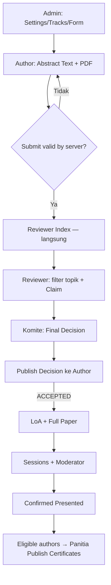

**Dokumen rinci:** [18B-02 Form, Settings & Paper](18B-02-CRUD-INTERNATIONAL-CONFERENCE-SUBMISSION.md) · [18B-03 Review, Decisions, Full Paper, Sessions & UAT](18B-03-CRUD-REVIEW-DECISION-FULLPAPER-SESSION-DAN-UAT.md).

---

## TAHAP 18B — SCANNER ANDROID, JARINGAN & KEAMANAN (USULAN)

**Rancangan Tahap 18B (belum disetujui final):** Android scanner khusus dapat bekerja offline menggunakan cache terenkripsi, mencatat **Pending Sync**, lalu mengirim catatan ke Laravel ketika internet pulih. **Pending bukan transaksi CONFIRMED oleh server**; dua HP terputus tidak bisa menjamin pencegahan penerimaan layanan ganda. Admin mengelola perangkat, operator, pos, sync dan konflik; server memerlukan load test, cadangan jaringan, backup, monitoring, kontrol API dan keamanan berlapis. [Arsitektur offline/keamanan](18B-00-ANDROID-OFFLINE-QR-RELIABILITY-DAN-KEAMANAN.md) · [CRUD Scanner](18B-01-CRUD-ADMIN-SCANNER-DAN-SINKRONISASI.md).

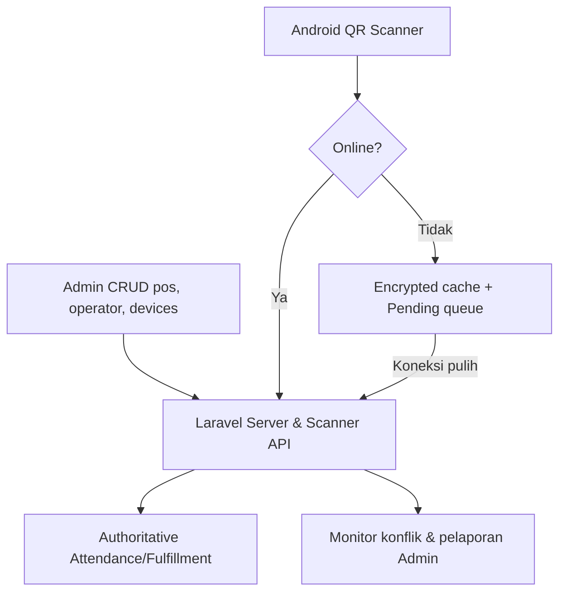

---

## TAHAP 18A — Role, Permission, dan Navigasi (rancangan untuk validasi)

**Sudah didokumentasikan:** siapa mengelola data dari Admin, siapa memutuskan ACCEPT, siapa memverifikasi pembayaran, siapa mengonfirmasi Presented, dan siapa hanya boleh scan QR pada pos yang ditugaskan. **Role/template menu terperinci adalah USULAN 18A**, sementara keputusan bisnis yang mendasarinya sudah tercatat sebagai ketetapan sebelumnya.

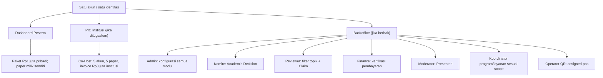

[Role, Permission & Menu](18A-ROLE-PERMISSION-DAN-NAVIGASI-BACKOFFICE.md) · [Simulasi dan 25 skenario UAT](18A-ALUR-OPERASIONAL-DAN-UAT-PERAN.md).

---

## KEBIJAKAN FINAL 27 OKTOBER: 5 PAPER CO-HOST DAN ADMIN PUSAT CRUD

**Co-Host Rp3.000.000 per institusi: lima perwakilan, masing-masing memiliki satu jatah paper International Conference.** Setiap perwakilan mengirim papernya sendiri melalui akun ICHES, total **lima paper dalam paket institusi**.

**Paket Program Internasional Rp1 juta/orang:** Admin dapat mengatur serta mengubah deadline pendaftaran **tanggal dan jam** lewat Backoffice; user mendaftar sendiri melalui Dashboard pribadi. **Conference, Co-Host, MoU, Upgrading, PKM, Destinasi, QR, Finance, sertifikat dan konten website semuanya memiliki pengaturan/CRUD Admin.** Ini tidak berarti Admin menggantikan reviewer, Komite Akademik, Moderator atau Finance.

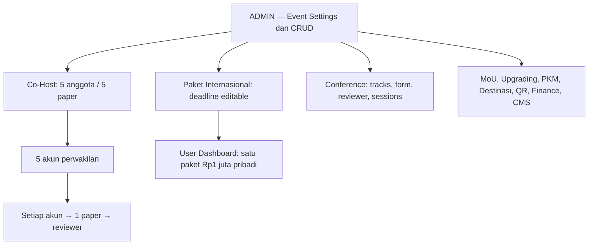

[Penjelasan kuota paper](16-COHOST-LIMA-PAPER-PERWAKILAN.md) · [Matriks CRUD](17-ADMIN-CRUD-DAN-PENGATURAN-ACARA.md).

---

## KOREKSI: SATU PAKET Rp1 JUTA, BELI SENDIRI DI DASHBOARD PESERTA

**Paket Program Internasional bukan fitur Co-Host.** User yang tertarik memilihnya sendiri di Dashboard pribadi dengan **satu pembayaran Rp1 juta untuk empat program**: International MoU, Upgrading Kasubdit Penelitian-PKM Kemenag RI, PKM Internasional, dan Destinasi Internasional Tumpak Sewu–Teras Semeru. **Bukan Rp1 juta × 4 program**; PIC Co-Host **tidak mengelola tagihan pribadi anggota**.

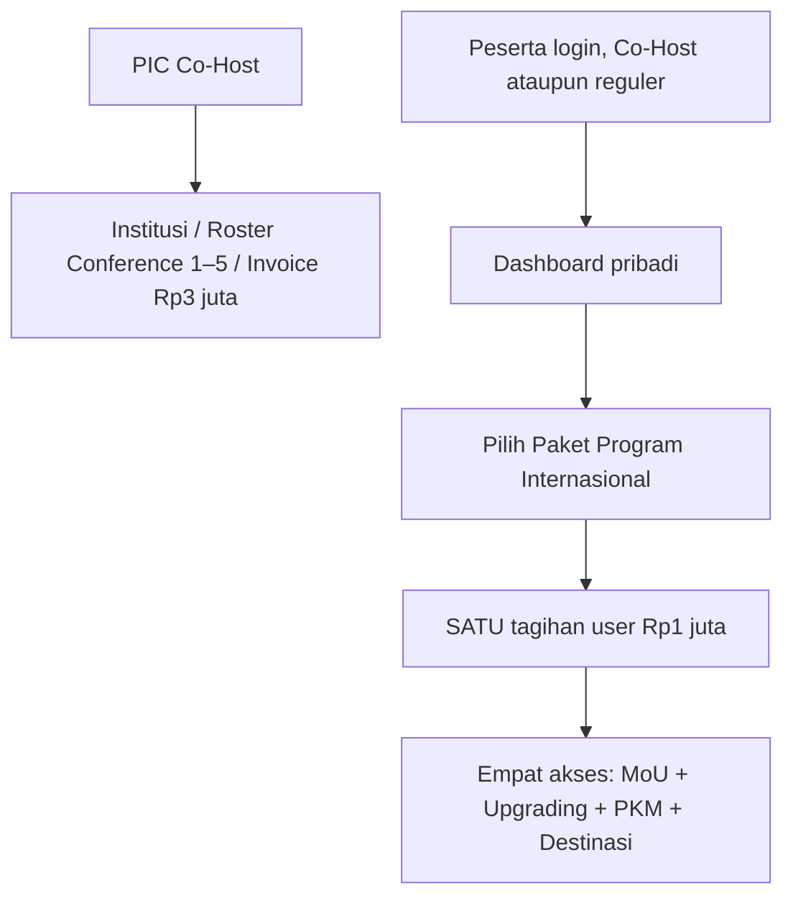

Lihat [alur user lengkap](15-PAKET-INTERNASIONAL-DASHBOARD-PESERTA.md).

## ATURAN CO-HOST FINAL: CONFERENCE ONLY + PAKET PENDAMPING PER ORANG

**Co-Host Rp3.000.000 berlaku sekali PER INSTITUSI untuk maksimal 5 anggota jalur paper International Conference.** Manfaat finansialnya **tidak mencakup** International PKM, Pembinaan, MoU, maupun Studi Destinasi. Bagi peserta yang memilih paket program pendamping tersebut, berlaku **Rp1.000.000 PER ORANG** secara terpisah. **Institusi yang menjadi Co-Host berhak dicantumkan sebagai institusi kolaborator penyelenggara ICHES 2027** pada identitas resmi acara; rincian logo dan media pencantuman perlu disepakati panitia.

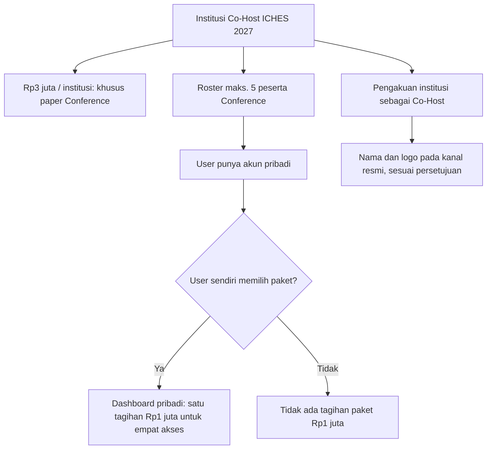

**Contoh:** Institusi A memiliki invoice Co-Host **Rp3 juta tetap**. Jika tiga anggotanya masing-masing membeli **satu Paket Program Internasional Rp1 juta dari Dashboard pribadi**, ketiga tagihan adalah **milik user**, tidak ditambahkan menjadi invoice institusi Rp6 juta. Satu paket Rp1 juta sudah mencakup empat akses. **Lima perwakilan = lima jatah paper Co-Host (satu paper per orang)**.

[Buka diagram dan aturan lengkap](14-CAKUPAN-COHOST-DAN-PROGRAM-PENDAMPING.md).

---

## KEPUTUSAN TERBARU UNTUK PRESENTASI WAREK I

| Keputusan | Rumusan terbaru |
|---|---|
| Co-Host | **Rp3.000.000 per institusi, satu tagihan mencakup maksimal lima peserta** (koreksi atas Rp450.000 pada TOR) |
| Agenda paralel | MoU/Pembinaan dan Panel Session boleh berjalan bersamaan; kehadiran per kegiatan tidak disamakan, tidak perlu optimasi jadwal |
| Reviewer | Sejak submission awal 1 Desember, abstract **valid disubmit** masuk **Reviewer Index**; semua reviewer mencari/filter topik dan melakukan **Claim** mandiri |
| Full Paper | Tombol unggah terbuka bagi paper yang **ACCEPTED dan keputusannya diumumkan ke author**; **REJECTED** tidak memperoleh akses |
| Pembayaran | Presenter bayar **setelah ACCEPT**, tetapi **tidak menjadi syarat membuka unggah Full Paper** |

**Kebijakan Co-Host sudah dikunci:** Rp3.000.000 dibayarkan **sekali per institusi** dan mencakup **maksimal lima peserta**, bukan ditagihkan kepada masing-masing peserta. **Paket tersebut hanya untuk paper International Conference; biaya paket program pendamping adalah Rp1 juta per orang bagi pesertanya.** **Jumlah paper FINAL: 5 paper**, masing-masing 1 paper oleh 1 perwakilan. Jumlah reviewer per paper masih perlu keputusan komite. Jadwal TOR 22 Desember untuk pengumuman masih menjadi **milestone**, tetapi bukan gate teknis untuk membuka review atau full paper. Tanggal 23–28 Desember untuk Full Paper tetap dicatat sebagai **rencana pada TOR**, bukan syarat unlock aplikasi.

Catatan: Reviewer **tidak diberi larangan topik A/B/C** melalui pengaturan akun. Pemeriksaan minimal saat claim: reviewer terautentikasi, paper masih tersedia, bukan paper sendiri, dan slot review belum penuh. Koordinator Akademik dapat membatalkan claim yang tidak dikerjakan tanpa aturan deadline otomatis yang berlebihan. Keputusan final tetap di Komite Akademik.

**➡️ [Dokumen visual dan ketentuan lengkap](11-KEPUTUSAN-OPERASIONAL-26-OKT-2026.md)**

---

## REBASELINE: Temuan TOR Warek I (dibaca terlebih dahulu)

**Dokumen sumber:** `TOR ICHES 6 UNISYA 2027.docx` (9 halaman). **Acuan acara:** 5 Januari 2027 Conference hybrid; 6 Januari 2027 Pengabdian dan Destinasi onsite. Tema resmi **Islamic Values in a Changing World: Education, Accountability, and Social Resilience for Inclusive Development**.

**TOR memuat lima rangkaian kegiatan, bukan hanya tiga jalur awal:**

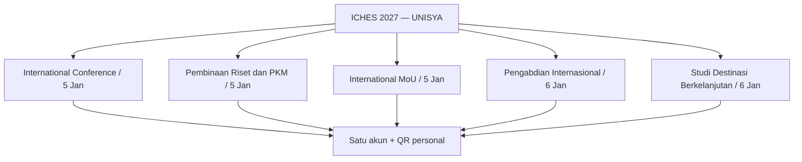

**Jadwal kunci:** Abstrak 1–20 Desember; hasil 22 Desember; full paper 23–28 Desember; registrasi/pembayaran 24–28 Desember; prosiding ditargetkan 28 Januari 2027.

**Konflik kebijakan/operasional yang wajib dijelaskan pada Warek I:**
- **TELAH DIPUTUSKAN:** Full Paper terbuka saat keputusan ACCEPT resmi diumumkan ke author, bukan berdasarkan tanggal atau verifikasi pembayaran. Tanggal Full Paper pada TOR menjadi milestone acara.
- **TELAH DIPUTUSKAN:** MoU/Pembinaan dan Panel berjalan paralel bila diperlukan; tidak perlu fitur khusus optimasi benturan. Kehadiran tiap kegiatan dan bukti presentasi tetap terpisah.
- **Koreksi:** tarif Co-Host **Rp3.000.000**, bukan **Rp450.000** yang tertulis di TOR; batas **lima peserta PER INSTITUSI**. **Unit pembayaran sudah final: satu tagihan Rp3 juta PER INSTITUSI yang mencakup paling banyak lima peserta.** **Bundle Rp1.000.000 per orang** berlaku terpisah bagi peserta program pendamping, termasuk bila orang tersebut anggota Co-Host.
- Research Coaching/Pembinaan Riset dan **Studi Destinasi** bukan lagi modul opsional dalam cakupan acara menurut TOR; desain pendaftaran tetap sederhana.

**➡️ [Audit TOR dan matriks perubahan selengkapnya](10-ANALISIS-TOR-DAN-REBASELINE-2027.md)**

> **Catatan pembacaan:** Diagram produk pada bagian di bawah telah disesuaikan agar menampilkan **lima rangkaian dari TOR**. Detail pendaftaran, kuota, dan paket biaya tiap kegiatan masih menunggu keputusan yang belum tertulis pada TOR.

---

## 1. Masalah yang ingin diselesaikan

Penyelenggaraan konferensi internasional mencakup registrasi peserta, seleksi abstrak, institusi mitra, delegasi, kegiatan pengabdian, pembayaran, distribusi fasilitas, absensi, dan sertifikat. Jika dikelola terpisah dengan banyak form/file, panitia sulit memperoleh data yang konsisten; peserta pun mengulang identitas.

**Solusi yang diajukan:** satu platform ICHES 2027 dengan dashboard sesuai tugas dan satu sumber data identitas. Sistem tidak menggantikan OJS, sistem keuangan bank, atau perjanjian hukum.

## 2. Peta produk dalam satu gambar

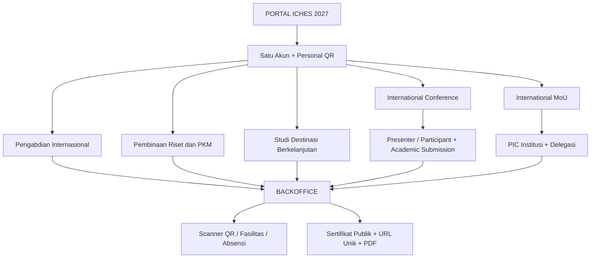

**Prinsip:** keikutsertaan di lima rangkaian bisa terkait kategori pembayaran/paket, tetapi kehadiran dan hak fasilitas masing-masing dicatat dengan benar. Satu personal QR berlaku lintas kegiatan.

## Co-Host: satu institusi, satu tagihan, lima peserta maksimal

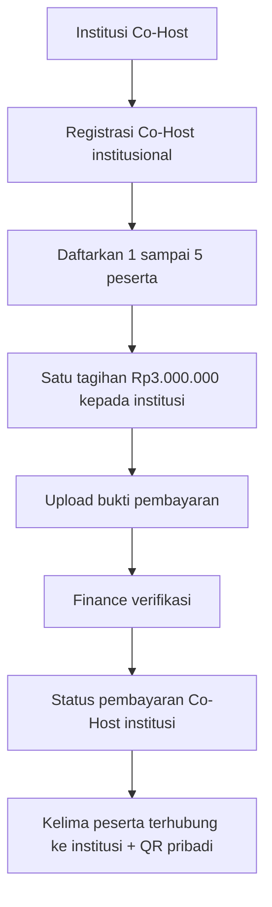

**Contoh:** Institusi A membawa tiga peserta = **satu tagihan Rp3.000.000**; Institusi B membawa lima peserta = **satu tagihan Rp3.000.000**. Menambah peserta keenam **tidak dibenarkan dalam paket lima orang**, dan tidak boleh otomatis menghasilkan tagihan Co-Host kedua. Paket Co-Host **khusus jalur paper International Conference dengan 5 paper (1 per perwakilan)**; fasilitas lain masih perlu perincian panitia. Program pendamping dikenai **Rp1 juta per peserta**, tidak termasuk Rp3 juta institusi. [Rancangan pembayaran Co-Host](12-PEMBAYARAN-COHOST-PER-INSTITUSI.md)

## 3. Contoh perjalanan peserta

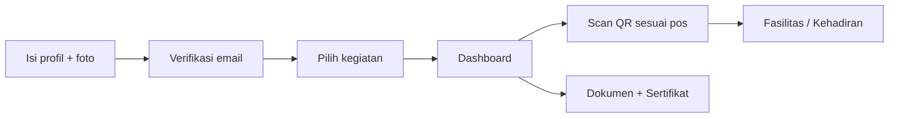

- Peserta membuat akun melalui email OTP/Magic Link **tanpa password peserta**, mengisi nomor WhatsApp dan foto profil (maks. 2 MB, crop 1:1).
- Dashboard hanya memperlihatkan kegiatan yang diikuti, statusnya, dokumen, dan **Next Action**.
- Peserta yang ikut Conference + MoU + ICD memakai **QR yang sama** tetapi hak dan kehadiran tiap kegiatan dibedakan.

## 4. Alur akademik dari abstrak ke sertifikat

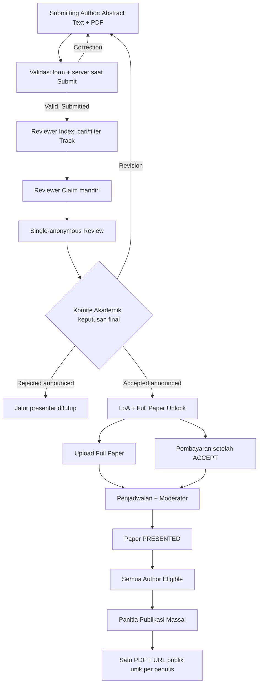

- **Disepakati:** text abstrak dan PDF wajib; **file abstrak PDF saja**. Submitting/Corresponding Author mengelola seluruh submission, tidak harus First Author.
- **Disepakati terbaru:** reviewer **bebas mencari/filter topik** dari indeks abstrak valid disubmit dan **Claim** mandiri; bukan menunggu penugasan manual atau akhir masa submission. Reviewer memberi rekomendasi, komite membuat final decision.
- **Baseline repo lama:** single-anonymous; satu reviewer default tetapi configurable. **Jumlah reviewer resmi ICHES masih terbuka.**
- **Disepakati terbaru:** Full Paper terbuka ketika **ACCEPT resmi diumumkan kepada author**. Rejected tidak dapat upload. Pembayaran presenter setelah ACCEPT dan proses administratifnya terpisah.
- **Disepakati:** paper yang benar-benar dipresentasikan membuat **semua author** memenuhi dasar sertifikat; panitia melakukan **publikasi massal**, satu URL dan PDF unik setiap penulis.

## 5. International MoU adalah pendaftaran institusi

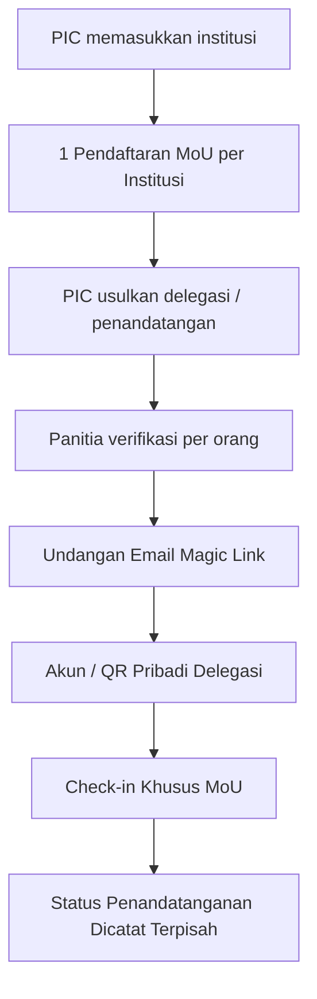

Delegasi yang hanya mengikuti MoU **tidak otomatis** memperoleh status Conference Presenter, hak mengikuti ICD, atau Conference Kit. Panitia dapat memberikan fasilitas tertentu melalui pengecualian individual tanpa memalsukan status keikutsertaan.

## 6. Operasional acara dan QR scanner

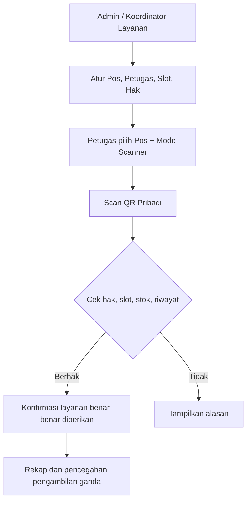

- **Model C hybrid:** pos tetap teridentifikasi, scanner dapat berpindah sesuai penugasan petugas.
- **Absensi hybrid:** check-in umum dan check-in khusus untuk MoU, ICD, atau sesi akademik yang memerlukan pembuktian.
- **Konsumsi bersama:** satu orang **hanya sekali** per slot konsumsi (contoh Lunch Hari 1), meskipun ikut tiga kegiatan.
- Hak fasilitas: **Default / Grant / Revoke**, dapat diubah segera oleh Admin dan Koordinator sesuai layanan. Penyerahan lampau tidak dihapus hanya karena hak berubah.
- Scan tidak otomatis berarti barang diserahkan, peserta hadir pada sesi, atau paper sudah dipresentasikan; diperlukan konfirmasi pelayanan/Moderator.

## 7. Sertifikat publik seperti pola verifikasi Codepolitan

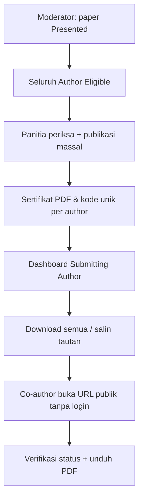

**Contoh URL ilustratif:** `https://<domain-iches>/c/<kode-acak-unik>`. Tautan dicetak pada PDF serta diwujudkan dalam QR sertifikat. Data pribadi (email/WhatsApp, pembayaran) tidak muncul pada halaman verifikasi. Dokumen yang dicabut/digantikan harus ditandai tidak valid.

## 8. Peran dan dashboard

| Aktor | Yang dikerjakan |
|---|---|
| Peserta / Submitting Author | Profil, kegiatan, abstrak, revisi, pembayaran, dokumen, sertifikat |
| PIC MoU | Pendaftaran institusi, pengusulan delegasi |
| Reviewer | Search/filter abstrak berdasarkan topik, claim mandiri, dan nilai paper yang tersedia |
| Komite Akademik | Pantau paper yang belum diklaim, review dan keputusan final, full paper, jadwal |
| Moderator | Konfirmasi pelaksanaan presentasi, bukan memutuskan ACCEPT |
| Finance | Memeriksa bukti pembayaran |
| Admin & Koordinator | Hak fasilitas, pos, slot, petugas, koreksi operasional |
| Petugas scanner | Memindai dan mengonfirmasi layanan sesuai penugasan |
| Admin Sertifikat | Pratinjau, publikasi massal, koreksi/reissue |

**Desain:** Laravel + Inertia + Vue 3 + Tailwind + shadcn-vue; Backoffice dominan **putih dan hijau polos, tanpa gradient**, responsif dan mobile-first. Referensi UI Shadcn Vue Admin. Preset visual yang diberikan: `b3G0JXXL04` (asal Next.js; hanya acuan desain, bukan template kode Vue yang langsung dipasang).

## 9. Yang dipakai dari repository terdahulu

Repository referensi: [international-conference-platform — develop](https://github.com/akhmadafnan/international-conference-platform/tree/develop).

| Dipertahankan sebagai baseline | Dirancang ulang | Belum menjadi fitur aplikasi |
|---|---|---|
| Metadata ilmiah, review, LoA, file versi, prinsip verifikasi | Multi-edition → single-event | Submission akademik, review, MoU institusional |
| Laravel/Vue/Inertia, kontrol akses, payment manual | Paket tetap → multi-keikutsertaan | Scanner hak fasilitas & slot konsumsi |
| UUID, storage privat, kode QR Event Pass | Password → Magic Link; QR personal | Sertifikat publik massal untuk seluruh author |

**Penting:** repo lama sampai **Phase 02 Registration + Payment**; spesifikasi akademik tersedia terutama sebagai dokumen, bukan bukti fitur akademik sudah berjalan.

## 10. Keputusan pimpinan yang masih diperlukan

| Area | Perlu arahan |
|---|---|
| Academic policy | Batas kata/keyword, template PDF, jumlah reviewer per paper, aturan klaim reviewer macet, siklus revisi final |
| Full paper & publikasi | Unlock Full Paper segera saat ACCEPT diumumkan; validasi pra-acara, penilaian pascapresentasi, kebijakan prosiding/jurnal |
| Keuangan | Co-Host Rp3 juta/institusi khusus paper Conference; program pendamping Rp1 juta/orang; kuota Co-Host 5 paper final, tarif kategori lain mengikuti pengaturan Admin |
| Fasilitas | Conference Kit sekali per orang; souvenir MoU per institusi atau per orang; kuota delegasi |
| Sertifikat | Apakah MoU Delegate dan ICD memiliki sertifikat tersendiri; aturan kelayakan |
| Jadwal | Jadwal acara dan layanan; agenda paralel diterima tanpa modul konflik kompleks |
| Identitas visual | Logo, template resmi, finalisasi token warna/font |

## 11. Usulan tahapan kerja (belum coding)

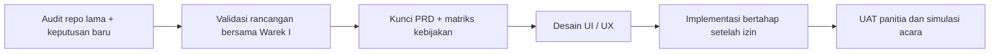

**Inti paparan kepada pimpinan:** satu sistem yang menyatukan pengalaman peserta dan pekerjaan panitia; kegiatan tetap independen; keputusan akademik, keuangan, kehadiran, hak fasilitas, dan sertifikat tidak dicampur; fitur operasional bisa dikelola panitia melalui CRUD yang mudah.

---

*Dokumen ini adalah visualisasi rancangan yang telah dibahas, bukan klaim bahwa aplikasi sudah diproduksi atau dipakai. Komponen berlabel “belum final” tidak boleh diperlakukan sebagai kebijakan yang telah disetujui.*
