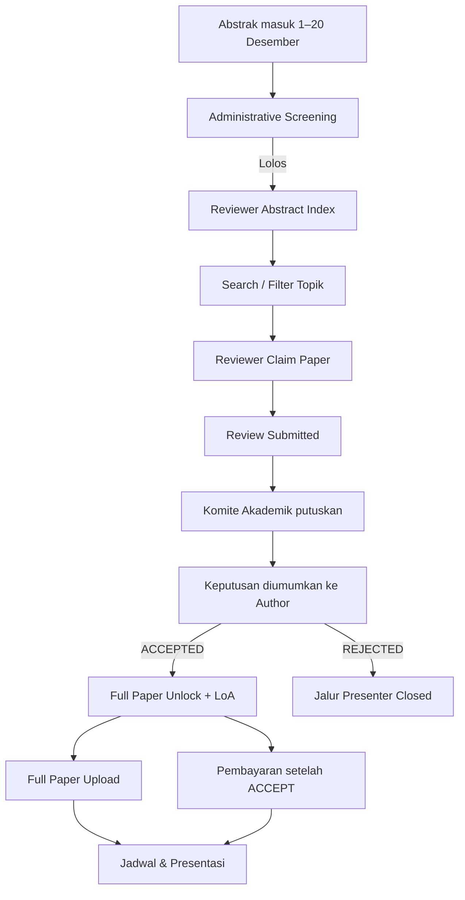
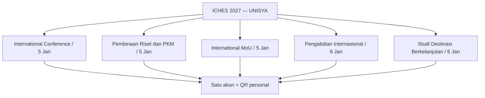
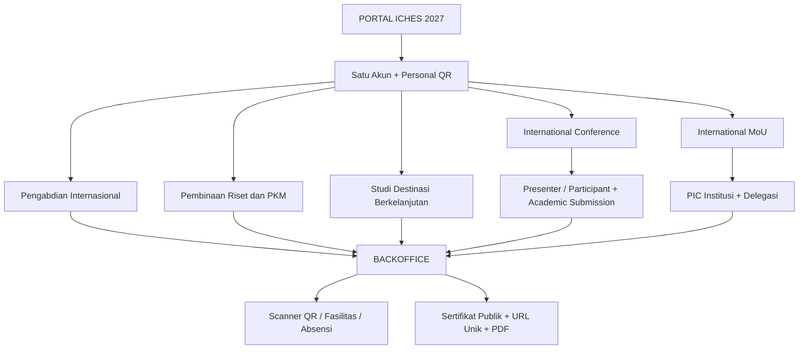
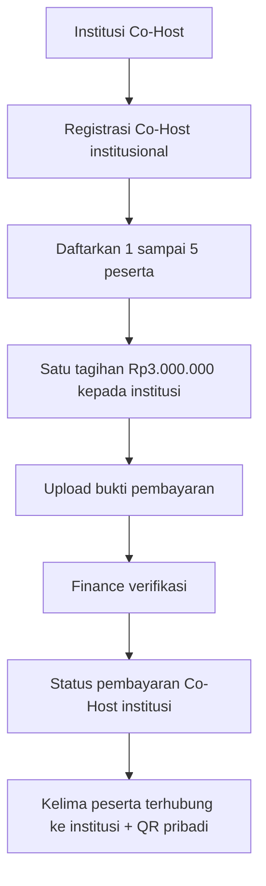
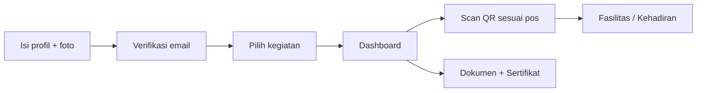
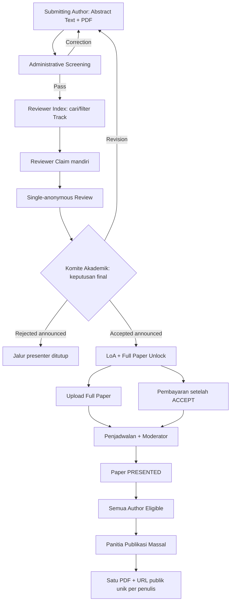
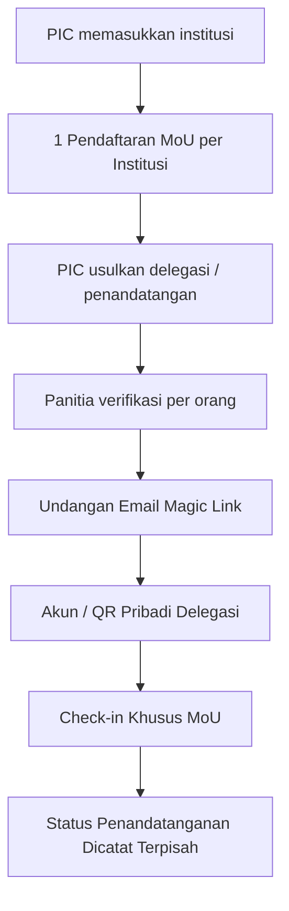
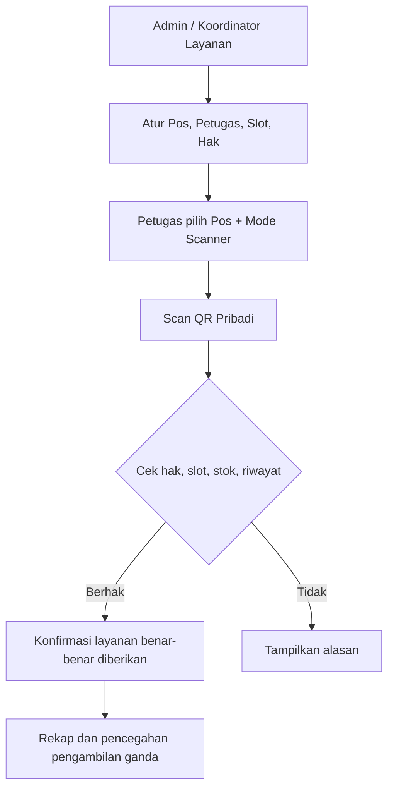
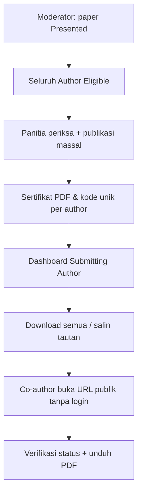
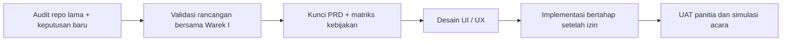

# Paparan Rancangan Sistem ICHES UNISYA 2027

> **Bahan presentasi untuk Wakil Rektor I — 26 Oktober 2026**  
> **Status:** konsep produk dan alur operasional untuk masukan/arah kebijakan; **belum** aplikasi operasional, belum pengesahan formal.
>
> **Gagasan utama:** satu portal konferensi, satu akun, satu QR pribadi, **lima rangkaian kegiatan menurut TOR**, dan layanan panitia yang fleksibel.

## KEPUTUSAN TERBARU UNTUK PRESENTASI WAREK I

| Keputusan | Rumusan terbaru |
|---|---|
| Co-Host | **Rp3.000.000 per institusi, satu tagihan mencakup maksimal lima peserta** (koreksi atas Rp450.000 pada TOR) |
| Agenda paralel | MoU/Pembinaan dan Panel Session boleh berjalan bersamaan; kehadiran per kegiatan tidak disamakan, tidak perlu optimasi jadwal |
| Reviewer | Sejak submission awal 1 Desember, abstract **lolos screening** masuk **Reviewer Index**; semua reviewer mencari/filter topik dan melakukan **Claim** mandiri |
| Full Paper | Tombol unggah terbuka bagi paper yang **ACCEPTED dan keputusannya diumumkan ke author**; **REJECTED** tidak memperoleh akses |
| Pembayaran | Presenter bayar **setelah ACCEPT**, tetapi **tidak menjadi syarat membuka unggah Full Paper** |

**Kebijakan Co-Host sudah dikunci:** Rp3.000.000 dibayarkan **sekali per institusi** dan mencakup **maksimal lima peserta**, bukan ditagihkan kepada masing-masing peserta. Ketentuan cakupan biaya presenter tambahan di luar paket Co-Host, serta jumlah reviewer per paper, masih memerlukan keputusan komite. Jadwal TOR 22 Desember untuk pengumuman masih menjadi **milestone**, tetapi bukan gate teknis untuk membuka review atau full paper. Tanggal 23–28 Desember untuk Full Paper tetap dicatat sebagai **rencana pada TOR**, bukan syarat unlock aplikasi.

Catatan: Reviewer **tidak diberi larangan topik A/B/C** melalui pengaturan akun. Pemeriksaan minimal saat claim: reviewer terautentikasi, paper masih tersedia, bukan paper sendiri, dan slot review belum penuh. Koordinator Akademik dapat membatalkan claim yang tidak dikerjakan tanpa aturan deadline otomatis yang berlebihan. Keputusan final tetap di Komite Akademik.

**➡️ [Dokumen visual dan ketentuan lengkap](11-KEPUTUSAN-OPERASIONAL-26-OKT-2026.md)**

---

## REBASELINE: Temuan TOR Warek I (dibaca terlebih dahulu)

**Dokumen sumber:** `TOR ICHES 6 UNISYA 2027.docx` (9 halaman). **Acuan acara:** 5 Januari 2027 Conference hybrid; 6 Januari 2027 Pengabdian dan Destinasi onsite. Tema resmi **Islamic Values in a Changing World: Education, Accountability, and Social Resilience for Inclusive Development**.

**TOR memuat lima rangkaian kegiatan, bukan hanya tiga jalur awal:**

**Jadwal kunci:** Abstrak 1–20 Desember; hasil 22 Desember; full paper 23–28 Desember; registrasi/pembayaran 24–28 Desember; prosiding ditargetkan 28 Januari 2027.

**Konflik kebijakan/operasional yang wajib dijelaskan pada Warek I:**
- **TELAH DIPUTUSKAN:** Full Paper terbuka saat keputusan ACCEPT resmi diumumkan ke author, bukan berdasarkan tanggal atau verifikasi pembayaran. Tanggal Full Paper pada TOR menjadi milestone acara.
- **TELAH DIPUTUSKAN:** MoU/Pembinaan dan Panel berjalan paralel bila diperlukan; tidak perlu fitur khusus optimasi benturan. Kehadiran tiap kegiatan dan bukti presentasi tetap terpisah.
- **Koreksi:** tarif Co-Host **Rp3.000.000**, bukan **Rp450.000** yang tertulis di TOR; batas **lima peserta PER INSTITUSI**. **Unit pembayaran sudah final: satu tagihan Rp3 juta PER INSTITUSI yang mencakup paling banyak lima peserta.** Bundle Rp1.000.000 tetap mengikuti TOR.
- Research Coaching/Pembinaan Riset dan **Studi Destinasi** bukan lagi modul opsional dalam cakupan acara menurut TOR; desain pendaftaran tetap sederhana.

**➡️ [Audit TOR dan matriks perubahan selengkapnya](10-ANALISIS-TOR-DAN-REBASELINE-2027.md)**

> **Catatan pembacaan:** Diagram produk pada bagian di bawah telah disesuaikan agar menampilkan **lima rangkaian dari TOR**. Detail pendaftaran, kuota, dan paket biaya tiap kegiatan masih menunggu keputusan yang belum tertulis pada TOR.

---

## 1. Masalah yang ingin diselesaikan

Penyelenggaraan konferensi internasional mencakup registrasi peserta, seleksi abstrak, institusi mitra, delegasi, kegiatan pengabdian, pembayaran, distribusi fasilitas, absensi, dan sertifikat. Jika dikelola terpisah dengan banyak form/file, panitia sulit memperoleh data yang konsisten; peserta pun mengulang identitas.

**Solusi yang diajukan:** satu platform ICHES 2027 dengan dashboard sesuai tugas dan satu sumber data identitas. Sistem tidak menggantikan OJS, sistem keuangan bank, atau perjanjian hukum.

## 2. Peta produk dalam satu gambar

**Prinsip:** keikutsertaan di lima rangkaian bisa terkait kategori pembayaran/paket, tetapi kehadiran dan hak fasilitas masing-masing dicatat dengan benar. Satu personal QR berlaku lintas kegiatan.

## Co-Host: satu institusi, satu tagihan, lima peserta maksimal

**Contoh:** Institusi A membawa tiga peserta = **satu tagihan Rp3.000.000**; Institusi B membawa lima peserta = **satu tagihan Rp3.000.000**. Menambah peserta keenam **tidak dibenarkan dalam paket lima orang**, dan tidak boleh otomatis menghasilkan tagihan Co-Host kedua. Verifikasi administrasi dan apa saja fasilitas/biaya presenter yang termasuk paket ini masih perlu perincian panitia. [Rancangan pembayaran Co-Host](12-PEMBAYARAN-COHOST-PER-INSTITUSI.md)

## 3. Contoh perjalanan peserta

- Peserta membuat akun melalui email OTP/Magic Link **tanpa password peserta**, mengisi nomor WhatsApp dan foto profil (maks. 2 MB, crop 1:1).
- Dashboard hanya memperlihatkan kegiatan yang diikuti, statusnya, dokumen, dan **Next Action**.
- Peserta yang ikut Conference + MoU + ICD memakai **QR yang sama** tetapi hak dan kehadiran tiap kegiatan dibedakan.

## 4. Alur akademik dari abstrak ke sertifikat

- **Disepakati:** text abstrak dan PDF wajib; **file abstrak PDF saja**. Submitting/Corresponding Author mengelola seluruh submission, tidak harus First Author.
- **Disepakati terbaru:** reviewer **bebas mencari/filter topik** dari indeks abstrak lolos screening dan **Claim** mandiri; bukan menunggu penugasan manual atau akhir masa submission. Reviewer memberi rekomendasi, komite membuat final decision.
- **Baseline repo lama:** single-anonymous; satu reviewer default tetapi configurable. **Jumlah reviewer resmi ICHES masih terbuka.**
- **Disepakati terbaru:** Full Paper terbuka ketika **ACCEPT resmi diumumkan kepada author**. Rejected tidak dapat upload. Pembayaran presenter setelah ACCEPT dan proses administratifnya terpisah.
- **Disepakati:** paper yang benar-benar dipresentasikan membuat **semua author** memenuhi dasar sertifikat; panitia melakukan **publikasi massal**, satu URL dan PDF unik setiap penulis.

## 5. International MoU adalah pendaftaran institusi

Delegasi yang hanya mengikuti MoU **tidak otomatis** memperoleh status Conference Presenter, hak mengikuti ICD, atau Conference Kit. Panitia dapat memberikan fasilitas tertentu melalui pengecualian individual tanpa memalsukan status keikutsertaan.

## 6. Operasional acara dan QR scanner

- **Model C hybrid:** pos tetap teridentifikasi, scanner dapat berpindah sesuai penugasan petugas.
- **Absensi hybrid:** check-in umum dan check-in khusus untuk MoU, ICD, atau sesi akademik yang memerlukan pembuktian.
- **Konsumsi bersama:** satu orang **hanya sekali** per slot konsumsi (contoh Lunch Hari 1), meskipun ikut tiga kegiatan.
- Hak fasilitas: **Default / Grant / Revoke**, dapat diubah segera oleh Admin dan Koordinator sesuai layanan. Penyerahan lampau tidak dihapus hanya karena hak berubah.
- Scan tidak otomatis berarti barang diserahkan, peserta hadir pada sesi, atau paper sudah dipresentasikan; diperlukan konfirmasi pelayanan/Moderator.

## 7. Sertifikat publik seperti pola verifikasi Codepolitan

**Contoh URL ilustratif:** `https://<domain-iches>/c/<kode-acak-unik>`. Tautan dicetak pada PDF serta diwujudkan dalam QR sertifikat. Data pribadi (email/WhatsApp, pembayaran) tidak muncul pada halaman verifikasi. Dokumen yang dicabut/digantikan harus ditandai tidak valid.

## 8. Peran dan dashboard

| Aktor | Yang dikerjakan |
|---|---|
| Peserta / Submitting Author | Profil, kegiatan, abstrak, revisi, pembayaran, dokumen, sertifikat |
| PIC MoU | Pendaftaran institusi, pengusulan delegasi |
| Reviewer | Search/filter abstrak berdasarkan topik, claim mandiri, dan nilai paper yang tersedia |
| Komite Akademik | Screening, reviewer, keputusan, full paper, jadwal |
| Moderator | Konfirmasi pelaksanaan presentasi, bukan memutuskan ACCEPT |
| Finance | Memeriksa bukti pembayaran |
| Admin & Koordinator | Hak fasilitas, pos, slot, petugas, koreksi operasional |
| Petugas scanner | Memindai dan mengonfirmasi layanan sesuai penugasan |
| Admin Sertifikat | Pratinjau, publikasi massal, koreksi/reissue |

**Desain:** Laravel + Inertia + Vue 3 + Tailwind + shadcn-vue; Backoffice dominan **putih dan hijau polos, tanpa gradient**, responsif dan mobile-first. Referensi UI Shadcn Vue Admin. Preset visual yang diberikan: `b3G0JXXL04` (asal Next.js; hanya acuan desain, bukan template kode Vue yang langsung dipasang).

## 9. Yang dipakai dari repository terdahulu

Repository referensi: [international-conference-platform — develop](https://github.com/akhmadafnan/international-conference-platform/tree/develop).

| Dipertahankan sebagai baseline | Dirancang ulang | Belum menjadi fitur aplikasi |
|---|---|---|
| Metadata ilmiah, review, LoA, file versi, prinsip verifikasi | Multi-edition → single-event | Submission akademik, review, MoU institusional |
| Laravel/Vue/Inertia, kontrol akses, payment manual | Paket tetap → multi-keikutsertaan | Scanner hak fasilitas & slot konsumsi |
| UUID, storage privat, kode QR Event Pass | Password → Magic Link; QR personal | Sertifikat publik massal untuk seluruh author |

**Penting:** repo lama sampai **Phase 02 Registration + Payment**; spesifikasi akademik tersedia terutama sebagai dokumen, bukan bukti fitur akademik sudah berjalan.

## 10. Keputusan pimpinan yang masih diperlukan

| Area | Perlu arahan |
|---|---|
| Academic policy | Batas kata/keyword, template PDF, jumlah reviewer per paper, aturan klaim reviewer macet, siklus revisi final |
| Full paper & publikasi | Unlock Full Paper segera saat ACCEPT diumumkan; validasi pra-acara, penilaian pascapresentasi, kebijakan prosiding/jurnal |
| Keuangan | Tarif presenter: per paper atau per peserta; kategori participant Free/Paid |
| Fasilitas | Conference Kit sekali per orang; souvenir MoU per institusi atau per orang; kuota delegasi |
| Sertifikat | Apakah MoU Delegate dan ICD memiliki sertifikat tersendiri; aturan kelayakan |
| Jadwal | Jadwal acara dan layanan; agenda paralel diterima tanpa modul konflik kompleks |
| Identitas visual | Logo, template resmi, finalisasi token warna/font |

## 11. Usulan tahapan kerja (belum coding)

**Inti paparan kepada pimpinan:** satu sistem yang menyatukan pengalaman peserta dan pekerjaan panitia; kegiatan tetap independen; keputusan akademik, keuangan, kehadiran, hak fasilitas, dan sertifikat tidak dicampur; fitur operasional bisa dikelola panitia melalui CRUD yang mudah.

---

*Dokumen ini adalah visualisasi rancangan yang telah dibahas, bukan klaim bahwa aplikasi sudah diproduksi atau dipakai. Komponen berlabel “belum final” tidak boleh diperlakukan sebagai kebijakan yang telah disetujui.*
