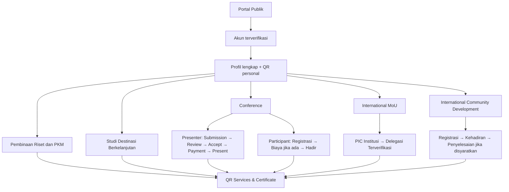

# 01 — Peta Produk dan Perjalanan Pengguna

> **Konteks:** The 6th ICHES 2027. **Status:** rancangan produk; keputusan yang belum final ditandai.  
> **Rujukan visual:** [Presentasi Warek I](00-PRESENTASI-WAREK-I.md).

> **Pembaruan 26 Oktober 2026:** [TOR Warek I](10-ANALISIS-TOR-DAN-REBASELINE-2027.md) menetapkan **lima rangkaian kegiatan** pada **5–6 Januari 2027**. Peta tiga jalur di dokumen ini merupakan konsep awal; dua kegiatan tambahan (**Pembinaan Riset/PKM** dan **Studi Destinasi Berkelanjutan**) wajib tercakup dalam desain baru.

> **KEPUTUSAN TERBARU:** *Administrative Screening* setelah Submit dihapus. Author wajib lolos validasi form **dan** server; naskah yang resmi Submitted langsung tersedia di Reviewer Abstract Index untuk self-claim. **Co-Host Rp3 juta per institusi/maksimal 5 peserta sudah final**. Mekanisme menghubungkan anggota via PIC + undangan email/Magic Link adalah **rekomendasi desain**, belum keputusan final. Lihat [rancangan 13 — linking Co-Host dan submission tanpa screening](13-LINK-COHOST-DAN-SUBMISSION-TANPA-SCREENING.md).

> **Kebijakan institusi terbaru:** Co-Host ICHES 2027 membayar **Rp3 juta/institusi** khusus jalur paper International Conference (maks. 5 orang), tetapi memperoleh pengakuan publik sebagai **institusi Co-Host acara**. Paket MoU/Pembinaan/International PKM/Destinasi dibayar **Rp1 juta per orang** secara terpisah. [Ketentuan dan diagram](14-CAKUPAN-COHOST-DAN-PROGRAM-PENDAMPING.md).

**KEPUTUSAN FINAL BARU (26 Oktober 2026):** **Paket Program Internasional Rp1.000.000/orang adalah SATU produk mandiri yang dipesan dan dibayar lewat Dashboard Peserta sendiri**, bukan di menu Co-Host/PIC. **Satu pembayaran Rp1 juta memberikan empat akses sekaligus**: International MoU; Upgrading Kasubdit Penelitian-PKM Kemenag RI; PKM Internasional; Destinasi Internasional Tumpak Sewu–Teras Semeru. **Bukan Rp1 juta per program.** Co-Host tetap satu invoice Rp3 juta per institusi (maks. 5 orang), tidak bertambah karena anggota mengambil paket sendiri. Akses kegiatan MoU **bukan** otomatis status PIC/delegasi/penandatangan resmi. [Alur dan aturan](15-PAKET-INTERNASIONAL-DASHBOARD-PESERTA.md).

## Tujuan produk

Satu portal untuk menghubungkan informasi acara, registrasi, proses akademik, pendaftaran institusi MoU, kegiatan pengabdian internasional, operasional pelayanan, dan sertifikat. Sistem **single-event ICHES 2027** dengan model satu akun / satu profil / satu QR pribadi dan banyak keikutsertaan.

Bukan platform multi-edition, ERP, OJS pengganti, sistem penandatanganan kontrak legal, sistem kepegawaian petugas, atau mesin penilaian akademik otomatis.

## Prinsip yang telah dipilih

| Prinsip | Implikasi |
|---|---|
| Satu identitas | Peserta, presenter, delegasi, dan peserta ICD dapat berupa orang yang sama |
| Multi-keikutsertaan | Conference, Pembinaan Riset/PKM, MoU, Pengabdian Internasional, dan Studi Destinasi tercakup; enrollment dan paket harga tetap dibedakan |
| Hak != kehadiran != layanan | Berhak Lunch tidak sama dengan sudah mengambil Lunch; datang tidak sama dengan telah presentasi |
| Institusi != individu | MoU didaftarkan sekali per institusi; PIC dan delegasi tetap mempunyai identitas masing-masing |
| Akun pengelola submission | Submitting/Corresponding Author dapat berbeda dengan First Author |
| Sertifikat individu | Satu sertifikat unik per penulis per paper yang memenuhi syarat |
| Backoffice terbatas per peran | Petugas hanya melihat dan mengerjakan yang menjadi penugasannya |

## Peta perjalanan utama

## Aktor

- **Visitor:** melihat website, call for papers, jadwal publik, dan verifikasi sertifikat.
- **User/Participant:** memiliki akun dan kegiatan aktif.
- **Submitting Author:** pengelola paper dan seluruh tautan sertifikat penulisnya.
- **Reviewer:** mencari/filter paper valid menurut track, Claim sendiri, menilai; tidak menetapkan keputusan final.
- **Academic Authority:** memantau reviewer claim, mengatasi klaim macet, keputusan final, jadwal dan final academic check.
- **PIC MoU:** mewakili administrasi pendaftaran institusi dan mengusulkan delegasi.
- **Verified Delegate:** individu terundang dengan akun/QR sendiri.
- **ICD Coordinator:** mengelola peserta dan bukti kegiatan.
- **Finance:** memeriksa bukti pembayaran, bukan menetapkan ACCEPT.
- **Moderator:** memverifikasi presentasi paper pada sesi.
- **Admin/Service Coordinator/Scanner Operator:** mengatur atau mengeksekusi hak layanan menurut scope.
- **Certificate Authority:** mempratinjau dan memublikasikan sertifikat.

## Contoh skenario lintas aktivitas

**Skenario A — Satu orang, tiga kegiatan:** orang yang sama mengikuti Conference + MoU + ICD; ia menggunakan akun dan QR identik, tetapi masing-masing pendaftaran/kehadiran tetap independen. Lunch bersama Hari 1 hanya dapat diambil sekali.

**Skenario B — Penulis berbeda dari presenter:** akun pengelola mengirim paper empat penulis. Satu penulis benar-benar menyampaikan paper; Moderator menandai Presented, lalu panitia dapat menerbitkan **empat** Presenter Certificate unik sesuai keputusan terbaru.

**Skenario C — MoU tanpa Conference:** delegasi MoU tidak otomatis menjadi Conference Participant/Presenter atau menerima kit. Koordinator Kit yang diberi kewenangan boleh memberikan hak kit khusus tanpa membuat registrasi akademik palsu.

## Peta cakupan fitur

| Modul | Target fungsional | Catatan |
|---|---|---|
| Public website | Call for Papers, agenda, narasumber, tempat, info biaya, tautan registrasi | Isi publik dapat dikelola panitia |
| Identity/profile | Email OTP / Magic Link, WhatsApp, foto crop, personal QR | Peserta tanpa password |
| Conference | Participant dan Presenter; academic lifecycle | Sistem sendiri bukan OJS |
| Pembinaan Riset dan PKM | Registrasi/akses sesi, agenda, kehadiran | Tidak menjadi LMS atau pelatihan jangka panjang |
| MoU | Satu institusi satu pendaftaran, PIC, delegasi, validasi | Tidak menjadi contract-management engine |
| ICD | Pendaftaran, kehadiran, penyelesaian bila dipersyaratkan | Tidak menjadi mini-KKN |
| Studi Destinasi Berkelanjutan | Keikutsertaan, daftar rombongan, titik kegiatan, kehadiran | Pengaturan rute/transport detail bila panitia memerlukan |
| Finance | Transfer manual, upload bukti, verifikasi | Presenter setelah ACCEPT |
| Operations | Pos, penugasan petugas, slot, entitlement, scanner | Berbasis CRUD |
| Certificates | Kelayakan, publikasi massal, URL unik, PDF, perbaikan | Co-author dapat unduh publik |

## Batas yang belum diputuskan

**SETELAH TOR:** Pembinaan Riset dan PKM serta Sustainable Destination Study **tercantum sebagai rangkaian resmi dalam TOR**. Keduanya bukan lagi sekadar ide tambahan di luar acara; kedalaman fitur, struktur pembayaran, dan hak layanannya masih memerlukan keputusan. Kehadiran opsional tidak berarti harus dibangun pada tahap pertama. Semua aturan jumlah peserta, tanggal riil acara, jadwal, biaya, dan kapasitas akan mengikuti keputusan panitia.

## Kriteria validasi bersama Warek I

Apakah cakupan tiga jalur awal sudah memadai? Siapa yang berwenang memutuskan kebijakan akademik dan keuangan? Apakah LoA serta sertifikat menggunakan penandatangan UNISYA yang sesuai? Apakah ada kegiatan tambahan yang benar-benar wajib pada ICHES 2027?

**Keputusan yang dipresentasikan di dokumen ini adalah hasil diskusi produk, bukan keputusan formal pimpinan.**
