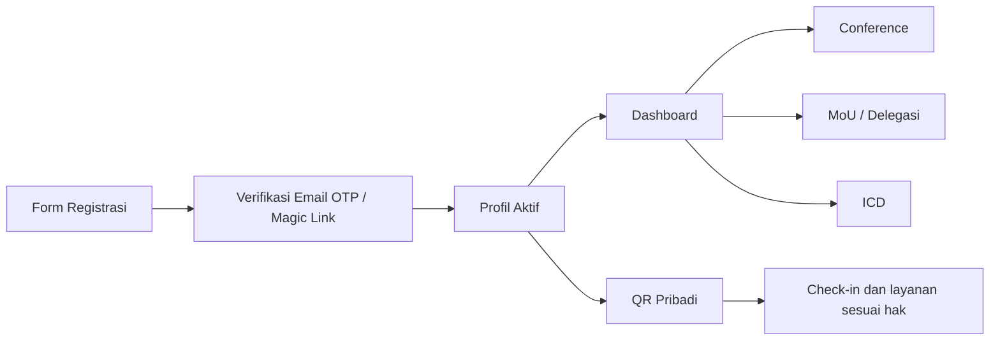
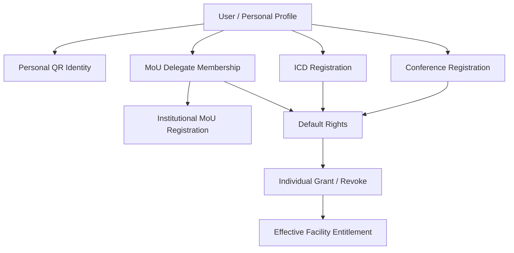

# 02 — Akun, Registrasi, dan Multi-Keikutsertaan

> **KEPUTUSAN FINAL 27 OKTOBER 2026:** Co-Host **Rp3.000.000/institusi = lima perwakilan + lima paper International Conference**, masing-masing perwakilan submit **satu paper sendiri melalui akun masing-masing**. **Deadline Paket Program Internasional Rp1 juta dibuat CRUD pada Admin**, sehingga tanggal/jam dapat diubah sewaktu diperlukan. **International Conference, MoU, Upgrading, PKM, Destinasi, serta seluruh pengaturan operasional dan website dikelola lewat Backoffice Admin**; bukan tanggal/nilai hardcoded. Reviewer/Finance/Moderator tetap melaksanakan perannya. [Paper Co-Host](16-COHOST-LIMA-PAPER-PERWAKILAN.md) · [Matriks Admin CRUD](17-ADMIN-CRUD-DAN-PENGATURAN-ACARA.md).

> **Status:** sebagian besar prinsip disepakati; detail form serta model staf masih perlu validasi.

> **Rebaseline TOR:** ICHES 2027 memiliki **lima rangkaian acara**. Konsep multi-keikutsertaan tetap berlaku, tetapi **kategori biaya/bundle bukan sinonim kegiatan**. TOR memiliki paket gabungan MoU + Pembinaan + PKM + Destinasi senilai **IDR 1.000.000**, dan kategori Co-Host **IDR 3.000.000** (**koreksi terbaru**; TOR masih mencetak IDR 450.000). Kuota Co-Host **maks. lima peserta per institusi** sudah disepakati. **Biaya Co-Host berlaku sekali PER INSTITUSI untuk maksimal lima peserta (sudah final)**; detail benefit dan eligibility lainnya masih memerlukan keputusan. Lihat [Audit TOR](10-ANALISIS-TOR-DAN-REBASELINE-2027.md).

> **KEPUTUSAN TERBARU:** *Administrative Screening* setelah Submit dihapus. Author wajib lolos validasi form **dan** server; naskah yang resmi Submitted langsung tersedia di Reviewer Abstract Index untuk self-claim. **Co-Host Rp3 juta per institusi/maksimal 5 peserta sudah final**. Mekanisme menghubungkan anggota via PIC + undangan email/Magic Link adalah **rekomendasi desain**, belum keputusan final. Lihat [rancangan 13 — linking Co-Host dan submission tanpa screening](13-LINK-COHOST-DAN-SUBMISSION-TANPA-SCREENING.md).

## Identity: satu profil untuk berbagai aktivitas

Alur peserta ditetapkan sebagai:

**Field dasar yang disepakati:** nama, email, nomor WhatsApp, foto profil maksimum **2 MB**, dan crop foto **1:1** dengan modal visual. Informasi seperti negara dan institusi didorong agar dapat melengkapi kebutuhan konferensi, tetapi daftar field wajib final menunggu ratifikasi.

Foto crop bergaya scanner hanya efek UI untuk memilih area foto, **bukan pengenalan biometrik**. Identitas tidak boleh diubah sedikit pun oleh animasi.

**Autentikasi peserta:** Email OTP atau Magic Link, tanpa password. OTP/token masa berlaku singkat, satu kali pakai, pembatasan percobaan, dan session aman. Untuk petugas berhak tinggi, kebijakan login dan pengamanan dapat lebih kuat serta perlu keputusan tersendiri.

## Hubungan akun, aktivitas, dan hak

Pendaftaran ke suatu kegiatan **tidak otomatis** memberikan hak seluruh fasilitas. Hak efektif berasal dari default tiap kategori + pengecualian individual dalam lingkup layanan. Pengambilan nyata disimpan terpisah.

**Satu personal QR** berlaku untuk identitas lookup, bukan untuk menyandikan email/WhatsApp atau daftar hak secara permanen. QR dapat dicabut/diganti jika bocor, tanpa kehilangan catatan kegiatan.

## Registrasi Conference

Konsep Conference memisahkan Participant dan jalur Presenter. Presenter membuat submission sebagai bagian dari jalur akademik, sementara Participant tanpa paper mengikuti registrasi kegiatan dan ketentuan biaya yang mungkin FREE/PAID. Keputusan lama yang mengharuskan paket gabungan tetap **tidak berlaku** pada sistem baru.

## Multi-keikutsertaan

Satu orang boleh menambah Conference, Pembinaan Riset/PKM, MoU, ICD, dan Studi Destinasi melalui dashboard tanpa membuat akun baru, dengan status masing-masing (draft/pending/verified/confirmed dan seterusnya sesuai domain). Tidak ada batas 'hanya satu aktivitas per akun'.

MoU berbeda karena yang didaftarkan adalah institusi; orang ditautkan sebagai PIC atau delegasi. **Co-Host juga mempunyai satu tagihan per institusi Rp3.000.000 untuk maksimal lima peserta, tanpa tagihan Co-Host berulang per orang.** Status Co-Host dan pendaftaran MoU merupakan dua hubungan institusi yang berbeda, meskipun dapat menggunakan satu master institusi. **Biaya Co-Host dan bundle TOR tidak boleh otomatis diperlakukan sebagai pembayaran per kegiatan.** Paket biaya dapat memberikan akses ke beberapa kegiatan tanpa menggandakan tagihan/serving. Lihat [04 — MoU dan ICD](04-MOU-DAN-ICD.md).

### Usulan hubungan anggota Co-Host (lima slot)

Satu **Institution** dengan satu **Co-Host Registration**, satu akun **PIC**, maksimal **5 anggota**. PIC input nama+email masing-masing lalu sistem mengundang lewat Email Magic Link: yang sudah punya akun dihubungkan tanpa akun ganda; yang belum punya akun melakukan aktivasi dan melengkapi profil. Undangan mencadangkan slot agar tak melebihi lima. **PIC hanya dihitung sebagai salah satu dari lima peserta bila PIC ikut acara**. Per anggota tetap personal QR sendiri; Finance mencatat **satu** pembayaran institusi Rp3.000.000.

Penggantian anggota sebelum check-in/layanan bisa dikelola PIC; sesudah hadir atau menerima fasilitas dikoordinasikan Admin tanpa menghapus fakta lama. Ketentuan ini **usulan**, belum final. [rancangan 13 — linking Co-Host dan submission tanpa screening](13-LINK-COHOST-DAN-SUBMISSION-TANPA-SCREENING.md).

### Pemisahan final Co-Host dan paket pendamping

**Rp3.000.000 per institusi** merupakan pembayaran Co-Host **khusus paper International Conference** untuk roster maksimal **5 orang**. Paket program lain dalam TOR (MoU, Pembinaan Riset/PKM, International PKM, Studi Destinasi) dibayar **Rp1.000.000 per peserta yang memilih paket**, termasuk peserta dari institusi Co-Host. Tidak ada otomatis aktif pada semua program hanya karena institusi Co-Host dan tidak ada invoice Rp1 juta otomatis untuk semua lima anggota.

**Benefit non-uang Co-Host yang disepakati:** pengakuan institusi sebagai **Co-Host penyelenggaraan ICHES 2027**, tercantum secara publik sesuai ketentuan publikasi dan identitas institusi resmi. Perincian media logo/nama masih usulan. [Diagram lengkap](14-CAKUPAN-COHOST-DAN-PROGRAM-PENDAMPING.md).

### Fitur paket program hanya di Dashboard Peserta

**KEPUTUSAN FINAL BARU (26 Oktober 2026):** **Paket Program Internasional Rp1.000.000/orang adalah SATU produk mandiri yang dipesan dan dibayar lewat Dashboard Peserta sendiri**, bukan di menu Co-Host/PIC. **Satu pembayaran Rp1 juta memberikan empat akses sekaligus**: International MoU; Upgrading Kasubdit Penelitian-PKM Kemenag RI; PKM Internasional; Destinasi Internasional Tumpak Sewu–Teras Semeru. **Bukan Rp1 juta per program.** Co-Host tetap satu invoice Rp3 juta per institusi (maks. 5 orang), tidak bertambah karena anggota mengambil paket sendiri. Akses kegiatan MoU **bukan** otomatis status PIC/delegasi/penandatangan resmi. [Alur dan aturan](15-PAKET-INTERNASIONAL-DASHBOARD-PESERTA.md).

PIC Co-Host tetap mengurus institusi, lima anggota Conference, pembayaran Rp3 juta, dan pengakuan institusi. **Jangan menambahkan tombol pendaftaran paket Rp1 juta, rincian pembayaran pribadi anggota, atau total gabungan pada panel Co-Host.**

## Aturan biaya Co-Host untuk model registrasi

- Satu institusi Co-Host dapat memiliki **maksimal lima peserta terdaftar** untuk ICHES 2027.
- Satu **tagihan Co-Host Rp3.000.000** melekat pada pendaftaran **institusi**, bukan akun masing-masing delegasi.
- Pengelola institusi/PIC dapat mengurus bukti pembayaran atas nama institusi; panitia Finance memverifikasi secara manual.
- Peserta tetap mempunyai satu akun/QR pribadi; harga paket tidak mengubah identitas atau membuktikan kehadiran secara otomatis.
- **Sudah final:** Co-Host hanya untuk jalur paper International Conference; **tidak termasuk paket MoU/Pembinaan/International PKM/Studi Destinasi Rp1 juta per orang**. Pengakuan institusi sebagai Co-Host berlaku pada branding ICHES 2027. **SUDAH FINAL:** lima paper Co-Host, satu paper oleh setiap perwakilan. Yang masih terbuka: fasilitas lainnya dan pergantian paper/anggota sesudah submit.

[Rancangan pembayaran Co-Host](12-PEMBAYARAN-COHOST-PER-INSTITUSI.md).

## Batas keamanan

- Kecocokan email terverifikasi adalah dasar pengaitan ke akun yang sudah ada; jangan menciptakan duplikat.
- Kontak pribadi, token QR lookup, dan bukti pembayaran tidak boleh terekspos dalam halaman publik.
- Panitia boleh membetulkan metadata dengan hak terbatas; perubahan profil tidak boleh merusak snapshot akademik/sertifikat yang sudah terbit.
- Petugas scanner hanya melihat identitas minimum dan hak layanan yang diperlukan.
- Tanpa *device fingerprint*, *geofencing*, atau pemaksaan perangkat scanner khusus pada MVP.

## Poin terbuka

Jadwal pengumpulan profil, apakah semua jenis kegiatan mensyaratkan foto, format nomor WhatsApp internasional, verifikasi peserta yang tidak mempunyai akses email sesaat, serta metode login staf/reviewer berhak tinggi.
