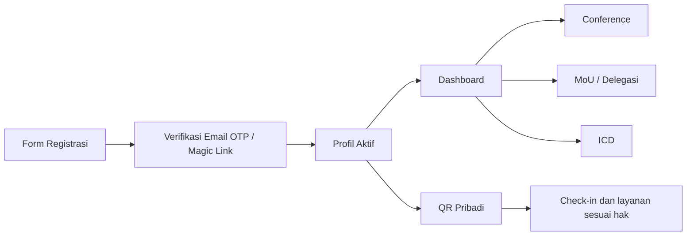
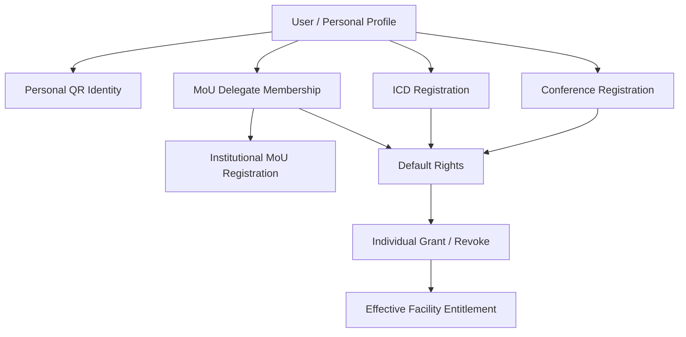

# 02 — Akun, Registrasi, dan Multi-Keikutsertaan

> **Status:** sebagian besar prinsip disepakati; detail form serta model staf masih perlu validasi.

## Identity: satu profil untuk berbagai aktivitas

Alur peserta ditetapkan sebagai:

**Field dasar yang disepakati:** nama, email, nomor WhatsApp, foto profil maksimum **2 MB**, dan crop foto **1:1** dengan modal visual. Informasi seperti negara dan institusi didorong agar dapat melengkapi kebutuhan konferensi, tetapi daftar field wajib final menunggu ratifikasi.

Foto crop bergaya scanner hanya efek UI untuk memilih area foto, **bukan pengenalan biometrik**. Identitas tidak boleh diubah sedikit pun oleh animasi.

**Autentikasi peserta:** Email OTP atau Magic Link, tanpa password. OTP/token masa berlaku singkat, satu kali pakai, pembatasan percobaan, dan session aman. Untuk petugas berhak tinggi, kebijakan login dan pengamanan dapat lebih kuat serta perlu keputusan tersendiri.

## Hubungan akun, aktivitas, dan hak

Pendaftaran ke suatu kegiatan **tidak otomatis** memberikan hak seluruh fasilitas. Hak efektif berasal dari default tiap kategori + pengecualian individual dalam lingkup layanan. Pengambilan nyata disimpan terpisah.

**Satu personal QR** berlaku untuk identitas lookup, bukan untuk menyandikan email/WhatsApp atau daftar hak secara permanen. QR dapat dicabut/diganti jika bocor, tanpa kehilangan catatan kegiatan.

## Registrasi Conference

Konsep Conference memisahkan Participant dan jalur Presenter. Presenter membuat submission sebagai bagian dari jalur akademik, sementara Participant tanpa paper mengikuti registrasi kegiatan dan ketentuan biaya yang mungkin FREE/PAID. Keputusan lama yang mengharuskan paket gabungan tetap **tidak berlaku** pada sistem baru.

## Multi-keikutsertaan

Satu orang boleh menambah Conference, MoU, ICD melalui dashboard tanpa membuat akun baru, dengan status masing-masing (draft/pending/verified/confirmed dan seterusnya sesuai domain). Tidak ada batas 'hanya satu aktivitas per akun'.

MoU berbeda karena yang didaftarkan adalah institusi; orang ditautkan sebagai PIC atau delegasi. Lihat [04 — MoU dan ICD](04-MOU-DAN-ICD.md).

## Batas keamanan

- Kecocokan email terverifikasi adalah dasar pengaitan ke akun yang sudah ada; jangan menciptakan duplikat.
- Kontak pribadi, token QR lookup, dan bukti pembayaran tidak boleh terekspos dalam halaman publik.
- Panitia boleh membetulkan metadata dengan hak terbatas; perubahan profil tidak boleh merusak snapshot akademik/sertifikat yang sudah terbit.
- Petugas scanner hanya melihat identitas minimum dan hak layanan yang diperlukan.
- Tanpa *device fingerprint*, *geofencing*, atau pemaksaan perangkat scanner khusus pada MVP.

## Poin terbuka

Jadwal pengumpulan profil, apakah semua jenis kegiatan mensyaratkan foto, format nomor WhatsApp internasional, verifikasi peserta yang tidak mempunyai akses email sesaat, serta metode login staf/reviewer berhak tinggi.
