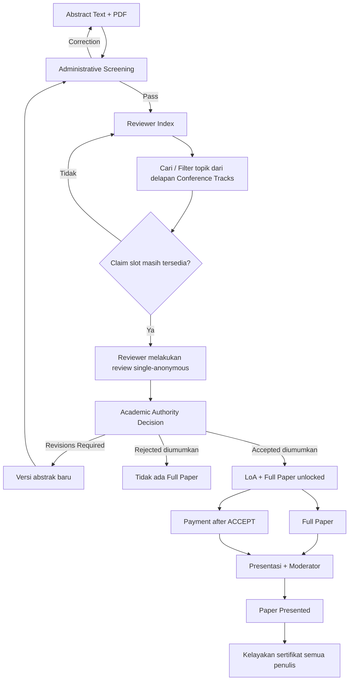

# 03 — Submission Akademik, Review, LoA, dan Full Paper

> **STATUS CAMPURAN:** 'Disepakati' bersumber diskusi ICHES baru. 'Baseline lama' dari [repository referensi](https://github.com/akhmadafnan/international-conference-platform/tree/develop), **belum otomatis berarti implementasi tersedia**.

> **Koreksi terbaru pemilik produk (26 Oktober 2026):** Tarif Co-Host **Rp3.000.000** menggantikan Rp450.000 yang tertulis di TOR; kapasitas **maksimal lima peserta per institusi**; agenda MoU/Pembinaan dan panel boleh paralel **tanpa modul anti-benturan**; reviewer melakukan **self-claim** dari daftar abstrak yang lolos screening dengan pencarian/filter topik (tidak perlu dibatasi topik pada akun reviewer); Full Paper dibuka **ketika ACCEPT resmi diumumkan kepada submitting author**, bukan dari tanggal tetap. **KEPUTUSAN FINAL Co-Host:** tarif Rp3.000.000 **per institusi**, satu kali tagihan untuk maksimal **lima peserta**. Satuan pembayaran tidak lagi terbuka. Detail cakupan layanan/paper dalam paket Co-Host masih perlu diputuskan. Lihat [Rancangan pembayaran Co-Host](12-PEMBAYARAN-COHOST-PER-INSTITUSI.md). Rincian: [Keputusan operasional terbaru](11-KEPUTUSAN-OPERASIONAL-26-OKT-2026.md).

## Penetapan jadwal akademik dari TOR (halaman 5)

| Tahap | Jendela TOR |
|---|---|
| Abstract submission | **1–20 Desember 2026** |
| Pengumuman Abstract Acceptance | **22 Desember 2026** |
| Full Paper upload | **23–28 Desember 2026** |
| Registration / Payment | **24–28 Desember 2026** |
| Parallel Panel | **5 Januari 2027, 13.15–16.30+** |
| Target prosiding | **28 Januari 2027** |

**KEPUTUSAN TERBARU:** Full Paper dibuka **untuk paper dengan keputusan ACCEPT yang telah diumumkan resmi kepada submitting author**. Tidak ada hard gate tanggal untuk membuka unggahan, dan tidak perlu menunggu Finance VERIFIED. Tanggal 23–28 Desember dari TOR tetap menjadi target kalender penyelenggara. Payment presenter berjalan **terpisah setelah ACCEPT**.

**Delapan Conference Track** berasal dari TOR bagian E dan harus diinisialisasi sebagai data editable (lihat [Audit TOR bagian III](10-ANALISIS-TOR-DAN-REBASELINE-2027.md)). Reviewer count tidak dicantumkan pada TOR; baseline repo lama **1 reviewer default configurable**, bukan ketetapan baru dua reviewer.

## Keputusan terbaru yang disepakati

1. **Submitting/Corresponding Author** adalah akun pengelola submission, tidak harus First Author.
2. Co-author dapat tercatat sebagai penulis tanpa akun.
3. Abstract submission **wajib mengisi teks abstrak online DAN mengunggah file**.
4. **Format unggahan abstrak: PDF saja.**
5. Pembayaran jalur Presenter dilakukan **setelah keputusan abstract ACCEPT**.
6. Setelah paper benar-benar dipresentasikan, **semua author tercantum** berhak mendapat Presenter Certificate menurut syarat akademik dan administrasi.
7. Sertifikat diterbitkan **massal oleh panitia**, tidak otomatis ketika Moderator menekan Presented.

## Satu identitas Paper dan alur Reviewer Self-Claim

Reviewer mulai bekerja secara **bergulir** sejak abstract submission dimulai 1 Desember dan sebuah paper **lolos screening**, bukan setelah tanggal penutupan abstrak. Akses reviewer index hanya bagi reviewer terautentikasi. Filter dan pencarian berdasarkan track digunakan untuk memilih paper **tanpa membatasi reviewer pada akun yang didaftarkan ke topik tertentu**.

Untuk mencegah claim ganda, claim harus atomik dan mengikuti jumlah slot reviewer per paper yang dikonfigurasi. Reviewer tidak boleh mengklaim karya sendiri; Koordinator Akademik dapat melepaskan/reassign claim yang tak kunjung dikerjakan, tanpa mesin deadline atau approval panjang. Rekomendasi reviewer tetap bukan keputusan akademik. Komite secara eksplisit membuat keputusan final lalu **mengumumkannya kepada penulis**, dan **hanya ACCEPT yang sudah diumumkan** mengaktifkan upload Full Paper.

## Wizard submission — rancangan UX (usulan)

| Langkah | Konten |
|---|---|
| 1 Paper | Judul, bidang/track, keywords, bahasa akademik |
| 2 Authors | Penulis berurutan, corresponding author, afiliasi, negara, email, ORCID opsional |
| 3 Abstract | **Teks online wajib + PDF wajib** |
| 4 Confirm | Pratinjau lengkap, pernyataan seluruh penulis, Submit |

Draft dapat disimpan dan dilanjutkan; setelah Submit, versi resmi dikunci. Revisi membuat versi baru **pada paper yang sama**.

## Metadata akademik dari kontrak repo lama — dipertahankan

Sumber: [Submission Scholarly Metadata Contract](https://github.com/akhmadafnan/international-conference-platform/blob/develop/docs/metadata/SUBMISSION_SCHOLARLY_METADATA_CONTRACT_V1.md).

- UUID internal dan kode paper yang mudah dibaca adalah identitas berbeda.
- Identitas penulis menyimpan nama autentik termasuk nama tunggal (*mononym*), urutan, email, negara, afiliasi, satu corresponding author, ORCID opsional.
- Afiliasi mendukung ROR jika tersedia, input manual tetap sah.
- UI language dan bahasa karya akademik terpisah.
- Keywords tersimpan per nilai, bukan hanya satu teks CSV.
- Dokumen dan metadata final disimpan sebagai versi/snapshot; profil akun belakangan tidak otomatis mengubah versi final.
- Metadata untuk OJS/prosiding disiapkan untuk *handoff*, bukan langsung menerbitkan DOI melalui aplikasi konferensi.

## Administrative screening

Panitia memeriksa kesesuaian scope, metadata, kata kunci, jumlah kata dan aturan PDF yang telah diputuskan, kelengkapan penulis, keterbacaan dan konsistensi **teks online dengan file PDF**. Jangan mengklaim pemeriksaan kesamaan isi otomatis tersedia; tahap awal cukup checklist staf.

Hasil screening: PASS, CORRECTION_REQUIRED, atau INELIGIBLE menurut aturan. Koreksi administrasi **bukan** putaran review akademik.

## Operasional Reviewer Abstract Index

| Kolom/tindakan | Perilaku yang dibutuhkan |
|---|---|
| Paper Code & Title | Identifikasi paper secara jelas |
| Track/Topic | Delapan subtema TOR, filter dan search |
| Status paper | Available, Claimed, Reviewed (sesuai kebutuhan reviewer) |
| Claim Abstract | Mengambil satu slot tersedia, tidak boleh klaim dua kali / merebut klaim |
| My Claimed Abstracts | Daftar tanggung jawab reviewer |
| Submit Review | Menyimpan rekomendasi dan komentar untuk komite/penulis |
| Release by Coordinator | Koordinator bisa membebaskan klaim yang macet |

**Tidak ada klasifikasi reviewer-ke-topic wajib pada akun.** Reviewer bertanggung jawab memilih abstrak yang sesuai kompetensinya. Admin Academic tetap memantau yang belum diklaim. Tanggal pengumuman **22 Desember dalam TOR** tetap milestone panitia, **bukan waktu menunggu review dimulai**, dan belum menjadikan setiap reviewer memiliki tenggat kaku.

## Peer review abstrak

**Baseline lama yang berlaku untuk accelerated V1:**
- Mode **single-anonymous**: reviewer melihat identitas penulis, penulis tidak melihat identitas reviewer.
- **1 reviewer default pada baseline repo lama, jumlah dapat dikonfigurasi**; dua reviewer yang pernah diusulkan **belum disahkan**. Penugasan rutin diganti menjadi **claim mandiri lewat index**.
- Rekomendasi reviewer lama: ACCEPT / REVISION / REJECT; keputusan akhir tetap Academic Authority.
- Normal **1 putaran revisi**, dengan pengecualian jika Academic Authority mengizinkan.
- Reviewer tidak boleh menilai paper sendiri; konflik langsung diblokir, afiliasi yang sama dapat memunculkan peringatan.

Sumber: [V1 Academic Review Baseline](https://github.com/akhmadafnan/international-conference-platform/blob/develop/docs/requirements/v1/V1_ACADEMIC_REVIEW_BASELINE.md).

**Usulan sebelumnya, belum final:** kriteria berbobot 20/20/15/20/15/10, 2 reviewer wajib, 200–300 kata, 3–5 keywords, PDF 1 A4 maksimal 3 MB. Parameter ini **jangan dikunci tanpa keputusan komite**.

## Pemisahan status

| Ranah | Contoh fakta/status |
|---|---|
| Academic | Draft, Submitted, Screening, Under Review, Revision, Accepted, Rejected |
| Finance | No obligation before ACCEPT, Due, Proof Submitted, Under Verification, Verified |
| Full Paper | Pending, Submitted, Correction Required, Cleared, Final ACC |
| Presentation | Scheduled, Presented, No Show |
| Certificate | Ineligible, Eligible, Published, Revoked/Reissued |

Status pembayaran VERIFIED bukan ACCEPT akademik. LoA berarti diterima untuk **presentasi**, bukan otomatis diterima terbit di jurnal.

## Full paper dan publikasi

**Baseline lama accelerated V1:** full article dibuka setelah ACCEPT/LoA, divalidasi sebelum konferensi, masuk penjadwalan setelah memenuhi prasyarat. Actual Presenter dikonfirmasi dari author list; boleh berbeda dari corresponding author. Setelah presentasi, terdapat penilaian artikel/presentasi, kemungkinan unggah revisi, Final ACC, kemudian *publication handoff*. **Tidak ada kewajiban membangun engine double-anonymous generic terpisah pada V1 lama.**

Sumber: [Pre-Phase02 Rebaseline](https://github.com/akhmadafnan/international-conference-platform/blob/develop/docs/governance/PRE_PHASE02_PRODUCT_REBASELINE.md) dan [V1 Academic Review](https://github.com/akhmadafnan/international-conference-platform/blob/develop/docs/requirements/v1/V1_ACADEMIC_REVIEW_BASELINE.md).

Untuk ICHES baru kebijakan ini direkomendasikan menjadi baseline, dengan keputusan final komite mengenai kebutuhan full paper untuk semua presenter dan syarat publikasi.

## Poin terbuka

Jumlah reviewer ICHES, penanganan reviewer yang sudah claim tetapi tidak aktif, batas kata, keywords, ukuran & template PDF, **deadline akhir Full Paper bila diperlukan (bukan gate unlock)**, tarif presenter per paper/per orang, kebijakan no-show/makeup, rubrik penilaian akhir dan kriteria penyerahan ke prosiding/jurnal.

**Tidak ada implementasi academic submission pada branch develop repo lama yang diaudit; ini kontrak produk/metadata untuk pembangunan berikutnya.**
