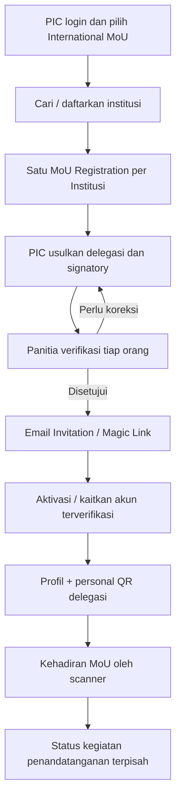
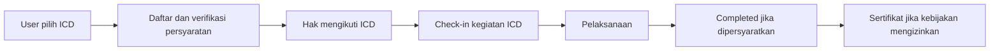

# 04 — International MoU dan International Community Development

> **KEPUTUSAN FINAL 27 OKTOBER 2026:** Co-Host **Rp3.000.000/institusi = lima perwakilan + lima paper International Conference**, masing-masing perwakilan submit **satu paper sendiri melalui akun masing-masing**. **Deadline Paket Program Internasional Rp1 juta dibuat CRUD pada Admin**, sehingga tanggal/jam dapat diubah sewaktu diperlukan. **International Conference, MoU, Upgrading, PKM, Destinasi, serta seluruh pengaturan operasional dan website dikelola lewat Backoffice Admin**; bukan tanggal/nilai hardcoded. Reviewer/Finance/Moderator tetap melaksanakan perannya. [Paper Co-Host](16-COHOST-LIMA-PAPER-PERWAKILAN.md) · [Matriks Admin CRUD](17-ADMIN-CRUD-DAN-PENGATURAN-ACARA.md).

> **Status:** alur institusional MoU dan undangan delegasi telah dipilih sebagai konsep produk; beberapa rincian operasional masih terbuka.

> **TOR 2027, bagian N:** Pada **5 Januari**, rangkaian MoU + Pembinaan Kemenag tercatat **13.00–17.15**; pada waktu yang sama, Panel Session berlangsung **13.15–16.30+**. Agenda paralel telah disepakati tanpa fitur pengaturan benturan yang kompleks. Pada **6 Januari**, Pengabdian dilaksanakan secara luring bersama perjalanan Teras Semeru → Desa Sidomulyo → Tumpak Sewu. Lihat [audit TOR](10-ANALISIS-TOR-DAN-REBASELINE-2027.md).

**KEPUTUSAN FINAL BARU (26 Oktober 2026):** **Paket Program Internasional Rp1.000.000/orang adalah SATU produk mandiri yang dipesan dan dibayar lewat Dashboard Peserta sendiri**, bukan di menu Co-Host/PIC. **Satu pembayaran Rp1 juta memberikan empat akses sekaligus**: International MoU; Upgrading Kasubdit Penelitian-PKM Kemenag RI; PKM Internasional; Destinasi Internasional Tumpak Sewu–Teras Semeru. **Bukan Rp1 juta per program.** Co-Host tetap satu invoice Rp3 juta per institusi (maks. 5 orang), tidak bertambah karena anggota mengambil paket sendiri. Akses kegiatan MoU **bukan** otomatis status PIC/delegasi/penandatangan resmi. [Alur dan aturan](15-PAKET-INTERNASIONAL-DASHBOARD-PESERTA.md).

## MoU: entitas pendaftaran adalah institusi

**Satu institusi mempunyai tepat satu pendaftaran MoU dalam ICHES 2027.** PIC adalah orang pengelola administrasi pendaftaran, bukan selalu pejabat yang menandatangani. Delegasi dan signatory dapat berbeda dari PIC.

## Peran dan aturan

| Peran | Kewenangan |
|---|---|
| PIC | Mendaftarkan institusi, mengusulkan/memperbaiki delegasi |
| Delegasi | Memiliki akun sendiri dan personal QR; memenuhi hak MoU jika verified |
| Signatory | Orang yang secara administratif diusulkan dan diverifikasi untuk penandatanganan |
| Admin MoU | Verifikasi pendaftaran institusi, delegasi, dan status kegiatan |

**Keputusan C delegasi:** PIC mengusulkan, panitia memverifikasi per orang (setujui, kembalikan, tolak). Delegasi baru diberi undangan Email Magic Link **setelah** lolos verifikasi panitia. Jika email sudah punya akun terverifikasi, gunakan akun yang ada; tidak perlu akun ganda. PIC boleh juga menjadi delegasi/signatory.

**Aturan hak layanan B:** Verified Delegate mendapat hak layanan MoU sesuai defaultnya, **tidak otomatis Conference/ICD**. Jika panitia memberi kit tertentu, gunakan individual rights grant tanpa membuat status Conference baru.

## Kedatangan dan penandatanganan berbeda

Scan QR personal di lokasi MoU menyatakan **orang yang bersangkutan hadir**, bukan menyatakan MoU otomatis telah ditandatangani. Kegiatan penandatanganan punya status tersendiri (contoh draft/ready/signed atau not signed sesuai kebutuhan panitia). Dokumen institusi tidak diperlakukan sebagai sertifikat pribadi.

Jika signatory berbeda dari PIC, PIC tetap pengelola submission institusi sementara kehadiran dan tugas signatory dicatat pada akun pribadi yang benar.

## ICD: kegiatan sebagai jalur partisipasi tersendiri

Kebutuhan ICD sengaja ringan: CRUD kegiatan, peserta, status verifikasi, kehadiran, dan konfirmasi penyelesaian jika perlu. **Tidak perlu membangun mini-KKN, monitoring program pengabdian jangka panjang, atau laporan wajib tiap peserta tanpa kebijakan acara.**

## MoU dan ICD memakai identitas lintas kegiatan

Satu orang bisa menjadi:
- Submitting Author Conference;
- PIC atau delegasi institusi MoU;
- peserta ICD.

Semua berada pada satu profil dan QR, tetapi status pendaftaran masing-masing independen. Lunch bersama yang sama hanya sekali per slot.

## Pembinaan Riset/PKM dan Studi Destinasi dalam TOR

**Pembinaan Riset dan PKM (5 Januari)** tercantum sebagai rangkaian resmi bersama kegiatan MoU; diperlukan daftar peserta yang berhak, jadwal, fasilitas, dan check-in jika disyaratkan. Tidak perlu membangun sistem learning management.

**Studi Destinasi Berkelanjutan (6 Januari)** merupakan kegiatan **onsite**. Cukup manifest peserta/rombongan, titik kehadiran, dan fasilitas sarapan/lunch sesuai jadwal. Kelompok Pengabdian Internasional menurut TOR mencakup bidang **Pendidikan, Ekonomi, dan Sosial Budaya**. Tidak ada kebutuhan membangun aplikasi wisata umum.

**KEPUTUSAN BARU:** paket program pendamping dalam TOR (**MoU + Pembinaan Riset/PKM + Pengabdian Internasional + Studi Destinasi**) berbiaya **IDR 1.000.000 PER ORANG**, terpisah dari **Co-Host Rp3.000.000 per institusi** yang khusus mencakup jalur paper International Conference. Peserta dari institusi Co-Host yang memilih program pendamping tetap memiliki kewajiban Rp1 juta masing-masing. **Pendaftaran institusi untuk MoU, pengusulan delegasi, keikutsertaan individu, dan bukti MoU Signed tetap dipisahkan**; membayar paket pendamping tidak otomatis menandatangani MoU. Satu harga Rp1 juta memberikan **empat akses sekaligus**; tidak ada penagihan Rp1 juta per program. Rincian fasilitas dan pencatatan kehadiran tiap kegiatan tetap perlu disusun. [Kebijakan biaya lengkap](14-CAKUPAN-COHOST-DAN-PROGRAM-PENDAMPING.md).

## Poin keputusan terbuka

Kuota delegasi per institusi, apakah souvenir MoU satu per institusi atau satu per orang, rincian verifikasi dokumen pejabat, kapan MoU dinyatakan selesai, syarat ICD Completed, dan apakah sertifikat MoU/ICD wajib diterbitkan.

**Ketentuan 'MoU Signing Completed' tidak sama dengan dokumen MoU sudah berkekuatan hukum; sistem hanya mencatat status operasional yang diverifikasi panitia.**
