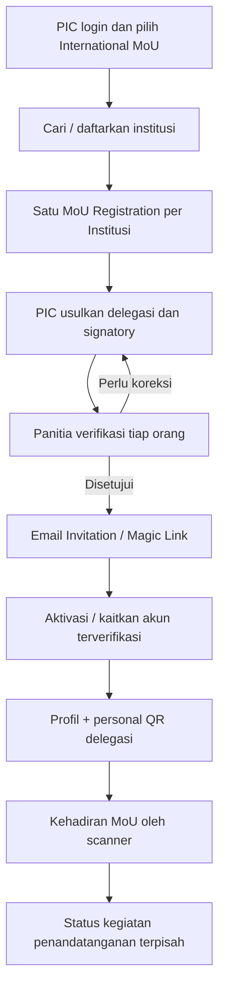
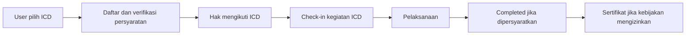

# 04 — International MoU dan International Community Development

> **Status:** alur institusional MoU dan undangan delegasi telah dipilih sebagai konsep produk; beberapa rincian operasional masih terbuka.

## MoU: entitas pendaftaran adalah institusi

**Satu institusi mempunyai tepat satu pendaftaran MoU dalam ICHES 2027.** PIC adalah orang pengelola administrasi pendaftaran, bukan selalu pejabat yang menandatangani. Delegasi dan signatory dapat berbeda dari PIC.

## Peran dan aturan

| Peran | Kewenangan |
|---|---|
| PIC | Mendaftarkan institusi, mengusulkan/memperbaiki delegasi |
| Delegasi | Memiliki akun sendiri dan personal QR; memenuhi hak MoU jika verified |
| Signatory | Orang yang secara administratif diusulkan dan diverifikasi untuk penandatanganan |
| Admin MoU | Verifikasi pendaftaran institusi, delegasi, dan status kegiatan |

**Keputusan C delegasi:** PIC mengusulkan, panitia memverifikasi per orang (setujui, kembalikan, tolak). Delegasi baru diberi undangan Email Magic Link **setelah** lolos verifikasi panitia. Jika email sudah punya akun terverifikasi, gunakan akun yang ada; tidak perlu akun ganda. PIC boleh juga menjadi delegasi/signatory.

**Aturan hak layanan B:** Verified Delegate mendapat hak layanan MoU sesuai defaultnya, **tidak otomatis Conference/ICD**. Jika panitia memberi kit tertentu, gunakan individual rights grant tanpa membuat status Conference baru.

## Kedatangan dan penandatanganan berbeda

Scan QR personal di lokasi MoU menyatakan **orang yang bersangkutan hadir**, bukan menyatakan MoU otomatis telah ditandatangani. Kegiatan penandatanganan punya status tersendiri (contoh draft/ready/signed atau not signed sesuai kebutuhan panitia). Dokumen institusi tidak diperlakukan sebagai sertifikat pribadi.

Jika signatory berbeda dari PIC, PIC tetap pengelola submission institusi sementara kehadiran dan tugas signatory dicatat pada akun pribadi yang benar.

## ICD: kegiatan sebagai jalur partisipasi tersendiri

Kebutuhan ICD sengaja ringan: CRUD kegiatan, peserta, status verifikasi, kehadiran, dan konfirmasi penyelesaian jika perlu. **Tidak perlu membangun mini-KKN, monitoring program pengabdian jangka panjang, atau laporan wajib tiap peserta tanpa kebijakan acara.**

## MoU dan ICD memakai identitas lintas kegiatan

Satu orang bisa menjadi:
- Submitting Author Conference;
- PIC atau delegasi institusi MoU;
- peserta ICD.

Semua berada pada satu profil dan QR, tetapi status pendaftaran masing-masing independen. Lunch bersama yang sama hanya sekali per slot.

## Poin keputusan terbuka

Kuota delegasi per institusi, apakah souvenir MoU satu per institusi atau satu per orang, rincian verifikasi dokumen pejabat, kapan MoU dinyatakan selesai, syarat ICD Completed, dan apakah sertifikat MoU/ICD wajib diterbitkan.

**Ketentuan 'MoU Signing Completed' tidak sama dengan dokumen MoU sudah berkekuatan hukum; sistem hanya mencatat status operasional yang diverifikasi panitia.**
