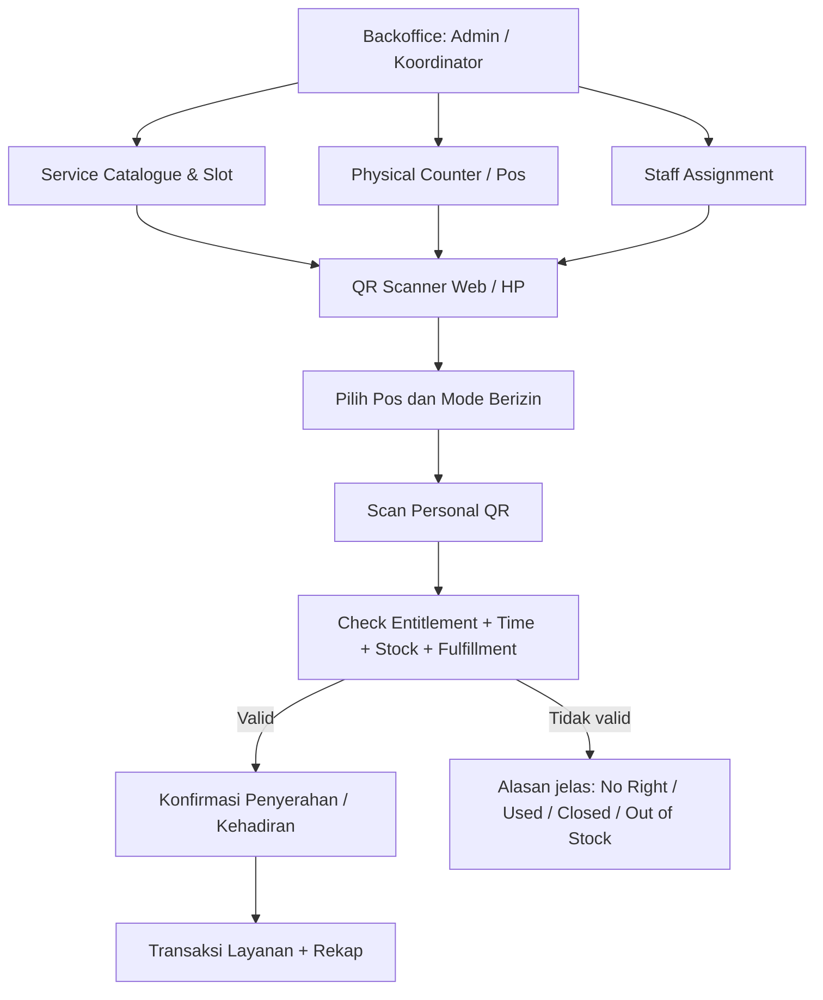
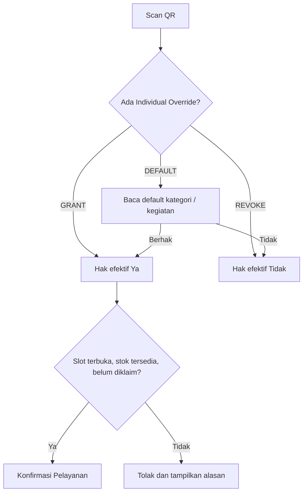
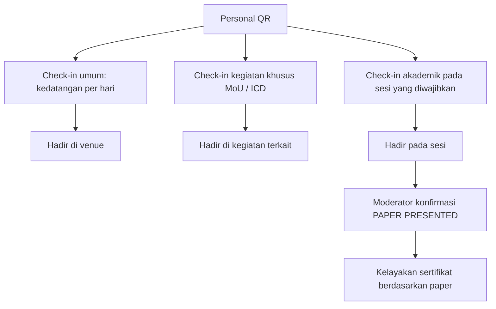

# 05 — QR, Absensi, Pos Layanan, dan Pengelolaan Fasilitas

> **Keputusan utama DISETUJUI:** scanner **Model C hybrid**, absensi **Model C hybrid**, hak fasilitas default dan individual override, serta konsumsi bersama **satu kali per orang per slot**.  
> Petugas operasional tidak perlu memakai akun berbeda untuk tiap pos.

> **TOR 2027:** Hari 1 (**5 Januari**) memiliki registrasi pagi 08.00–08.45, parallel panel sore, MoU/Pembinaan sore, serta coffee break 15.40–15.55 pada panel. Hari 2 (**6 Januari**) merupakan perjalanan **03.00–15.30** termasuk sarapan **06.00–07.00** dan Lunch **12.30–13.30**; keduanya **slot berbeda**. Seluruh check-in lapangan memerlukan fallback prosedural jika konektivitas buruk. Lihat [Audit TOR](10-ANALISIS-TOR-DAN-REBASELINE-2027.md).

## Tiga konsep jangan disamakan

1. **Personal identity / QR:** menunjuk seseorang. QR bukan daftar hak permanen.
2. **Entitlement:** hak efektif menerima layanan berdasarkan kegiatan/status dan penyesuaian koordinator.
3. **Fulfillment / attendance:** bukti operasional layanan atau kehadiran **telah dikonfirmasi**.

Mempunyai QR bukan berarti sudah check-in; check-in umum bukan bukti hadir di MoU, ICD atau telah mempresentasikan paper; berhak Lunch bukan berarti sudah menerima makanan.

## Model C: pos tetap, scanner fleksibel

| Entitas | Makna | Contoh |
|---|---|---|
| Pos / Counter | Lokasi fisik yang teridentifikasi | REG-01, FNB-01, MOU-01 |
| Service | Jenis pelayanan | Check-in, Lunch, Kit, Souvenir |
| Slot | Hari/jam/periode pelayanan yang spesifik | Lunch Hari 1 |
| Assignment | Petugas, pos dan service yang boleh dikerjakan | Operator A: REG-01 + FNB-01 |
| Entitlement | Boleh menerima apa | Lunch-D1 GRANTED |
| Fulfillment | Apa yang sudah dilaksanakan | Lunch-D1 CONFIRMED |

Pos tidak membutuhkan HP terkunci/GPS/geofence. Petugas login, memilih pos dan mode yang diizinkan, memindai QR, mencocokkan foto penerima, dan mengonfirmasi penyerahan **setelah** barang/makanan benar-benar diberikan. Setiap konfirmasi memeriksa ulang hak saat itu.

## Hak fasilitas: default + pengecualian individual

Default dapat berasal dari status Conference/Presenter/Participant, Verified MoU Delegate, ICD. **Individual Override = DEFAULT, GRANT, REVOKE**; GRANT/REVOKE menang terhadap default. GRANT tidak berarti bebas mengabaikan pengamanan duplikat, status slot, atau stok.

**Hak ubah:** Admin memiliki cakupan seluruh layanan. **Service Coordinator** boleh mengubah **default dan hak individual untuk layanan miliknya saja** (mis. Koordinator Konsumsi untuk Lunch, bukan kit). Scanner Operator tidak dapat menerbitkan hak sendiri. Saat default massal diubah, tunjukkan perkiraan jumlah orang terdampak sebelum menyimpan; tidak perlu approval bertingkat.

Hak berubah real-time. Menghapus override kembali ke default. Perubahan hak tidak menghapus fakta barang yang sudah diserahkan. Koreksi transaksi layanan, jika ternyata salah klik, merupakan tindakan terpisah dari mengubah hak.

## Contoh slot konsumsi lintas hari

| Slot contoh | Shared? | Penerima |
|---|---|---|
| Lunch Hari 1 | Ya | Satu per orang walau Conference+MoU+ICD |
| Coffee Break Hari 1 pagi | Ya | Satu per orang |
| Lunch Hari 2 | Ya, **slot berbeda** | Dapat mengambil lagi jika berhak |
| MoU Exclusive Dinner | Terpisah, jika memang acara khusus | Hanya yang berhak |

Tanggal, jam, jumlah slot dan porsi **belum** final. Deduplication wajib pada kombinasi identitas orang + shared service slot, **bukan** identitas kategori kegiatannya. Dua scanner bersamaan tidak boleh berhasil menyerahkan dua porsi pada slot yang sama; validasi dan konfirmasi harus atomik di sisi server.

Stok fasilitas disimpan sederhana: stok awal, stok masuk tambahan, jumlah terdistribusi, stok tersisa. **Hak bukan reservasi stok.** Out of stock memblokir penyerahan walaupun orang berhak.

## Absensi Model C hybrid

**Rekomendasi implementasi:** check-in umum sekali per orang per hari. Check-in MoU, ICD dan sesi konferensi dapat diwajibkan hanya pada kegiatan yang membutuhkan bukti terpisah. Presenter online diverifikasi oleh Moderator; tidak perlu memalsukan scan QR fisik. **PRESENTED** ditetapkan per paper/sesi, bukan dari scan di pintu.

## Tabel layanan awal (contoh operasional, belum tanggal resmi)

| Layanan | Skop unik | Ada stok? | Bukti |
|---|---|---|---|
| Check-in umum | Person + day | Tidak | Kehadiran venue |
| Check-in MoU | Person + MoU event/slot | Tidak | Kehadiran MoU |
| Check-in ICD | Person + ICD activity | Tidak | Kehadiran ICD |
| Check-in sesi akademik | Person + session, bila diwajibkan | Tidak | Kehadiran sesi |
| Lunch | Person + shared meal slot | Ya, jika dikelola | Makanan diserahkan |
| Coffee Break | Person + shared slot | Ya, jika dikelola | Makanan diserahkan |
| Conference Kit | Diusulkan person + event | Ya | Kit diserahkan |
| Souvenir MoU | **Belum diputuskan:** person atau institution | Ya | Souvenir diserahkan |

## Contoh respons scanner

- **Berhak, belum diambil:** tampilkan foto/nama, layanan, tombol konfirmasi besar.
- **Sudah diambil:** tampilkan informasi *already served*; jangan catat kedua kali.
- **Tidak berhak:** jelaskan dan arahkan Koordinator untuk memeriksa pengecualian.
- **Hak dicabut setelah sudah dilayani:** catatan pelayanan tetap ada dan tidak terhapus.
- **Koneksi terputus:** proses tidak boleh diam-diam menganggap sukses; fallback manual terbatas dan koreksi oleh koordinator, bukan offline-sync tidak terkontrol.

## Koreksi pelayanan tanpa audit berlebihan

Data transaksi minimum: penerima, layanan/slot, petugas, pos, timestamp, status konfirmasi atau pembatalan/koreksi. Koordinator terkait dan Admin dapat membatalkan penyerahan keliru serta menyesuaikan stok/hak klaim sesuai fakta. Riwayat transaksi perlu untuk mencegah duplikasi; **tidak perlu sistem audit seluruh klik CRUD pengaturan hak**.

## Penyesuaian operasional TOR 5–6 Januari

- **REG-05JAN-AM:** check-in umum konferensi (slot awal sesuai registrasi pagi TOR).
- **MOU-05JAN-PM:** check-in khusus MoU; jangan dipakai sebagai bukti penandatanganan.
- **COACH-05JAN-PM:** check-in pembinaan Riset/PKM, bila diaktifkan.
- **PANEL-05JAN-PM:** kehadiran sesi panel bila diperlukan; Moderator tetap mengonfirmasi **Presented**.
- **FNB-05JAN-COFFEE:** coffee break panel adalah layanan konsumsi, bukan check-in akademik.
- **TRIP-06JAN-DEPART:** kehadiran rombongan saat keberangkatan luring (TOR mulai 03.00).
- **FNB-06JAN-BREAKFAST:** slot sarapan hari 2.
- **ICD-06JAN-GROUP:** check-in/pembagian kelompok PKM untuk Pendidikan, Ekonomi, Sosial Budaya.
- **FNB-06JAN-LUNCH:** slot makan siang hari 2.
- **DEST-06JAN:** kehadiran kegiatan destinasi apabila disyaratkan.

Semua kode di atas **usulan teknis**, bukan nama pos fisik final. Tambahkan pemeriksaan benturan waktu: peserta yang ikut dua agenda pada 5 Januari tidak boleh otomatis dianggap hadir pada keduanya.

## Hal yang belum dipilih

- Conference Kit sekali per eligible person selama event (baru rekomendasi).
- Souvenir MoU: per institusi atau per delegasi.
- Aturan interval kedatangan/check-in per hari dan sesi terpilih.
- Konfigurasi petugas / login internal / shift.
- Jam operasional nyata serta stok awal.

Lihat juga [02 — akun](02-AKUN-REGISTRASI-KEIKUTSERTAAN.md) dan [06 — sertifikat](06-SERTIFIKAT-PUBLIK.md).
