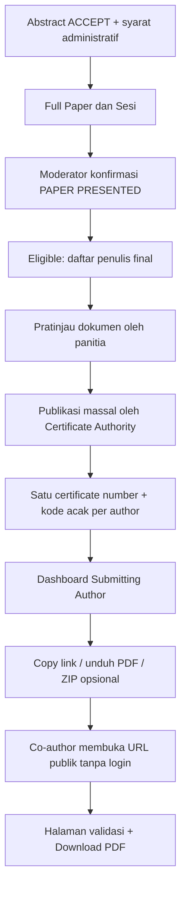

# 06 — Sertifikat Publik, QR Verifikasi, dan Distribusi Co-author

> **Keputusan terbaru DISETUJUI:** semua penulis pada paper **yang benar-benar dipresentasikan** mendapat *Presenter Certificate* individual; penerbitan **massal oleh panitia**; URL unik publik per penerima, bisa unduh PDF tanpa akun; Submitting/Corresponding Author melihat seluruh link penulis di dashboard.

## Makna Presenter Certificate pada kebijakan ICHES

Nama sertifikat tetap *Presenter Certificate* untuk **seluruh author dari paper yang telah dipresentasikan** (bukan hanya actual presenter). Oleh karena itu redaksi isi harus faktual dan tidak mengatakan setiap co-author secara pribadi maju presentasi.

**Redaksi usulan (belum final desain):**
> This certificate is awarded to [Author Name] in recognition of authorship of the paper “[Paper Title]”, which was presented at The 6th ICHES 2027.

Actual Presenter tetap dicatat pada sesi untuk keperluan bukti operasional dan penilaian Best Presenter. Kehadiran QR tiap penulis tetap fakta yang terpisah.

## Alur penerbitan

**Jangan** otomatis mengaktifkan URL ketika Moderator baru menekan Presented. Sertifikat dapat masuk status Eligible/Draft Generated, tetapi menjadi publik **setelah** panitia mengizinkan publikasi.

## Contoh kasus satu paper empat penulis

| Paper | Recipient | Certificate | URL ilustratif |
|---|---|---|---|
| P-001 | Author A | Presenter Certificate A | /c/K7M9Q2X4P8 |
| P-001 | Author B | Presenter Certificate B | /c/R6N3T8B2W5 |
| P-001 | Author C | Presenter Certificate C | /c/P4H8Y2M9C6 |
| P-001 | Author D | Presenter Certificate D | /c/X9D5K3Q7N2 |

Semua kode di atas **fiktif**. Jika Author B juga menjadi penulis pada paper P-002 yang dipresentasikan, ia dapat memiliki sertifikat berbeda untuk P-002. Cegah duplikasi sertifikat aktif untuk pasangan **paper + author + certificate type** yang sama.

## Pengelola distribusi

Pemilik dashboard adalah **Submitting/Corresponding Author yang mengelola paper**, tidak harus First Author. Ia dapat melihat, mengunduh, menyalin URL, dan membagikan dokumen seluruh penulis. Co-author **tidak perlu akun atau Magic Link** untuk membuka sertifikat publiknya. Unduh ZIP semua sertifikat penulis merupakan **opsional** (belum diputuskan wajib).

## Halaman publik

Format URL yang diusulkan: `https://DOMAIN-ICHES/c/KODE-ACAK` (domain final belum ditentukan).

Halaman publik memuat:
- status validitas (valid/revoked/reissued);
- nama penerima;
- tipe sertifikat;
- judul paper jika akademik;
- nama dan tanggal kegiatan;
- kode/nomor sertifikat;
- tombol **Download PDF**, hanya untuk sertifikat Published/Valid.

Tidak menampilkan email, nomor WhatsApp, kontak akun, data pembayaran, tanggal teknis pembuatan, data internal review, maupun QR personal. QR di PDF mengarah ke **QR verifikasi sertifikat**, bukan QR pelayanan pribadi. Gunakan kode yang acak/tidak mudah ditebak, tidak berurutan. Pengaturan `noindex` dapat mengurangi penemuan melalui mesin pencari, tetapi URL tetap bersifat **publik bagi pemilik link**.

## Lifecycle dokumen

| Status | Hak publik |
|---|---|
| Not Eligible | Tidak ada sertifikat |
| Eligible | Belum dapat diunduh |
| Generated / Draft | Pratinjau panitia saja |
| Published / Valid | URL verifikasi dan PDF aktif |
| Revoked | Terlihat tidak valid; bukan sertifikat sah |
| Superseded / Reissued | Versi yang diganti tidak lagi sah; pengganti diterbitkan |

Jika nama/judul salah, panitia membuat koreksi dan **terbit ulang dengan identitas dokumen/versi baru**; tidak menimpa PDF resmi yang sebelumnya telah beredar secara diam-diam.

## Sertifikat lainnya: belum sepenuhnya final

- Participant Certificate: usulan berbasis partisipasi dan kehadiran sesuai aturan Conference.
- Reviewer Certificate: berdasarkan tugas review selesai (baseline lama).
- Moderator Certificate: berdasarkan tugas yang terlaksana (baseline lama).
- MoU Delegate Certificate: **belum diputuskan wajib**.
- ICD Certificate: **belum diputuskan wajib**, syarat Completed jika diaktifkan.
- Best Presenter dan Best Paper: penetapan komite, bukan otomatis dari ranking sistem.
- Manual/ad-hoc certificate: kemampuan yang didokumentasikan pada repo lama, belum otomatis wajib pada MVP baru.

Sumber referensi: [Certificate Governance Baseline lama](https://github.com/akhmadafnan/international-conference-platform/blob/develop/docs/requirements/CERTIFICATE_GOVERNANCE_BASELINE.md). **Konflik diselesaikan oleh keputusan terbaru:** ketentuan lama “Presenter Certificate hanya untuk yang tampil” sudah diganti dengan kelayakan seluruh penulis setelah papernya dipresentasikan.

## Catatan tata kelola

Sertifikat digital dengan QR verifikasi publik **bukan** klaim tanda tangan elektronik tersertifikasi. Tanda tangan pejabat pada template dan kewenangan penerbitan perlu disetujui panitia/pimpinan.
