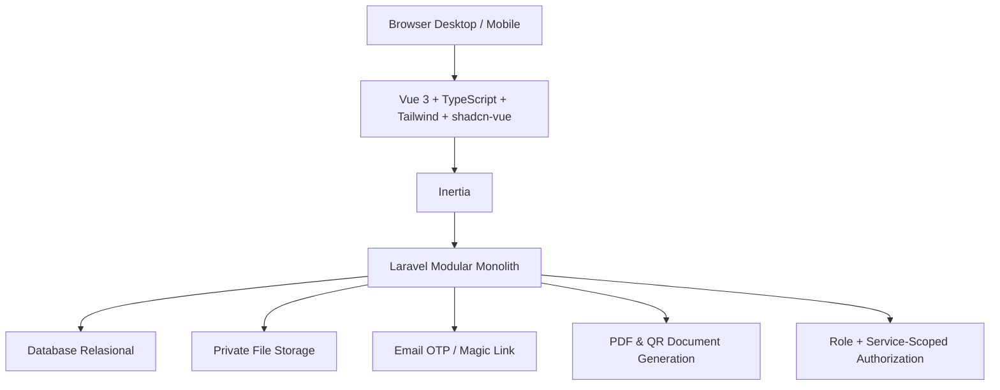
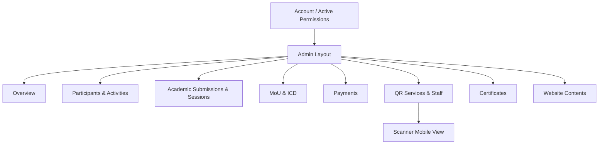

# 07 — Arah UI/UX, Backoffice, dan Arsitektur Teknis

> **Status:** kesepakatan arah stack dan gaya, belum coding. Referensi visual: Shadcn Vue Admin; preset user `b3G0JXXL04` dari shadcn/ui Next.js **hanya inspirasi visual**, bukan kode Vue siap instalasi.

## Prinsip visual disepakati

- **Putih + hijau polos**, tanpa gradient.
- Minimalis, profesional, mudah dioperasikan staf acara.
- Desktop: sidebar sederhana, header, tabel, filter, pencarian, form dan modal.
- HP: mobile-first, navigasi kompak, tombol tindakan besar.
- Status menggunakan teks jelas dan warna seperlunya, bukan bergantung warna saja.
- Jangan membuat dashboard penuh statistik, animasi atau dekorasi tidak relevan.

### Palet usulan (bukan hasil decode preset dan belum dikunci)

| Token | Usulan | Pemakaian |
|---|---|---|
| Primary | #176747 | Tombol aksi utama / aksen |
| White | #FFFFFF | Konten dan permukaan utama |
| Background | #F7F9F7 | Latar halaman |
| Border | #E4EBE6 | Batas tabel/form |
| Text | #172C24 | Teks utama |

Foto, logo, header, dan template visual final mengikuti identitas resmi ICHES/UNISYA.

## Stack teknis yang direkomendasikan

Pilihan ini mempertahankan stack relevan dari [repo lama](https://github.com/akhmadafnan/international-conference-platform/tree/develop), tetapi **tidak mengharuskan meng-copy arsitektur multi-edition**.

Jangan menjalankan `pnpm dlx shadcn@latest init --preset b3G0JXXL04 --template next` di aplikasi Vue; `--template next` untuk React/Next.js. Saat pengembangan diizinkan, pakai komponen shadcn-vue dan terjemahkan pilihan visual preset ke token Vue.

**Arah UI baru:** Reviewer: `Abstract Index → filter topik → Claim → My Reviews`, tanpa tombol PASS screening pada akademik. PIC Co-Host: `Institution Details → 5 Seats (invite/status) → Single Rp3m Institutional Payment`. Ini pola UI sederhana; detail undangan masih usulan. [rancangan 13 — linking Co-Host dan submission tanpa screening](13-LINK-COHOST-DAN-SUBMISSION-TANPA-SCREENING.md).

**Backoffice Co-Host dan publikasi institusi:** satu record institusi berisi PIC, roster maksimal 5 peserta, satu tagihan Conference Rp3 juta, serta status institusi sebagai **Co-Host ICHES 2027**. Daftar nama/logo Co-Host yang sudah dikonfirmasi dapat ditampilkan pada **Public Website** tanpa menambah aplikasi sponsor yang besar. Anggota yang memilih **paket pendamping Rp1 juta per orang** mempunyai pembayaran pribadinya sendiri; Co-Host tidak otomatis mengaktifkan kegiatan pendamping. [Aturan lengkap](14-CAKUPAN-COHOST-DAN-PROGRAM-PENDAMPING.md).

**Pemisahan komponen UI dikunci:** Dashboard Peserta memiliki **satu kartu Paket Program Internasional Rp1 juta** berisi empat program. Menu Co-Host/PIC hanya data institusi, anggota Conference, invoice Rp3 juta, status pengakuan. **Tidak ada add-on Rp1 juta milik anggota pada Co-Host.** Finance dapat melihat pembayaran kedua domain pada rekap keseluruhan sesuai pembayar. [Detail](15-PAKET-INTERNASIONAL-DASHBOARD-PESERTA.md).

## Area UI

| Workspace | Prinsip |
|---|---|
| Public | Hero, informasi konferensi, **daftar institusi Co-Host**, call for papers, agenda, pembicara, venue, sponsor, register, verify certificate |
| Participant | Profil, aktivitas yang diikuti, personal QR, Next Action, dokumen |
| Submitting Author | My Submissions, draft/revisi, LoA, bukti pembayaran, full paper, sertifikat seluruh penulis |
| PIC MoU | Institusi, delegasi usulan, status verifikasi dan undangan |
| Pembinaan Riset/PKM | Agenda pembinaan dan daftar peserta sesuai TOR |
| Studi Destinasi | Rombongan peserta, titik kehadiran dan fasilitas lapangan untuk 6 Januari |
| Reviewer | Abstract Index, filter topik, Claim, My Reviews, penilaian dan komentar |
| Moderator | Daftar sesi/paper, Presented/No Show |
| Finance | Bukti transfer, status verifikasi, koreksi terbatas |
| Coordinator/Admin | CRUD layanan, hak, petugas, penjadwalan, rekap, penerbitan sertifikat |
| Scanner | Kamera besar, pilih pos/mode, detail peserta, tombol konfirmasi layanan |

## Backoffice: navigasi bersyarat sesuai kewenangan

Menu tidak perlu terlihat bila tidak relevan dengan akun. Satu orang boleh memegang beberapa peran tanpa berpindah akun; setiap tindakan tetap dibatasi scope server-side. Koordinator Konsumsi tidak menjadi Koordinator Kit hanya karena memakai perangkat scanner yang sama.

## Rencana batas modul (konseptual, belum struktur folder final)

- Accounts / Profiles / Role authority
- Participations (Conference, ICD, MoU delegate)
- Institutions & MoU
- Research Coaching + Sustainable Destination Study (lightweight activity workflows)
- Academic Submission / Review / Decisions / Scheduling
- Finance / Payment proof
- Operational Services / Entitlements / Fulfillments / Attendance
- Documents / Public Certificates
- Public CMS / Program information

**Tidak perlu:** microservices, sistem multitenant multi-edition, API internal baru yang kompleks, offline scanner sync engine, general legal contract engine, OJS replacement, atau QR hardware khusus tanpa kebutuhan.

## Prinsip teknologi

Server memvalidasi seluruh tindakan sensitif. Upload akademik dan bukti pembayaran privat; informasi verifikasi sertifikat publik hanya yang memang diperlukan. Transaksi klaim layanan harus aman terhadap dua scanner serentak. Kode unik QR jangan menaruh data kontak langsung. Gunakan konfigurasi operasi dan hak per layanan tanpa overengineering.

## Status

Hanya rancangan UI/arsitektur. **Belum** ada komponen, instalasi template, desain final, fitur berjalan, atau deployment pada repo `iches-unisya`.
