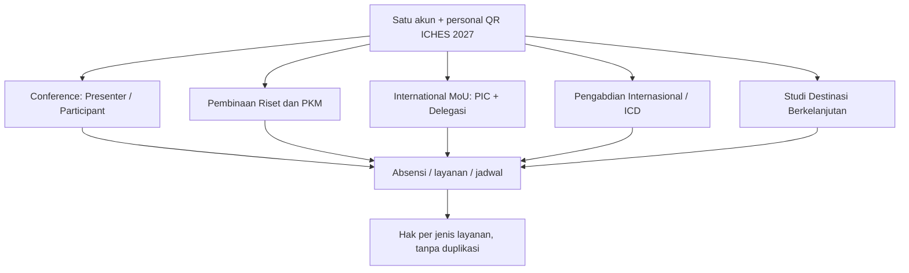

# 10 — Analisis TOR Warek I & Rebaseline Aplikasi ICHES UNISYA 2027

> **SUMBER PRIMER:** Dokumen yang diunggah pemilik proyek: `TOR ICHES 6 UNISYA 2027.docx`, 9 halaman, bagian A–O. Tanggal audit: **26 Oktober 2026**.  
> **PENTING:** dokumen ini merupakan analisis kebutuhan aplikasi **berdasarkan TOR**, bukan keputusan seluruh rincian biaya/fitur yang sudah disahkan untuk implementasi. TOR sumber belum diunggah ke repo publik; hanya kebutuhan relevan yang diringkas. **Tidak ada pengembangan fitur** dalam pembaruan ini.
>
> Gunakan status: **TERCANTUM DI TOR**, **SUDAH DISEPAKATI PRODUK**, **USULAN SISTEM**, atau **PERLU KONFIRMASI PANITIA/WAREK I**.

> **Koreksi terbaru pemilik produk (26 Oktober 2026):** Tarif Co-Host **Rp3.000.000** menggantikan Rp450.000 yang tertulis di TOR; kapasitas **maksimal lima peserta per institusi**; agenda MoU/Pembinaan dan panel boleh paralel **tanpa modul anti-benturan**; reviewer melakukan **self-claim** dari daftar abstrak yang valid disubmit dengan pencarian/filter topik (tidak perlu dibatasi topik pada akun reviewer); Full Paper dibuka **ketika ACCEPT resmi diumumkan kepada submitting author**, bukan dari tanggal tetap. **KEPUTUSAN FINAL Co-Host:** tarif Rp3.000.000 **per institusi**, satu kali tagihan untuk maksimal **lima peserta**. Satuan pembayaran tidak lagi terbuka. Detail cakupan layanan/paper dalam paket Co-Host masih perlu diputuskan. Lihat [Rancangan pembayaran Co-Host](12-PEMBAYARAN-COHOST-PER-INSTITUSI.md). Rincian: [Keputusan operasional terbaru](11-KEPUTUSAN-OPERASIONAL-26-OKT-2026.md).

> **KEPUTUSAN TERBARU:** *Administrative Screening* setelah Submit dihapus. Author wajib lolos validasi form **dan** server; naskah yang resmi Submitted langsung tersedia di Reviewer Abstract Index untuk self-claim. **Co-Host Rp3 juta per institusi/maksimal 5 peserta sudah final**. Mekanisme menghubungkan anggota via PIC + undangan email/Magic Link adalah **rekomendasi desain**, belum keputusan final. Lihat [rancangan 13 — linking Co-Host dan submission tanpa screening](13-LINK-COHOST-DAN-SUBMISSION-TANPA-SCREENING.md).

> **Revisi kebijakan pasca-TOR, 26 Oktober 2026:** Co-Host **Rp3 juta/institusi untuk maksimal lima peserta** **khusus jalur paper International Conference**. Tarif Rp1 juta dalam baris 9 TOR **berlaku per orang** bagi peserta paket program pendamping (MoU + Pembinaan + International PKM + Studi Destinasi). Co-Host memberi pengakuan **institusi sebagai kolaborator penyelenggaraan ICHES 2027**; **tidak otomatis membebaskan biaya program pendamping**. TOR tertulis masih dicatat apa adanya sebagai bukti sumber; perubahan ini berasal dari keputusan pemilik produk sesudah TOR. [Aturan terbaru](14-CAKUPAN-COHOST-DAN-PROGRAM-PENDAMPING.md).

**KEPUTUSAN FINAL BARU (26 Oktober 2026):** **Paket Program Internasional Rp1.000.000/orang adalah SATU produk mandiri yang dipesan dan dibayar lewat Dashboard Peserta sendiri**, bukan di menu Co-Host/PIC. **Satu pembayaran Rp1 juta memberikan empat akses sekaligus**: International MoU; Upgrading Kasubdit Penelitian-PKM Kemenag RI; PKM Internasional; Destinasi Internasional Tumpak Sewu–Teras Semeru. **Bukan Rp1 juta per program.** Co-Host tetap satu invoice Rp3 juta per institusi (maks. 5 orang), tidak bertambah karena anggota mengambil paket sendiri. Akses kegiatan MoU **bukan** otomatis status PIC/delegasi/penandatangan resmi. [Alur dan aturan](15-PAKET-INTERNASIONAL-DASHBOARD-PESERTA.md).

## I. Identitas kegiatan yang harus masuk konfigurasi acara

| Komponen | TOR (halaman) | Status |
|---|---|---|
| Nama | The 6th International Conference on Humanity, Education, and Society (ICHES 2027) | TERCANTUM DI TOR, hal. 1 & 3 |
| Penyelenggara/tempat utama | UNISYA Lumajang | TERCANTUM DI TOR, hal. 1 & 4 |
| Tema | ISLAMIC VALUES IN A CHANGING WORLD: EDUCATION, ACCOUNTABILITY, AND SOCIAL RESILIENCE FOR INCLUSIVE DEVELOPMENT | TERCANTUM DI TOR, hal. 3 |
| Konferensi (hari utama) | **Selasa, 5 Januari 2027** | TERCANTUM DI TOR, hal. 4 |
| Pengabdian + destinasi | **Rabu, 6 Januari 2027** | TERCANTUM DI TOR, hal. 4 |
| Mode konferensi | Hybrid: luring dan daring | TERCANTUM DI TOR, hal. 4 |
| Mode pengabdian/destinasi | Luring penuh | TERCANTUM DI TOR, hal. 4 |
| Lokasi lapangan | Teras Semeru, Desa Sidomulyo, Tumpak Sewu | TERCANTUM DI TOR, hal. 4 & 8 |

Tema dan tanggal merupakan data yang sudah tertulis dalam TOR; tetap sediakan pengaturan Admin jika pimpinan mengubah rundown.

## II. Lima rangkaian kegiatan: bukan lagi hanya tiga

TOR bagian F, hal. 3 **menetapkan lima jenis kegiatan**:

1. International Conference — plenary dan parallel session.
2. **Pembinaan Riset dan PKM** — bersama Subdit Penelitian dan PKM Kemenag RI.
3. **Penandatanganan International MoU** — kemitraan perguruan tinggi.
4. **Pengabdian Internasional** — dengan kampus mitra dan masyarakat lokal.
5. **Studi Internasional Destinasi Berkelanjutan** — kawasan Teras Semeru dan Tumpak Sewu.

### Peta aplikasinya

**Penting:** lima program tidak otomatis berarti lima **tagihan terpisah**. Aktivitas yang dapat diikuti independen tetap dapat didanai oleh **paket harga/bundle** sebagaimana TOR. Pisahkan entitas **activity enrollment**, **package/fee**, **service entitlement**, dan **attendance**.

**Dampak terhadap rancangan sebelumnya:** dua program yang sempat dianggap tambahan opsional, yaitu Pembinaan Riset/PKM dan Sustainable Destination Study, kini **berbasis TOR masuk lingkup acara**. Detail pendaftaran, kapasitas, dan tarif tersendiri belum dijelaskan.

## III. Delapan subtema untuk konfigurasi Conference Track

Dari TOR hal. 3:
1. Islamic Studies, Ethics, and Contemporary Civilization
2. Education, Pedagogy, and Human Development
3. Leadership, Governance, and Institutional Accountability
4. Economics, Sustainable Business, and Inclusive Development
5. Law, Human Rights, Social Justice, and Public Policy
6. Social Sciences, Humanities, Culture, and Community Resilience
7. Digital Transformation, Responsible Innovation, and Society
8. Environmental Sustainability, and Human Well-Being

**Aplikasi:** jadikan daftar delapan track ini sebagai data yang dapat diedit panitia; harus dapat dipilih ketika abstract submission. TOR tidak menyatakan batas kata, jumlah keywords, ukuran PDF atau default reviewer; ketentuan tersebut **tetap terbuka**, kecuali keputusan pemilik produk sebelumnya bahwa abstract text + **PDF saja** wajib.

## IV. Important Dates — konfigurasi awal dari TOR

| Tahap | Jadwal tertulis TOR | Implikasi aplikasi |
|---|---|---|
| Abstract submission | **1–20 Desember 2026** | Window formulir abstrak |
| Pengumuman abstrak diterima | **22 Desember 2026** | Target pengumuman TOR, bukan hambatan untuk review bergulir |
| Full Paper | **23–28 Desember 2026** | **Jadwal TOR**; akses aplikasi dibuka saat ACCEPT diumumkan |
| Registrasi / pembayaran | **24–28 Desember 2026** | Window tagihan dan verifikasi keuangan |
| Konferensi | **5 Januari 2027** | Plenary, panel, MoU, pembinaan |
| Pengabdian dan destinasi | **6 Januari 2027** | Rombongan onsite dan check-in lokasi |
| Prosiding | **28 Januari 2027** | Target *publication handoff/monitoring*, bukan otomatis terbit di ICHES |
| Jurnal | Mengikuti jurnal tujuan | Tidak menjanjikan tanggal terbit di platform |

**DIPUTUSKAN SETELAH TOR:** Meski TOR menulis Full Paper 23–28 Desember dan pembayaran 24–28 Desember, akses unggah Full Paper **dibuka saat keputusan final ACCEPT sudah diumumkan kepada submitting author**, **bukan** berdasarkan tanggal hard gate atau pembayaran VERIFIED. Setelah ACCEPT, pembayaran dapat berjalan paralel. Tanggal TOR tetap disimpan sebagai target/milestone dan dapat dikomunikasikan panitia.

**RESPONS PRODUK UNTUK JADWAL SINGKAT:** Sejak abstrak masuk 1 Desember dan **valid disubmit**, paper tampil pada **Reviewer Abstract Index**. Reviewer mencari/filter sesuai topic/track dan **claim mandiri**; tanpa pemetaan hak akun ke topik tertentu. Review berjalan **bergulir**, tidak menunggu 20 Desember atau deadline per reviewer. Koordinator memantau indeks paper yang belum diklaim dan dapat membebaskan claim yang tertunda; keputusan final Academic Authority dan publikasi hasil tetap diperlukan. Target pengumuman 22 Desember pada TOR tetap milestone penyelenggaraan.

## V. Biaya dan kategori peserta persis dari TOR (hal. 5)

| No | Kategori TOR | Mode TOR | Biaya TOR |
|---|---|---|---|
| 1 | Pemakalah Reguler (Nasional) | Luring / onsite | **IDR 500.000** |
| 2 | Pemakalah Reguler (Internasional) | Luring / onsite | **USD 40** |
| 3 | Pemakalah Daring (Nasional) | Daring / online | **IDR 250.000** |
| 4 | Pemakalah Daring (Internasional) | Daring / online | **USD 20** |
| 5 | Peserta (Nasional) | Non-pemakalah, luring / onsite | **IDR 150.000** |
| 6 | Peserta (Internasional) | Non-pemakalah, daring / online | **USD 10** |
| 7 | Peserta Mahasiswa | Non-pemakalah, luring / daring | **IDR 100.000** |
| 8 | Peserta Institusi Co-Host | Pemakalah & peserta, luring / daring | **IDR 450.000 (angka asli dalam TOR; DIKOREKSI pengguna menjadi Rp3.000.000)** |
| 9 | MoU + Upgrading Kemenag + PKM Internasional + Destinasi Internasional | Peserta, luring / onsite | **IDR 1.000.000** |

TOR bagian J juga mengelompokkan peserta: Reguler; delegasi PTKIS Tapal Kuda; Institusi Co-Host dengan keterangan **maksimal 5 peserta** (hal. 5). **Pengguna telah memperjelas: batas lima peserta berlaku PER INSTITUSI.**

**KOREKSI NOMINAL SETELAH TOR:** tarif Co-Host **Rp3.000.000**, bukan Rp450.000 yang masih tampak dalam naskah TOR. Simpan Rp450.000 hanya sebagai bukti bunyi dokumen asal; **jangan gunakan untuk menghitung tagihan sistem ICHES baru**. **KEPUTUSAN TERBARU: Rp3 juta adalah tarif per institusi, satu tagihan mencakup maksimal lima peserta.**

**Jangan mengasumsikan hal yang tidak dinyatakan TOR:**
- **TERJAWAB:** batas Co-Host maksimal **5 peserta PER INSTITUSI**.
- **TERJAWAB FINAL:** Co-Host **Rp3.000.000 PER INSTITUSI** mencakup maksimal lima peserta, menggantikan Rp450.000 dalam TOR. **Tidak ada biaya Co-Host Rp3 juta per peserta.**
- **TERJAWAB:** tarif bundle program MoU + Pembinaan + International PKM + Studi Destinasi **Rp1.000.000 PER ORANG**, terpisah dari Co-Host Conference. Fasilitas detail (transport, akomodasi, dll.) belum dinyatakan.
- Apakah delegasi PTKIS Tapal Kuda memiliki diskon atau harga khusus? **Tidak ada tabel tarif khusus Tapal Kuda** dalam TOR.
- Bagaimana peserta nasional yang ingin *participant-only online*, peserta internasional non-pemakalah onsite, atau mahasiswa internasional ditagih? Tidak ada kategori eksplisit untuk beberapa kombinasi.
- **TERJAWAB untuk Co-Host:** keikutsertaan Co-Host dalam Conference dibiayai Rp3 juta/institusi, sedangkan tiap orang dari institusi itu yang ikut paket pendamping **membayar Rp1 juta tambahan secara individual**. Harga di luar kombinasi ini dan paket program sebagian tetap memerlukan kebijakan.
- **Biaya yang dibebankan sebelum ACCEPT bagi Presenter tetap tidak boleh terjadi** menurut keputusan produk; window TOR 24–28 Desember mendukung aturan itu.

**Model sistem yang direkomendasikan:** Admin mengonfigurasi kategori fee + mode onsite/online + mata uang, eligibility rules, opsi bundle, dan kewajiban pembayarannya. Setiap pembebanan biaya menyimpan snapshot kategori, nominal, mata uang, dan tujuan transfer. Tidak perlu mesin konversi USD otomatis tanpa kebijakan finansial; transfer manual dan verifikasi Finance tetap dapat dipakai.

## VI. Jadwal pelaksanaan dan implikasi operasional

### 5 Januari — pembukaan dan plenary

- Registrasi dan penyambutan: **08.00–08.45**.
- Pembukaan dilanjutkan plenary, dengan susunan sambutan dan tiga keynote; plenary tercatat berlangsung **10.28–12.33**.
- TOR juga mencantumkan pemberian hadiah *International Competition* pada pembukaan; **belum cukup alasan** untuk membangun modul kompetisi lengkap. Cukup masukkan agenda/hasil penghargaan jika panitia benar-benar memerlukan.

**Kebutuhan aplikasi:** jadwal yang dapat dipublikasikan, penanda acara plenary, informasi narasumber dan moderator, registrasi QR pagi, rekap kehadiran, dan pengaturan slot konsumsi riil.

### 5 Januari — dua agenda sore yang bertabrakan

| Agenda TOR | Jam |
|---|---|
| MoU + Pembinaan Kemenag | **13.00–17.15** (registrasi di awal; upgrading 15.15–16.30) |
| Parallel Panel | **13.15–16.30+** (presentasi 13.40–15.40; catatan reviewer 16.15–16.30) |

**KEPUTUSAN BARU — CUKUP SEDERHANA:** MoU/Pembinaan dan Panel boleh berjalan paralel. Kita **tidak membangun engine konflik jadwal** atau sistem pengalihan peserta otomatis. Kehadiran tetap dicatat **menurut kegiatan** jika diperlukan, sedangkan Moderator mengonfirmasi status Presented pada paper. Perubahan jadwal atau orang yang hadir, jika memang perlu, dilakukan panitia melalui CRUD/penjadwalan biasa.

Detail TOR MoU pukul **13.00–13.30** memiliki kolom kegiatan kosong (PIC Sie Registrasi), jadi sebut **slot registrasi/penyambutan sementara**, belum mengklaim deskripsi final. TOR menulis format waktu tidak seragam pada beberapa baris; normalisasi jam diperlukan sebelum input sebagai jadwal aplikasi.

### 6 Januari — Pengabdian dan Destinasi (seluruhnya onsite)

| Jam dari TOR | Kegiatan |
|---|---|
| 03.00–04.30 | Berangkat dari Lumajang |
| 04.30 | Tiba di Teras Semeru |
| 04.30–06.00 | Eksplorasi/pemandangan Semeru |
| 06.00–07.00 | Sarapan di rumah warga |
| 07.00–07.30 | Pembukaan dan pembagian kelompok PKM (Pendidikan, Ekonomi, Sosial Budaya) |
| 07.30–08.00 | Perjalanan ke Desa Sidomulyo |
| 08.00–11.30 | Pengabdian per kelompok |
| 11.30–12.30 | Perjalanan ke Tumpak Sewu |
| 12.30–13.30 | Makan siang |
| 13.30–15.00 | Kegiatan di Tumpak Sewu |
| 15.00–15.30 | Closing |

Kebutuhan sistem yang relevan **tanpa overengineering**:
- manifest peserta luring dan pembagian kelompok PKM;
- penugasan PIC kelompok/pendamping, informasi kendaraan/rombongan **hanya jika panitia membutuhkannya**;
- check-in keberangkatan/awal kegiatan dan titik yang disepakati;
- hak sarapan serta lunch pada **slot berbeda**;
- rekap siapa terdaftar, hadir dan berpartisipasi;
- catatan status kegiatan/Completed untuk laporan bila dipersyaratkan.
- **Mitigasi konektivitas lapangan:** data daftar peserta yang dibawa petugas dan prosedur pencatatan manual terbatas; jangan mengklaim QR online akan selalu bekerja di seluruh titik.

## VII. Luaran resmi TOR harus terhubung ke laporan kegiatan

TOR bagian G, hal. 3–4 menargetkan:
1. Prosiding konferensi internasional (ISBN/ISSN).
2. Artikel terpilih untuk jurnal nasional/internasional.
3. Rekomendasi kebijakan dan resolusi konferensi.
4. Penguatan jaringan kolaborasi akademik (MoU).
5. Dokumentasi serta dampak Pengabdian Internasional.
6. Laporan kegiatan kolaborasi internasional.

**Aplikasi tidak harus mengerjakan semuanya secara otomatis.** Sarankan dokumen hasil/proceedings links/status publication handoff, rekap MoU per institusi, bukti kegiatan lapangan minimum, dan ekspor ringkasan CSV/PDF untuk laporan panitia. Penerbitan jurnal tetap urusan penerbit/OJS.

## VIII. Matriks perubahan terhadap dokumentasi pra-TOR

| Rancangan sebelumnya | Bukti TOR | Penyesuaian |
|---|---|---|
| 3 jalur utama dan 2 opsional | Lima rangkaian acara bagian F | **PROMOTE** Pembinaan Riset/PKM dan Studi Destinasi menjadi cakupan acara |
| Tanggal/kegiatan sebagai contoh | Important Dates lengkap bagian K | **SET** tanggal sebagai milestone TOR, bukan hard gate Full Paper |
| Tipe biaya belum jelas | 9 baris fee bagian L | **Co-Host: Rp3 juta per institusi (maks. 5 peserta) FINAL**, kategori lain dan paket gabungan perlu parameter/validasi |
| Semua memilih keikutsertaan independen | Bundle MoU + Pembinaan + PKM + Destinasi | **KEEP** enrollment terpisah; **ADD** bundle pricing sehingga tidak memalsukan registrasi |
| Full paper mengikuti pembayaran | Full Paper 23 Des, pembayaran 24 Des | **OVERRIDE** upload unlock setelah ACCEPT diumumkan; pembayaran tetap paralel |
| Absensi konseptual | Registrasi, plenary, MoU, panel, dan field visits ada jamnya | **SCOPE** station/slot dan bukti hadir per kegiatan |
| Jadwal hanya akademik | Dua rangkaian sore beririsan | **KEEP SIMPLE** agenda paralel diperbolehkan, tanpa conflict optimizer |
| ICD generik | PKM per kelompok Pendidikan/Ekonomi/Sosial Budaya | **ADD** group allocation sederhana |
| Studi destinasi belum wajib | Hari 2 penuh onsite | **ADD** manifest dan checkpoint lapangan |
| Output hanya sertifikat/paper | 6 outputs pada bagian G | **ADD** ringkasan pelaporan, arsip tautan hasil |

## IX. Keputusan krusial yang perlu dibawa ke Warek I

1. **Co-Host FINAL:** Rp3.000.000 **per institusi, maks. lima orang, khusus paper Conference**. **Paket pendamping Rp1.000.000/orang** terpisah. **Yang terbuka:** jumlah paper Co-Host, dan biaya jika hanya sebagian paket pendamping.
2. **Co-Host maksimal 5:** **TERJAWAB — per institusi**.
3. **Agenda paralel 5 Januari:** **TERJAWAB — boleh bersamaan, tak perlu fitur anti-benturan khusus**.
4. **Reviewer/timeline:** **Alur TERJAWAB — reviewer self-claim dari index filter topic setelah validasi Submit**. Jumlah reviewer dan aturan revisi detail tetap terbuka.
5. **Full Paper:** **TERJAWAB — unlock saat ACCEPT diumumkan, bukan berdasarkan tanggal atau Finance Verified**.
6. **Peserta Day 2:** pendaftaran mandiri/bundle, kuota, transport, pembagian kelompok, titik check-in, fasilitas.
7. **Output & sertifikat non-akademik:** sertifikat Pembinaan, MoU, PKM, Studi Destinasi dan syarat kelayakannya.
8. **Kategori tarif yang belum tercakup:** peserta internasional onsite non-pemakalah, nasional online non-pemakalah, dll.
9. **Rundown yang belum rapi:** sesi MoU 13.00–13.30 tanpa nama kegiatan; beberapa waktu tidak seragam; satu atau dua sesi dapat bertabrakan.

## X. Prioritas MVP berdasarkan tanggal acara

**Gelombang 1 — sebelum 1 Desember:** website/CfP, akun/email, profil, jalur partisipasi, 8 tracks, abstract online + PDF, konfigurasi fee awal dan important dates.

**Gelombang 2 — selama periode 1–28 Desember:** validasi form dan server dilakukan saat Submit, reviewer claim bergulir segera setelah tiap paper valid disubmit, kemudian keputusan akademik/LoA; Full Paper unlock saat ACCEPT diumumkan dan tagihan/pembayaran setelah ACCEPT; delegasi, jadwal, pos, entitlement.

**Gelombang 3 — sebelum 5 Januari:** scan personal QR, registrasi on-site, slot konsumsi/kit, check-in khusus MoU, moderator dan sesi parallel, manifest dan kelompok Day 2.

**Gelombang 4 — pascaacara:** validasi Presented, penilaian lanjutan / publication handoff, publikasi sertifikat massal serta arsip laporan/output.

Ini **urutan yang direkomendasikan**, bukan janji tenggat pengembangan. Penentuan GO pembangunan dan pengujian tetap diputuskan pemilik proyek.

## XI. Aturan sumber kebenaran

- TOR memberi **fakta acara dan arah penyelenggaraan**, bukan otomatis spesifikasi semua fitur aplikasi.
- Keputusan eksplisit pemilik produk untuk mekanisme aplikasi yang **tidak bertentangan TOR** tetap berlaku.
- Bila sebuah keputusan aplikasi bertentangan dengan tanggal/biaya/rangkaian TOR, dokumentasikan konfliknya dan minta keputusan panitia/WAREK I; **jangan diam-diam memilih aturan baru**.
- Kontrak metadata dan fondasi review dari [repo lama](https://github.com/akhmadafnan/international-conference-platform/tree/develop) dapat digunakan ketika TOR tidak membahasnya.
- Semua pengembangan tetap **belum dimulai**; dokumentasi ini adalah bahan harmonisasi kebijakan dan presentasi.
