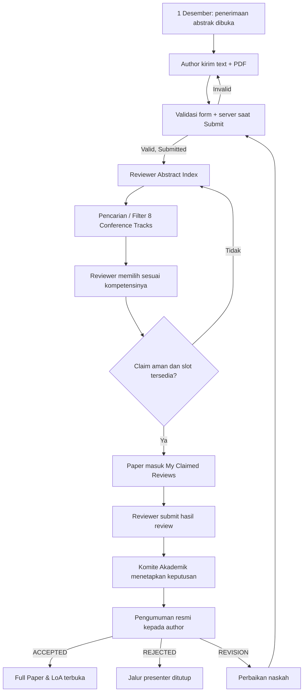
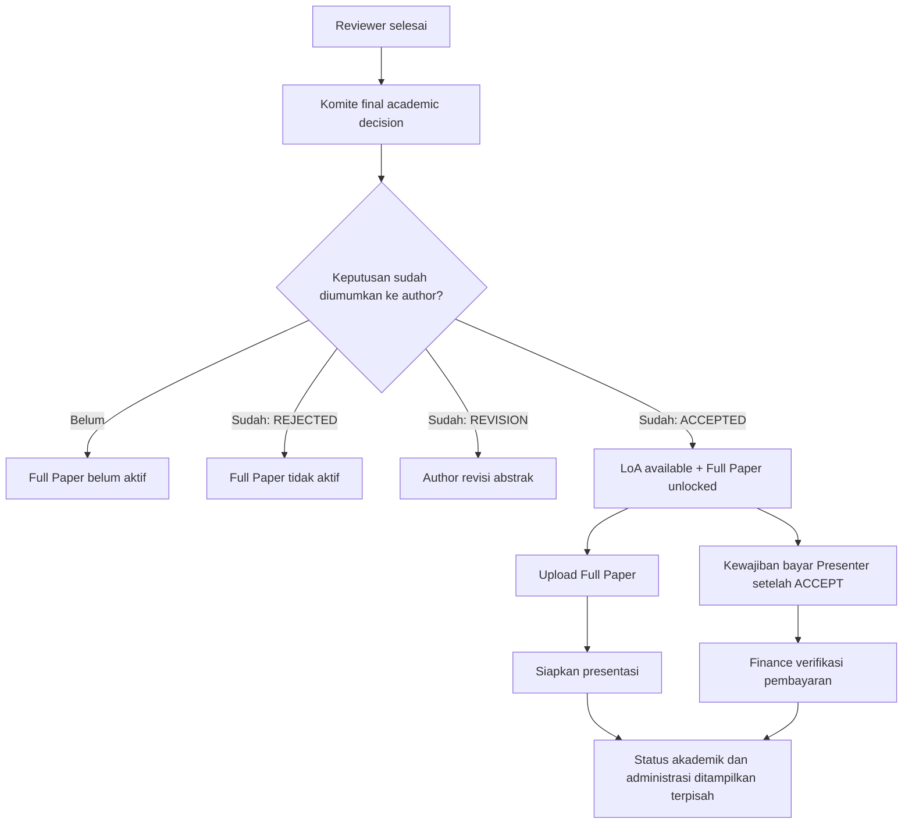
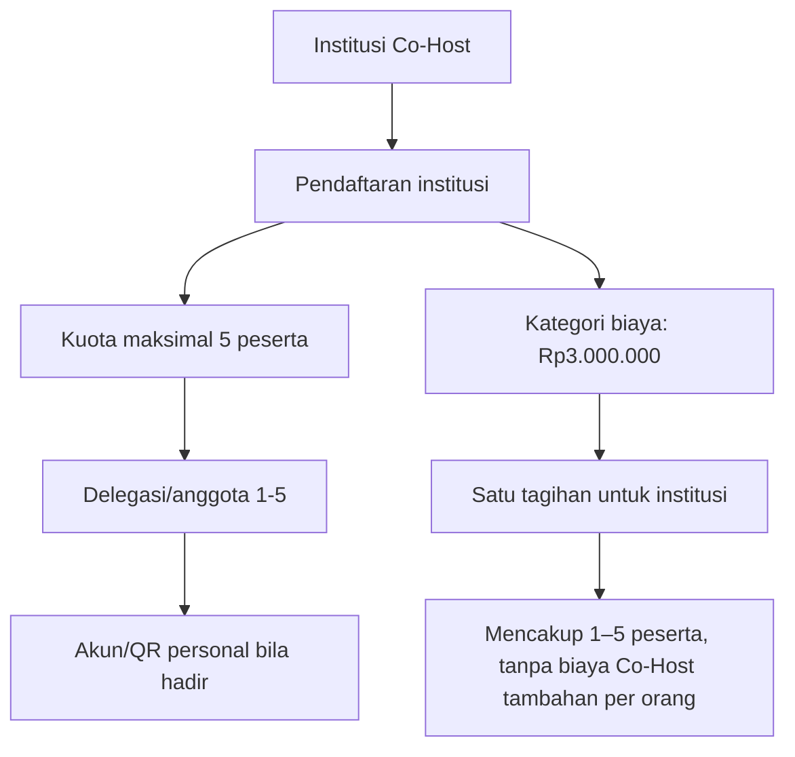

# 11 — Keputusan Terbaru: Co-Host, Reviewer Self-Claim, Full Paper

> **Untuk penjelasan kepada Warek I · 26 Oktober 2026**  
> **Status:** kebijakan produk yang baru dipilih langsung oleh pemilik produk; sumber acara: TOR ICHES 6 UNISYA 2027. Belum menjadi aplikasi operasional, belum dilakukan coding.
>
> [Kembali ke presentasi besar](00-PRESENTASI-WAREK-I.md) · [Audit TOR](10-ANALISIS-TOR-DAN-REBASELINE-2027.md) · [Register keputusan](09-KEPUTUSAN-DAN-ISU-TERBUKA.md).

> **KEPUTUSAN TERBARU:** *Administrative Screening* setelah Submit dihapus. Author wajib lolos validasi form **dan** server; naskah yang resmi Submitted langsung tersedia di Reviewer Abstract Index untuk self-claim. **Co-Host Rp3 juta per institusi/maksimal 5 peserta sudah final**. Mekanisme menghubungkan anggota via PIC + undangan email/Magic Link adalah **rekomendasi desain**, belum keputusan final. Lihat [rancangan 13 — linking Co-Host dan submission tanpa screening](13-LINK-COHOST-DAN-SUBMISSION-TANPA-SCREENING.md).

> **KEPUTUSAN PEMILIK PRODUK TERBARU (26 Oktober 2026):** **Co-Host Rp3.000.000 SEKALI PER INSTITUSI (maksimal 5 orang)** berlaku **hanya untuk jalur paper International Conference**. Paket **MoU + Pembinaan Riset/PKM + Pengabdian Internasional + Studi Destinasi** yang tercantum di TOR adalah **Rp1.000.000 PER ORANG** dan dibayar terpisah oleh orang yang ikut program pendamping, termasuk anggota Co-Host. Institusi Co-Host memperoleh **pengakuan publik sebagai institusi yang turut menyelenggarakan/berkolaborasi dalam ICHES 2027**. Jumlah paper dalam paket Rp3 juta dan rincian media/format pengakuan institusi belum diputuskan. **Jangan menyimpulkan Co-Host otomatis menjadi delegasi MoU atau peserta program pendamping.** Baca [14 — Cakupan Co-Host dan Paket Program Pendamping](14-CAKUPAN-COHOST-DAN-PROGRAM-PENDAMPING.md).

**KEPUTUSAN FINAL BARU (26 Oktober 2026):** **Paket Program Internasional Rp1.000.000/orang adalah SATU produk mandiri yang dipesan dan dibayar lewat Dashboard Peserta sendiri**, bukan di menu Co-Host/PIC. **Satu pembayaran Rp1 juta memberikan empat akses sekaligus**: International MoU; Upgrading Kasubdit Penelitian-PKM Kemenag RI; PKM Internasional; Destinasi Internasional Tumpak Sewu–Teras Semeru. **Bukan Rp1 juta per program.** Co-Host tetap satu invoice Rp3 juta per institusi (maks. 5 orang), tidak bertambah karena anggota mengambil paket sendiri. Akses kegiatan MoU **bukan** otomatis status PIC/delegasi/penandatangan resmi. [Alur dan aturan](15-PAKET-INTERNASIONAL-DASHBOARD-PESERTA.md).

## 1. Lima keputusan yang sudah ditegaskan

| No | Pokok | Keputusan |
|---|---|---|
| 1 | Tarif Co-Host | **Rp3.000.000 per institusi untuk maksimal 5 peserta**, bukan Rp450.000 pada TOR atau Rp3 juta per peserta |
| 2 | Kuota Co-Host | **Maksimal lima peserta PER INSTITUSI**, bukan lima peserta seluruh acara |
| 3 | MoU/Pembinaan dan Parallel Panel | Jadwal boleh **beririsan**, tidak butuh mekanisme penanganan benturan otomatis |
| 4 | Reviewer | Reviewer berwenang dapat **mencari/filter abstract berdasarkan track** dan **Claim** sendiri tanpa menjadi anggota wajib track tertentu |
| 5 | Full Paper | Terbuka **bila keputusan final ACCEPT sudah DIUMUMKAN kepada Submitting Author**; tidak memakai tanggal sebagai gate upload |

**KEPUTUSAN FINAL TAMBAHAN:** biaya Co-Host **Rp3.000.000 dibayar sekali per institusi**, mencakup maksimal **lima peserta**, bukan tarif per orang. Perhitungan Co-Host pada sistem harus menghasilkan **satu tagihan institusi**. **Cakupan paket sudah dipersempit: khusus paper International Conference.** Kewajiban Rp1 juta/orang untuk paket program pendamping terpisah, sedangkan **jumlah paper** yang termasuk Co-Host masih perlu keputusan.

## 2. Visual: alur reviewer aktif, bukan menunggu akhir submission

### Tampilan Reviewer Abstract Index yang konkret

| Paper | Conference Track | Status | Tindakan |
|---|---|---|---|
| ICHES27-001 — Digital Literacy ... | Digital Transformation ... | Available | **Claim** |
| ICHES27-002 — Community Resilience ... | Social Sciences ... | Available | **Claim** |
| ICHES27-003 — Education Innovation ... | Education, Pedagogy ... | Claimed | Lihat status |

Tabel contoh di atas berisi **data fiktif**, bukan pendaftar nyata.

- Semua reviewer yang sudah **memiliki peran Reviewer** dapat melihat paper **valid disubmit** yang tersedia. **Tidak ada konfigurasi batas Reviewer A hanya Topik 1 / Reviewer B hanya Topik 2.**
- Search: judul, kode paper; filter: daftar delapan subtema TOR. Reviewer memilih sesuai keahliannya.
- **Claim sekali secara atomik**, cegah slot diambil dua reviewer melebihi kuota; blokir reviewer mengklaim paper sendiri atau konflik langsung yang diketahui. Jumlah slot mengikuti konfigurasi jumlah reviewer per paper.
- Setelah Claim, paper tampil dalam **My Reviews**. Koordinator Akademik tetap bisa melepas/reassign klaim yang macet. **Tidak perlu deadline wajib per reviewer, SLA otomatis, atau engine reminder yang rumit.**
- **Reviewer bukan pengambil keputusan final**; penilaian diberikan kepada Komite Akademik untuk keputusan dan publikasi kepada author.
- TOR memuat tanggal pengumuman **22 Desember 2026**. Tanggal ini tetap **milestone acara**, bukan alasan menahan abstract sampai akhir masa kirim 20 Desember. Review dimulai bergulir sejak submission pertama yang valid disubmit.

**Yang masih terbuka:** jumlah reviewer default operasional ICHES (baseline repo lama **1, configurable**), penanganan klaim tidak dikerjakan (cukup tindakan manual koordinator), standar rubrik dan jumlah revisi. Jangan mengunci '2 reviewer wajib' tanpa keputusan baru.

## 3. Visual: Full Paper menggunakan pemicu status, bukan kalender

**Poin penting:**
- Reviewer menyatakan Accept sebagai **rekomendasi** belum membuka Full Paper.
- Komite menyimpan final Accept secara internal **belum cukup** jika keputusan belum dipublikasikan ke author.
- Saat final ACCEPT **resmi diumumkan**, sistem mengaktifkan Full Paper pada paper itu dan menyediakan LoA.
- Jika REJECTED atau REVISION REQUIRED, Full Paper tidak aktif.
- **Finance VERIFIED bukan prasyarat mengunggah Full Paper**. Pembayaran tetap diwajibkan/ditangani setelah ACCEPT menurut kategori tarif dan aturan Finance.
- TOR menulis target Full Paper **23–28 Desember**, pembayaran **24–28 Desember**, pengumuman **22 Desember**. Ini tetap boleh ditampilkan sebagai *Important Dates*, namun tanggal **23 Desember tidak menjadi validasi pembuka akses upload**.
- Detail apakah akan ada batas akhir unggah yang keras (*closing deadline*) masih perlu diputuskan; keputusan terbaru hanya menyangkut **pemicu pembukaan**.

## 4. Co-Host: dua entitas yang harus dibedakan

- **Quota rule sudah final:** maksimal 5 orang untuk **setiap** institusi Co-Host.
- **Price value sudah final dalam rancangan baru:** Rp3.000.000.
- **Price unit FINAL:** Rp3.000.000 **per institusi**, satu tagihan mencakup hingga lima peserta. Jangan membuat invoice per peserta Co-Host.
- Catat sumber historis Rp450.000 pada TOR halaman 5 sebagai teks yang dikoreksi pemilik produk. **Jangan gunakan** Rp450.000 untuk perhitungan tagihan baru.
- Paket MoU + Pembinaan + PKM + Destinasi **Rp1.000.000** pada TOR **tidak dikoreksi** dalam diskusi ini.

## 5. Agenda sore 5 Januari: cukup satu prinsip

MoU/Pembinaan dan Parallel Panel memang berjalan pada jam beririsan di TOR. **Tidak perlu modul konflik jadwal, mesin pencarian pengganti, atau pop-up kompleks**. Cukup agenda yang ditampilkan dengan benar, dan petugas mencatat kehadiran pada sesi masing-masing bila perlu. Status "paper Presented" **hanya** berdasarkan konfirmasi Moderator, bukan otomatis karena check-in umum ataupun kehadiran MoU.

## 6. Peta prioritas dan efek ke modul aplikasi

| Modul | Perubahan paling relevan |
|---|---|
| Backoffice Finance | Satu tagihan **Rp3 juta per institusi Co-Host** dengan daftar maksimum lima peserta; verifikasi pembayaran satu kali |
| Institusi/Co-Host | Batas 5 orang **per institusi**, tidak global |
| Reviewer UI | Menu **Abstract Index**, **My Claimed Reviews**, filter track, tombol Claim |
| Academic Backoffice | Monitor unclaimed/claimed, release claim, final decision, **Publish Decision** |
| Submitting Author Dashboard | Hasil ACCEPT diumumkan → tampil LoA dan **Upload Full Paper** |
| Jadwal/QR | Agenda paralel diterima; hanya kehadiran/status presenter yang dicatat terpisah |
| Product Documentation | Catat bahwa TOR masih menulis Rp450 ribu dan jadwal Full Paper berbasis tanggal; **produk terbaru** menggantikan kedua hal tersebut |

## 7. Satu pertanyaan yang belum perlu menghambat pembahasan

**Keputusan sudah dijawab dan ditutup:** Rp3.000.000 **ditagihkan satu kali kepada tiap institusi Co-Host**, mencakup maksimal lima peserta. **Sudah diputuskan paket Rp3 juta hanya untuk paper International Conference** dan **paket pendamping Rp1 juta/orang terpisah**. Yang belum diputuskan adalah jumlah paper dan detail pengakuan institusi. Lihat [Rancangan pembayaran Co-Host](12-PEMBAYARAN-COHOST-PER-INSTITUSI.md).

**Status:** perancangan produk saja; dokumen/diagram GitHub dapat dipresentasikan. Belum coding, belum deployment dan belum ada migrasi database.
