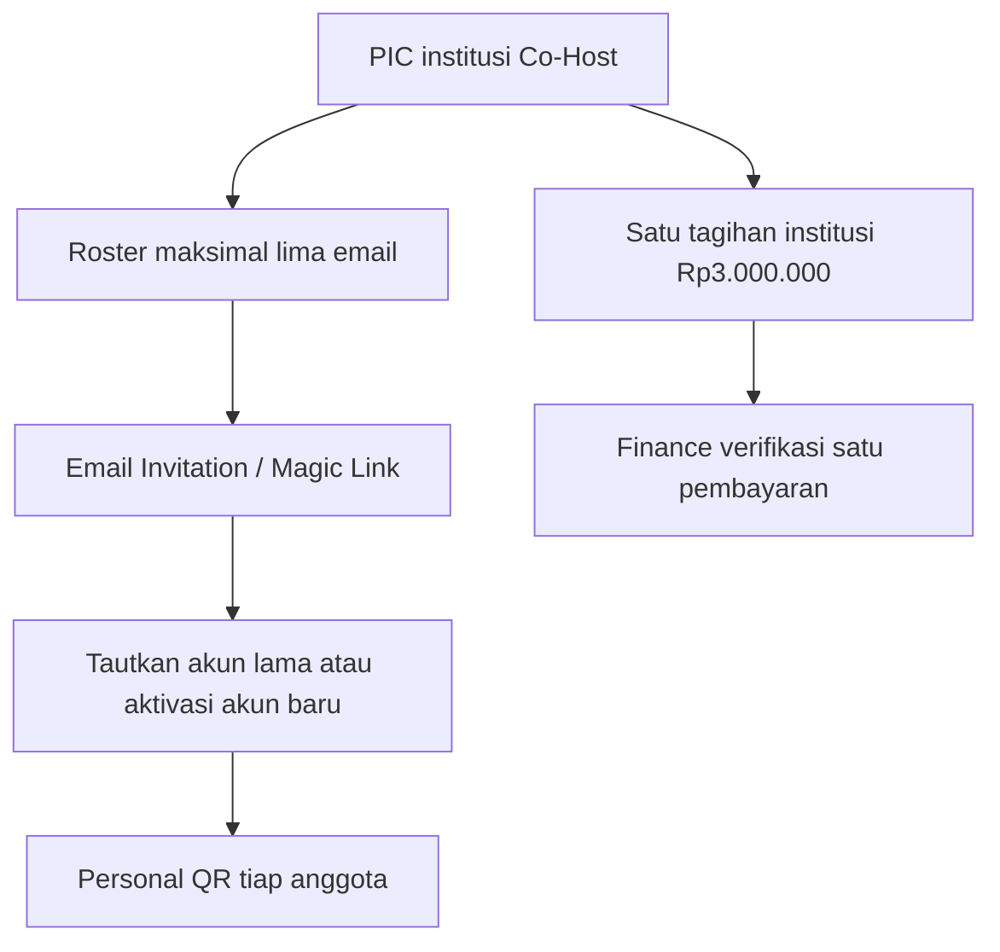
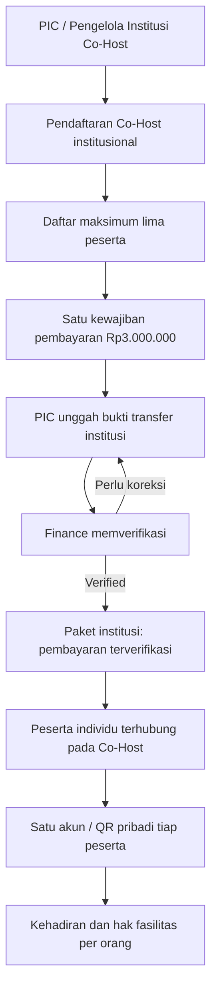

# 12 — Kebijakan Pembayaran Co-Host (Per Institusi)

> **KEPUTUSAN FINAL 27 OKTOBER 2026:** Co-Host **Rp3.000.000/institusi = lima perwakilan + lima paper International Conference**, masing-masing perwakilan submit **satu paper sendiri melalui akun masing-masing**. **Deadline Paket Program Internasional Rp1 juta dibuat CRUD pada Admin**, sehingga tanggal/jam dapat diubah sewaktu diperlukan. **International Conference, MoU, Upgrading, PKM, Destinasi, serta seluruh pengaturan operasional dan website dikelola lewat Backoffice Admin**; bukan tanggal/nilai hardcoded. Reviewer/Finance/Moderator tetap melaksanakan perannya. [Paper Co-Host](16-COHOST-LIMA-PAPER-PERWAKILAN.md) · [Matriks Admin CRUD](17-ADMIN-CRUD-DAN-PENGATURAN-ACARA.md).

> **KEPUTUSAN PEMILIK PRODUK — 26 Oktober 2026**  
> Tarif **Co-Host Rp3.000.000 PER INSTITUSI**, mencakup maksimal **LIMA PESERTA** pada ICHES UNISYA 2027. Ini mengoreksi **Rp450.000** dalam tabel biaya TOR (hal. 5). **Bukan** Rp3 juta per peserta.  
> **Status:** spesifikasi bisnis/dokumen presentasi; **belum coding, belum invoice nyata**.  
> [Kembali ke Presentasi Warek I](00-PRESENTASI-WAREK-I.md) · [Register keputusan](09-KEPUTUSAN-DAN-ISU-TERBUKA.md) · [Audit TOR](10-ANALISIS-TOR-DAN-REBASELINE-2027.md).

> **KEPUTUSAN PEMILIK PRODUK TERBARU (26 Oktober 2026):** **Co-Host Rp3.000.000 SEKALI PER INSTITUSI (maksimal 5 orang)** berlaku **hanya untuk jalur paper International Conference**. Paket **MoU + Pembinaan Riset/PKM + Pengabdian Internasional + Studi Destinasi** yang tercantum di TOR adalah **Rp1.000.000 PER ORANG** dan dibayar terpisah oleh orang yang ikut program pendamping, termasuk anggota Co-Host. Institusi Co-Host memperoleh **pengakuan publik sebagai institusi yang turut menyelenggarakan/berkolaborasi dalam ICHES 2027**. Jumlah paper dalam paket Rp3 juta dan rincian media/format pengakuan institusi belum diputuskan. **Jangan menyimpulkan Co-Host otomatis menjadi delegasi MoU atau peserta program pendamping.** Baca [14 — Cakupan Co-Host dan Paket Program Pendamping](14-CAKUPAN-COHOST-DAN-PROGRAM-PENDAMPING.md).

**BATAS MODUL CO-HOST — DISETUJUI:** paket Rp1 juta tidak ditampilkan atau dibeli melalui PIC/menu Co-Host, **tidak menjadi add-on invoice Rp3 juta institusi**. Anggota Co-Host yang berminat mendaftar **satu Paket Program Internasional untuk empat akses** dari Dashboard pribadinya, dengan satu tagihan atas nama user. [Lihat alur mandiri](15-PAKET-INTERNASIONAL-DASHBOARD-PESERTA.md).

## Solusi praktis menautkan maksimal lima anggota (usulan, belum final)

Undangan belum aktif tetap mencadangkan slot. PIC tidak memakai slot kecuali ikut sebagai peserta. Setiap anggota dapat ikut kegiatan lain dengan akun/QR sama. Penggantian setelah layanan dipakai perlu Admin agar fakta kehadiran tidak dihapus. **Cakupan finansial SUDAH FINAL hanya untuk paper International Conference**; **lima paper (satu per perwakilan) sudah final**; fasilitas lainnya belum diputuskan. Paket pendamping Rp1 juta/orang terpisah. [rancangan 13 — linking Co-Host dan submission tanpa screening](13-LINK-COHOST-DAN-SUBMISSION-TANPA-SCREENING.md).

## 1. Keputusan yang sudah final

| Aturan | Ketetapan |
|---|---|
| Jenis pembayaran | **Paket Co-Host tingkat institusi** |
| Tarif paket | **IDR 3.000.000** |
| Satuan harga | **Per institusi, sekali untuk satu pendaftaran Co-Host pada event ICHES 2027** |
| Batas orang yang tercakup | **Maksimal 5 peserta per institusi** |
| Tarif peserta ke-2 s.d. ke-5 | **Tidak ada tagihan Co-Host terpisah** |
| Enam peserta dalam satu paket | **Tidak diperbolehkan**, perlu penyesuaian daftar atau keputusan kebijakan lain |
| Teks harga di TOR sumber | **Rp450.000 (sudah dikoreksi melalui keputusan baru)** |
| Metode pembayaran | **Usulan mempertahankan transfer manual + upload bukti + verifikasi Finance** seperti baseline lama |

**Catatan:** tarif tetap Rp3 juta untuk paket hingga lima peserta; **jangan menghitung proporsi biaya Co-Host per orang**. Pengurangan harga karena peserta kurang dari lima atau penambahan harga untuk peserta keenam **tidak pernah diputuskan**.

## 2. Diagram alur yang bisa dipresentasikan

**Waktu penagihan** (misalnya setelah validasi/approval institusi) merupakan **rekomendasi operasional**, belum keputusan final. Status terdaftar/tidak, kelayakan fasilitas, serta kapan akses panel acara aktif jangan dipaksakan berdasarkan pembayaran sampai ketentuan panitia diratifikasi.

## 3. Data bisnis yang diperlukan, bukan model database final

| Entitas | Field/perilaku utama |
|---|---|
| Institution | Nama institusi, identitas institusi yang terverifikasi dan PIC |
| Co-Host Registration | Institusi, event, status, kuota maksimum lima, daftar peserta |
| Co-Host Participant | Referensi satu personal user per peserta; dapat mengikuti kegiatan lain |
| Institutional Payment | Pendaftaran institusi, kategori Co-Host, **IDR 3.000.000**, status, bukti transfer |
| Finance Verification | Pemeriksa, waktu, hasil/verifikasi/koreksi |
| Effective Participation/Service Rights | Hak per orang berdasarkan keikutsertaan/paket & override, bukan karena scan QR |

**Kunci aturan integritas:** satu institusi tidak boleh menghasilkan dua tagihan Co-Host aktif untuk **paket yang sama** pada ICHES 2027 hanya karena PIC mencoba submit ulang atau mengisi peserta bertahap. Bukti pembayaran adalah milik kewajiban **institusi**, bukan lima record pembayaran per orang.

Pendaftaran Co-Host **berbeda konsep** dari MoU. Satu master institusi dapat terhubung ke Co-Host maupun MoU, tetapi status ikut Co-Host tidak otomatis menyatakan dokumen MoU sudah ditandatangani, dan sebaliknya.

## 4. Contoh penghitungan dan validasi

| Skenario | Hasil Co-Host |
|---|---|
| Universitas A mendaftarkan 1 peserta | **Satu tagihan Rp3.000.000** |
| Universitas B mendaftarkan 3 peserta | **Satu tagihan Rp3.000.000** |
| Universitas C mendaftarkan 5 peserta | **Satu tagihan Rp3.000.000** |
| Universitas D mengajukan peserta keenam | **Kapasitas paket terlampaui**, tidak otomatis menagih Rp3 juta kedua |
| PIC mengunggah bukti pembayaran ulang | Perbarui bukti pada **tagihan institusi yang sama**, bukan membuat kewajiban baru |
| Anggota Co-Host ikut International PKM dan paket program pendamping lain | Tetap satu akun/QR; **Rp1 juta per orang** bagi yang memilih paket pendamping, di luar tagihan institusi Rp3 juta |

## 5. Operasional pada Backoffice

**Co-Host Institutions:** daftar institusi, PIC, status registrasi, jumlah peserta terdaftar (misalnya 3/5), daftar lima nama dan tautan akun bila sudah ada. Tombol tambah peserta tidak boleh melampaui lima pada institusi yang sama.

**Finance:** daftar tagihan berdasar nama/kode institusi; satu nilai Rp3.000.000; proof submitted; Pending/Under Verification/Verified/Correction Required sesuai alur Finance. Finance dapat meninjau bukti, meminta koreksi dan menandai pembayaran valid. **Tidak** membuat invoice massal terpisah berdasarkan jumlah peserta.

**Participant Dashboard:** tiap orang tetap melihat keikutsertaan dan hak layanan sendiri. Status lunas Co-Host dapat ditampilkan sebagai informasi paket institusi jika relevan, **tanpa** menyatakan tiap orang melakukan transfer pribadi.

## 6. Cakupan yang sudah diputuskan: conference paper vs program pendamping

| Area | Kewajiban biaya | Cakupan/konsekuensi |
|---|---|---|
| Institusi **Co-Host** | **Rp3.000.000 satu kali / institusi** | **Khusus jalur paper International Conference**, maks. 5 peserta institusi |
| Anggota Co-Host yang ikut **paket pendamping** | **Rp1.000.000 / orang yang ikut** | Paket program TOR: MoU + Pembinaan + PKM Internasional + Studi Destinasi, dengan aktivitas tetap tercatat masing-masing |
| Anggota Co-Host tidak ikut paket pendamping | **Tidak ditagih Rp1 juta** | Tidak otomatis memperoleh hak layanan/kehadiran program pendamping |
| Institusi Co-Host sebagai mitra | Pengakuan tercantum pada paket Co-Host | Dapat dicantumkan sebagai **institusi Co-Host ICHES 2027** pada publikasi acara yang disahkan panitia |

Contoh: Institusi A mempunyai invoice Co-Host **Rp3 juta tetap**. Budi, Siti, dan Ani memilih secara mandiri satu Paket Program Internasional **Rp1 juta per akun**. Tiga invoice pribadi tersebut **tidak muncul sebagai tambahan biaya di menu Co-Host/PIC**, dan **institusi tidak ditagih Rp6 juta**. Satu paket Rp1 juta sudah meliputi empat akses.

**Jumlah paper FINAL: satu institusi Co-Host Rp3 juta = 5 jatah paper untuk 5 perwakilan; masing-masing perwakilan mengirim satu paper sendiri.** Tidak ada paper Co-Host keenam atau jatah bebas tanpa batas. Status Co-Host tidak menjamin abstrak ACCEPT, paper Presented, maupun MoU Signed. Full Paper tetap setelah ACCEPT diumumkan; reviewer tetap self-claim tanpa administrative screening.

## 7. Pengakuan institusi — benefit nonfinansial

**SUDAH DISETUJUI:** nama institusi Co-Host tercantum sebagai mitra/kolaborator penyelenggara ICHES 2027 sehingga institusi berhak mengkomunikasikan keterlibatannya sebagai Co-Host pada acara ini.

**USULAN implementasi:** daftar institusi pada website `Co-Hosting Institutions` (nama/logo dengan izin), serta penyebutan pada materi publikasi resmi, program book atau laporan kegiatan jika disetujui Warek I/panitia. Status penampilan publik sebaiknya setelah konfirmasi resmi; **tidak otomatis bergantung hanya pada mengisi form**. Bila dibutuhkan bukti formal, surat konfirmasi Co-Host dapat disiapkan; bukan otomatis MoU dan bukan surat yang telah diterbitkan.

## 8. Hal yang masih perlu diputuskan

1. **FINAL kuota 5 paper, satu per perwakilan**. Masih terbuka: apakah paper di luar kuota dapat didaftarkan sebagai paper Conference reguler; aturan penggantian paper Rejected.
2. Paket Rp1 juta **SUDAH FINAL sebagai satu pembelian empat akses**; waktu pembayaran, aktivasi hak, dan refund masih terbuka.
3. Kapan status Co-Host resmi dan kapan nama/logo diumumkan; media resmi/izin logo serta bentuk bukti status.
4. Mekanisme penggantian anggota roster, refund, batas pembayaran, dan kewenangan PIC jika perlu.
5. Paper tambahan di luar **jatah lima paper Co-Host** bila memang diizinkan akan mengikuti kebijakan Conference reguler yang harus ditentukan panitia.

**Bukan isu terbuka lagi:** satuan paket pendamping **Rp1 juta per orang**, cakupan Co-Host **hanya paper International Conference**, dan pengakuan institusi sebagai Co-Host ICHES 2027.

## 9. Ringkasan untuk pimpinan

**Co-Host adalah hubungan institusi dengan acara ICHES 2027:** satu institusi membayar Rp3.000.000 untuk jalur paper International Conference (maksimal lima peserta) dan diakui sebagai Co-Host penyelenggaraan. Untuk MoU, Pembinaan, International PKM serta Studi Destinasi, berlaku **paket Rp1.000.000 per orang** bagi masing-masing peserta yang mengikuti paket tersebut. Seluruh status akademik, biaya, kehadiran, hak fasilitas dan MoU Signed tetap dipisahkan.

[Lihat diagram dan redaksi pengakuan institusi](14-CAKUPAN-COHOST-DAN-PROGRAM-PENDAMPING.md).

---

*Source-of-truth harga produk: keputusan pemilik produk pada 26 Oktober 2026, supersedes nominal Co-Host yang ada pada TOR tertulis. Dokumen TOR aslinya tidak dimutasi di GitHub.*