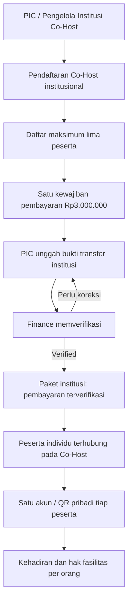

# 12 — Kebijakan Pembayaran Co-Host (Per Institusi)

> **KEPUTUSAN PEMILIK PRODUK — 26 Oktober 2026**  
> Tarif **Co-Host Rp3.000.000 PER INSTITUSI**, mencakup maksimal **LIMA PESERTA** pada ICHES UNISYA 2027. Ini mengoreksi **Rp450.000** dalam tabel biaya TOR (hal. 5). **Bukan** Rp3 juta per peserta.  
> **Status:** spesifikasi bisnis/dokumen presentasi; **belum coding, belum invoice nyata**.  
> [Kembali ke Presentasi Warek I](00-PRESENTASI-WAREK-I.md) · [Register keputusan](09-KEPUTUSAN-DAN-ISU-TERBUKA.md) · [Audit TOR](10-ANALISIS-TOR-DAN-REBASELINE-2027.md).

## 1. Keputusan yang sudah final

| Aturan | Ketetapan |
|---|---|
| Jenis pembayaran | **Paket Co-Host tingkat institusi** |
| Tarif paket | **IDR 3.000.000** |
| Satuan harga | **Per institusi, sekali untuk satu pendaftaran Co-Host pada event ICHES 2027** |
| Batas orang yang tercakup | **Maksimal 5 peserta per institusi** |
| Tarif peserta ke-2 s.d. ke-5 | **Tidak ada tagihan Co-Host terpisah** |
| Enam peserta dalam satu paket | **Tidak diperbolehkan**, perlu penyesuaian daftar atau keputusan kebijakan lain |
| Teks harga di TOR sumber | **Rp450.000 (sudah dikoreksi melalui keputusan baru)** |
| Metode pembayaran | **Usulan mempertahankan transfer manual + upload bukti + verifikasi Finance** seperti baseline lama |

**Catatan:** tarif tetap Rp3 juta untuk paket hingga lima peserta; **jangan menghitung proporsi biaya Co-Host per orang**. Pengurangan harga karena peserta kurang dari lima atau penambahan harga untuk peserta keenam **tidak pernah diputuskan**.

## 2. Diagram alur yang bisa dipresentasikan

**Waktu penagihan** (misalnya setelah validasi/approval institusi) merupakan **rekomendasi operasional**, belum keputusan final. Status terdaftar/tidak, kelayakan fasilitas, serta kapan akses panel acara aktif jangan dipaksakan berdasarkan pembayaran sampai ketentuan panitia diratifikasi.

## 3. Data bisnis yang diperlukan, bukan model database final

| Entitas | Field/perilaku utama |
|---|---|
| Institution | Nama institusi, identitas institusi yang terverifikasi dan PIC |
| Co-Host Registration | Institusi, event, status, kuota maksimum lima, daftar peserta |
| Co-Host Participant | Referensi satu personal user per peserta; dapat mengikuti kegiatan lain |
| Institutional Payment | Pendaftaran institusi, kategori Co-Host, **IDR 3.000.000**, status, bukti transfer |
| Finance Verification | Pemeriksa, waktu, hasil/verifikasi/koreksi |
| Effective Participation/Service Rights | Hak per orang berdasarkan keikutsertaan/paket & override, bukan karena scan QR |

**Kunci aturan integritas:** satu institusi tidak boleh menghasilkan dua tagihan Co-Host aktif untuk **paket yang sama** pada ICHES 2027 hanya karena PIC mencoba submit ulang atau mengisi peserta bertahap. Bukti pembayaran adalah milik kewajiban **institusi**, bukan lima record pembayaran per orang.

Pendaftaran Co-Host **berbeda konsep** dari MoU. Satu master institusi dapat terhubung ke Co-Host maupun MoU, tetapi status ikut Co-Host tidak otomatis menyatakan dokumen MoU sudah ditandatangani, dan sebaliknya.

## 4. Contoh penghitungan dan validasi

| Skenario | Hasil Co-Host |
|---|---|
| Universitas A mendaftarkan 1 peserta | **Satu tagihan Rp3.000.000** |
| Universitas B mendaftarkan 3 peserta | **Satu tagihan Rp3.000.000** |
| Universitas C mendaftarkan 5 peserta | **Satu tagihan Rp3.000.000** |
| Universitas D mengajukan peserta keenam | **Kapasitas paket terlampaui**, tidak otomatis menagih Rp3 juta kedua |
| PIC mengunggah bukti pembayaran ulang | Perbarui bukti pada **tagihan institusi yang sama**, bukan membuat kewajiban baru |
| Satu peserta Co-Host juga terdaftar Conference / MoU / ICD | Tetap satu akun/QR dan status aktivitas terpisah; **aturan tarif tambahan lintas jalur menunggu keputusan panitia** |

## 5. Operasional pada Backoffice

**Co-Host Institutions:** daftar institusi, PIC, status registrasi, jumlah peserta terdaftar (misalnya 3/5), daftar lima nama dan tautan akun bila sudah ada. Tombol tambah peserta tidak boleh melampaui lima pada institusi yang sama.

**Finance:** daftar tagihan berdasar nama/kode institusi; satu nilai Rp3.000.000; proof submitted; Pending/Under Verification/Verified/Correction Required sesuai alur Finance. Finance dapat meninjau bukti, meminta koreksi dan menandai pembayaran valid. **Tidak** membuat invoice massal terpisah berdasarkan jumlah peserta.

**Participant Dashboard:** tiap orang tetap melihat keikutsertaan dan hak layanan sendiri. Status lunas Co-Host dapat ditampilkan sebagai informasi paket institusi jika relevan, **tanpa** menyatakan tiap orang melakukan transfer pribadi.

## 6. Hubungan dengan kebijakan akademik dan paket lain

- **Submission / Reviewer / LoA / Full Paper:** tetap mengikuti mekanisme akademik yang telah dipilih. Status Co-Host **tidak** membuat paper otomatis Accepted atau Presented.
- **Biaya Presenter setelah ACCEPT:** aturan ini tetap berlaku bagi jalur presenter secara umum. **Belum diputuskan** apakah membayar paket Co-Host sudah mencakup biaya Presenter masing-masing paper/orang, berapa paper yang masuk, atau kapan biaya tambahan diperlukan. Jangan menagih ganda atau menyatakan otomatis bebas tarif.
- **Paket MoU + Pembinaan + PKM + Destinasi Rp1.000.000:** merupakan kategori **lain** dalam TOR. Jumlahnya dan satuan penagihannya belum dikoreksi/diputuskan dalam percakapan ini. Jangan otomatis menggabungkan atau menghapus kewajiban di antaranya.
- **Delegasi/Co-Host vs MoU:** institusi dan perwakilan dapat sama, tetapi administrasi MoU tetap entitas sendiri.
- **Kelayakan QR/kit/konsumsi:** tetap mengikuti default rights + individual GRANT/REVOKE yang sudah dipilih, bukan satu QR untuk satu institusi.

## 7. Kebutuhan yang sengaja masih terbuka

1. Apakah Rp3 juta Co-Host **sudah mencakup biaya pemakalah, jumlah paper tertentu, publikasi, dan/atau seluruh fasilitas**?
2. Apakah Co-Host otomatis memperoleh hak mengikuti kegiatan MoU, Pembinaan, Pengabdian dan Studi Destinasi, atau hanya Conference?
3. Siapa yang boleh mendaftarkan/perbarui peserta (PIC saja atau petugas Co-Host juga), dan apakah pergantian nama peserta diperbolehkan setelah pembayaran?
4. Kapan tagihan institusi diterbitkan (sebelum atau sesudah verifikasi institusi), kapan batas akhir, dan bagaimana refund/pembatalan?
5. Bagaimana tarif paket Rp1.000.000 diterapkan, serta apa aturan peserta yang sekaligus memiliki dua paket?

**Semua pertanyaan ini tidak boleh mengubah keputusan final satuan tagihan Co-Host.** Hanya cakupan manfaat dan prosedur pelaksanaannya yang masih terbuka.

## 8. Ringkasan pimpinan

**Satu institusi Co-Host membayar Rp3.000.000 sekali untuk maksimal lima peserta.** Petugas mengelola satu pendaftaran institusi dan satu pembayaran; peserta tetap memakai akun serta QR masing-masing. Pembayaran diverifikasi oleh Finance melalui alur yang terpisah dari ACCEPT akademik, presentasi, kehadiran, dan penyerahan fasilitas.

---

*Source-of-truth harga produk: keputusan pemilik produk pada 26 Oktober 2026, supersedes nominal Co-Host yang ada pada TOR tertulis. Dokumen TOR aslinya tidak dimutasi di GitHub.*