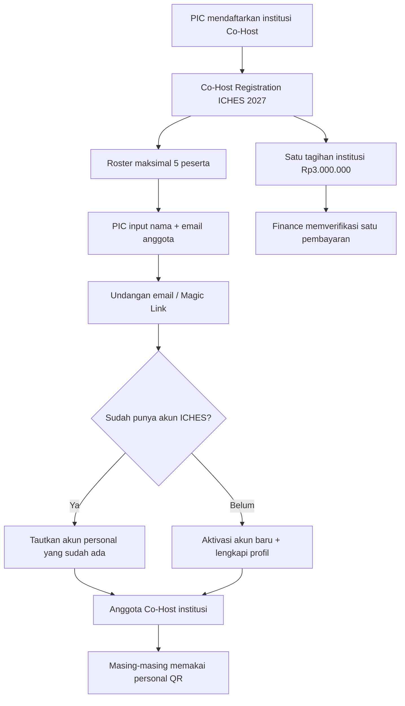
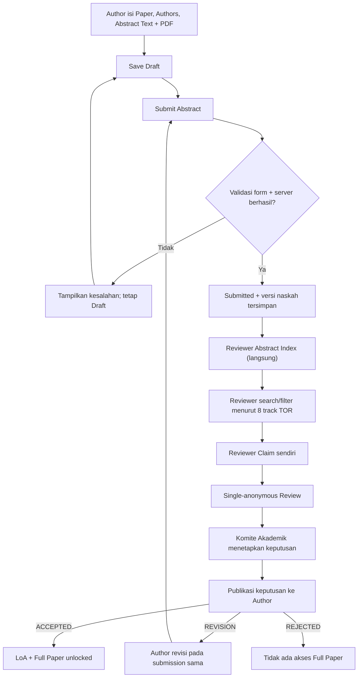

# 13 — Linking Co-Host Members & Abstract Submission Tanpa Screening

> **Keputusan Produk ICHES 2027 — 26 Oktober 2026.**  
> **DISETUJUI:** Co-Host **Rp3.000.000 per institusi**, mencakup **maksimal lima peserta**; tidak ada *Administrative Screening* setelah abstract Submit; validasi wajib dilakukan pada formulir dan server saat Submit; paper yang valid langsung masuk **Reviewer Abstract Index** untuk pencarian/filter topik dan *self-claim*.  
> **USULAN DESAIN (belum dikunci):** cara menghubungkan lima orang memakai undangan email/Magic Link dan lima slot anggota institusi.  
> **Status:** dokumentasi perancangan saja; tidak ada kode aplikasi.

> **Cakupan terbaru:** satu tagihan Co-Host **Rp3 juta/institusi khusus paper International Conference**, dengan pengakuan institusi sebagai **Co-Host ICHES 2027**. Anggota yang mendaftar paket MoU/Pembinaan/International PKM/Destinasi membayar **Rp1 juta/orang secara terpisah**; tidak otomatis masuk paket Co-Host. **Jumlah paper Co-Host masih terbuka**. [Dokumen 14](14-CAKUPAN-COHOST-DAN-PROGRAM-PENDAMPING.md).

## A. Menghubungkan lima peserta dengan satu Co-Host institusi



**Jangan membuat lima tagihan, lima institusi, atau lima QR institusi.** PIC mengelola satu pendaftaran institusi. Anggota tetap individu dengan akun terverifikasi dan QR pribadi yang sama untuk kegiatan ICHES lainnya. Data induk institusi dapat dipakai bersama administrasi MoU, tetapi **keikutsertaan Co-Host tidak otomatis berarti MoU ditandatangani**.

### Layar PIC Co-Host (usulan)

```
Co-Host: Universitas Mitra A              Payment: Rp3.000.000
Members: 3 / 5                             Status: Under Verification

1. Anggota A   ● Activated
2. Anggota B   ◌ Invited
3. Anggota C   ● Activated
4. Slot kosong
5. Slot kosong

[Invite Participant] [View Payment] [Upload Proof]
```

**Aturan sederhana yang diusulkan:**

- PIC memasukkan maksimal lima **nama dan alamat email**. Undangan yang masih menunggu aktivasi tetap memesan slot, agar tidak terjadi oversubscription.
- PIC **tidak otomatis menggunakan slot** kecuali ia benar-benar menjadi salah satu peserta.
- Jika email sudah dimiliki akun ICHES, undangan menautkan akun tersebut. Jika belum, orang itu aktivasi via Email OTP/Magic Link. **Co-author yang hanya menerima sertifikat publik tidak harus membuka akun**; aturan itu tetap berbeda.
- Email sama tidak boleh mengisi dua slot dalam institusi yang sama. Jika pengguna terkait institusi Co-Host lain, panitia dapat menyelesaikannya tanpa menggandakan identitas atau hak.
- Sebelum peserta melakukan check-in/mengambil hak layanan, PIC boleh meminta pergantian slot secara sederhana. Setelah ada catatan kehadiran/penyerahan, Admin menangani koreksi tanpa menghapus fakta lama.
- Tidak ada biaya Co-Host tambahan untuk anggota kedua hingga kelima; satu tagihan **Rp3 juta per institusi** tetap berlaku meskipun peserta yang datang kurang dari lima.
- **SUDAH DIPUTUSKAN:** biaya Co-Host mencakup **jalur paper International Conference**, bukan program pendamping. Paket program pendamping **Rp1 juta per peserta** jika dipilih terpisah. **Masih terbuka:** jumlah paper dan rincian hak layanan konferensi; jangan otomatis membebaskan tagihan paper di luar jatah yang kelak ditentukan.

## B. Abstract langsung ke Reviewer Index, tanpa screening



**Tidak ada status `Under Screening`, `Pass Screening`, atau antrean administrasi yang harus disetujui sebelum reviewer dapat melihat naskah.** Reviewer sudah dapat memulai sejak submission pertama yang valid diterima mulai 1 Desember, tanpa menunggu berakhirnya periode abstrak 20 Desember.

### Validasi pengiriman yang wajib ada

| Komponen | Pencegahan sebelum Submit sukses |
|---|---|
| Paper | Judul wajib dan Conference Track yang aktif |
| Authors | Minimal satu penulis; urutan unik; identitas dan satu Corresponding Author sesuai aturan |
| Abstract online | Teks wajib; batas kata ketika disahkan komite |
| Keywords | Wajib mengikuti rentang yang nantinya disetujui |
| Abstract file | PDF wajib; server memastikan jenis file benar, file utuh/dapat dibaca, ukuran maksimum terkonfigurasi |
| Konsistensi | Author mengonfirmasi bahwa abstrak online dan PDF sesuai; **tidak perlu OCR/AI semantic matcher** |
| Submit | Tindakan server atomik, tidak menghasilkan dua paper karena tombol ditekan ulang |

**Frontend memberi umpan balik**, tetapi **backend tetap menolak** submission tidak sah; tidak cukup sekadar menonaktifkan tombol. File akademik tetap privat dan hanya dapat dibaca staf/reviewer berwenang.

Jika PDF ternyata berbeda substansinya dari teks online, reviewer bisa melaporkan lewat komentar penilaian, kemudian Komite/Koordinator membuka koreksi resmi pada submission tersebut. Ini **bukan** tahap screening rutin yang menghambat masuknya semua paper.

### Reviewer index

| Paper | Track | Review slot | Aksi |
|---|---|---|---|
| ICHES-001 (contoh) | Education, Pedagogy | Available | **Claim** |
| ICHES-002 (contoh) | Digital Transformation | Claimed | View |
| ICHES-003 (contoh) | Social Sciences | Available | **Claim** |

- Reviewer **tidak dibatasi keanggotaan topic A/B/C pada profil**; pemilihan berdasarkan pengetahuan reviewer lewat search/filter.
- Backend melarang claim atas paper sendiri, memeriksa ketersediaan slot/konflik langsung, dan menjaga agar dua reviewer tidak mengambil slot yang sama secara bersamaan.
- Koordinator Akademik cukup memantau paper yang belum diklaim dan melepas/reassign klaim yang mandek. Reviewer memberikan **rekomendasi**, bukan keputusan akademik final.
- **Jumlah reviewer per paper belum final**: baseline repo lama default satu reviewer yang dapat dikonfigurasi. Usulan dua reviewer belum disetujui.
- Jadwal pengumuman TOR **22 Desember 2026** tetap milestone, **bukan pemicu dimulainya review**.
- **Full Paper** terbuka jika dan hanya jika keputusan final **ACCEPTED sudah diumumkan kepada submitting author**, bukan tergantung tanggal 23 Desember atau status Finance VERIFIED. Pembayaran Presenter tetap setelah ACCEPT.

## C. Ringkasan untuk Warek I

**Institusi Co-Host membayar Rp3.000.000 satu kali dan membawa maksimal lima peserta yang memiliki akun/QR masing-masing; PIC menyatukan identitas mereka melalui undangan.** Mekanisme undangan merupakan **solusi yang direkomendasikan** dan masih dapat disederhanakan sesuai keputusan panitia.

**Penulis mengirim abstrak lengkap; bila lolos validasi form dan server, abstrak langsung muncul pada daftar reviewer tanpa meja screening administratif.** Reviewer aktif mencari topik yang sesuai dan mengklaim paper sendiri. Komite mengambil keputusan final; penerimaan yang diumumkan mengaktifkan Full Paper.

## D. Pemisahan keputusan dan usulan

| Komponen | Status |
|---|---|
| Tarif Co-Host Rp3 juta PER INSTITUSI, maksimal 5 orang | **DISETUJUI** |
| Hapus administrative screening setelah submit | **DISETUJUI** |
| Validasi wajib form + backend saat Submit | **DISETUJUI** |
| Paper valid langsung ke Reviewer Index | **DISETUJUI** |
| Search/filter track dan reviewer self-claim | **DISETUJUI** |
| PIC invite anggota Co-Host via Magic Link | **USULAN SOLUSI** |
| Slot undangan dihitung kuota, PIC bila hadir memakai slot | **USULAN OPERASIONAL** |
| Benefit Co-Host terkait biaya paper dan kegiatan tambahan | **BELUM DIPUTUSKAN** |
| Batas kata, PDF size, jumlah reviewer | **BELUM DIPUTUSKAN** |

Acuan: [Register keputusan](09-KEPUTUSAN-DAN-ISU-TERBUKA.md) · [Submission akademik](03-SUBMISSION-REVIEW-AKADEMIK.md) · [Co-Host billing](12-PEMBAYARAN-COHOST-PER-INSTITUSI.md).
