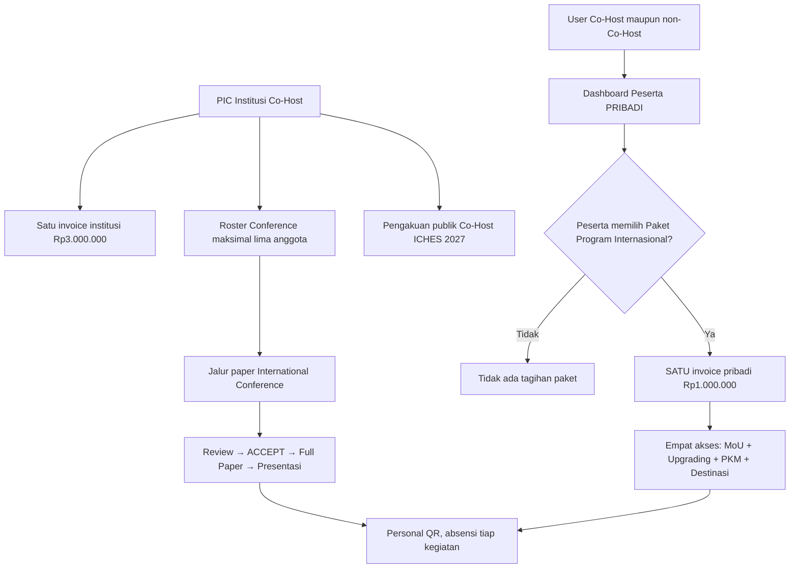
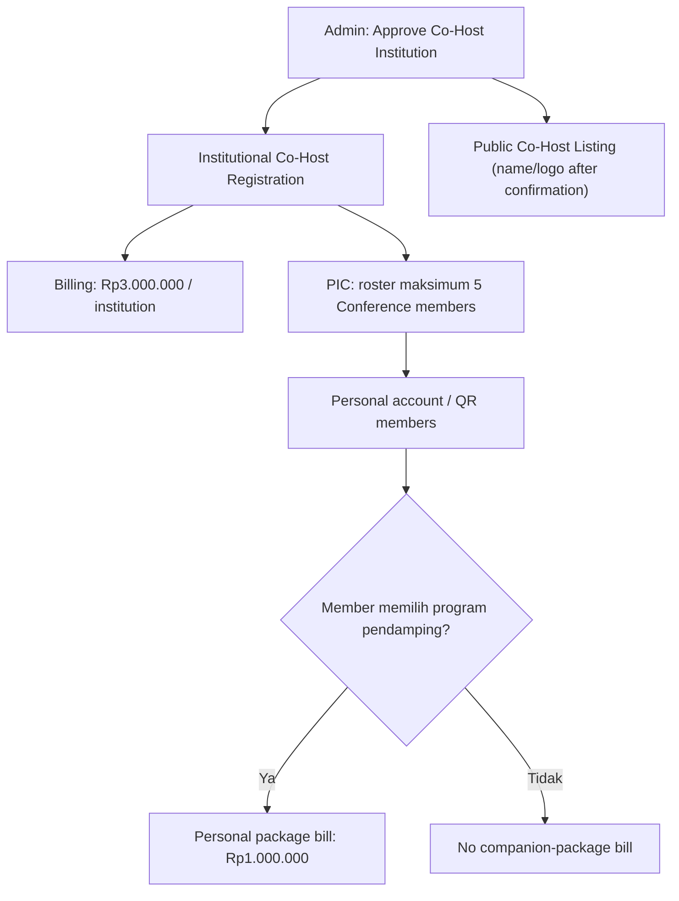

# 14 — Cakupan Biaya Co-Host, Paket Program Pendamping, dan Pengakuan Institusi

> **KEPUTUSAN FINAL 27 OKTOBER 2026:** Co-Host **Rp3.000.000/institusi = lima perwakilan + lima paper International Conference**, masing-masing perwakilan submit **satu paper sendiri melalui akun masing-masing**. **Deadline Paket Program Internasional Rp1 juta dibuat CRUD pada Admin**, sehingga tanggal/jam dapat diubah sewaktu diperlukan. **International Conference, MoU, Upgrading, PKM, Destinasi, serta seluruh pengaturan operasional dan website dikelola lewat Backoffice Admin**; bukan tanggal/nilai hardcoded. Reviewer/Finance/Moderator tetap melaksanakan perannya. [Paper Co-Host](16-COHOST-LIMA-PAPER-PERWAKILAN.md) · [Matriks Admin CRUD](17-ADMIN-CRUD-DAN-PENGATURAN-ACARA.md).

> **Kebijakan produk ICHES 2027 · 26 Oktober 2026.** Sumber: klarifikasi langsung pemilik produk; tabel kegiatan dan paket program dalam TOR Warek I menjadi konteks.  
> **FINAL DALAM RANCANGAN:** Co-Host **Rp3.000.000 per institusi** (maks. 5 peserta) **khusus untuk paper International Conference**; program pendamping dalam paket TOR **Rp1.000.000 per peserta** (bukan per institusi); institusi Co-Host diakui sebagai kolaborator penyelenggara ICHES 2027.  
> **FINAL kuota:** 5 perwakilan dan 5 paper (satu paper tiap perwakilan) termasuk Rp3 juta. **TERBUKA:** media pengakuan institusi, izin logo, masa/aktivasi status resmi, dan kebijakan paper Conference di luar kuota. Satu Paket Program Internasional Rp1 juta tetap mencakup keempat akses.  
> **Tidak ada coding atau transaksi yang telah dijalankan.**

**KEPUTUSAN FINAL BARU (26 Oktober 2026):** **Paket Program Internasional Rp1.000.000/orang adalah SATU produk mandiri yang dipesan dan dibayar lewat Dashboard Peserta sendiri**, bukan di menu Co-Host/PIC. **Satu pembayaran Rp1 juta memberikan empat akses sekaligus**: International MoU; Upgrading Kasubdit Penelitian-PKM Kemenag RI; PKM Internasional; Destinasi Internasional Tumpak Sewu–Teras Semeru. **Bukan Rp1 juta per program.** Co-Host tetap satu invoice Rp3 juta per institusi (maks. 5 orang), tidak bertambah karena anggota mengambil paket sendiri. Akses kegiatan MoU **bukan** otomatis status PIC/delegasi/penandatangan resmi. [Alur dan aturan](15-PAKET-INTERNASIONAL-DASHBOARD-PESERTA.md).

> **Turunan spesifikasi tahap 18B-04/05 (USULAN FORM/TEKNIS):** aturan produk yang sudah dikunci tetap **Co-Host Rp3 juta/INSTITUSI = maksimal 5 orang/5 paper (1 paper per orang)** dan **Paket Program Internasional Rp1 juta/ORANG = satu pembelian empat akses secara mandiri melalui Dashboard pribadi**. Field halaman, invitation Magic Link, metode penggantian anggota/paper, status dan waktu publikasi logo, payment activation serta detail refund **belum final**. Admin memiliki CRUD pengaturan, PIC hanya institusinya, Finance memverifikasi uang, peserta membeli sendiri. [18B-04 — CRUD Co-Host, 5 Seats & 5 Papers](18B-04-CRUD-COHOST-INSTITUSI-LIMA-PAPER.md) · [18B-05 — CRUD Paket Rp1 Juta / 4 Akses](18B-05-CRUD-PAKET-INTERNASIONAL-DASHBOARD-PESERTA.md).

## A. Pemisahan tiga hal yang sering tertukar

| Lapisan | Siapa/apa | Ketentuan |
|---|---|---|
| **Identitas Co-Host** | Institusi (contoh: Universitas Mitra A) | Dapat dicantumkan sebagai **Institusi Co-Host ICHES 2027**; ini pengakuan peran institusi pada event |
| **Paket Co-Host Conference** | Pendaftaran **institusi** | **Rp3.000.000 sekali**, mencakup **maks. 5 orang** untuk **jalur paper International Conference**, bukan tiket otomatis semua program |
| **Paket program pendamping** | Pendaftaran **orang per orang** | **Rp1.000.000 per orang** untuk paket program dalam TOR: International MoU + Pembinaan Riset/PKM + Pengabdian Internasional + Studi Destinasi, sesuai hak pendaftaran/kehadiran yang ditetapkan |

**Satu pengguna tetap boleh mengikuti beberapa kegiatan**, tetapi pendaftaran kegiatan, paket yang dibayar, hak pelayanan, dan bukti kehadiran tetap merupakan catatan berbeda. **Tidak ada pembayaran Rp1 juta otomatis untuk setiap anggota Co-Host**; hanya peserta yang mendaftar program pendamping yang mempunyai kewajiban sesuai kebijakan biaya. Juga **tidak ada pembebasan Rp1 juta karena institusinya Co-Host**.

## B. Bagan untuk presentasi Warek I

Contoh: **tagihan Co-Host institusi tetap Rp3 juta**. Tiga anggota secara mandiri membeli **satu paket pribadi Rp1 juta untuk empat akses** di Dashboard masing-masing. Tagihan pribadi mereka **tidak masuk invoice Co-Host**; jangan tampilkan Rp6 juta sebagai kewajiban pembayaran institusi.

**Keputusan FINAL:** Rp3 juta mencakup **lima paper dan lima perwakilan**, satu perwakilan mempunyai hak mengirim **satu paper**. Co-author dalam satu paper tidak otomatis memperoleh slot Co-Host; kuota paper dihitung berdasarkan paper yang terhubung dengan masing-masing perwakilan.

## C. Solusi hubungan lima akun Co-Host

Keputusan sebelumnya **tetap berlaku**: satu pendaftaran Co-Host per institusi, satu PIC, satu invoice Rp3 juta, dan maksimal lima anggota. **Usulan paling sederhana:** PIC memasukkan nama + email 1–5 anggota, mengundang mereka lewat Email OTP/Magic Link, dan sistem menautkan tiap orang ke pendaftaran institusi yang sama dengan **akun dan personal QR milik masing-masing**. PIC tidak menghabiskan slot kecuali ikut sebagai peserta.

Setiap anggota dapat secara independen memilih program pendamping. Jika memilih, sistem membuat kewajiban Rp1 juta yang melekat ke **orang tersebut** (dan paket program), bukan menambah biaya invoice Co-Host. **Bukti transfer, verifikasi, dan statusnya dipisahkan**.

| Contoh | Kewajiban |
|---|---|
| Universitas A Co-Host, 5 anggota, hanya jalur Conference | Satu invoice institusi Rp3.000.000 |
| Anggota 1 & 2 juga ikut paket pendamping | Dua kewajiban individual Rp1.000.000 masing-masing |
| Anggota 3, 4, 5 tidak ikut paket pendamping | Tidak ada tagihan Rp1.000.000 bagi mereka |
| PIC bukan peserta | Tidak memakai slot, tidak otomatis ditagih Rp1.000.000 |
| Institusi lain bukan Co-Host tetapi ada delegasi ikut paket pendamping | Berlaku ketentuan Rp1.000.000 per orang bagi yang mendaftar |
| Paper dari penulis yang bukan anggota roster Co-Host | **Tidak otomatis** masuk cakupan biaya institusi |

**TELAH DISETUJUI:** **SATU tagihan Rp1 juta mencakup keempat program sekaligus**. User membelinya sendiri pada Dashboard pribadi, tidak melalui menu/PIC Co-Host. Tidak ada empat tagihan Rp1 juta atau pembelian setiap kegiatan satu per satu. Kehadiran tiap kegiatan tetap dicatat terpisah.

## D. Benefit Co-Host: pengakuan institusi sebagai mitra penyelenggara

**Keputusan bisnis:** Institusi Co-Host harus memperoleh pengakuan yang dapat dibuktikan bahwa ICHES 2027 **diselenggarakan dengan kolaborasi institusi tersebut**, bukan sekadar satu orang menghadiri acara.

**Usulan implementasi yang sederhana:**
1. Admin memiliki daftar **Co-Host Institutions**; setiap institusi berisi nama resmi, logo yang diizinkan, kontak/PIC, dan status konfirmasi Co-Host.
2. Website publik ICHES menampilkan bagian **Co-Hosting Institutions** (nama dan logo institusi), dengan tautan halaman institusi bila tersedia.
3. Materi resmi acara yang disetujui panitia dapat memuat institusi Co-Host: poster/flyer, backdrop, buku program, dan laporan kegiatan. **Media mana yang wajib belum diputuskan**.
4. Pada dashboard Co-Host, PIC dapat melihat status pengakuan dan halaman publik institusinya. **Dokumen/Sertifikat Kerja Sama Co-Host** atau surat konfirmasi resmi bisa ditambahkan jika Warek I menghendaki, tetapi belum menjadi fitur wajib.
5. Contoh redaksi publik yang diusulkan: **“The 6th ICHES 2027, organized by UNISYA in collaboration with participating Co-Hosting Institutions.”** Nama institusi muncul sebagai daftar resmi. Redaksi spesifik dan penggunaan logo harus disahkan penyelenggara/para institusi, bukan otomatis memberi kuasa hukum menandatangani dokumen atas nama mereka.

**Klarifikasi penting:** pengakuan sebagai Co-Host atas **penyelenggaraan ICHES 2027** tidak otomatis memberikan hak administratif atau akademik pada MoU, PKM, pembinaan, atau studi destinasi; dan **tidak sama dengan status MoU Signed**. Hak menghadiri dan memperoleh fasilitas kegiatan pendamping tetap mengikuti registrasi **Rp1 juta/orang** dan aturan kehadiran yang berlaku.

## E. Alur Backoffice minimum yang disarankan

Daftar co-host publik dan kaitan roster tidak perlu menjadi CRM sponsorship yang rumit. Cukup **CRUD institusi**, pengelola/PIC, anggota, satu status pembayaran institusi, satu kategori paket pendamping per orang, dan nama/logo untuk display publik. Finance tidak boleh menjadikan publikasi logo sebagai bukti lunas tanpa aturan panitia yang disepakati.

## F. Register keputusan

| ID | Kebijakan | Status |
|---|---|---|
| NEW-038 | Paket Rp3 juta Co-Host **hanya untuk jalur paper International Conference** | **DISETUJUI** |
| NEW-039 | Paket program pendamping berbiaya **Rp1 juta per orang**, terpisah dari Co-Host | **DISETUJUI** |
| NEW-040 | Institusi Co-Host memperoleh **pengakuan publik** sebagai institusi kolaborator/co-host penyelenggaraan ICHES 2027 | **DISETUJUI** |
| NEW-041 | Keikutsertaan MoU, Pembinaan, PKM, Destinasi tidak otomatis dari status Co-Host; bayar terpisah per orang yang berpartisipasi | **KONSEKUENSI DISETUJUI** |
| PROP-013 | Daftar nama/logo publik, status konfirmasi, materi promosi, surat kerja sama Co-Host opsional | **USULAN RINCIAN IMPLEMENTASI** |

**Sudah final: 5 paper Co-Host (satu per perwakilan)**. Terbuka: aturan paper tambahan/penggantian, refund/aktivasi Paket Rp1 juta, media nama/logo. **Batas akhir daftar Paket Rp1 juta dikelola CRUD Admin.** **Sudah final:** Rp1 juta SATU paket empat akses, dibeli sendiri dari Dashboard Peserta, tidak di menu Co-Host.

> **Penting bagi presentasi:** bedakan **manfaat administratif/biaya khusus paper konferensi** dari **manfaat reputasi dan atribusi institusi sebagai Co-Host acara ICHES 2027**.

[Lihat kebijakan Co-Host](12-PEMBAYARAN-COHOST-PER-INSTITUSI.md) · [Cara tautkan lima anggota](13-LINK-COHOST-DAN-SUBMISSION-TANPA-SCREENING.md) · [Register keseluruhan](09-KEPUTUSAN-DAN-ISU-TERBUKA.md).
