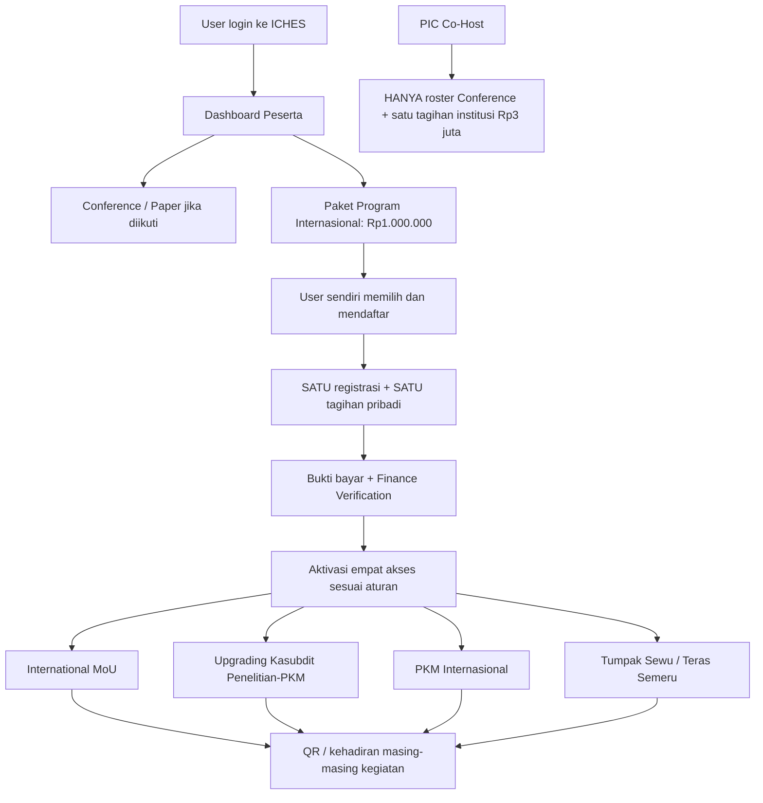

# 15 — Paket Program Internasional Rp1 Juta pada Dashboard Peserta

> **KEPUTUSAN FINAL 27 OKTOBER 2026:** Co-Host **Rp3.000.000/institusi = lima perwakilan + lima paper International Conference**, masing-masing perwakilan submit **satu paper sendiri melalui akun masing-masing**. **Deadline Paket Program Internasional Rp1 juta dibuat CRUD pada Admin**, sehingga tanggal/jam dapat diubah sewaktu diperlukan. **International Conference, MoU, Upgrading, PKM, Destinasi, serta seluruh pengaturan operasional dan website dikelola lewat Backoffice Admin**; bukan tanggal/nilai hardcoded. Reviewer/Finance/Moderator tetap melaksanakan perannya. [Paper Co-Host](16-COHOST-LIMA-PAPER-PERWAKILAN.md) · [Matriks Admin CRUD](17-ADMIN-CRUD-DAN-PENGATURAN-ACARA.md).


> **KEPUTUSAN PRODUK FINAL — 26 Oktober 2026.** Belum implementasi, hanya dokumentasi.  
> **Satu peserta + satu paket Rp1.000.000 + empat akses.** **Bukan** Rp1 juta tiap program; bukan modul maupun tagihan Co-Host.

## Kebijakan utama

| Ranah | Co-Host Conference | Paket Program Internasional |
|---|---|---|
| Pendaftaran | PIC institusi untuk maksimal lima anggota jalur paper International Conference | **Peserta mendaftar sendiri dari Dashboard pribadi** |
| Tarif | Rp3.000.000 **per institusi, sekali** | Rp1.000.000 **per orang, sekali untuk empat program** |
| Pembayar & catatan | Tagihan institusi | **Tagihan user/pribadi**, tidak masuk invoice Co-Host |
| UI | Panel PIC: institusi, lima anggota, pengakuan Co-Host, status pembayaran institusi | **Dashboard Peserta: satu kartu Paket Program Internasional dan status pembayaran sendiri** |
| Relasi | Co-Host tidak otomatis punya paket | Anggota Co-Host dan bukan Co-Host memakai alur yang sama |

### Isi paket satu harga Rp1 juta

1. **International MoU** — akses menghadiri rangkaian kegiatan MoU.
2. **Upgrading Kasubdit Penelitian-PKM Kemenag RI**.
3. **PKM Internasional**.
4. **Destinasi Internasional (Tumpak Sewu–Teras Semeru)**.

Keempatnya **satu produk bundling** yang menawarkan empat akses; peserta **tidak perlu membeli atau membayar setiap program secara terpisah**. Pendaftaran/presensi kegiatan tetap dapat dicatat terpisah, tetapi **tidak berarti empat transaksi atau empat kuitansi**.

**Batas MoU:** membeli paket memberi **akses kegiatan International MoU**, tidak otomatis membuat pendaftaran MoU atas nama institusi, memberi kewenangan PIC, mendaftarkan delegasi resmi, atau menjadikan orang penandatangan dokumen. Alur institusi/PIC/delegasi terverifikasi tetap tersedia terpisah.

## Diagram untuk Warek I



### Tampilan konseptual Dashboard Peserta

```text
DASHBOARD PESERTA — ICHES 2027
---------------------------------------
Profil, foto dan QR pribadi
International Conference (jika diikuti)
  Status paper / LoA / presentasi
  Anggota Co-Host: Nama Institusi (jika ada)

PAKET PROGRAM INTERNASIONAL
  Rp1.000.000 — SATU PAKET / ORANG
  ✓ International MoU
  ✓ Upgrading Kasubdit Penelitian-PKM Kemenag RI
  ✓ PKM Internasional
  ✓ Destinasi: Tumpak Sewu & Teras Semeru
  [Daftar Paket]
  → [Satu tagihan] → [Upload bukti] → [Status verifikasi]
---------------------------------------
```

Jika peserta Co-Host tidak membeli paket, **tidak ada tagihan Rp1 juta**. Jika dia membelinya, **hanya di Dashboard pribadinya** muncul satu tagihan Rp1 juta. **Tidak ada tombol Paket Rp1 juta, total tambahan, atau status bayar anggota dalam menu PIC Co-Host**.

## Contoh operasional

- Institusi A membayar **Rp3 juta Co-Host**, memiliki lima anggota: **tagihan institusi tetap Rp3 juta**, tanpa add-on otomatis.
- Budi, salah satu anggota, membeli sendiri Paket Program Internasional: **tagihan Budi Rp1 juta** di Dashboard Budi, memberi akses empat program; **PIC tetap melihat Rp3 juta**.
- Siti bukan anggota institusi Co-Host tetapi membeli paket yang sama: mendapat **keempat akses dengan harga yang sama Rp1 juta**.
- Satu orang yang hadir hanya di dua dari empat kegiatan tidak membuat biaya menjadi Rp2 juta atau membuktikan kehadiran di empat kegiatan sekaligus.

## Kriteria penerimaan aplikasi

1. Satu pembayaran Rp1.000.000 menghasilkan akses ke **empat** program, bukan empat tagihan.
2. Pendaftaran/pembayaran dimulai dari Dashboard user; tidak ada pembelian paket di Co-Host/PIC.
3. Pembayaran user tidak mengubah total institusi Rp3.000.000 dan tidak tampil sebagai kewajiban Co-Host.
4. Anggota Co-Host dan bukan anggota bisa membeli paket dengan alur identik.
5. Satu user tidak membuat dua kewajiban aktif yang sama hanya karena double-click (usulan integritas).
6. Status **entitled/terdaftar**, **hadir**, dan **signatory MoU** terpisah.
7. QR personal tetap sama; kehadiran masing-masing program tidak otomatis hanya karena pembayaran.
8. Aktivasi hak setelah Finance Verified merupakan **rekomendasi**, belum tanggal atau syarat final yang disahkan.

## Register keputusan

| ID | Ketetapan | Status |
|---|---|---|
| NEW-042 | Pembelian Paket Rp1 juta dilakukan sendiri di Dashboard Peserta | **DISETUJUI** |
| NEW-043 | Menu Co-Host tidak mencakup pembelian/tagihan Paket Rp1 juta anggota | **DISETUJUI** |
| NEW-044 | **Satu paket Rp1 juta untuk keempat program**, tidak Rp1 juta masing-masing | **DISETUJUI** |
| NEW-045 | Co-Host dan non-Co-Host bisa membeli paket pribadi dengan alur sama | **DISETUJUI** |
| PROP-014 | Pembatasan satu pendaftaran aktif per user, teknis aktivasi hak setelah Finance Verified | **USULAN** |

**METODE DEADLINE SUDAH FINAL:** Admin dapat menetapkan/mengubah tanggal-jam batas akhir pendaftaran paket kapan diperlukan melalui CRUD Backoffice; **angka tanggal akhirnya belum ditetapkan**. Masih terbuka: refund, teknis aktivasi hak, kuota peserta lapangan, fasilitas tambahan dan sertifikat tiap kegiatan. **Sudah final:** unit satu harga Rp1 juta/orang untuk satu paket empat akses dan pemisahan penuh dari fitur Co-Host.

[Rancangan Co-Host](12-PEMBAYARAN-COHOST-PER-INSTITUSI.md) · [Presentasi Warek I](00-PRESENTASI-WAREK-I.md) · [Register keputusan](09-KEPUTUSAN-DAN-ISU-TERBUKA.md).
