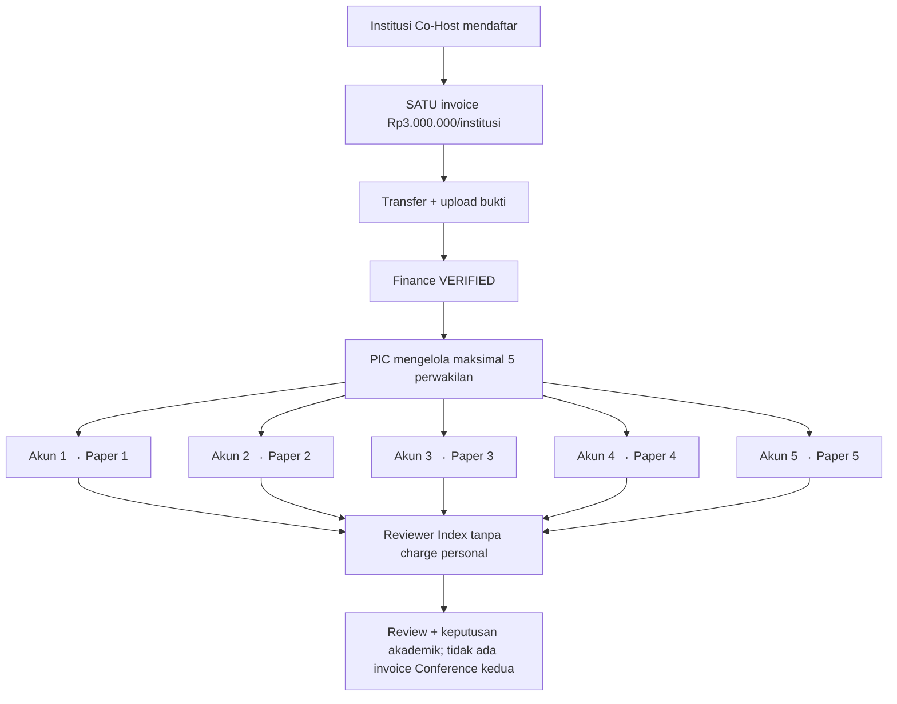

# 16 — Co-Host: Lima Perwakilan, Lima Paper International Conference

> **UPDATE FINANCE 27 OKTOBER 2026:** fitur roster/paper sponsor pada Co-Host **hanya aktif setelah invoice Rp3 juta/institusi Finance VERIFIED**. Tiap anggota berhak mengirim satu paper Conference setelah aktivasi **tanpa biaya Conference tambahan meskipun ACCEPT**. Jika membeli Paket Program Internasional, bayar sendiri di Personal Dashboard. [Finance 18B-06](18B-06-CRUD-FINANCE-INVOICE-PEMBAYARAN-VERIFIKASI.md).

> **Keputusan final, 27 Oktober 2026.** **Co-Host membayar Rp3.000.000 per institusi** untuk **lima perwakilan dan lima paper**. **Masing-masing perwakilan mengirim satu paper melalui akun pribadi** dan seluruh paper mengikuti alur akademik ICHES yang sama. Dokumentasi saja, belum ada coding aplikasi.

## Diagram untuk Warek I



> **Turunan spesifikasi tahap 18B-04/05 (USULAN FORM/TEKNIS):** aturan produk yang sudah dikunci tetap **Co-Host Rp3 juta/INSTITUSI = maksimal 5 orang/5 paper (1 paper per orang)** dan **Paket Program Internasional Rp1 juta/ORANG = satu pembelian empat akses secara mandiri melalui Dashboard pribadi**. Field halaman, invitation Magic Link, metode penggantian anggota/paper, status dan waktu publikasi logo, payment activation serta detail refund **belum final**. Admin memiliki CRUD pengaturan, PIC hanya institusinya, Finance memverifikasi uang, peserta membeli sendiri. [18B-04 — CRUD Co-Host, 5 Seats & 5 Papers](18B-04-CRUD-COHOST-INSTITUSI-LIMA-PAPER.md) · [18B-05 — CRUD Paket Rp1 Juta / 4 Akses](18B-05-CRUD-PAKET-INTERNASIONAL-DASHBOARD-PESERTA.md).


## Kebijakan yang telah disetujui

1. **Kuota institusi** maksimal **lima perwakilan** dan **lima paper Co-Host**, secara berpasangan **satu orang = satu paper Co-Host**. Bukan lima paper oleh PIC dari satu akun, bukan satu orang memakai jatah orang lain, dan bukan paper tidak terbatas.
2. **Setiap perwakilan memakai akun/identitas sendiri** untuk mengisi metadata judul, penulis, Abstract Text dan PDF wajib, kemudian Submit. Akun pengelola submission dapat berbeda dari First Author tetapi tetap perwakilan yang menggunakan satu jatah paper Co-Host.
3. **Semua paper mengikuti jalur akademik normal:** validasi di form + backend (tanpa Administrative Screening), Submitted → Reviewer Index → reviewer self-claim sesuai topik → keputusan Komite → publikasi hasil → Full Paper terbuka ketika ACCEPT diumumkan.
4. **Tidak ada ACCEPT otomatis** karena Co-Host. Paper yang ditolak tidak otomatis memberi sertifikat atau memengaruhi keputusan empat paper lainnya.
5. **Jumlah lima adalah kapasitas dan jatah**, bukan kewajiban menciptakan paper fiktif. Jika baru tiga perwakilan mengirim paper, terlihat **3/5 paper terpakai**.
6. **Jatah submission berbeda dari jumlah co-author.** Co-author tambahan tercatat sesuai metadata, tetapi tidak otomatis menjadi perwakilan keenam atau mengambil jatah orang lain.
7. **Paket Program Internasional Rp1 juta** untuk MoU, Upgrading Kasubdit Penelitian-PKM Kemenag RI, PKM, dan destinasi dibeli sendiri pada dashboard peserta, tidak menjadi add-on invoice Co-Host.

## Solusi sederhana untuk menghubungkan lima orang (rekomendasi desain)

PIC mengisi maksimal lima **nama + email** perwakilan pada daftar institusi. Sistem menawarkan **Email Magic Link** untuk menghubungkan akun yang sudah ada atau mengaktifkan akun baru. Tiap orang memiliki QR pribadi. Status `Invited`, `Activated`, `Draft`, `Submitted`, beserta kode paper terkait ditampilkan dalam daftar lima slot.

**Saran agar tidak ada submission keenam:** ketika perwakilan membuka draft paper yang mengklaim jatah Co-Host, sistem menahan satu jatah paper untuk user/slot tersebut; perwakilan tidak dapat membuat draft paper Co-Host kedua yang aktif. Admin menangani pembatalan/pergantian anggota/paper dengan menjaga versi submission yang sudah terkirim. Detail penggantian paper *Rejected* masih perlu keputusan panitia; jangan berasumsi boleh mengulang jatah tanpa batas.

```text
ADMIN / PIC CO-HOST — UNIVERSITAS MITRA A
Invoice institusi      Rp3.000.000
Kuota perwakilan        5/5
Paper Co-Host           3/5 submitted

1  Dosen A  Active   ICHES27-001  Under Review
2  Dosen B  Active   ICHES27-002  Accepted
3  Dosen C  Active   ICHES27-003  Submitted
4  Dosen D  Active   —            Belum submit
5  Dosen E  Invited  —            Belum aktivasi
```

Contoh di atas fiktif. Admin memiliki kendali pusat CRUD institusi, roster, relasi paper dan koreksi sesuai kewenangan; PIC hanya self-service roster yang diizinkan. Mengganti anggota tidak menghapus paper/review historis.

## Penerimaan fitur (UAT kelak)

- Lima akun berbeda dapat mengirim masing-masing satu paper Co-Host; paper keenam atau paper Co-Host kedua dari user sama tidak dibebankan pada paket ini.
- Semua paper valid langsung masuk reviewer index dan masing-masing mendapatkan keputusan independen.
- Admin melihat daftar perwakilan dan penggunaan kuota 0/5–5/5.
- Satu tagihan institusi tetap Rp3 juta sekalipun hanya tiga paper yang sudah Submitted.
- Pembelian Paket Program Internasional oleh individu tidak memodifikasi invoice Co-Host.

**Final:** lima perwakilan, lima jatah paper, satu perwakilan satu paper. **Masih terbuka:** aturan penggantian paper yang Rejected/withdrawn, pergantian user sesudah Submitted, dan apakah paper Conference di luar kuota dapat dibeli secara reguler.

[Lihat Admin CRUD](17-ADMIN-CRUD-DAN-PENGATURAN-ACARA.md) · [alur akademik](03-SUBMISSION-REVIEW-AKADEMIK.md) · [registrasi Co-Host](13-LINK-COHOST-DAN-SUBMISSION-TANPA-SCREENING.md).