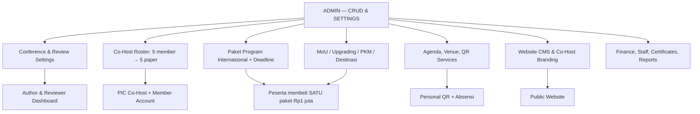
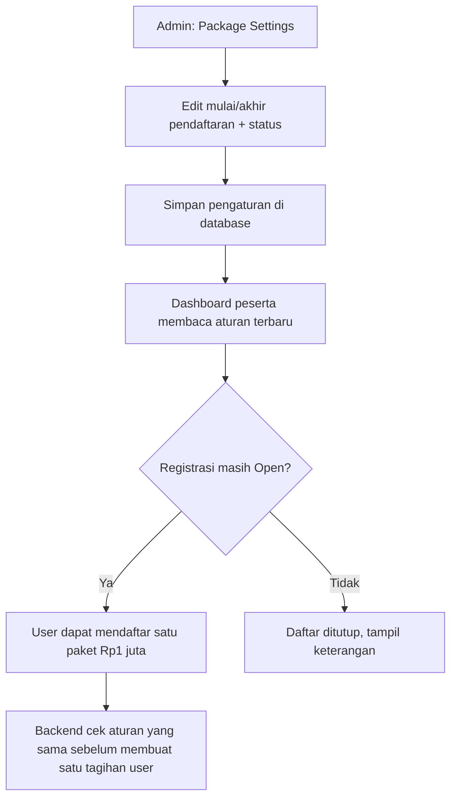

# 17 — Admin-Centered CRUD dan Pengaturan Seluruh ICHES 2027

> **NEW REQUIREMENT 28 OKTOBER — WEBSITE CMS:** selain CRUD operasional, Backoffice wajib menyediakan **menu Website CMS** untuk membuat/mengubah **halaman publik, section, navigation/footer, media, EN/ID/AR, SEO, preview/publish/rollback dan Countdown**. Target countdown mengambil **Event Master starts_at dalam Asia/Jakarta**, bukan teks statis. Komponen bisa ditambah/direvisi, dan Admin tidak otomatis mendapat izin Finance/Academic. [18C-04E](18C-04E-AICIS-FEATURES-COUNTDOWN-CMS-AND-AGENT-SKILL.md) · [AI Skill](../.agents/skills/iches-public-frontend/SKILL.md). Bentuk editor/schema masih DRAFT.

> **UPDATE FINANCE 27 OKTOBER:** Superadmin mengelola **satu rekening langsung tanpa dual approval**; satu antrean Finance untuk transfer manual/bukti JPG/PNG/PDF. **Co-Host Verified dulu baru fitur 5 paper aktif; Paket personal Verified dulu baru 4 akses aktif.** [Tahap 18B-06](18B-06-CRUD-FINANCE-INVOICE-PEMBAYARAN-VERIFIKASI.md).

> **Keputusan final, 27 Oktober 2026:** semua aspek **International Conference** dan rangkaian kegiatan lain dikelola melalui Backoffice **Admin** yang menyediakan CRUD sesuai kebutuhan, supaya panitia dapat mengubah pengaturan tanpa meminta developer atau deploy kode. **Batas akhir pendaftaran Paket Program Internasional harus dapat ditentukan dan diubah Admin kapan diperlukan.** Dokumentasi spesifikasi, belum implementasi.

## 1. Prinsip arsitektur pengelolaan

**Admin mengatur data dan kebijakan operasional; pengguna dengan peran masing-masing menjalankan alur.** CRUD pusat bukan berarti Admin harus menyetujui setiap abstrak atau melakukan semua pekerjaan. Reviewer tetap self-claim, Komite Akademik tetap memutuskan ACCEPT, Finance memverifikasi pembayaran, Moderator menandai Presented, dan petugas mengonfirmasi QR/layanan.

> **Tahap 18A tersedia:** [Role Permission & Navigasi](18A-ROLE-PERMISSION-DAN-NAVIGASI-BACKOFFICE.md) mengusulkan siapa berhak mengelola CRUD dari matriks ini, cakupan institusi/program/pos, dan pola satu akun multi-role; [Alur Operasional & UAT](18A-ALUR-OPERASIONAL-DAN-UAT-PERAN.md) menyediakan 25 skenario simulasi. **Belum final:** nama role dan pemberian izin per user; keputusan bisnis Admin-centered CRUD sudah final.

**Turunan field-level khusus International Conference** telah dirancang pada [18B-02 — Submission Settings, Tracks, All Papers & Author Wizard](18B-02-CRUD-INTERNATIONAL-CONFERENCE-SUBMISSION.md) serta [18B-03 — Reviewer, Keputusan, Full Paper, Sessions, Moderator & UAT](18B-03-CRUD-REVIEW-DECISION-FULLPAPER-SESSION-DAN-UAT.md). Ini memperinci matriks CRUD umum di bawah tanpa mengubah keputusan final maupun memulai coding.

> **Turunan spesifikasi tahap 18B-04/05 (USULAN FORM/TEKNIS):** aturan produk yang sudah dikunci tetap **Co-Host Rp3 juta/INSTITUSI = maksimal 5 orang/5 paper (1 paper per orang)** dan **Paket Program Internasional Rp1 juta/ORANG = satu pembelian empat akses secara mandiri melalui Dashboard pribadi**. Field halaman, invitation Magic Link, metode penggantian anggota/paper, status dan waktu publikasi logo, payment activation serta detail refund **belum final**. Admin memiliki CRUD pengaturan, PIC hanya institusinya, Finance memverifikasi uang, peserta membeli sendiri. [18B-04 — CRUD Co-Host, 5 Seats & 5 Papers](18B-04-CRUD-COHOST-INSTITUSI-LIMA-PAPER.md) · [18B-05 — CRUD Paket Rp1 Juta / 4 Akses](18B-05-CRUD-PAKET-INTERNASIONAL-DASHBOARD-PESERTA.md).

## 2. Matriks modul CRUD Backoffice

| Menu Admin | Pengaturan dan aksi utama |
|---|---|
| **Event & Site Settings** | Nama/tema ICHES, tanggal, venue, teks, kontak, status publikasi |
| **Public Website CMS** | Hero, call for papers, dates, speakers, partners, Co-Host name/logo, jadwal, FAQ, footer |
| **Conference Tracks** | Delapan subtema TOR: create/edit/order/disable |
| **Abstract Submission Settings** | Open/Close, batas waktu, format PDF, batas kata, keywords, template, file size, bahasa |
| **Academic Submissions** | Cari/filter paper, versi, reviewer index, jumlah reviewer (konfigurasi setelah disahkan), review, keputusan, publish decision |
| **Full Paper & Sessions** | Template, persyaratan, jadwal/panel, moderator, status Presented; **unlock setelah ACCEPT diumumkan**, bukan tanggal kaku |
| **Co-Host Institutions** | Institusi, PIC, roster lima perwakilan, **satu paper per anggota/total lima**, invoice Rp3 juta, publikasi branding |
| **Participants** | Identitas, registrasi Conference dan paket pribadi, status, koreksi sesuai hak |
| **Paket Program Internasional** | Harga satu paket Rp1 juta/orang dan empat benefit, **tanggal/jam buka–tutup yang dapat diedit**, manual Open/Closed, peserta dan transaksi |
| **International MoU** | Institusi PIC, delegasi, signatory terverifikasi, jadwal, status penandatanganan |
| **Upgrading Kasubdit Penelitian-PKM Kemenag RI** | Jadwal, deskripsi, peserta, check-in |
| **PKM Internasional** | Kelompok, lokasi, peserta, PIC, daftar kehadiran |
| **Destinasi Internasional** | Tumpak Sewu–Teras Semeru, agenda, rombongan, titik kehadiran |
| **Finance** | Tarif, invoice **institusi vs pribadi**, bukti, koreksi/verifikasi, ekspor |
| **QR, Facilities & Attendance** | Stasiun/pos, petugas, layanan, slot konsumsi, stok, Default/Grant/Revoke, kehadiran |
| **Certificates** | Template, signer, preview, batch publish, koreksi/revoke, URL verifikasi |
| **Staff/Roles & Reports** | Penugasan dan kewenangan, rekap serta ekspor kegiatan |

**Jangan membangun satu halaman CRUD raksasa.** Menu dikelompokkan sesuai aktivitas, dengan pola tabel, filter, form, modal dan tombol Simpan yang konsisten, shadcn-vue putih–hijau. Admin memiliki hak pusat, petugas lain dapat memperoleh scope terbatas sesuai tanggung jawab.

## 3. CRUD batas akhir Paket Program Internasional: keputusan wajib

| Field admin | Fungsi |
|---|---|
| Nama | **Paket Program Internasional** |
| Harga | **Rp1.000.000/orang**, satu paket empat program (sesuai kebijakan saat ini) |
| Termasuk | MoU; Upgrading; PKM Internasional; Destinasi Tumpak Sewu–Teras Semeru |
| Registration Opens | Tanggal dan jam mulai pendaftaran (Asia/Jakarta) |
| **Registration Deadline** | **Tanggal dan jam batas akhir; CRUD Admin, dapat diubah kapan diperlukan** |
| Registration Status | **Open / Closed**, penutupan manual jika dibutuhkan |
| Visibility | Tampil/tidak tampil di Dashboard peserta |
| Registered Users | Daftar peserta dan status pembayaran pribadi |
| Save Changes | Menerapkan perubahan untuk pendaftaran berikutnya, tanpa perubahan source code |

**Rekomendasi minimal:** tanggal deadline yang diubah langsung memengaruhi apakah peserta *baru* masih dapat mendaftar. Jangan hanya disable tombol Vue: backend memverifikasi status & deadline pada saat request. Peserta yang sudah mendaftar tetap dapat melihat tagihan dan riwayatnya meski pendaftaran ditutup. Admin bisa memperpanjang atau menutup sesuai ketentuan acara tanpa deploy. **Status Finance VERIFIED** sebagai syarat aktivasi keempat akses adalah **KEPUTUSAN FINAL 27 Oktober 2026**.

**Deadline Paket Program Internasional terpisah dari deadline Conference Abstract Submission**; penutupan salah satu tidak otomatis menutup yang lain. **Full Paper dibuka ketika ACCEPT diumumkan**, bukan karena admin mengubah tanggal program pendamping.

**Rancangan Tahap 18B (belum disetujui final):** Android scanner khusus dapat bekerja offline menggunakan cache terenkripsi, mencatat **Pending Sync**, lalu mengirim catatan ke Laravel ketika internet pulih. **Pending bukan transaksi CONFIRMED oleh server**; dua HP terputus tidak bisa menjamin pencegahan penerimaan layanan ganda. Admin mengelola perangkat, operator, pos, sync dan konflik; server memerlukan load test, cadangan jaringan, backup, monitoring, kontrol API dan keamanan berlapis. [Arsitektur offline/keamanan](18B-00-ANDROID-OFFLINE-QR-RELIABILITY-DAN-KEAMANAN.md) · [CRUD Scanner](18B-01-CRUD-ADMIN-SCANNER-DAN-SINKRONISASI.md).

## 4. Batas kewenangan agar CRUD tidak merusak catatan

| Boleh dikelola dengan Admin CRUD | Tetap dilindungi dari overwrite/hapus biasa |
|---|---|
| Tanggal pendaftaran, status Open/Closed, jadwal, lokasi, isi website, daftar program | Riwayat pembayaran/bukti dan nominal invoice lama |
| Tarif untuk **transaksi baru** setelah kebijakan disetujui | Naskah/version dan review yang telah resmi Submitted |
| Kuota, PIC, anggota Co-Host dan relasi paper (dengan koreksi) | Keputusan akademik historis, dokumen LoA yang sudah issued |
| Pos scanner, petugas, fasilitas, stok/entitlement | Bukti kedatangan dan layanan yang benar-benar diserahkan |
| Layout sertifikat dan daftar publikasi | Sertifikat Published dan histori revoke/reissue |

**CRUD pusat tidak menghilangkan validasi:** Admin dapat menetapkan kuota sesuai kebijakan penyelenggara, tetapi satu perwakilan tidak berhak mengonsumsi dua slot paper paket Co-Host yang sama. Mengubah tenggat **tidak secara retroaktif membatalkan** pengguna yang sebelumnya mendaftar; pengubahan biaya **tidak mengubah invoice lama**.

**Tidak perlu approval multilapis atau audit setiap tombol**, tetapi untuk koreksi data transaksi/sertifikat/keputusan akademik pertahankan fakta historis dan siapa yang berwenang memutuskan.

## 5. Acceptance criteria untuk UAT

1. Admin mengubah **tanggal/jam Deadline Paket Program Internasional** dari Backoffice tanpa developer; pendaftaran baru mengikuti nilai terbaru.
2. Admin dapat Open/Close pendaftaran paket; user lama tetap melihat tagihan dan status miliknya.
3. User membeli **satu paket Rp1 juta untuk empat akses** di Dashboard pribadi, tidak melalui PIC Co-Host.
4. Co-Host: **maks. lima perwakilan, satu paper masing-masing = maksimal lima paper**; satu invoice institusi Rp3 juta.
5. Semua paper Co-Host mengikuti validasi form/server → Reviewer Index langsung, reviewer self-claim dan Komite memutuskan.
6. Admin dapat CRUD tema/track, important dates, informasi konferensi, jadwal, program MoU, upgrading, PKM, destinasi, hak QR dan publikasi institusi.
7. Admin dapat mengelola deadline dan data **tanpa menghapus riwayat** keuangan, akademik, presensi atau sertifikat.

## 6. Register

> **Tahap 18C-01 DRAFT, MENUNGGU REVIEW:** [arsitektur relasional/empat ERD](18C-01-DRAFT-DATABASE-ARCHITECTURE-ERD.md) dan [kamus data/constraints/urutan migration/36 UAT](18C-01A-DRAFT-DATA-DICTIONARY-CONSTRAINTS-MIGRATIONS-UAT.md) menurunkan kebijakan Admin-centered CRUD, Finance, Co-Host, Conference, QR & Sertifikat ke kandidat tabel. **Belum schema final, belum database, belum coding.** Pilihan tabel dan DB engine boleh direvisi.

> **18B-07A/08 — lanjutan rancangan Finance:** opsi transfer susulan pada invoice sama, pencatatan surplus/duplikasi, permohonan refund manual, dan due date editable **masih draft dan belum keputusan final**. **Invoice PDF** adalah tagihan, **bukti transfer** belum berarti lunas, dan **Payment Receipt** hanya boleh terbit setelah Finance VERIFIED; notifikasi in-app/email masih **usulan UI**. [Kebijakan draf](18B-07A-DRAFT-KEBIJAKAN-PELUNASAN-REFUND-DAN-TENGGAT.md) · [Invoice/Receipt/Notifikasi](18B-08-CRUD-INVOICE-BUKTI-LUNAS-NOTIFIKASI-DAN-UAT.md).

> **Usulan tahap 18B-07:** Finance dapat memakai **inbox Payment Verification yang sama** untuk pembayaran kurang, lebih, transfer ganda, bukti salah dan rekonsiliasi bank manual. Tidak ada gateway atau approval berlapis. Refund/top-up/tenggat pelunasan **belum disepakati**; jangan dijadikan aturan otomatis. [Rancangan 18B-07](18B-07-FINANCE-EXCEPTIONS-REKONSILIASI-DAN-UAT.md).

| ID | Ketentuan | Status |
|---|---|---|
| NEW-046 | Satu institusi Co-Host: **lima perwakilan, lima paper, masing-masing satu paper** | **DISETUJUI** |
| NEW-047 | **Admin-centered CRUD** untuk International Conference dan rangkaian kegiatan ICHES lainnya | **DISETUJUI prinsip** |
| NEW-048 | Deadline Paket Program Internasional **editable Admin kapan diperlukan** | **DISETUJUI** |
| NEW-049 | Sistem membaca pengaturan Admin, sedangkan reviewer/finance/moderator/user tetap menjalankan perannya | **KONSEKUENSI DISETUJUI** |
| PROP-015 | Struktur menu, sakelar Open/Closed, visibility, pencadangan jatah paper pada Draft | **USULAN TEKNIS** |

Yang masih perlu didetailkan: aturan paper Rejected ditarik/ganti, ketentuan refund, dan daftar hak CRUD tiap role. **Empat hak paket dan fitur Co-Host setelah VERIFIED telah FINAL.** **Rancangan Admin sudah menjelaskan arah operasional tanpa menulis kode fitur.**

[Lihat kuota paper Co-Host](16-COHOST-LIMA-PAPER-PERWAKILAN.md) · [Paket user](15-PAKET-INTERNASIONAL-DASHBOARD-PESERTA.md) · [Register keputusan](09-KEPUTUSAN-DAN-ISU-TERBUKA.md).