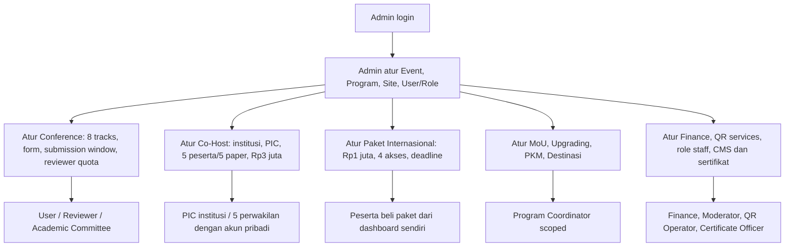
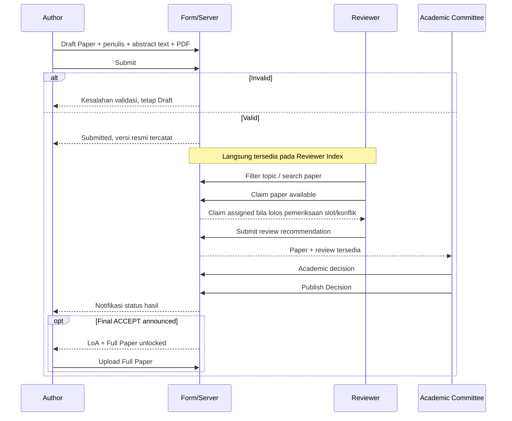
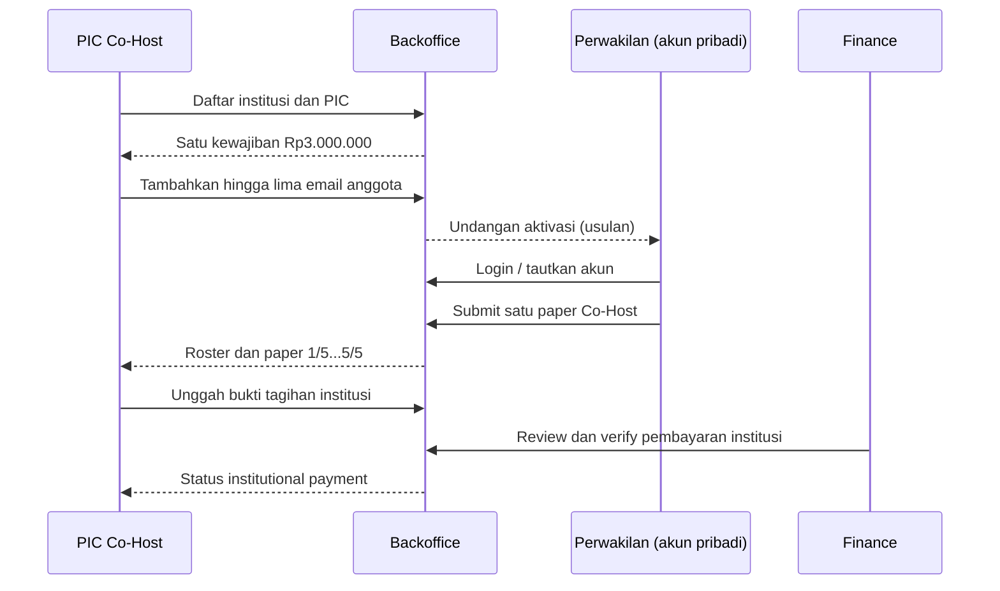
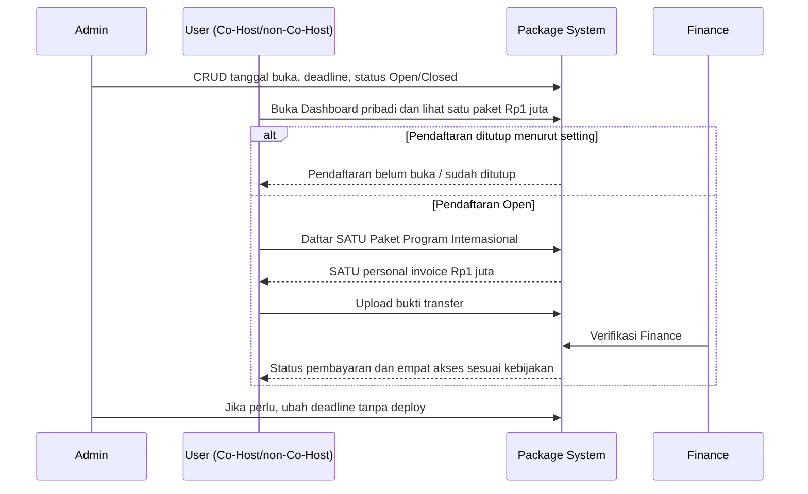
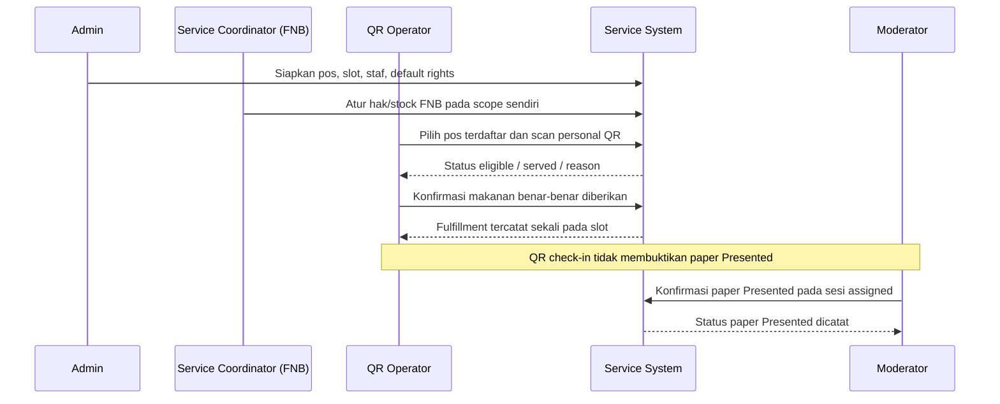
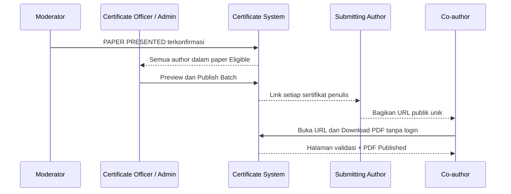

# 18A — Alur Operasional, Simulasi Role, dan UAT ICHES 2027

> **Tahap 18A, pendamping dokumen Role & Permission.** Bahan simulasi panitia dan paparan Warek I.  
> **Status:** rancangan untuk divalidasi; **belum ada aplikasi atau pengujian sistem nyata**.  
> Kebijakan yang sudah final tetap merujuk [Register Keputusan](09-KEPUTUSAN-DAN-ISU-TERBUKA.md); nama menu dan role assignments adalah [usulan 18A](18A-ROLE-PERMISSION-DAN-NAVIGASI-BACKOFFICE.md).

## A. Skenario 1 — Dari Admin ke seluruh dashboard, tanpa login ganda

**Cara Admin mengelola:** menu memiliki `List → Search/Filter → Add/Edit/Disable → Save`, ditambah tindakan domain khusus jika perlu. Tidak perlu mengelola semua program lewat satu form besar. Admin tidak harus menekan persetujuan untuk setiap paper yang Submitted.

## B. Skenario 2 — Academic Submission langsung ke Review

**Pemeriksaan role dan status:**
- Submitting Author hanya mengirim/merevisi paper miliknya, Co-Host member maksimal satu paper yang memakai hak paket.
- Semua reviewer berwenang boleh melihat **paper valid Submitted** dan memfilter delapan track. **Tidak ada assignment wajib Reviewer A ke Topic A atau screening admin.**
- Reviewer tidak boleh claim paper sendiri/konflik langsung; claim slot atomic; reviewer lain tidak boleh melewati kuota reviewer per paper.
- Reviewer merekomendasikan, Komite Akademik memutuskan. **ACCEPT internal tanpa publish** tidak membuka Full Paper; yang membuka adalah **ACCEPT yang diumumkan**.
- Deadline Abstract Submission dapat dikelola Admin; berbeda dari syarat pengaktifan Full Paper. Jumlah reviewer final masih perlu keputusan komite.

## C. Skenario 3 — Co-Host institusi: lima anggota, lima paper

**Konsekuensi:** PIC yang tidak menjadi peserta **tidak** otomatis mengambil salah satu slot. Anggota A dapat mengirim satu paper Co-Host; ia **tidak boleh** memakai slot B untuk paper kedua. Kelima paper **belum tentu semuanya ACCEPT**. Status tiap paper dan riwayatnya tidak boleh berubah hanya karena pembayaran institusi disahkan.

**Paket Program Internasional tidak termasuk panel PIC.** Jika anggota ingin berpartisipasi pada empat program, buka Dashboard pribadi dan lakukan pembelian pribadi Rp1 juta.

## D. Skenario 4 — Paket Program Internasional Rp1 juta untuk empat akses

**Empat akses paket:** **International MoU; Upgrading Kasubdit Penelitian-PKM Kemenag RI; PKM Internasional; Destinasi Tumpak Sewu–Teras Semeru**. Satu pembayaran, **bukan empat kali Rp1 juta**.

**Batas MoU:** mendapat akses acara MoU **tidak menjadikan peserta delegasi/signatory resmi**. Jika suatu institusi ingin menandatangani MoU, PIC institusi mengusulkan delegasi dan Koordinator/Admin MoU memverifikasinya. Status datang di lokasi dan status MoU Signed tercatat terpisah.

**Deadline:** perubahan Admin adalah konfigurasi untuk **pendaftaran baru**. Histori pendaftaran dan invoice yang pernah dibuat tidak boleh hilang. Rekomendasi aktivasi hak empat kegiatan setelah Finance Verified **belum final**, tunggu keputusan penyelenggara.

## E. Skenario 5 — QR Scanner, Coordinator, dan Moderator

**Contoh:** user membeli paket empat kegiatan, mempunyai hak Lunch Hari 2, dan mengambil Lunch sekali. Scan kedua dengan QR sama dan slot sama harus menunjukkan **Already Served** walaupun peserta ikut Conference+PKM+Destinasi. Hak FNB tidak dapat diubah oleh Koordinator Kit; Operator tidak dapat melakukan Grant/Revoke sendiri.

**Moderator:** penetapan `Presented` hanya berdasarkan presentasi benar-benar dilakukan, termasuk presentasi daring yang dikonfirmasi tanpa menciptakan scan onsite fiktif.

## F. Skenario 6 — Sertifikat penulis dan distribusi publik

**Kebijakan final:** *seluruh penulis dari paper yang benar-benar dipresentasikan* mendapat Presenter Certificate individual, bukan hanya actual presenter. Sertifikat **tidak otomatis diterbitkan** saat moderator mencentang Presented; Admin/Certificate Officer menerbitkan **massal**. Setiap sertifikat memakai kode URL unik dan QR verifikasi publik. Redaksi tidak boleh mengklaim co-author yang tidak tampil telah menyampaikan presentasi secara pribadi. Pembatalan/perbaikan memakai revoke/reissue tanpa menghapus sertifikat lama diam-diam.

## G. Simulasi orang yang memiliki lebih dari satu role

**Contoh fiktif:** Dosen X adalah Author paper Co-Host, menjadi Reviewer untuk paper lain, serta membeli Paket Rp1 juta dan menjadi panitia QR di satu pos.

| Ruang | Apa yang boleh terlihat/dilakukan |
|---|---|
| **Personal Dashboard** | Paper sendiri dan deadline/hasil akademiknya, Paket Rp1 juta pribadi, bukti pembayaran sendiri, QR |
| **Reviewer Workspace** | Reviewer Index seluruh track yang terbuka untuk claim; paper sendiri **tidak bisa di-claim** |
| **QR Operator** | Hanya pos yang ditugaskan; melihat eligibility dan konfirmasi layanan |
| **PIC Co-Host** | **Tidak ada akses** kecuali Dosen X juga secara eksplisit ditunjuk menjadi PIC institusi |
| **Finance** | Tidak otomatis, walau Dosen X sudah membayar paket atau operator QR |

**Server menegakkan irisan hak yang benar**, bukan sekadar menggabungkan semua menu menjadi izin global. Jika ada beberapa assignment aktif, lingkup akses digabung hanya sepanjang tiap assignment sah dan **tidak melompati pemeriksaan berbasis pemilik data/pos/paper**.

## H. Matriks UAT — Positive & Negative Test (rancangan, bukan hasil tes)

| ID | Penguji role | Skenario | Hasil yang diharapkan |
|---|---|---|---|
| UAT-18A-01 | Admin | Edit deadline Paket Internasional | Pendaftaran baru memakai deadline terbaru tanpa deploy |
| UAT-18A-02 | User | Klik Daftar saat paket Closed | Server menolak pendaftaran baru; invoice lama tetap terlihat |
| UAT-18A-03 | User | Membeli Paket Rp1 juta | Hanya **satu** invoice pribadi dan empat hak program sesuai aktivasi |
| UAT-18A-04 | PIC Co-Host | Melihat menu Co-Host setelah anggota beli Paket Rp1 juta | Invoice institusi **tetap Rp3 juta**, tidak terlihat invoice pribadi anggota |
| UAT-18A-05 | PIC Co-Host | Tambah anggota keenam | Ditolak/ditandai butuh koreksi, tidak bisa melampaui kuota lima |
| UAT-18A-06 | Co-Host Member | Buat paper Co-Host kedua | Ditolak sebagai jatah Co-Host kedua pada institusi tersebut |
| UAT-18A-07 | Author | Submit Abstract tidak lengkap/PDF invalid | Tetap Draft; reviewer index tidak menampilkan paper itu |
| UAT-18A-08 | Author | Submit valid Abstract Text + PDF | Langsung muncul di Reviewer Index **tanpa screening** |
| UAT-18A-09 | Reviewer | Filter track apa pun dan Claim paper eligible | Paper dapat di-claim tanpa role khusus per topik |
| UAT-18A-10 | Reviewer | Claim paper sendiri | Ditolak server |
| UAT-18A-11 | Reviewer | Dua reviewer claim slot terakhir bersamaan | Hanya satu klaim berhasil |
| UAT-18A-12 | Reviewer | Submit rekomendasi ACCEPT | Full Paper **belum** otomatis terbuka |
| UAT-18A-13 | Academic Committee | Putuskan ACCEPT internal tetapi belum Publish | Full Paper **belum** aktif |
| UAT-18A-14 | Academic Committee | Publish ACCEPT ke author | Author melihat LoA dan Full Paper unlocked |
| UAT-18A-15 | Finance | Verify pembayaran personal | Tidak mengubah invoice Rp3 juta milik institusi |
| UAT-18A-16 | Program Coordinator MoU | Kelola delegasi MoU pada institusi terkait | Bisa memproses sesuai scope; tidak bisa mengubah PKM jika tidak ditugaskan |
| UAT-18A-17 | Scanner Operator | Coba ubah GRANT/REVOKE sendiri | Ditolak; operator hanya melayani assigned pos |
| UAT-18A-18 | Service Coordinator FNB | Coba mengubah hak KIT | Ditolak; hanya FNB yang scoped |
| UAT-18A-19 | QR Operator | Scan makan siang dua kali pada slot sama | Konfirmasi kedua ditolak sebagai Already Served |
| UAT-18A-20 | Moderator | Confirm paper Presented | Status paper berubah; sertifikat masih belum Published |
| UAT-18A-21 | Certificate Officer | Batch Publish paper Presented berisi 4 author | Masing-masing author dapat URL/PDF unik setelah publish |
| UAT-18A-22 | Co-author tanpa akun | Akses URL sertifikat Published | Halaman validasi + unduh PDF berjalan tanpa login |
| UAT-18A-23 | Content Editor | Coba buka bukti transfer peserta | Ditolak, tidak memiliki permission Finance |
| UAT-18A-24 | Admin | Ubah biaya atau deadline setelah transaksi | Invoice dan catatan keuangan yang sudah dibuat tetap utuh |
| UAT-18A-25 | Operator / User | Panggil URL aksi Backoffice langsung tanpa izin | Ditolak oleh otorisasi backend, bukan hanya menu disembunyikan |

**Data pada skenario adalah fiktif.** UAT disebut *rencana*, **bukan klaim test PASS**.

## I. Peran dan pengaturan yang layak segera ditentukan panitia

| Keputusan belum final | Rekomendasi awal tanpa mengunci |
|---|---|
| Siapa menjadi Admin | Tetapkan satu/lebih user penanggung jawab; kewenangan tinggi dapat dikendalikan panitia |
| Academic Coordinator | Delegasi yang memang berhak menetapkan keputusan final dan publish |
| Reviewer count | Pertahankan baseline lama **default 1 configurable** sampai panitia akademik memutuskan jumlah |
| Finance | Staf khusus atau orang yang diberi assignment Finance; tidak perlu role payment khusus per kategori |
| Certificate publication | Admin atau Certificate Officer terdelegasi; harus bisa publish secara massal |
| Program coordinators | Satu role dengan program scope, bukan empat tipe login |
| Service coordinators/operators | Scope per service/pos, penugasan dapat CRUD Admin |
| Staff login security | Verifikasi lebih kuat untuk role kritis diusulkan; metode pastinya terbuka |

## J. Kelanjutan setelah Tahap 18A

Jika role template, scope, dan navigasi ini diterima pemilik proyek, **Tahap 18B** yang paling masuk akal adalah **Field-Level CRUD Specification** untuk tiap layar: kolom, field, validasi, tabel, filter, tindakan, empty/error states, serta acceptance criteria. Prioritaskan **Conference Submission/Reviewer**, **Co-Host lima anggota/lima paper**, **Paket Rp1 juta mandiri/deadline**, **Finance**, lalu **QR & Sertifikat** agar perancangan tidak melebar.

Dokumentasikan setiap perubahan di [Register Keputusan](09-KEPUTUSAN-DAN-ISU-TERBUKA.md), jangan menganggap usulan 18A sudah disetujui sebelum direspons pemilik produk.

[Lihat Role & Navigasi](18A-ROLE-PERMISSION-DAN-NAVIGASI-BACKOFFICE.md) · [Matriks Admin CRUD](17-ADMIN-CRUD-DAN-PENGATURAN-ACARA.md) · [Presentasi Warek I](00-PRESENTASI-WAREK-I.md).
