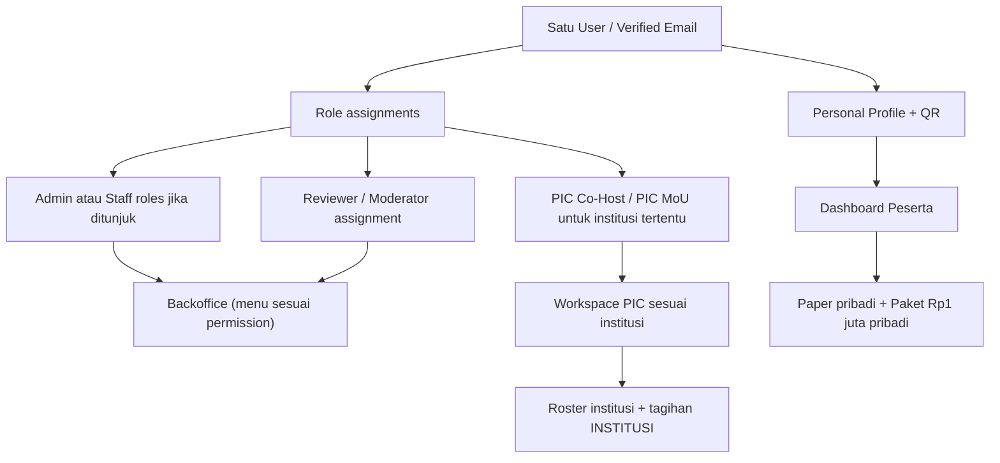
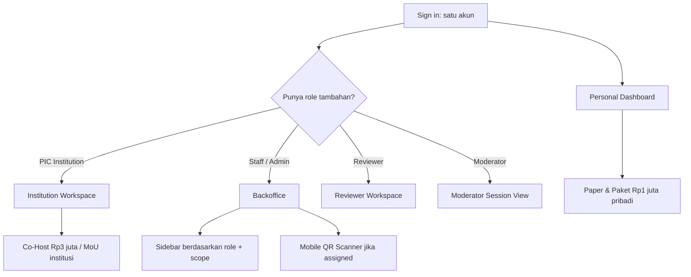
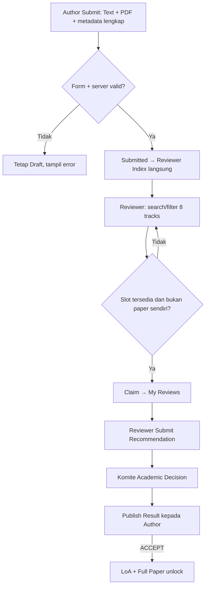

# 18A — Blueprint Role, Permission, Scope, dan Navigasi ICHES 2027

> **Tahap:** 18A · spesifikasi produk, **belum coding**.  
> **Tanggal penyusunan:** 27 Oktober 2026.  
> **Status:** **USULAN TERSTRUKTUR** untuk diperiksa pemilik produk dan Warek I. Bukan berarti setiap nama role, menu, dan permission teknis telah disetujui.  
> **Kebijakan yang sudah final** diambil dari [Register Keputusan](09-KEPUTUSAN-DAN-ISU-TERBUKA.md), [Admin CRUD](17-ADMIN-CRUD-DAN-PENGATURAN-ACARA.md), [QR](05-QR-ABSENSI-DAN-FASILITAS.md), [Sertifikat](06-SERTIFIKAT-PUBLIK.md), [Paket pribadi](15-PAKET-INTERNASIONAL-DASHBOARD-PESERTA.md), [Co-Host](16-COHOST-LIMA-PAPER-PERWAKILAN.md), dan [Review](03-SUBMISSION-REVIEW-AKADEMIK.md).

## 1. Keputusan produk yang TIDAK boleh berubah oleh desain permission

| Kebijakan disetujui | Konsekuensi akses |
|---|---|
| Semua aturan acara dan modul dikelola melalui **Admin CRUD** | Admin mengelola master, konfigurasi, delegasi kewenangan, dan melihat rekap lintas program |
| Co-Host **Rp3 juta/institusi, lima orang/lima paper, satu paper per orang** | PIC melihat **institusinya sendiri** dan roster/paper terkait; Admin mengelola seluruh institusi |
| Paket internasional **Rp1 juta/orang = satu produk empat program** | Hanya peserta memesan dari **Dashboard pribadi**; PIC tidak memperoleh hak melihat/membayar tagihan pribadi anggota |
| Abstract Text + PDF divalidasi saat Submit, **tanpa screening pascasubmit** | Reviewer Index langsung menampilkan paper Submitted yang valid; **tidak ada role/staf Screening Officer atau aksi PASS SCREENING** |
| Reviewer **self-claim** paper menurut filter topik | Reviewer tidak dikunci ke topik akun tertentu; claim dibatasi konflik dan slot paper, bukan membership topik |
| Academic ACCEPT adalah keputusan final komite | Reviewer **hanya merekomendasikan**; Admin mengatur workflow dan menugaskan pejabat akademik, bukan otomatis mengubah rekomendasi reviewer menjadi keputusan |
| Full Paper dibuka saat keputusan **ACCEPT diumumkan ke author** | Internal ACCEPT belum membuka akses; hanya transisi hasil publikasi yang sah |
| Payment presenter setelah ACCEPT | Finance memverifikasi pembayaran; hak konferensi/publikasi tidak berasal dari petugas scanner |
| Moderator memastikan **Paper Presented** | QR check-in/kehadiran lain tidak dapat menggantikan Presented |
| Sertifikat **semua penulis paper Presented**, dengan **batch publish oleh panitia** | Officer sertifikat menyiapkan/publikasi menurut kewenangan; reviewer, moderator, dan submitting author tidak dapat menerbitkan sendiri |
| QR layanan per pos, slot, hak Default/Grant/Revoke | Operator hanya scan/konfirmasi layanan terotorisasi; Koordinator layanan mengelola hak pada layanannya sendiri |
| Detail deadline Paket Rp1 juta editable Admin | Pendaftaran baru dibuka/ditutup berdasarkan **pengaturan database**, bukan hardcoded frontend |

## 2. Model satu akun, banyak peran; tidak perlu duplikasi pengguna

**Rekomendasi desain:** gunakan **satu `User` global** dengan beberapa **Role Assignment + Scope**. Identitas seorang dosen bisa sekaligus menjadi Author, Reviewer, Moderator, PIC Co-Host, dan peserta paket pribadi; semua tetap memakai akun dan QR pribadi yang sama.



- **Hak mengelola** terbit dari peran dan scope, **bukan** karena user membayar paket, memakai email institusi tertentu, atau namanya masuk daftar co-author.
- **Participant/Author** adalah identitas dasar; tidak perlu akun/login terpisah untuk menjadi Submitting Author. Hak mengubah paper hanya berlaku pada submission yang dikelolanya.
- **PIC** adalah penugasan **berdasarkan institusi + acara**, bukan role global yang bisa melihat semua institusi.
- Akun bisa mempunyai lebih dari satu penugasan; navigasi dapat memakai **Personal / Institution / Backoffice** agar user tahu sedang beroperasi pada ruang mana. Ini hanya pilihan tampilan, bukan impersonasi akun lain.
- Undangan email Magic Link untuk anggota Co-Host tetap **USULAN**, sedangkan aturan lima perwakilan/lima paper **sudah FINAL**.

## 3. Rekomendasi template role (bukan 13 silo aplikasi)

| Template role | Scope awal | Yang boleh dilakukan | Yang tidak otomatis boleh |
|---|---|---|---|
| **Admin (Event Administrator)** | Semua ICHES 2027 | CRUD master, content, event rules, staff/role assignment, data/rekap seluruh modul, tindakan koreksi berwenang | Memalsukan review, presensi, pembayaran, Presented atau sertifikat yang belum eligible |
| **Academic Coordinator / Committee** | Conference 2027 | Konfigurasi akademik yang didelegasikan, monitor reviewer index & claims, release claim macet, final decision, **Publish Decision**, jadwal dan full paper | Mengganti review orang lain seolah-olah dirinya reviewer; verifikasi transfer bank |
| **Reviewer** | Paper yang dapat di-claim + assignment sendiri | Cari/filter semua track, claim paper tersedia, baca author (single-anonymous), simpan/submit review sendiri | Review paper sendiri; ACCEPT final; akses pembayaran; terbitkan LoA |
| **Moderator** | Session/paper yang ditugaskan | Baca agenda/paper yang diperlukan, konfirmasi **Presented / No Show** dan koreksi terbatas | Menentukan paper ACCEPT, mengubah reviewer, publish sertifikat |
| **Finance** | Semua transaksi keuangan yang ditugaskan | Lihat invoice institusi dan individu pada modul Finance, bukti pembayaran, verify/reject/correction, laporan | Mengubah academic decision/Presented; mengubah tarif historis; melihat isi review tanpa perlu |
| **Program Coordinator** | Satu atau beberapa program: MoU / Upgrading / PKM / Destinasi | CRUD agenda/kelompok, peserta dan kehadiran program pada scope sendiri; status MoU sesuai kewenangan | Akses seluruh program secara otomatis, mengubah tagihan pribadi peserta, menentukan paper ACCEPT |
| **Service Coordinator** | Satu atau beberapa layanan: REG/KIT/FNB/MOU/ICD/SES | CRUD pos, slot, stok, default rights, individual Grant/Revoke, penugasan scanner & koreksi layanan **dalam scope** | Mengubah hak KIT bila hanya koordinator FNB; validasi pembayaran |
| **Scanner Operator** | Pos + jenis layanan + penugasan | Pilih pos berizin, scan QR, lihat identitas minimum/hak, konfirmasi layanan atau check-in yang benar-benar terjadi | Grant/Revoke hak, lihat riwayat bank/review, scan pos lain tanpa assignment |
| **Certificate Officer** *(delegasi opsional)* | Sertifikat ICHES / tipe atau batch | Preview eligible, buat draft, publikasi massal, revoke/reissue bila diberi izin | Mengubah status paper menjadi Presented atau menambah author tanpa revisi data akademik |
| **Content Editor** *(delegasi opsional)* | Website/CMS | CRUD konten publik, agenda yang boleh dipublikasikan, logo Co-Host yang sudah dikonfirmasi | Melihat bukti pembayaran, mengubah paper, menerbitkan sertifikat |
| **PIC Co-Host** | **Satu institusi Co-Host** | Profil institusi & roster hingga 5 orang, pantau 5 paper terkait & **satu invoice Rp3 juta institusi**, nama/logo jika diizinkan | Akses **tagihan pribadi Rp1 juta** anggota, memutuskan ACCEPT, melihat roster Co-Host lain |
| **PIC MoU** | **Satu institusi MoU** | Mengusulkan/memperbaiki delegasi/signatory, melihat status institusi MoU sendiri | Mengesahkan delegasi sendiri tanpa verifikasi panitia, menandatangani otomatis, mengelola Co-Host lain |
| **Participant / Submitting Author** | **Data pribadi + paper yang dikelola** | Profil/QR, buat 1 paper per jatah Co-Host bila terkait, abstract submit, lihat hasil, full paper setelah ACCEPT diumumkan, paket pribadi Rp1 juta, pembayaran sendiri, sertifikat seluruh co-author paper miliknya | Mengubah paper lain, memperoleh tanggungan Co-Host kedua, melihat keuangan Co-Host/PIC tanpa assignment |

**Catatan penting:** tidak perlu role `MoUCoordinator`, `ICDCoordinator`, `DestinationCoordinator`, `UpgradingCoordinator` sebagai empat sistem autentikasi berbeda. Cukup **Program Coordinator** dengan assignment program. Demikian pula **Service Coordinator** dibatasi berdasarkan layanan/pos. **Certificate Officer** dan **Content Editor** adalah delegasi tugas opsional dari Admin, bukan tambahan akun login yang wajib.

**Rincian struktural DIUSULKAN, belum dipilih final:** apakah butuh istilah `Super Admin` terpisah? Rekomendasi MVP: **satu template Admin utama**; pisahkan user/person yang berhak mengelola akun petugas dengan izin sensitif apabila dibutuhkan, tanpa menambah lapisan role hanya demi nama.

## 4. Matriks permission lintas fitur

**Legenda:** `ALL` = semua dalam event; `OWN` = pemilik data; `ASSIGNED` = paper/sesi/pos yang ditugaskan; `SCOPE` = program/layanan/institusi yang dikuasakan; `MANAGE` = konfigurasi+CRUD pada ranah berizin; `DECIDE` = keputusan domain yang memang berwenang; `VERIFY` = verifikasi Finance; `PUBLISH` = terbitkan ke publik; `—` = tidak ada izin. **`VIEW` tidak otomatis mengizinkan download seluruh berkas privat.**

| Fitur/aksi | Admin | Akademik | Reviewer | Moderator | Finance | Koord. Program | Koord. Layanan | Operator QR | PIC | User |
|---|---|---|---|---|---|---|---|---|---|---|
| Identitas/akun/penugasan staff | MANAGE ALL | VIEW relevan | OWN | OWN | OWN | OWN | OWN | OWN | OWN | OWN |
| CMS, event, deadline, tracks | MANAGE ALL | MANAGE akademik jika delegasi | VIEW | VIEW | VIEW fee | MANAGE SCOPE | VIEW | VIEW | VIEW | VIEW |
| Registrasi dan daftar peserta | MANAGE ALL | VIEW conference | VIEW tugas | VIEW sesi | VIEW invoice | MANAGE SCOPE | VIEW layanan | VIEW minimum | VIEW institusi sendiri | OWN |
| Paper/metadata/versi | MANAGE administratif + koreksi berwenang | MANAGE akademik | VIEW claimed | VIEW assigned | — | — | — | — | VIEW paper anggota Co-Host (status minimum) | MANAGE OWN paper |
| Reviewer Index, filter, Claim | Monitor/release berwenang | Monitor/release | CLAIM self | — | — | — | — | — | — | — |
| Submit review/rekomendasi | VIEW audit | VIEW | WRITE OWN CLAIM | — | — | — | — | — | — | — |
| Final decision / publish hasil | Pengaturan, assign otoritas | **DECIDE + PUBLISH** | — | — | — | — | — | — | — | VIEW OWN |
| LoA / Full Paper access | VIEW/CONFIG | MANAGE akademik | — | VIEW assigned | — | — | — | — | VIEW status minimum | OWN setelah ACCEPT diumumkan |
| Co-Host roster: 5 wakil/5 paper | MANAGE ALL | VIEW paper relevan | — | — | VIEW invoice | — | — | — | MANAGE OWN INSTITUTION sesuai izin | VIEW keanggotaan OWN |
| Co-Host invoice Rp3 juta | CONFIG, VIEW | — | — | — | **VERIFY** | — | — | — | VIEW & upload proof OWN institution | — kecuali anggota adalah PIC |
| Paket Rp1 juta (satu bundle 4 program) | MANAGE settings/deadline | — | — | — | **VERIFY** | VIEW peserta SCOPE | VIEW hak minimum | VIEW hak minimum | **— pada panel PIC** | ORDER & PAY OWN dashboard |
| MoU delegates/signatories | MANAGE ALL | — | — | — | — | VERIFY delegate/SCOPE | VIEW layanan MoU | CHECK-IN assigned | NOMINATE OWN institution | VIEW status OWN |
| Program Upgrading/PKM/Destinasi | MANAGE ALL | — | — | — | — | MANAGE SCOPE | VIEW layanan | CHECK-IN assigned | — | VIEW OWN access |
| Pos, slot, stok & hak fasilitas | MANAGE ALL | — | — | — | — | VIEW relevant | **MANAGE SCOPE** | SERVE assigned | VIEW OWN eligibility | VIEW OWN eligibility |
| Paper Presented | Manage sessions/correction authorized | VIEW/coordinate | — | **CONFIRM assigned** | — | — | — | — | VIEW relevant | VIEW OWN |
| Batch sertifikat Presenter | MANAGE settings + delegated publish | VIEW eligibility | — | — | — | — | — | — | VIEW institutional status only | DOWNLOAD linked paper |
| Public certificate verification | VIEW PUBLIC | VIEW PUBLIC | VIEW PUBLIC | VIEW PUBLIC | VIEW PUBLIC | VIEW PUBLIC | VIEW PUBLIC | VIEW PUBLIC | VIEW PUBLIC | VIEW PUBLIC |

**Tambahan role opsional:** Certificate Officer menerima `PREVIEW/GENERATE/PUBLISH/REVOKE` sesuai penugasan (Admin boleh mendelegasikan, tetapi perubahan publikasi harus terlacak); Content Editor menerima `MANAGE WEBSITE CMS` tanpa membuka data peserta. Pada matriks ringkas, kedua delegasi tidak dibuat sebagai kolom tambahan agar mudah dibaca Warek I.

## 5. Menu final untuk dirancang: tiga ruang kerja, satu login

### Public site (tidak perlu login)

```text
ICHES 2027 Public Website
- Home / About / Conference / Tracks / Call for Papers
- Important Dates / Fees / Schedule / Speakers
- Co-Hosting Institutions / Partners
- Four Program Package / Registration
- Certificate Verification (kode unik)
```

### Personal Dashboard (untuk seluruh peserta/author/reviewer/staf)

```text
MY DASHBOARD
- Overview / Next Action
- My Profile & Personal QR
- International Conference
  - My Submissions / Draft & Revision / Decision
  - LoA / Full Paper / Sessions / My Certificates
- Paket Program Internasional
  - Satu paket Rp1.000.000 untuk 4 akses
  - Daftar / Satu Tagihan Pribadi / Bukti Bayar / Akses & Jadwal
- My Payments & Documents
- My Activities / Attendance (yang relevan)
```

**Catatan:** Reviewer yang juga author tetap bisa melihat paper pribadinya pada Personal Dashboard; saat bertindak Reviewer ia membuka workspace Review, bukan mendapat hak mengklaim paper sendiri. **My Payments** hanya milik user; invoice institusi tampak pada panel PIC berotorisasi.

### Institution Workspace (tampil hanya jika diberi role PIC institusi)

```text
INSTITUTION WORKSPACE
- Co-Host (jika PIC Co-Host)
  - Identitas Institusi / Branding
  - Members: 0/5 .. 5/5
  - Papers: 0/5 .. 5/5 (read status)
  - Single Invoice: Rp3.000.000
- Institutional MoU (jika PIC MoU)
  - MoU Institution Details
  - Propose Delegates / Signatories
  - Validation & Signing Status
```

**Dilarang menambahkan** menu `Buy Rp1m Package`, `Member Personal Invoice`, atau `Pay Extra for 4 Activities` di dalam Co-Host. Jika PIC sendiri ingin paket, ia berpindah ke **Personal Dashboard** dan membayar menggunakan identitasnya sendiri.

### Backoffice — Admin pusat, sidebar kondisional

```text
ADMIN / STAFF BACKOFFICE
01 Overview
02 Event & Website
   - Event Settings / Important Dates / CMS / Speakers / Partners / Co-Host Listing
03 Conference Management
   - Tracks & Submission Settings
   - All Submissions
   - Reviewer Index & Claims / Academic Decisions / Publish Results
   - Full Paper / Sessions & Moderators
04 Co-Host Institutions
   - Institutions / PIC / Members 0–5 / Paper Quota 0–5 / Institutional Invoice
05 Participants & International Package
   - Participants / Registrations
   - Paket Rp1m: Settings + Editable Deadline / Enrollments / Personal Payments
06 International Programs
   - Institutional MoU / Upgrading
   - International PKM / Destinations
07 Finance & Payments
   - Institutional Transactions / Personal Transactions / Proof Verification
08 Event Operations
   - Service Catalogue / Counters / Slots / Stock / Rights / Staff
   - Attendance / Scanner (mobile)
09 Certificates & Documents
   - Eligibility / Preview / Batch Publish / Verification / Reissue
10 Reports & Export
11 Staff / Roles & Permissions
```

**Visibility berdasarkan scope**: Reviewer biasanya hanya melihat `My Reviewer Workspace` (Index, My Claims, Review Form), bukan seluruh sidebar Admin. Finance hanya mendapat Finance & hal relevan. Operator mobile langsung ke Scanner dan Assigned Counters; tidak perlu dashboard berisi 11 modul. Program Coordinator hanya melihat International Programs yang menjadi tanggung jawabnya.



## 6. Reviewer Workspace: tidak ada screening dan tidak ada penguncian akun-ke-topik



**Scope reviewer index:** semua paper **valid-Submitted** yang tersedia untuk claim, tanpa pembatasan reviewer pada daftar track tertentu di profil. Informasi penulis ditampilkan karena mode *single-anonymous*; reviewer tidak diberikan akses melihat komentar reviewer lain jika belum dibutuhkan. Aksi Claim aman terhadap klik bersamaan. Target review per paper **baseline lama 1 configurable** tetapi jumlah operasional ICHES **belum dikunci**. Komite dapat release klaim yang terbengkalai. **Tidak ada form administrasi PASS screening atau jangka waktu menunggu periode reviewer dimulai.**

## 7. Titik kontrol sensitif: satu Admin pusat bukan izin memalsukan fakta

| Aksi penting | Pelaku otoritatif | Catatan kontrol sederhana |
|---|---|---|
| Ubah harga/kuota/deadline untuk **pendaftaran baru** | Admin | Perubahan dari CRUD, tarif/tanggal lama pada invoice tidak berubah |
| Submit abstract | Submitting Author | Validasi form + backend, versi resmi immutable secara historis |
| Claim + submit review | Reviewer yang claim | Blok self-review, claim atomik, catat pelaku |
| Final ACCEPT/REJECT + Publish Decision | Academic Coordinator/Committee | Dua tahap: keputusan internal vs hasil diumumkan |
| Finance VERIFIED | Finance (atau Admin yang secara formal diberi izin Finance) | Berdasarkan bukti, bukan tombol "mark paid" bebas |
| MoU delegates approved | Admin/Program Coordinator MoU yang berwenang | PIC hanya mengusulkan |
| Confirm paper Presented | Moderator ditugaskan / koreksi berwenang | Tidak dipicu oleh scan pintu atau status pembayaran |
| Grant/Revoke fasilitas | Admin / Service Coordinator sesuai scope | Tidak menghapus record layanan yang sudah diserahkan |
| Scan/confirm layanan | Scanner Operator assigned | Identitas minimum, jenis/slot/pos sesuai izin |
| Sertifikat massal | Admin atau Certificate Officer berotorisasi | Setelah paper Presented; tiap author PDF/URL unik |
| Co-Host Public Listing | Admin/Content Editor yang didelegasikan | Nama/logo setelah status institusi dan izin publikasi benar |

**Rekomendasi audit minimal untuk tindakan kritis**: `actor`, `entity`, `action`, `before→after`, `timestamp`, dan `reason` pada koreksi. Hindari mencatat seluruh klik biasa. Jika user sekaligus Admin dan Komite, aksi `Publish Decision` tetap tercatat sebagai **fungsi Komite**—bukan bypass melalui edit row generik.

## 8. Permission keys dan scope — contoh kontrak konseptual, BUKAN kode

**Rencana namespace (usulan, belum implementasi):**

| Domain | Contoh izin bermakna |
|---|---|
| Event/CMS | `event.manage`, `cms.manage`, `cohost.publication.manage` |
| Academic | `academic.settings.manage`, `submission.view`, `review.claim`, `review.submit`, `academic.decision.make`, `academic.decision.publish` |
| Co-Host | `cohost.manage`, `cohost.roster.manage`, `cohost.paper_quota.view` |
| Package | `package.settings.manage`, `package.enrollment.view`, `package.enroll_own` |
| MoU/Program | `mou.institution.manage`, `mou.delegate.approve`, `program.manage`, `program.attendance.record` |
| Finance | `payment.view`, `payment.verify`, `payment.correct` |
| Service | `service.settings.manage`, `service.rights.manage`, `service.fulfill`, `attendance.record` |
| Session/Certificate | `session.presented.confirm`, `certificate.preview`, `certificate.publish`, `certificate.reissue` |
| Access | `staff.assignment.manage`, `permission.assign`, `report.export` |

**Scope minimum:** `event_id` (hanya ICHES 2027), `institution_id`, `program_id`, `service_id`/`counter_id`, `session_id` dan `paper_id` untuk aksi yang ditugaskan, serta `user_id` untuk data personal. Tidak semua permission memerlukan semua scope; tentukan seperlunya.

**Server-side authorization wajib pada setiap aksi**. Menyembunyikan tombol bukan kontrol keamanan. Tautan undangan dan QR harus punya token aman tanpa membawa data sensitif. **Pemulihan/penugasan role staf** hanya oleh pihak berwenang; akun operasional bernilai tinggi dianjurkan verifikasi lebih kuat dibanding akun peserta, tetapi metode final masih perlu dipilih.

**Rancangan Tahap 18B (belum disetujui final):** Android scanner khusus dapat bekerja offline menggunakan cache terenkripsi, mencatat **Pending Sync**, lalu mengirim catatan ke Laravel ketika internet pulih. **Pending bukan transaksi CONFIRMED oleh server**; dua HP terputus tidak bisa menjamin pencegahan penerimaan layanan ganda. Admin mengelola perangkat, operator, pos, sync dan konflik; server memerlukan load test, cadangan jaringan, backup, monitoring, kontrol API dan keamanan berlapis. [Arsitektur offline/keamanan](18B-00-ANDROID-OFFLINE-QR-RELIABILITY-DAN-KEAMANAN.md) · [CRUD Scanner](18B-01-CRUD-ADMIN-SCANNER-DAN-SINKRONISASI.md).

**Turunan Tahap 18B untuk role Akademik:** [18B-02 Field-level Conference](18B-02-CRUD-INTERNATIONAL-CONFERENCE-SUBMISSION.md) dan [18B-03 Review→Certificate Handoff](18B-03-CRUD-REVIEW-DECISION-FULLPAPER-SESSION-DAN-UAT.md) menggunakan peran dan scope dari dokumen ini. **Keputusan bisnis telah disetujui; field teknis dan role assignment orang tertentu masih rancangan.**

## 9. Yang dianggap FINAL vs yang masih membutuhkan persetujuan

| Jenis | Isi |
|---|---|
| **DISETUJUI sebelumnya** | Admin CRUD seluruh modul; reviewer self-claim; Komite final decision; Finance payment verification; Moderator Presented; Co-Host 5 wakil/5 paper; paket Rp1 juta mandiri; QR scoped; sertifikat seluruh author dengan batch publish |
| **REKOMENDASI 18A** | Template role di atas, nama menu, `Role Assignment + Scope`, workspace Personal/Institution/Backoffice, Certificate Officer/Content Editor delegasi, contoh permission keys |
| **TERBUKA** | Siapa orang nyata yang ditunjuk; apakah satu Admin saja atau ada beberapa Admin; siapa boleh menerbitkan/menarik sertifikat; batas ekspor data; login staf berisiko tinggi; apakah Finance/admin boleh koreksi refund; final jumlah reviewer per paper |

**Kesimpulan:** satu sistem ICHES 2027 yang dapat diatur Admin, tetapi aksi sensitif tetap mengikuti kompetensi dan wewenang. Tidak membangun perangkat lunak terpisah untuk setiap peran/program. **Belum ada kode aplikasi**, router/migration/permission seeding, maupun instalasi template.

[Lihat alur operasional dan skenario UAT](18A-ALUR-OPERASIONAL-DAN-UAT-PERAN.md) · [Blueprint CRUD](17-ADMIN-CRUD-DAN-PENGATURAN-ACARA.md) · [Register keputusan](09-KEPUTUSAN-DAN-ISU-TERBUKA.md).
