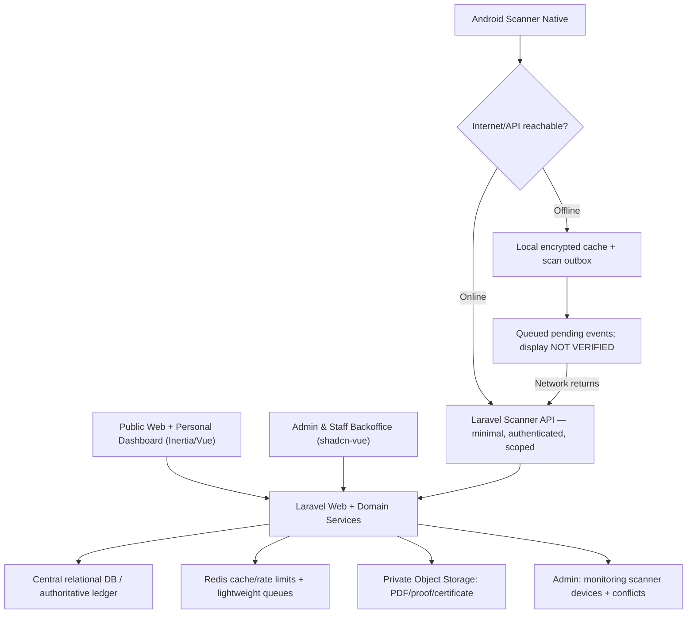
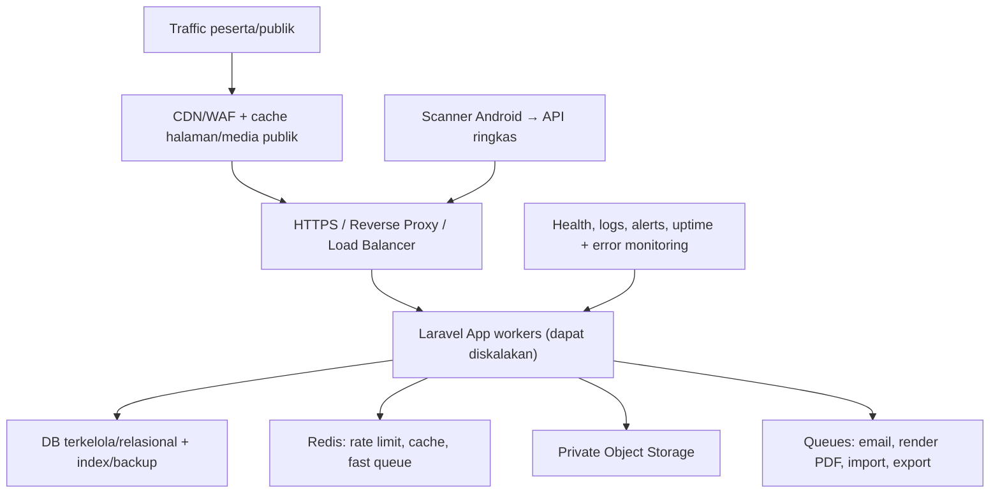

# 18B-00 — Android QR Scanner, Offline Sync, Ketahanan Server, dan Keamanan Berlapis

> **27 Oktober 2026 · USULAN ARSITEKTUR, BUKAN KEPUTUSAN FINAL / BUKAN IMPLEMENTASI.**  
> Dokumen ini menjawab kebutuhan pemilik produk: **Android khusus petugas scanner**, tetap berguna ketika sinyal atau internet buruk, terhubung ke satu aplikasi Laravel ICHES, tidak mengganggu kinerja website pada 5–6 Januari 2027, dan keamanan berlapis.  
> **Keputusan terdahulu tetap berlaku**: satu identitas/QR personal, scanner Model C (pos fleksibel dengan assignment), rights DEFAULT/GRANT/REVOKE, satu pemenuhan per orang per slot, Attendance berbeda dari Presented, Admin mengelola pos/slot/petugas melalui CRUD, tidak ada sistem administrasi multi-app yang terpisah.

## 1. Ringkasan rekomendasi untuk pimpinan

**Usulan prioritas:**
1. **Satu backend Laravel** dan satu database pusat yang merupakan **source of truth** untuk entitlement, transaksi layanan, dan kehadiran; web ICHES tetap memakai Inertia/Vue/shadcn-vue.
2. **Android Scanner khusus petugas** (native Android minimal) menggunakan **kamera QR yang dapat bekerja offline**, basis data lokal terenkripsi, serta antrian sinkronisasi jika jaringan gagal. Fokus hanya pada scanner/pos; **jangan membangun ulang dashboard Admin/Author pada Android**.
3. **Mode online sebagai utama**. Ketika offline, hasil **QUEUED/PENDING**, bukan `CONFIRMED` oleh server. Offline dapat menampilkan hak berdasarkan cache terbatas dan belum tentu mengetahui duplikasi di HP lain. **Setiap layanan memerlukan SOP offline**, terutama barang/konsumsi.
4. **Jaringan venue yang disiapkan khusus** (Wi-Fi petugas, router/UPS dan koneksi cadangan), dan **server yang diuji dengan beban puncak**. Android offline adalah fallback ketika WAN hilang, **bukan pengganti internet/hosting**.
5. **Defense-in-depth**: enkripsi komunikasi, autentikasi staf lebih kuat, RBAC/scope di server, batas akses perangkat, minimisasi data cache, transaksi idempotent, rate limit/WAF, backup, monitoring, latihan insiden. Tidak mungkin menjamin “anti-hack 100%” atau “tidak pernah down”.

**Pilihan implementasi yang belum disetujui:** apakah Android scanner native akan menjadi bagian MVP, atau web/PWA scanner digunakan terlebih dahulu dan Android native menjadi peningkatan. Karena venue 5–6 Januari 2027, keputusan ini perlu mempertimbangkan waktu pengerjaan, inventaris HP, kemampuan tim, dan uji lapangan. Native memberi kontrol lebih kuat pada antrian lokal dan distribusi perangkat; PWA biasanya lebih cepat dirilis tetapi perilaku offline/background scanner bergantung browser/perangkat.

## 2. Arsitektur usulan



**Satu web+API yang berbagi domain logic**, bukan dua sistem bisnis berbeda. API scanner tidak mengandung semua properti paper, payment, dan profil. Tidak ada alasan membuat microservices hanya karena scanner Android.

## 3. Pilihan platform scanner

| Opsi | Kelebihan | Keterbatasan | Penilaian |
|---|---|---|---|
| Web scanner responsive (kamera HP) | Satu codebase, update terpusat, cocok **online** | Perilaku offline kamera/cache tergantung browser dan layanan worker; perlu uji perangkat nyata | Basis cepat jika offline bukan prioritas |
| PWA Scanner offline-first | Instal ringan, UI dapat dicache, dapat mengantre transaksi lokal sesuai dukungan browser | Background sync dan storage dapat dibatasi/dihapus browser; debugging antar-HP lebih sulit | Cadangan yang mungkin paling realistis untuk MVP cepat |
| **Android native scanner minimal** | Kamera dan model barcode bundled bekerja tanpa koneksi; Room/database lokal + WorkManager sync; lebih terkontrol | Perlu pengembangan, pengujian, distribusi APK/aplikasi dan perawatan perangkat khusus | **Rekomendasi teknis jika kebutuhan offline tinggi dan waktu/tim memadai** |
| Local venue edge hub + sync cloud | Beberapa scanner di Wi-Fi lokal dapat berbagi ledger ketika internet publik mati | Tambah perangkat, operasional, keamanan & rekonsiliasi; bukan MVP default | Fase lanjutan jika perlu offline multi-scanner tanpa risiko duplikasi |

**Rujukan vendor:** Google ML Kit barcode scanning **bundled** dapat digunakan offline: https://developers.google.com/ml-kit/vision/barcode-scanning/android . Google Android Offline-first/Room/WorkManager: https://developer.android.com/topic/architecture/data-layer/offline-first . Rekomendasi ini tidak mengunci bahasa Kotlin/framework sampai desain diotorisasi, meski Kotlin native + ML Kit bundled + Room + WorkManager adalah kombinasi yang cocok.

## 4. Makna status scanner — wajib jelas

| Status UI | Arti sebenarnya | Boleh disebut transaksi selesai? |
|---|---|---|
| **ONLINE / VERIFIED / CONFIRMED** | Server memeriksa identitas, hak, slot, stok, duplikat; menyimpan transaksi resmi | **Ya**, setelah server mengirim acknowledgement |
| **OFFLINE / PENDING_SYNC** | Identitas teridentifikasi dari cache; kejadian dicatat pada device dan **belum disahkan server** | **Tidak** |
| **SYNCING** | Device sedang mengirim catatan antrean | **Tidak** |
| **SYNCED/CONFIRMED** | Server menerima dan menyimpan sebagai transaksi sah | **Ya** |
| **CONFLICT/REJECTED** | Server menemukan sudah diambil/hak tak berlaku/slot tertutup/kebijakan gagal | **Tidak**; koordinator menyelesaikan sesuai bukti lapangan |
| **UNKNOWN / CACHE_EXPIRED** | Identitas/hak tidak ada atau cache terlalu lama | Tidak. Gunakan fallback supervisor/manual |

**Syarat kejujuran data:** catatan `PENDING` tidak boleh menghitung sebagai `Confirmed Attendance`, `Fulfillment`, atau `Paper Presented`. Jika barang sudah diserahkan offline, bukti fisik dapat tercatat sebagai **provisional handed-over** dan dinilai ketika sync, tetapi konflik tidak bisa membatalkan barang fisik yang terlanjur diserahkan.

## 5. Mode online dan offline

```mermaid
sequenceDiagram
  participant O as Operator
  participant D as Android Scanner/Local DB
  participant S as Laravel Central API
  O->>D: Scan QR di pos yang ditugaskan
  D->>D: Periksa cache lokal + session/perangkat
  alt API reachable
    D->>S: Validate + confirm service(slot, person, idempotency_key)
    S->>S: Check scope, rights, time, stock, dedupe, transaction
    S-->>D: Confirmed / Already Used / Not Entitled
    D-->>O: Hasil server (otoritatif)
  else Internet/APi unreachable
    D->>D: Simpan event lokal (encrypted) dengan unique ID
    D-->>O: Pending Sync; belum diverifikasi server
    Note over D,O: SOP offline menentukan apakah boleh beri layanan
    D->>S: Auto-sync batch setelah koneksi pulih
    S-->>D: Ack per event: confirmed / conflict / rejected
    D-->>O: Status final dan laporan konflik
  end
```

**Data transaksi event minimal:** `client_event_uuid`, `device_id`, `operator_id`, `counter_id`, `service_id`, `slot_id`, `qr_token_reference`, `device_scanned_at` (indikatif), `server_received_at` (otoritatif), `permission_snapshot_version`, `local_status`, `server_status`, `sync_attempts`, `reason` bila koreksi. **Bukan kode final**.

**Operasional sync**: perangkat menyimpan event sebelum menyatakan pending, mengirim batch kecil dengan retry/backoff; backend menggunakan **idempotency key** agar retry tidak menambah transaksi ganda. Event lokal boleh dibersihkan dari antrean setelah acknowledgement tersimpan, bukan saat permintaan dikirim. Jika server mengembalikan sebagian konflik, operator/koordinator melihat item satu per satu. UI menampilkan jumlah **Pending**, **Synced**, **Conflict**, dan **last successful sync**.

### Batas besar: double-scan saat dua HP sama-sama offline

Dua HP tidak bisa mengetahui transaksi yang baru tersimpan pada perangkat lain tanpa jaringan bersama. Karena itu **tidak bisa dijamin exact-once penerimaan makan/kit lintas HP ketika sepenuhnya offline**. Usulan SOP:
- **Registrasi/absensi umum:** offline dapat dicatat sementara, tetapi server baru menetapkan rekap final setelah sync; potensi duplikat direkonsiliasi.
- **Makanan/kit/stok terbatas:** saat offline, operator **jangan menampilkan hijau Confirmed** hanya berdasarkan cache. Jika panitia memutuskan tetap melayani, gunakan **satu titik/petugas per pos, pencatatan jumlah manual/daftar tanggap darurat**, dan akui risiko konflik; opsi aman adalah tahan pelayanan berisiko tinggi sampai validasi online.
- **Paper Presented:** hanya Moderator assigned mengonfirmasi fakta presentasi. Offline dapat berupa catatan sementara untuk sinkronisasi kemudian, **bukan otomatis membuat sertifikat**.
- **MoU Signed/Finance Verified:** **tidak boleh** dideklarasikan melalui scan offline. Ini domain kewenangan lain.
- **Override GRANT/REVOKE:** cache offline dapat tertinggal; jika cache melewati usia maksimum yang ditentukan, alat harus menolak klaim entitlement offline atau mengarahkan ke supervisor.

**Alternatif jika event harus bisa mencegah duplikat walaupun tidak ada internet publik:** sediakan **local Wi-Fi + local edge server/hub** sehingga semua scanner menyepakati pemakaian satu slot secara bersama di lokasi. Ini lebih rumit; usulkan hanya bila uji lapangan menunjukkan kebutuhan nyata. Local Wi-Fi saja **tanpa hub** tidak menyelesaikan sinkronisasi apabila semua data tetap harus mencapai cloud.

## 6. QR, identitas dan cache perangkat

- **Personal QR tetap satu per user**; jangan gunakan QR individu yang memuat email, nomor WhatsApp, nama lengkap, hak permanen, atau kode pembayaran. QR menunjuk token acak yang dapat dipetakan oleh server dan **snapshot lokal terbatas jika mode offline diaktifkan**.
- Sebelum acara, HP operator melakukan **device enrollment + initial sync** hanya untuk **event/pos/layanan yang ditugaskan**. Unduh data minimum (ID atau alias, status hak, bila perlu nama singkat/foto kecil untuk konfirmasi) dan **jangan download semua dokumen pribadi peserta**.
- Cache harus dilindungi oleh penyimpanan internal Android + enkripsi data sensitif; kunci disimpan aman (contoh Android Keystore), tidak di file biasa.
- Token login/akses tidak di-hardcode dalam APK. Device/operator diotorisasi oleh backend, bisa dicabut oleh Admin; masa sesi/cache offline dibuat terbatas dan di-refresh saat online. **Pencabutan tidak seketika efektif pada perangkat sepenuhnya offline**; batasi kemampuan offline dan prosedur perangkat hilang.
- **Token QR personal tidak sama dengan QR sertifikat publik**. QR sertifikat untuk validasi dokumen published; QR pribadi untuk lookup orang/hak.
- Offline disarankan hanya bila data/cache telah disegarkan dalam jendela waktu yang disetujui; bila ada peserta baru setelah cache dibuat, tampilkan `UNKNOWN` dan minta koordinasi, jangan mengarang hak.
- Foto (jika dipakai untuk mencegah joki) sebaiknya thumbnail terbatas; **bukan** mengunduh ratusan foto HD besar dan seluruh file author.

## 7. Desain API Scanner (kontrak rancangan, belum endpoint riil)

| Tindakan | Contoh endpoint konseptual | Batas |
|---|---|---|
| Device authorization | `POST /api/scanner/device/session` | Petugas login dan assignment, device terdaftar |
| Sync snapshot | `GET /api/scanner/bootstrap` | Scope pos, event, layanan; versi dan checksum |
| Validate online | `POST /api/scanner/validate` | QR+pos+slot; tidak otomatis mark served |
| Confirm online | `POST /api/scanner/fulfill` | Entitlement/stock/duplicate dicek **transaksi sinkron** |
| Upload outbox | `POST /api/scanner/sync` | Batch events, idempotent IDs, outcome per event |
| Health/permission | `GET /api/scanner/status` | Server availability/assignment/current version |

**Perbedaan prioritas:** PDF/sertifikat/email/video dapat dikerjakan dengan queues/background workers. **Validasi dan commit penyerahan layanan** harus **transaksional di database pusat** saat online; jangan mengirim `Confirmed` sebelum transaksi berhasil.

Rekomendasi authentication API untuk mobile satu backend Laravel: scoped tokens atau sesi device-bound, bukan API key global di APK. Laravel Sanctum mendukung mobile API tokens; akses endpoint tetap melalui Policies/Gates dan pemeriksaan scope `operator + device + event + counter + service`. Rujukan: https://laravel.com/docs/13.x/sanctum dan https://laravel.com/docs/13.x/authorization.

## 8. High availability & performa untuk 5–6 Januari 2027



**Minimal yang perlu direncanakan:**
1. **Capacity plan menurut angka peserta/scan peak** (bukan jumlah total kunjungan). Asumsi jumlah HP, sesi check-in dalam waktu pendek, QR per detik, burst logins, upload PDF dan unduh sertifikat diuji dengan angka nyata. Tidak menjanjikan 'bebas down'.
2. **Server dengan RAM/CPU/DB/IO memadai**, TLS dan backup teruji. Hindari shared hosting tanpa kemampuan kontrol worker/Redis/monitoring bila beban acara cukup tinggi. Pilih sizing **sesudah** load test.
3. **Pemisahan beban**: file PDF upload/download di object storage; CDN/cache untuk asset publik; request scan sangat kecil; email, PDF rendering, laporan massal diproses queue, **bukan dalam request scanner**. Laravel 13 mendukung Redis rate limiter/caching dan queue worker.
4. **Scanner memiliki endpoint API ringan dan prioritas operasional**; jika terjadi lonjakan public web, jangan membiarkan proses marketing site atau render PDF memakan semua worker/DB. Pengenalan Redis/cache, PHP app worker terpisah, serta larangan job berat pada jalur scanner membantu; scaling dan isolasi lebih lanjut sesuai uji.
5. **Venue network**: dedicated private Wi-Fi petugas, AP sesuai cakupan, router dan UPS, jalur internet utama + tether/4G/5G cadangan **dengan operator berbeda jika memungkinkan**. Uji sinyal di pos/koridor/lokasi Tumpak Sewu–Teras Semeru, bukan hanya di ruang kantor.
6. **Freeze perubahan menjelang hari H**; tidak deploy schema fitur besar pada jam kedatangan. Monitoring uptime, API latency, DB connections, queue delay, error, disk, dan perangkat scanner/Backoffice. Siapkan operator teknis dan prosedur rollback.
7. **Offsite/automated backups + restore drill** dan cadangan sumber daya. Redundansi app server atau managed DB dapat dipilih jika budget tersedia, tetapi failover juga wajib diuji.
8. **Stress/load test**: simulasi banyak user login, banyak QR bersamaan, dua scan yang saling berebut slot, jaringan intermiten, puluhan batch sync sekaligus setelah koneksi pulih, server restart, dan storage penuh di HP.

**Pengingat:** jaringan offline scanner membuat antrean tetap tercatat di HP, tetapi **tidak mencegah website/hosted app outage** dan tidak memastikan sinkronisasi sampai layanan pusat pulih.

## 9. Keamanan berlapis (defense-in-depth)

| Lapisan | Kontrol yang direkomendasikan |
|---|---|
| **User auth** | Passwordless Email OTP/Magic Link (peserta), OTP sekali pakai dengan expiry/rate limit, anti-account-enumeration; staff/Admin butuh verifikasi lebih kuat (mis. MFA) jika disetujui |
| **Authorization** | Admin CRUD terkontrol, RBAC + `institution/program/service/counter/session/paper` scope **diterapkan server-side** pada setiap aksi; role UI tidak cukup |
| **API scanner** | Hanya device/operator terotorisasi, token terbatas dan dapat dicabut, rate limit berdasar device/akun, tidak ada master API secret di APK |
| **Network** | HTTPS/TLS wajib; WAF dan proteksi abuse/DDoS sesuai penyedia; hindari koneksi plaintext |
| **Uploads** | Validasi file sebenarnya, ukuran, mime, akses privat, scan malware bila tersedia; isolate abstract PDF dan bukti pembayaran dari URL publik |
| **Storage/privacy** | Cache minimal terenkripsi, expiry dan remote device disable saat online, backup aman, tidak tampilkan seluruh biodata di QR/cache/operator |
| **Data integrity** | Unique constraints dan database transaction untuk fulfillment satu per `person+slot`; idempotent sync; optimistic/atomic conflict handling; event history immutable |
| **Audit** | Catat pelaku, action, entitas, waktu, before/after dan alasan koreksi untuk final decision, finance, revoke, hak layanan, publish sertifikat |
| **Infrastructure** | Patch dependencies/server, pengelolaan secrets, akses server minimum, database private network, backup-restore, monitoring dan alarm |
| **Testing** | Penetration testing sesuai ruang lingkup dan anggaran, review akses antarakun, uji brute force OTP, file upload, QR tampering, API auth, lost device, sync replay/conflict |

**Gunakan kerangka pemeriksaan standar yang aktif:** OWASP ASVS 5.0 untuk web/API (https://asvs.owasp.org/) dan OWASP MASVS untuk Android (https://mas.owasp.org/MASVS/). Rekomendasi vendor Android Keystore untuk melindungi kunci dan penyimpanan internal untuk data sensitif: https://developer.android.com/privacy-and-security/risks/sensitive-data-external-storage. Laravel 13 menyediakan Policies/Gates dan rate limiting yang relevan.

**Tidak ada aplikasi yang kebal hack 100%.** Tujuan desain adalah mengurangi permukaan serangan, membatasi dampak jika satu akun/perangkat bocor, mendeteksi anomali, dan memulihkan layanan dengan cepat.

## 10. Admin CRUD yang diperlukan tanpa overengineering

### Admin → Event Operations → Devices & Scanner

| Tab | Kebutuhan |
|---|---|
| Devices | Daftar HP approved, device alias/id, petugas, last seen, app version, status active/revoked |
| Operator assignments | Role user, counter/service yang boleh diakses, masa berlaku penugasan |
| POS & Services | Counter, stock, slot, default rights/override sesuai Dokumen 05 |
| Offline policy | Izinkan catat pending untuk layanan mana; usia maksimum cache, batasan mode offline (semua setting ini **USULAN**) |
| Sync monitor | Device, last sync, `pending / confirmed / conflict / rejected` counts, waktu terakhir online |
| Conflict reconciliation | Event ID, service, slot, operator/device, alasan konflik, keputusan koreksi yang tercatat |
| System health | Status scanner API, error rate, pending queue, keterlambatan sync, incident log |

**Prinsip**: petugas biasa **tidak dapat** mengubah kebijakan offline atau mengesahkan konflik. Admin/Service Coordinator dengan kewenangan dapat mengelola pengecualian; Admin melihat seluruhnya. Jangan menyatukan invoice institusi dengan pembayaran paket personal di dashboard scanner.

## 11. Rencana simulasi kesiapan acara (belum dites)

| ID | Uji pra-acara | Harapan |
|---|---|---|
| OPS-01 | 5–20 operator scan QR berbeda serentak (angka simulasi; sesuaikan kondisi riil) | API tetap responsif; tiap konfirmasi mempunyai server ACK dan satu ledger |
| OPS-02 | Dua scanner ONLINE scan orang yang sama untuk Lunch-D1 | Hanya satu berhasil, lainnya Already Served |
| OPS-03 | HP tanpa internet scan identitas yang pernah dibootstrap | Catatan local Pending, bukan Confirmed |
| OPS-04 | Dua HP OFFLINE scan orang yang sama | Tidak diklaim bebas duplikat; risiko dan konflik ditampilkan pasca-sync |
| OPS-05 | Internet pulih setelah banyak pending | Batch sync idempotent, retry/backoff, tidak menghapus event sebelum ACK |
| OPS-06 | HP dimatikan/restart di tengah queue | Queue tersimpan utuh dan bisa dilanjutkan (jika storage tidak rusak) |
| OPS-07 | Akses pos FNB oleh operator yang hanya ditugaskan REG | Server menolak; cache scope tidak memberi izin luas |
| OPS-08 | Admin REVOKE hak peserta saat salah satu HP offline | Offline menyatakan cache stale; server menolak/flag konflik saat sync |
| OPS-09 | Operator mencoba replay event UUID berkali-kali | Maksimal satu transaksi resmi dibuat |
| OPS-10 | Peak QR scan bersamaan dengan generate massal sertifikat/unduh PDF | Jalur scan tetap diprioritaskan; kapasitas diketahui dari load test |
| OPS-11 | Server restart atau database latensi tinggi | Alert/fallback berjalan; tidak ada double-confirmation |
| OPS-12 | User mencoba brute force OTP / API unauthorized | Rate limit/role guard menolak, event tercatat |
| OPS-13 | HP operator hilang/dicuri | Admin disable/revoke akses online; offline cache expiry dan perangkat dikunci |
| OPS-14 | Backup dipulihkan untuk uji | Restore data dan integritas ledger diuji, bukan hanya backup file tersedia |
| OPS-15 | Sinyal 6 Jan di lokasi lapangan buruk | Scan pending + manifest/fallback manual dan sinkronisasi kembali diuji langsung |

**Uji lapangan sebelum 5–6 Januari 2027 wajib direncanakan**. Hasil nyata belum ada; semua tabel adalah kriteria penerimaan rencana.

## 12. Hal yang perlu diputuskan sebelum coding scanner

| Keputusan | Status saat dokumen disusun |
|---|---|
| Aplikasi Android native atau PWA scanner offline-first untuk MVP | **TERBUKA** — rekomendasi native minimal bila offline prioritas tinggi |
| Apakah layanan makanan/kit boleh diserahkan dalam status Offline Pending | **TERBUKA; risiko duplicate dibahas terang** |
| Berapa HP/pos, jumlah staff, jangkauan jaringan venue dan lapangan | **TERBUKA** |
| Apakah perlu local venue hub untuk cross-device dedup tanpa internet | **BELUM DISARANKAN sebagai default** |
| Host provider/sizing/availability target, budget infrastruktur, backup connectivity | **TERBUKA; perlu hasil load test** |
| Lama cache offline, data apa yang disalin perangkat, pembatasan session | **USULAN teknis untuk diputuskan** |
| Staff/Admin MFA, distribusi Android APK, device management | **USULAN keamanan** |

**Tahap setelah pengesahan arah ini:** lanjut field-level CRUD 18B untuk `Scanner Devices/Assignments/Sync/Conflicts`, `Conference`, `Paket Internasional`, dan `Finance`, plus acceptance criteria yang menguji status online/offline tanpa mengorbankan kebenaran ledger.

[Lihat pengelolaan QR sebelumnya](05-QR-ABSENSI-DAN-FASILITAS.md) · [CRUD Admin](17-ADMIN-CRUD-DAN-PENGATURAN-ACARA.md) · [Role 18A](18A-ROLE-PERMISSION-DAN-NAVIGASI-BACKOFFICE.md) · [Register Keputusan](09-KEPUTUSAN-DAN-ISU-TERBUKA.md).
