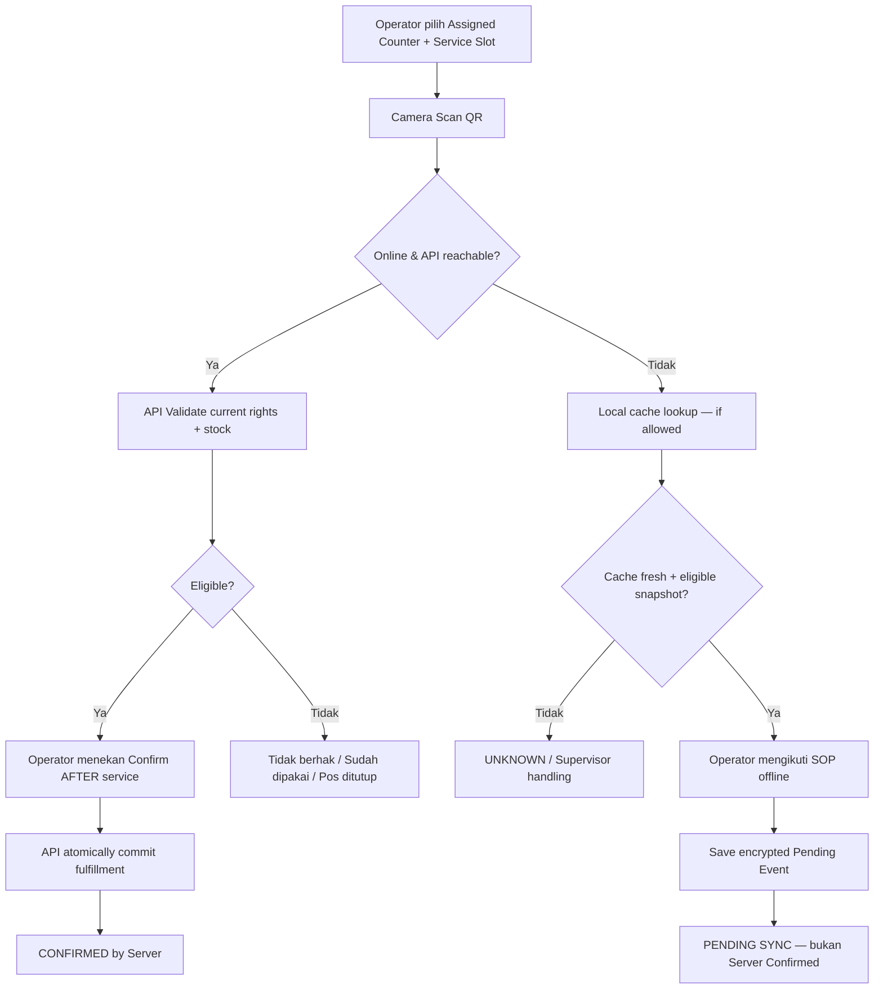

# 18B-01 — Detail CRUD Admin: Scanner Devices, Assignments, Sync & Incidents

> **27 Oktober 2026 · Tahap 18B awal · USULAN field-level UI, bukan kode**.  
> Turunan dari [18B-00 Architecture & Security](18B-00-ANDROID-OFFLINE-QR-RELIABILITY-DAN-KEAMANAN.md), [05 QR Services](05-QR-ABSENSI-DAN-FASILITAS.md), [17 Admin CRUD](17-ADMIN-CRUD-DAN-PENGATURAN-ACARA.md), [18A Role](18A-ROLE-PERMISSION-DAN-NAVIGASI-BACKOFFICE.md).  
> **Semua field yang menyangkut offline policy berstatus USULAN.** Admin CRUD seluruh event sudah disetujui; Android native untuk MVP dan SOP pelayanan offline belum disetujui secara eksplisit.

## 1. Menu yang diusulkan

```text
BACKOFFICE ADMIN
Event Operations
 ├── Counters & Service Types
 ├── Service Slots & Stock
 ├── Operator Assignments
 ├── Scanner Devices             ← tambahan
 ├── Offline Sync Monitoring     ← tambahan
 ├── Conflict Reconciliation     ← tambahan
 ├── Offline Service Policies    ← usulan, perlu keputusan panitia
 └── Incidents & System Health   ← tambahan minimum

SCANNER ANDROID OPERATOR
 ├── My Counter & Assigned Mode
 ├── QR Scan / Check & Confirm
 ├── Scan History
 ├── Sync Queue: Pending / Synced / Conflict
 └── Device Connection + Last Sync
```

Tidak ada UI billing Co-Host dan pembelian paket pribadi di aplikasi Android. **Operator scanner tidak memerlukan akses ke paper lengkap, bukti pembayaran, atau author review.**

## 2. Halaman Admin: Scanner Devices

| Kolom tabel | Kegunaan |
|---|---|
| Device Alias | Nama yang mudah dikenali: `REG-HP-01`, `ICD-FIELD-02` |
| Device ID | Kode unik internal, tidak berisi nomor identitas personal |
| Linked Operator | Akun petugas aktif (jika satu perangkat bergantian orang, session operator tetap terpisah) |
| Assigned Counter / Service Scope | Pos dan mode layanan yang diizinkan |
| Last Seen | Terakhir terhubung API |
| Last Sync | Sinkronisasi berhasil terakhir |
| Pending / Conflict Counts | Jumlah event menunggu dan perlu rekonsiliasi, dari data yang sudah diketahui server |
| Software Version | Versi scanner yang digunakan |
| Status | Active / Suspended / Revoked / Offline |
| Actions | Detail / Edit Alias / Manage Assignment / Suspend / Revoke / Sync Diagnostics |

**Form pendaftaran perangkat (usulan):** Alias (required, unique pada event); device registration token/QR pairing **sekali pakai dan singkat** (dikeluarkan Admin; tidak dikirim via chat), scope event/pos/service; session policy. **Jangan memasukkan global API key ke APK**. Perangkat tidak boleh mendaftarkan diri sebagai Admin melalui user-entered role tanpa persetujuan pusat.

**Koreksi:** Device `Revoked` tidak boleh melakukan sync/fulfillment online berikutnya; cache offline yang sudah ada tidak bisa otomatis dimusnahkan saat device terputus, sehingga diperlukan TTL cache pendek, enkripsi, device lock, dan SOP kehilangan HP.

## 3. Halaman Admin: Operator Assignments

| Field | Aturan |
|---|---|
| Operator | User dengan role operator yang ditetapkan Admin |
| Event | ICHES 2027 |
| Device | Device aktif yang didaftarkan, opsional untuk pergantian HP menurut kebijakan |
| Assigned Counter | Pilih pos yang sudah dibuat melalui CRUD |
| Allowed Services | Multi-select layanan, mis. REG, KIT, FNB, MOU, ICD, SES sesuai pos |
| Assignment Starts/Ends | Rentang waktu otorisasi, editable Admin |
| Status | Active / Suspended / Ended |
| Notes | Instruksi singkat koordinator |
| Actions | Create / Edit / Deactivate / Reassign |

**Validasi:** Operator tidak dapat self-assign pos; Service Coordinator hanya bisa mengatur assignment pada layanan scope miliknya jika permission didelegasikan; Admin dapat lintas layanan. Pos dapat berubah tanpa membuat akun baru. Satu HP dapat bergantian operator, tetapi event log tetap menunjukkan siapa yang menekan `Confirm`.

## 4. Android UI: Scan & Confirm — online maupun offline



**Layar wajib punya:** indikator Online/Offline, nama & foto kecil (jika scope mengizinkan), layanan & slot yang dipilih, status hak, tombol `CONFIRM` ketika online atau `SAVE PENDING` ketika offline, jumlah Pending, waktu `last synced`, pesan `Already Served` dan `Not Eligible`. **Warna hijau saja tidak cukup**; teks status harus jelas.

**Cara mencatat fakta layanan:** jika barang sudah diserahkan saat offline (atas SOP panitia), petugas harus mengisi status faktual `Provisionally Handed Over` dan event dicatat sebelum petugas pindah. Jika panitia melarang layanan offline untuk service tertentu, tombol konfirmasi disembunyikan dan tampilkan instruksi menghubungi koordinator.

## 5. Halaman Admin: Sync Monitoring

| Kolom | Fungsi |
|---|---|
| Device / Operator | Asal catatan |
| Counter / Service | Pos dan mode asal |
| Last Successful Sync | Timestamp pusat |
| Local Pending Reported | Jumlah pending yang terakhir dilaporkan device (bisa stale) |
| Confirmed | Event yang di-ACK sebagai transaksi sah |
| Conflict | Jumlah ditolak atau membutuhkan penyelesaian |
| App/Cache Version | Membantu mengidentifikasi ketidaksesuaian snapshot |
| Diagnostics | View per-device sync/outbox history, tanpa akses root/unrestricted |

**Aksi Admin/Koordinator yang diizinkan:** minta refresh snapshot (baru saat device online), nonaktifkan device jika hilang, buka conflict list, ekspor rekonsiliasi. **Tidak boleh memaksa semua event Pending menjadi Confirmed melalui satu tombol**.

## 6. Halaman Admin: Conflict Reconciliation

| Kolom | Arti |
|---|---|
| Event UUID | Mencegah duplikasi retry |
| Person (minimum) | Identity user/token yang di-resolve pada server |
| Device + Operator | Sumber kejadian |
| Service + Slot + Counter | Contoh Lunch-Hari-2, pos FNB-01 |
| Scanned At vs Received At | Waktu perangkat vs server, dibedakan |
| Server Result | Duplicate/Expired Rights/Slot Closed/Stock Exhausted/Unknown Person |
| Local Evidence | Apakah petugas menandai barang sudah diserahkan di lapangan |
| Resolution | Confirm existing / mark duplicate / corrective adjustment / escalate, sesuai bukti dan permission |
| Reason | Alasan singkat koreksi wajib pada tindakan sensitif |

**Satu QR scan dua kali di dua HP offline:** setelah sync server mungkin menerima event pertama dan menandai event kedua sebagai `Duplicate Conflict`. Dua catatan lapangan **tidak boleh hilang** karena satu sudah mendapat layanan fisik. Jika ada stok berkurang dua tetapi hanya satu hak, Koordinator menindaklanjuti selisih stok/insiden. Rekonsiliasi **mencatat fakta**, bukan memalsukan entitlements menjadi dua agar tabel tampak rapi.

**Server transaction:** event yang valid online dikonfirmasi secara atomik dengan unique guard sesuai layanan, contoh `person + service + slot` untuk konsumsi bersama. Jumlah stok dan idempotency key dicek/diperbarui dalam transaksi yang sama. Jika API hanya menerima retry, kembalikan ACK lama, bukan membuat baris kedua.

## 7. Offline Policy — hanya setelah panitia memilih SOP

| Service category | Mode usulan | Catatan |
|---|---|---|
| General Registration | Pending offline diperbolehkan | Absensi sementara, final sesudah sync |
| Activity Attendance | Pending offline diperbolehkan | Bedakan MoU/Upgrading/PKM/Destinasi, jangan auto confirmed |
| Lunch/Kit/Stock | Pending dengan SOP manual yang diputuskan panitia | Risiko dua HP offline tidak saling tahu. Default paling aman: online-only untuk final fulfillment |
| Moderator Paper Presented | Dapat dicatat pending jika benar-benar terjadi, perlu verifikasi setelah sync | Tidak langsung terbitkan sertifikat |
| Finance Verified / MoU Signed | Bukan domain scanner, tidak tersedia mode offline | Wajib otoritas/rekam domain lain |

**Belum final**: apakah layanan stok boleh tetap diserahkan offline, maksimal umur snapshot cache, apakah perlu offline-only-one-terminal per pos, apakah ada local edge hub. Jangan paksa kebijakan ini menjadi keputusan bisnis tanpa konfirmasi.

## 8. System Health & Security Controls — Admin view

| Field/indikator | Kegunaan |
|---|---|
| API Latency p95 | Kinerja jalur scanner dalam uji dan operasi |
| Error Rate & Auth Denials | Mendeteksi gangguan dan penyalahgunaan |
| Active Devices / Last Online | Ketersediaan HP petugas |
| Sync Backlog & Oldest Pending | Melihat risiko penumpukan |
| DB Connection / Queue Delay | Kesehatan infrastruktur |
| Backup Last Success / Restore Drill | Membuktikan kemampuan pemulihan |
| Incident Log | Gangguan jaringan, HP hilang, laporan double scan, fallback manual |

**Admin UI bukan pengganti monitoring teknis server**; ia menampilkan ringkasan aman dari health service yang dikelola ops/sysadmin. Jangan expose informasi rahasia infrastruktur, internal URL, secret keys, atau stack traces kepada operator.

## 9. Batas access matrix baru

| Tindakan | Admin | Service Coordinator | Scanner Operator | Other roles |
|---|---|---|---|---|
| Register/Revoke Device | ✓ | Jika didelegasikan pada scope | — | — |
| Assign Operator/Counter | ✓ | Hanya scope layanan milik sendiri | — | — |
| Scan pada counter assigned | ✓ bila operator ditugaskan | ✓ bila operator ditugaskan | ✓ | — |
| Change Offline Policy | ✓ | Belum otomatis | — | — |
| View Sync Pending & Conflict | Semua | Scope layanan sendiri | Hanya riwayat device/operator sendiri | — |
| Correct fulfillment & stock ledger | ✓ dengan alasan | Scope sendiri + alasan | — | — |
| View full payment / author manuscript | Sesuai permission domain | — | — | Sesuai hak domain lain |

Admin dapat melihat rekap domain, tetapi semua akses tetap dicek oleh server; tidak dapat mengedit event seseorang menjadi `Presented` atau `Paid` hanya karena operator memakai scanner.

## 10. UAT tambahan khusus scanner (rencana, bukan hasil)

| ID | Uji | Expected |
|---|---|---|
| UAT-18B-01 | Operator FNB pilih pos REG tanpa assignment | Akses ditolak |
| UAT-18B-02 | Android offline QR valid dan cache masih segar | Tampil Pending; tidak menyatakan Server Confirmed |
| UAT-18B-03 | HP restart dengan 10 Pending | Catatan Pending tetap ada di storage lokal |
| UAT-18B-04 | Sinkronisasi yang sama diretry tiga kali | Satu event sukses maksimum, idempotent ACK |
| UAT-18B-05 | Dua HP offline melayani user yang sama | Konflik rekonsiliasi tercatat; tidak dijanjikan anti-duplikasi offline |
| UAT-18B-06 | Admin mencabut device saat online | Device tidak dapat mengirim scan baru |
| UAT-18B-07 | Snapshot offline kedaluwarsa | Mode offline yang berisiko diblokir/eskalasi |
| UAT-18B-08 | Stok layanan 1, dua scanner online confirm paralel | Hanya satu sukses, stok tidak minus |
| UAT-18B-09 | Akun PIC Co-Host mencoba akses scanner API | Ditolak tanpa scanner assignment |
| UAT-18B-10 | Operator mencoba mengubah Grant/Revoke offline/online | Ditolak |
| UAT-18B-11 | Admin ubah tanggal pendaftaran paket | Tidak mengubah aturan sesi scanner/riwayat scan |
| UAT-18B-12 | 20 HP sync batch saat internet pulih | Server tetap responsif, setiap event di-ACK atau konflik; angka target disesuaikan hasil load test |

## 11. Status untuk ditinjau

- **DISETUJUI sebelumnya**: Admin CRUD pusat, Model C scanner/pos, hak per layanan, satu QR pribadi, distinct attendance vs Presented, hak fasilitas satu kali per slot.
- **USULAN BARU**: Android scanner offline-first, daftar device/monitoring sync/rekonsiliasi, cache terenkripsi, status Pending, dan pengaturan kebijakan offline.
- **TERBUKA**: platform native vs PWA, SOP memberikan barang saat offline, inventaris device dan koneksi lapangan, host/provider budget, TTL, aktivasi scanner spesifik.

[Lihat detail arsitektur & keamanan](18B-00-ANDROID-OFFLINE-QR-RELIABILITY-DAN-KEAMANAN.md) · [Role 18A](18A-ROLE-PERMISSION-DAN-NAVIGASI-BACKOFFICE.md) · [QR lama](05-QR-ABSENSI-DAN-FASILITAS.md).
