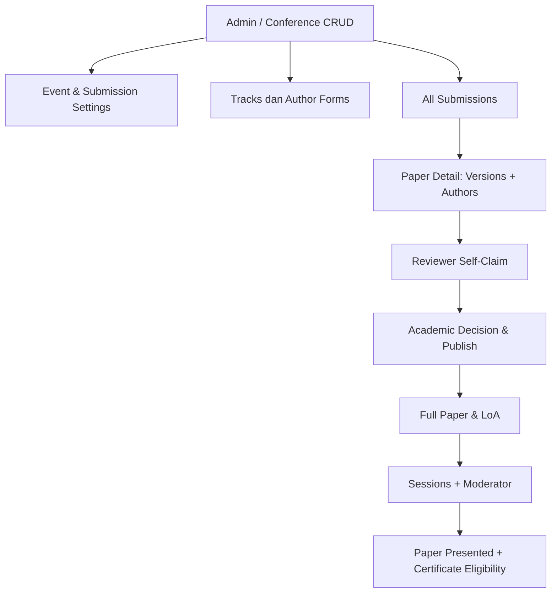

# 18B-02 — Field-Level CRUD International Conference: Settings, Tracks, Paper, dan Author

> **Tanggal:** 27 Oktober 2026 · **Tahap 18B — Rancangan siap divalidasi, bukan implementasi.**  
> **Fokus:** layar Backoffice Admin dan formulir Submitting Author untuk International Conference ICHES 2027.  
> **Sumber keputusan:** [TOR yang dianalisis](10-ANALISIS-TOR-DAN-REBASELINE-2027.md), [alur akademik](03-SUBMISSION-REVIEW-AKADEMIK.md), [Admin CRUD](17-ADMIN-CRUD-DAN-PENGATURAN-ACARA.md), [Role 18A](18A-ROLE-PERMISSION-DAN-NAVIGASI-BACKOFFICE.md), [Co-Host 5 paper](16-COHOST-LIMA-PAPER-PERWAKILAN.md).  
> **Kebijakan disetujui sudah bersifat acuan; detail nama halaman, field, dan validasi yang belum diputuskan ditandai USULAN.** Tidak ada coding, migration, API atau aplikasi yang dijalankan.

## 1. Tujuan dan batas modul

**International Conference** adalah **salah satu dari lima kegiatan ICHES 2027**, bukan nama umum bagi seluruh pendaftaran MoU/Upgrading/PKM/Destinasi. Di sisi Conference, Admin harus dapat mengelola **settings, track, submissions, reviewer workflow, final decision, full paper, session, moderator, dan rekap akademik**, tanpa meminta developer mengubah kode untuk tanggal/jadwal/topik/form.

**Batas yang wajib dipertahankan:**
- **DRAFT → Submit tervalidasi (online text + PDF wajib) → langsung Reviewer Abstract Index.** **Tidak ada Administrative Screening, tombol PASS, atau antrian pra-review.**
- Reviewer boleh cari/filter **delapan track** dan claim sendiri; bukan ditetapkan izin khusus berdasarkan track pada profil.
- Reviewer **memberi rekomendasi**, Komite Akademik **menetapkan final decision** dan secara terpisah **Publish Decision**.
- **ACCEPT yang SUDAH DIUMUMKAN** kepada author mengaktifkan Full Paper dan LoA; bukan sekadar rekomendasi reviewer/keputusan internal, tidak tergantung tanggal 23 Desember atau Finance Verified.
- Co-Host **5 perwakilan = 5 paper**, **satu paper dari akun tiap perwakilan**, tarif institusi Rp3 juta; status dan hak akademik paper Co-Host mengikuti jalur biasa.
- Paket personal **Rp1 juta/empat program pendamping tidak ditempatkan dalam menu Conference atau Co-Host**. Finance memisahkan jenis kewajiban.

## 2. Peta navigasi International Conference — Admin

```text
BACKOFFICE → INTERNATIONAL CONFERENCE
  Overview                         [A-01]
  Conference Settings              [A-02]
  Conference Tracks                [A-03]
  Abstract Submission Settings     [A-04]
  All Submissions                  [A-05]
  Paper Detail                     [A-06] (halaman detail dari daftar)
  Review Management                [A-07]
  Academic Decisions               [A-08]
  Full Paper Management            [A-09]
  Sessions & Moderators            [A-10]
  Academic Reports & Export        [A-11]

REVIEWER WORKSPACE
  Abstract Index                    [R-01]
  My Claimed Reviews                [R-02]
  Review Form                       [R-03]

SUBMITTING AUTHOR — PERSONAL DASHBOARD
  My Papers                         [U-01]
  Paper Submission Wizard           [U-02]
  Review/Decision & Revisions        [U-03]
  LoA & Full Paper                   [U-04]
  Presentation / Certificate         [U-05]
```

**A-07 sampai A-11, R-01 sampai R-03, dan beberapa domain sensitif dibahas lebih rinci di [18B-03](18B-03-CRUD-REVIEW-DECISION-FULLPAPER-SESSION-DAN-UAT.md).** Angka A/R/U merupakan **ID spesifikasi layar**, bukan URL/rute/struktur folder yang sudah dibuat. Sidebar tidak harus menampilkan setiap subhalaman sekaligus; gunakan section collapse/tab bila sederhana.



## 3. A-01 — Conference Overview

**Tujuan:** Admin/Panitia memahami keadaan Conference dalam satu tampilan, tanpa mengganti seluruh monitoring menjadi dashboard statistik rumit.

| Elemen | Isi/usulan perilaku |
|---|---|
| Abstract Submission | Open/Closed + tanggal-jam sekarang menurut **Asia/Jakarta**, jumlah submitted |
| Paper Queue | Count Draft (milik user, agregat minimal), Submitted/Available, Claimed, Reviewed, Revision |
| Decisions | Pending / Accepted / Rejected / Published |
| Co-Host | Jumlah institusi, total jatah dan pemakaian paper 0–5 per institusi |
| Full Paper | Accepted announced, full papers uploaded, correction required |
| Sessions | Total sessions, paper belum dijadwalkan, moderator assigned |
| Next Actions | Paper tak diklaim, keputusan menunggu publish, full paper pending, session kosong |
| Quick Links | Conference Settings, All Submissions, Reviewer Claims, Academic Decision, Schedule |

**Bukan kebutuhan final:** real-time websocket, leaderboard reviewer, performa individual terbuka untuk seluruh staf, atau indikator beban yang tidak dapat dipercaya. Gunakan agregasi terindeks dan cache seperlunya agar dashboard Admin tidak membebani server.

## 4. A-02 — Conference Settings (pengaturan acara oleh Admin)

| Field | Contoh nilai dari TOR / perilaku | Validasi / catatan status |
|---|---|---|
| Event Identity | The 6th ICHES 2027 | CRUD Admin; identitas resmi mengikuti TOR |
| Conference Theme | Islamic Values in a Changing World ... | CRUD teks publik; nama resmi lengkap ada di TOR |
| Event Day | 5 Januari 2027 | TOR; tanggal dapat diubah Admin berdasarkan keputusan panitia |
| Mode | Hybrid: Onsite/Online | TOR; mode tiap sesi dapat berbeda |
| Timezone | **Asia/Jakarta** | Rekomendasi operasional agar tanggal-jam konsisten |
| Venue | UNISYA Lumajang (venue/ruang spesifik editable) | TOR tingkat lokasi; detail ruang belum final |
| Contact / Secretariat | Nama/email/kontak resmi | CRUD, jangan mengarang data panitia |
| Public Visibility | Draft / Published | USULAN switch CMS agar belum lengkap tidak terbuka |
| Conference Registration | Open/Closed + window | USULAN, dipisahkan dari Abstract Submission dan Paket Rp1 juta |
| Public Important Dates | Daftar label/tanggal yang ditampilkan di website | **Informasi** kalender tidak boleh menjadi hard gate Full Paper |

**Tabel tanggal referensi dari TOR, bukan batas permanen di kode:** Abstract Submission **1–20 Desember 2026**, pengumuman **22 Desember**, Full Paper **23–28 Desember**, pembayaran **24–28 Desember**, Conference **5 Januari 2027**. Admin boleh mengubah konfigurasi atau publikasi jadwal bila panitia mengesahkan perubahan. **Tanggal pengumuman 22 Desember bukan syarat untuk reviewer mulai bekerja**, sedangkan **tanggal 23 Desember bukan gate pembukaan Full Paper**.

Akses CMS publik tersedia untuk Admin/Content Editor yang diberi izin, bukan reviewer/Finance dengan akses otomatis.

## 5. A-03 — Conference Tracks (CRUD topik)

Delapan track **sebagaimana tercantum pada TOR bagian E** harus dapat dikelola sebagai data Admin:

1. Islamic Studies, Ethics, and Contemporary Civilization.
2. Education, Pedagogy, and Human Development.
3. Leadership, Governance, and Institutional Accountability.
4. Economics, Sustainable Business, and Inclusive Development.
5. Law, Human Rights, Social Justice, and Public Policy.
6. Social Sciences, Humanities, Culture, and Community Resilience.
7. Digital Transformation, Responsible Innovation, and Society.
8. Environmental Sustainability, and Human Well-Being.

| Field/aksi | Aturan |
|---|---|
| Track Name (EN/ID/AR jika tersedia) | Nama resmi English dari TOR sebagai referensi dasar; terjemahan belum diisi |
| Slug/Code | Unik dan stabil untuk filter/form, tidak bergantung nama yang diubah |
| Sort Order | Atur urutan menu publik dan pilihan dalam form |
| Active for New Submission | Aktif/nonaktif pilihan pada form baru |
| Public Description | Opsional; hanya deskripsi dari panitia yang dipublikasikan |
| View Paper Count | Hitung paper ber-track tersebut sesuai hak akses |
| Create/Edit/Disable | Admin atau Koordinator Akademik bila mendapat delegasi |

**Aturan keselamatan data:** jika suatu track sudah dipakai paper Submitted, **jangan hard delete track**. Nonaktifkan untuk submission baru; paper lama tetap memegang track/kode/nama historis yang benar. Memindahkan track paper setelah review harus tindakan koreksi resmi oleh komite dengan catatan perubahan, bukan edit bebas.

**Tidak diperlukan:** `Reviewer A khusus Track 1` / `Reviewer B khusus Track 2` sebagai permission. Filter track hanya alat reviewer memilih paper sesuai kompetensi.

## 6. A-04 — Abstract Submission Settings (CRUD form dan jendela kirim)

| Field Admin | Tujuan | Keterangan |
|---|---|---|
| Submission Opens At | Mulai menerima Submit baru | Referensi TOR **1 Desember 2026**; editable Admin |
| Submission Closes At | Batas Submit baru | Referensi TOR **20 Desember 2026**; editable Admin |
| Manual Registration/Submission Status | Open/Closed | USULAN override untuk darurat/rapat panitia |
| Paper Language Options | Bahasa karya ilmiah yang diterima | **Belum diputuskan**; berbeda dari UI language EN/ID/AR |
| Abstract Min/Max Words | Rentang validasi teks abstrak | **Belum disepakati**, jangan hardcode 200–300 kata |
| Keyword Min/Max | Jumlah keyword | **Belum disepakati**, jangan hardcode 3–5 |
| Allowed Abstract Attachment | **PDF ONLY** | **DISETUJUI** |
| Abstract PDF Max Size | Ukuran maksimum | **Belum disepakati**, dapat diset Admin setelah keputusan |
| Abstract PDF Template/Guidelines | Dokumen contoh jika disediakan panitia | **Belum ada template final** |
| Mandatory Text + PDF | **KEDUANYA WAJIB** | **DISETUJUI, tidak dapat dibuat optional tanpa mengubah keputusan** |
| Require Authors/Affiliations | Metadata lengkap akademik | Mengacu kontrak scholarly metadata repo lama |
| Revision Policy | Normal satu siklus revisi (baseline lama), pengecualian akademik | Jumlah final/kesempatan revisi masih perlu keputusan |
| Allow Draft Save | Ya | USULAN UX; draft tidak tersedia di Reviewer Index |
| Allow New Submit After Deadline | Default tidak | Jika butuh pengecualian gunakan otorisasi Admin yang tercatat, bukan bypass tanggal tersembunyi |

**Saat jendela ditutup, bukan berarti semua paper yang sudah Submitted langsung Rejected**. Paper yang telah masuk tetap bisa direview, diputuskan, dan jika ACCEPT diumumkan dapat mengunggah Full Paper. Revisi paper sesudah submission closed mengikuti otorisasi *Revisions Required* dan batas revisi yang nanti ditentukan, bukan otomatis dianggap submission baru.

**Pemisahan tanggal:** deadline Abstract Submission berbeda dari deadline Paket Program Internasional pribadi dan berbeda dari tanggal publikasi keputusan. Semuanya membaca setting masing-masing dari Admin.

## 7. A-05 — All Submissions (tabel Admin)

| Kolom | Isi | Filter yang disarankan |
|---|---|---|
| Paper Code | Kode mudah dicari, ID internal tetap stabil | Keyword |
| Title | Judul versi Submitted terbaru; nama penulis sesuai hak | Keyword |
| Track | Dari Conference Tracks CRUD | Filter track |
| Submitting Author | Akun yang berhak mengelola paper | Nama/email hanya Backoffice berwenang |
| Institution / Co-Host | Status asal paper dan relasi institusi jika menggunakan jatah | Regular / Co-Host |
| Abstract Submitted At | Waktu server menerima versi resmi | Periode |
| Review | Available, Claimed, Reviewed, Revision | Filter review status |
| Academic Decision | Pending, Revision, Accepted, Rejected | Filter keputusan |
| Decision Published? | Belum/Ya, kapan diumumkan | Filter |
| Full Paper | Locked/Eligible/Submitted/Correction | Filter |
| Session | Belum dijadwalkan / kode sesi | Filter |
| Action | View Detail / lihat riwayat / koreksi berwenang | Scope |

**CRUD bukan berarti setiap paper bisa diedit bebas Admin.** Author mengelola draftnya, sedangkan **paper Submitted adalah versi resmi**. Bila ada kesalahan metadata atau PDF setelah Submitted, Admin/Komite melakukan **koreksi dengan riwayat/alasan/versi baru**, tidak overwrite diam-diam. Review tetap berkaitan pada versi yang benar.

**Pagination server-side, filter dan sort stabil** diperlukan untuk performa ketika paper mencapai banyak ratus; tidak perlu memuat semua file PDF dan nama penulis dalam satu response.

## 8. A-06 — Paper Detail: tab & field

```text
BACKOFFICE / CONFERENCE / PAPER ICHES27-001
------------------------------------------------
[Overview] [Authors] [Abstract & Files] [Review]
[Decision] [Full Paper] [Presentation] [History]

STATUS: Submitted | Track: Education, Pedagogy ...
Paper title: ...
Submitting Author: ...
Membership: Regular / Co-Host [Universitas A, Seat 2/5]
[View PDF - Authorized] [Review Status] [Audit History]
------------------------------------------------
```

| Tab | Data dan aksi minimum |
|---|---|
| Overview | Code/UUID, title, language, track, status per domain, tanggal, submitting account |
| Authors | Urutan penulis, **mononym**, name display, corresponding author exactly one, email, affiliation/negara, ROR optional/manual, ORCID optional |
| Abstract & Files | Teks online, PDF privat, file size/type, versi, uploader, timestamp |
| Review | Assignment, nama reviewer hanya komite, status claim, rekomendasi dan komentar yang boleh dilihat |
| Decision | Draft keputusan internal, final decision, publish status/timestamp, alasan, notifikasi |
| Full Paper | Locked/Available/Uploaded/Revision; versi dokumen dan penanda validasi akademik |
| Presentation | Mode Onsite/Online, sesi/moderator, actual presenter, Presented/No Show |
| History | Riwayat koreksi metadata, file, keputusan, publish, actor, reason |

**Privasi:** PIC Co-Host yang melihat roster dapat melihat **kode paper/status umum**, bukan membaca komentar reviewer privat atau bukti transfer pribadi masing-masing anggota. Finance tidak diberi akses isi review akademik. Reviewer hanya melihat submission yang sesuai izin index/claim; tidak melihat tagihan atau nomor rekening.

## 9. U-01 sampai U-05 — Alur penulis & formulir yang dikelola Admin

### U-01 My Papers

- Tampilkan My Papers (code, title, track, academic status, next action).
- **Co-Host member:** perlihatkan satu jatah paper miliknya dalam institusi. Tidak boleh menggunakan jatah kedua dari institusi yang sama. Satu jatah tidak memblokir hak user menjadi co-author di paper orang lain.
- **Regular author:** hak submission mengikuti aturan konferensi/reguler yang nantinya diputuskan.
- **No payment before ACCEPT untuk jalur Presenter.** Status fee setelah ACCEPT bergantung kategori dan Finance; Co-Host ditangani invoice institusi terpisah.

### U-02 Paper Submission Wizard (USULAN UX empat langkah)

| Langkah | Field wajib/opsional |
|---|---|
| **1. Paper** | Title wajib; pilih Track wajib; paper language sesuai setting; keywords sesuai rentang jika ditetapkan |
| **2. Authors** | Daftar berurutan wajib; nama lengkap *atau mononym*, affiliation/negara/email, **tepat satu corresponding author**; ORCID opsional; ROR jika ada, input manual jika tak ada |
| **3. Abstract** | **Teks online wajib** dan **file PDF wajib**. Frontend beri preview dan error field yang jelas; server validasi berkas dan isinya yang dapat diuji secara teknis |
| **4. Preview & Submit** | Ringkasan metadata dan file, pernyataan bahwa text/PDF sesuai, tombol `Submit Abstract` |

**Mekanisme submit yang benar:**
1. Draft dapat disimpan (USULAN).
2. Tekan Submit → frontend memeriksa mandatory, lalu **backend memeriksa ulang** otorisasi, deadline, track active, author order, corresponding author, text, PDF MIME/signature/size, file upload, dan hak satu paper Co-Host bila relevan.
3. Gagal → tetap Draft + error pada field, tidak muncul di reviewer.
4. Sukses → **satu Paper ID** dan versi Submitted tercatat; file privat; **langsung muncul di Reviewer Abstract Index** untuk self-claim.
5. Tombol diklik berulang **tidak menghasilkan dua submission** / kuota paper kedua. Kelengkapan file tidak berarti panel Admin harus melakukan screening.
6. Reviewer yang menemukan perbedaan substansi teks vs PDF menilai/melaporkan; bukan automatic AI/OCR semantic checker atau screening staf.

### U-03, U-04, U-05

- **U-03 Decision/Revisions:** notifikasi keputusan yang **telah diumumkan**, komentar yang boleh diberikan kepada author, upload revisi pada Paper ID **yang sama** dengan versi baru dan pengawasan kebijakan revisi.
- **U-04 LoA & Full Paper:** jika ACCEPT telah diumumkan → tampil LoA dan form Full Paper. File yang boleh diunggah, ukuran, template serta closing deadline **masih parameter untuk ditetapkan panitia**. Tidak menunggu Finance VERIFIED untuk **unlock**.
- **U-05 Presentation/Certificates:** author melihat sesi/venue/link daring bila dipublikasikan, status moderator Presented serta sertifikat sesuai status publish panitia; **seluruh co-author** berhak atas sertifikat individual jika Paper Presented dan panitia menerbitkan secara massal.

> **Turunan spesifikasi tahap 18B-04/05 (USULAN FORM/TEKNIS):** aturan produk yang sudah dikunci tetap **Co-Host Rp3 juta/INSTITUSI = maksimal 5 orang/5 paper (1 paper per orang)** dan **Paket Program Internasional Rp1 juta/ORANG = satu pembelian empat akses secara mandiri melalui Dashboard pribadi**. Field halaman, invitation Magic Link, metode penggantian anggota/paper, status dan waktu publikasi logo, payment activation serta detail refund **belum final**. Admin memiliki CRUD pengaturan, PIC hanya institusinya, Finance memverifikasi uang, peserta membeli sendiri. [18B-04 — CRUD Co-Host, 5 Seats & 5 Papers](18B-04-CRUD-COHOST-INSTITUSI-LIMA-PAPER.md) · [18B-05 — CRUD Paket Rp1 Juta / 4 Akses](18B-05-CRUD-PAKET-INTERNASIONAL-DASHBOARD-PESERTA.md).


## 10. Kontrak metadata akademik minimum (konseptual, bukan database migration)

| Entitas konseptual | Data pokok |
|---|---|
| ConferenceSettings | event identity, mode, timezone, publication settings, important dates |
| ConferenceTrack | stable code, names, order, active, history |
| AbstractSubmissionConfig | opens/closes, status, language options, text/keyword bounds, PDF constraints |
| Paper | UUID internal, public code, title, track, submitting user, origin `regular/cohost`, current academic statuses |
| PaperAuthor | paper relation, order, display/name form, corresponding marker, email/affiliation/country, ORCID optional |
| PaperAffiliation | display name, country, ROR if provided, manual fallback |
| PaperVersion | version kind (`abstract`/`revision`/`full paper`), metadata snapshot, file pointer, timestamp |
| PaperCoHostEntitlement | one member/user + institution seat + one paper allocation, no double claim |
| AcademicAuditEvent | actor, entity, action, before/after, timestamp, reason if correcting official record |

**Tidak ada kebutuhan menduplikasi akun co-author**, menganggap semua author harus login, atau membuat jurnal baru dalam aplikasi. Data paper harus bisa diekspor untuk prosiding/OJS *handoff* kelak, bukan membuat sistem OJS kedua.

## 11. Validasi, hak akses, dan keterbatasan operasional

| Aturan | Frontend | Server/backend (wajib) |
|---|---|---|
| Mandatory Abstract Text dan PDF | Required state jelas | Tolak Submit jika salah satu kosong |
| Deadline dan status Open/Closed | Tampilkan info, disable sesuai setting | Periksa setting saat Submit (Asia/Jakarta) |
| Track | Dropdown track aktif | Tolak track invalid/nonactive untuk submission baru |
| Authors | Ordered form, validasi sederhana | Exactly one corresponding; urutan unik; email sesuai kebijakan |
| PDF | Type/size indicator | Verifikasi signature/type asli, max size, akses file privat; malware scan jika infrastruktur tersedia |
| Co-Host one paper | Perlihatkan seat & quota 1 paper | Unique guard user+event+institution entitlement, transaksi aman |
| Paper Submitted | Form terkunci normal | Edit resmi melalui versioned correction; jangan overwrite |
| Visibility reviewer | Indeks menurut status paper | Otorisasi role + paper status, enforce self-claim |
| Admin correction | Modal reason dan preview diff | Catat actor/reason/old/new; tidak menghapus histori |

**Tidak ada hardcoded tanggal/kuota sebagai aturan permanen**; Admin dapat CRUD sesuai kebijakan. Namun Admin **tidak boleh secara diam-diam mengubah keputusan akademik atau sejarah pembayaran** lewat edit umum.

## 12. Acceptance Criteria awal (belum diuji)

| ID | Skenario | Hasil yang diharapkan |
|---|---|---|
| CF-01 | Admin ubah tanggal Abstract Submission | User baru mengikuti konfigurasi terbaru tanpa deploy; data lama tetap utuh |
| CF-02 | Admin nonaktifkan Track yang sudah punya paper | Paper lama tetap ber-track historis; track tak muncul untuk submission baru |
| CF-03 | Author simpan Draft tanpa PDF | Boleh Draft; **tidak** masuk Reviewer Index |
| CF-04 | Author Submit tanpa Abstract Text | Ditolak backend dengan field error |
| CF-05 | Author Submit PDF non-PDF | Ditolak backend, bukan sekadar penamaan ekstensi |
| CF-06 | Author Submit valid Text+PDF | Langsung `Submitted` dan tersedia di Reviewer Index **tanpa screening** |
| CF-07 | User double-click Submit | Tidak membuat dua Paper ID atau dua jatah Co-Host |
| CF-08 | PIC Co-Host menambah anggota keenam | Ditolak, tidak membuat kursi keenam |
| CF-09 | Perwakilan Co-Host mencoba dua paper memakai paket | Hanya satu paper/jatah paket untuk akun tersebut |
| CF-10 | Admin membuka Paper Detail | Dapat membaca metadata/versi sesuai izin dan jejak tindakan |
| CF-11 | PIC membuka komentar Reviewer privat pada paper anggota | Akses ditolak |
| CF-12 | Deadline Abstract Submission berakhir | New Submit tertutup, review atas Submitted tetap berjalan |

**Semua contoh nomor paper, user, tanggal pengujian, dan hasil di atas adalah rancangan**, bukan data/pengujian nyata.

## 13. Yang telah DIPUTUSKAN vs detail masih USULAN/TERBUKA

**DIPUTUSKAN:** cakupan Conference, Admin CRUD pengaturan, delapan track sebagai sumber TOR dan data editable, Text+PDF abstrak wajib, PDF saja, tanpa administrative screening, reviewer search/filter/self-claim, satu paper tiap perwakilan Co-Host, lima paper/institusi, ACCEPT diumumkan membuka Full Paper, reviewer bukan pengambil keputusan final.

**USULAN UI/teknis:** empat langkah wizard, nama menu dan id A/U, caching Overview, draft save, halaman Paper Detail bertab, status Open/Closed manual, reservation slot sejak draft, permission keys, mode koreksi yang diaudit.

**TERBUKA:** jumlah review per paper (baseline lama 1 configurable), kata abstrak/keyword, PDF max/format template, bahasa paper, revisi final, pembatasan paper reguler, detail Full Paper termasuk closing deadline & file format, penjadwalan actual presenter, rubrik penilaian.

**Kelanjutan:** [18B-03 — Review, Decision, Full Paper, Session dan UAT](18B-03-CRUD-REVIEW-DECISION-FULLPAPER-SESSION-DAN-UAT.md).

---

[Lihat Register Keputusan](09-KEPUTUSAN-DAN-ISU-TERBUKA.md) · [Presentasi untuk Warek I](00-PRESENTASI-WAREK-I.md) · [Admin CRUD Map](17-ADMIN-CRUD-DAN-PENGATURAN-ACARA.md).
