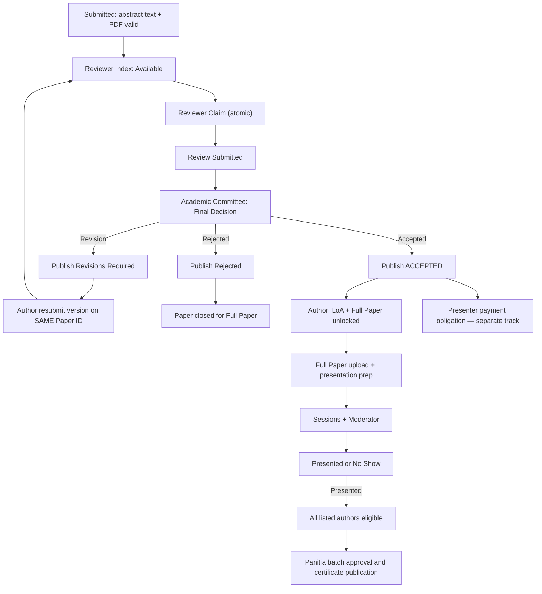
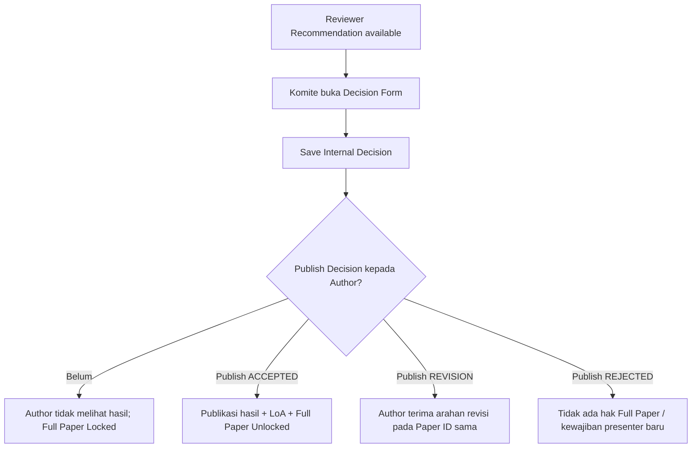
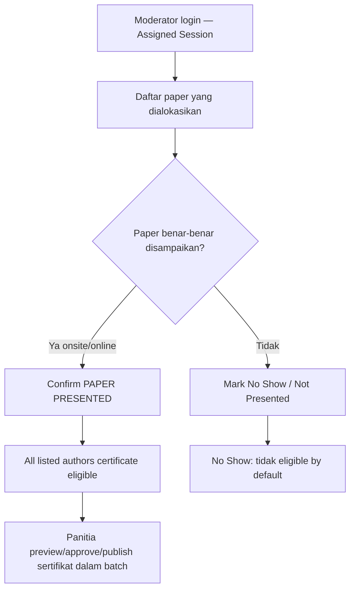

# 18B-03 — Field-Level CRUD Review, Academic Decision, Full Paper, Session & UAT

> **UPDATE 27 OKTOBER — DRAFT TAMBAHAN:** Abstract Review/ACCEPT/Full Paper unlock tetap seperti keputusan sebelumnya. Untuk **Full Paper Submission OJS-like, penilaian artikel saat/pascapresentasi, revisi bersyarat atau tanpa revisi, Final ACC, dan export ke OJS Proceedings/Journal**, baca [18B-09 Workflow DRAFT](18B-09-DRAFT-FULLPAPER-OJS-LIKE-POSTPRESENTATION-PUBLICATION.md) dan [18C-01B Database Extension](18C-01B-DRAFT-FULLPAPER-PUBLICATION-ERD-DATA-DICTIONARY.md). **Jangan** mengartikan penilaian baru sebagai administrative screening abstrak atau mengubah aturan Finance/Co-Host.

> **Tahap 18B · tanggal 27 Oktober 2026 · USULAN FIELD-LEVEL, BUKAN IMPLEMENTASI.**  
> **Prinsip final:** reviewer self-claim dari paper valid-Submitted (tanpa screening), Komite Akademik final decision, Full Paper unlocked **saat ACCEPT diumumkan**, Finance terpisah, Moderator memastikan Paper Presented, dan penerbitan sertifikat individual untuk seluruh author setelah persetujuan publikasi massal panitia.  
> Dokumen ini pendamping [18B-02 — Settings/Tracks/Submission](18B-02-CRUD-INTERNATIONAL-CONFERENCE-SUBMISSION.md), [03 Academic](03-SUBMISSION-REVIEW-AKADEMIK.md), [06 Certificate](06-SERTIFIKAT-PUBLIK.md), [18A Role](18A-ROLE-PERMISSION-DAN-NAVIGASI-BACKOFFICE.md) dan [09 Register](09-KEPUTUSAN-DAN-ISU-TERBUKA.md).

## 1. Peta halaman dan hak penanganannya

| ID layar | Nama | Pelaku utamanya | Fungsi |
|---|---|---|---|
| R-01 | Reviewer Abstract Index | Reviewer | Cari/filter semua track, pilih paper eligible, **Claim** |
| R-02 | My Claimed Reviews | Reviewer | Daftar klaim sendiri dan status review |
| R-03 | Review Form | Reviewer | Baca abstrak+PDF, rekomendasi, komentar, kirim |
| A-07 | Review Management | Komite/Koordinator Akademik; Admin konfigurasi | Pantau unclaimed/claimed/reviewed, release klaim macet |
| A-08 | Academic Decisions | Komite Akademik | Lihat review, buat keputusan internal, **Publish Decision** |
| U-03 | My Decision & Revisions | Submitting Author | Hanya keputusan yang sudah diumumkan dan tindak lanjut |
| A-09 | Full Paper Management | Komite/Administrator akademik | Pantau unggahan/versi/pemeriksaan |
| U-04 | LoA & Full Paper | Submitting Author | Ambil LoA dan upload Full Paper setelah ACCEPT diumumkan |
| A-10 | Sessions & Moderators | Admin/Komite sesuai izin | Ruang, mode, slot, paper, moderator |
| M-01 | Moderator Workspace | Moderator assigned | Confirm Presented/No Show paper yang ditugaskan |
| A-11 | Academic Reports & Export | Admin/Akademik sesuai izin | Ringkasan paper, reviewer, decisions, sessions |
| C-01 | Certificate Eligibility Handoff | Admin/Certificate Officer | Baca eligibility; publikasi sertifikat tetap pada modul Certificates |

**Role/pemisahan otoritas:** Admin mengatur konfigurasi, role dan penyimpanan yang berizin; Reviewer membuat **rekomendasi**, Academic Committee menetapkan **final decision**, Moderator mencatat **Presented**, Finance memeriksa **pembayaran**, dan panitia berwenang **publish certificates**. Orang yang memiliki beberapa role tetap harus melakukan tindakan pada scope yang tepat.

## 2. Diagram lifecycle: status yang benar-benar berbeda

**Penting:** ada beberapa *status domain*, bukan satu kolom status panjang yang bercampur. `AcademicDecisionInternal` bukan `DecisionPublished`; `FullPaperUploaded` bukan `FinanceVerified`; `AttendanceCheckedIn` bukan `PaperPresented`; `CertificateEligible` bukan `CertificatePublished`. Diagram memvisualkan alur ideal; syarat pembayaran sebelum final presentasi masih perlu ketentuan panitia, jangan membenarkan presentasi/sertifikat otomatis hanya karena diagram bertemu.

## 3. R-01 — Reviewer Abstract Index (self-claim langsung)

**Data minimal pada tabel Reviewer:**

| Field/kolom | Perilaku |
|---|---|
| Paper Code & Title | Kode unik stabil dan judul versi saat ini |
| Track | Salah satu dari delapan Conference Tracks, filter bebas |
| Authors | Reviewer **boleh melihat identitas author** sesuai single-anonymous; jangan tampilkan email massal pada indeks jika tidak perlu |
| Abstract Preview | Ringkasan teks bila berizin; file PDF dapat dibaca untuk review |
| Submitted At | Waktu paper Submitted resmi |
| Review Slot | Jumlah yang diperlukan, jumlah telah diklaim, slot tersedia |
| Claim Status | Available / Claimed / Completed / Closed |
| My Claim | Identifikasi apakah reviewer sudah claim paper itu |
| Action | `View`, `Claim` jika eligible, atau `Unavailable` dengan alasan |

**Filter:** Keyword Paper Code/Title, Track, Claimed/Available, tanggal masuk, kemungkinan keyword abstrak. **Tidak ada account-topic whitelist** atau tombol `Pass Administrative Screening`. **Hanya paper valid Submitted** yang belum final/closed dan masih membutuhkan review tampil sebagai claimable.

### Validasi Claim yang wajib di backend

1. User terautentikasi dan memiliki Reviewer role event.
2. Paper eligible untuk review dan versi sesuai fase (bukan Draft, Accepted-announced, Rejected-announced, atau ditutup).
3. Paper **bukan karya reviewer sendiri**, termasuk reviewer sebagai co-author atau submitting author. Konflik afiliasi/kolaborasi lain bisa diberi peringatan/penolakan menurut kebijakan yang belum final.
4. Reviewer belum mengklaim slot pada paper itu.
5. Jumlah review yang diperlukan **belum penuh**. **Baseline repo lama 1 reviewer configurable**, bukan otomatis dua reviewer ICHES; jumlah final ditentukan Koordinator/Admin setelah kebijakan akademik disetujui.
6. Dua reviewer menekan tombol Claim pada slot terakhir pada waktu sama → **maksimal satu klaim berhasil**, dengan transaksi/constraint; tidak cukup disable tombol di Vue.
7. Reviewer tidak mendapatkan hak edit Paper maupun final decision hanya karena berhasil Claim.

**No fixed reviewer wait-period:** begitu paper Submitted valid, ia masuk Index. TOR menulis target pengumuman hasil **22 Desember 2026**, tetapi **bukan start review yang menunggu hingga 20 Desember**. Tidak ada SLA/deadline otomatis reviewer yang sudah disetujui; Koordinator memantau keaktifan dan bisa release klaim macet melalui mekanisme sederhana.

## 4. R-02 & R-03 — My Reviews dan Review Form

### My Claimed Reviews

| Kolom | Makna |
|---|---|
| Paper Code / Track | Rujukan naskah yang diambil |
| Version Under Review | Versi naskah yang dinilai; jangan berganti diam-diam |
| Claim Time | Waktu resmi klaim |
| Review Progress | Claimed / In Progress / Submitted |
| Submission Action | Open Review / Edit Draft / Submit Recommendation |
| Resubmission | Jika paper direvisi, tugas review ulang ditampilkan setelah Koordinator/mekanisme yang berhak mengaitkan versi berikutnya |

**Usulan UX sederhana:** satu tombol `Save Draft Review` dan `Submit Review`. Jika sudah Submit, konten reviewer disimpan sebagai fakta akademik; koreksi resmi harus punya histori. **Tidak perlu alat chatting reviewer-author** yang kompleks.

### Review Form

| Field | Wajib? | Status |
|---|---|---|
| Paper Code, Title, Track, Abstract Text/PDF | Read-only | Identitas paper versi spesifik |
| Reviewer Recommendation | ACCEPT / REVISION / REJECT | **Baseline lama**, rekomendasi bukan final decision |
| Comments to Author | Text area | Diisi sesuai ketentuan Komite; apakah wajib tiap kategori belum final |
| Confidential Comments to Committee | Text area | Hanya reviewer+Komite (jangan tampil ke penulis) |
| Review Rubric | Opsional jika Komite menyetujui komponen/skor | **Belum final**, jangan hardcode skor 20/20/15/... |
| Conflict of Interest Declaration | Pernyataan sebelum review | **Usulan** sederhana, tidak perlu workflow etik terpisah |
| Save / Submit | Tindakan terpisah | Submit mencatat reviewer/time/version |

**Akses:** reviewer tidak membaca review orang lain hanya karena mereka menilai paper yang sama; penulis tidak melihat nama reviewer; Komite dapat membaca rekomendasi dan komentar berwenang, menilai relevansinya dan menetapkan keputusan final.

## 5. A-07 — Review Management (monitoring dan intervensi minimal)

| Kolom | Makna |
|---|---|
| Paper/Track | Daftar paper yang sudah Submitted dan butuh reviewer |
| Review Target | Jumlah reviewer yang ditetapkan pada paper/aturan |
| Claimed/Completed | `0/1`, `1/1`, atau nilai konfigurasi lain |
| Claim Age | Lama klaim aktif (indikator, **bukan deadline otomatis**) |
| Assigned Reviewer | Hanya Admin/Komite yang berwenang |
| Next Action | View Claims, Release/Reassign if necessary |

**Actions:**
- `Release Claim` oleh Koordinator berwenang untuk reviewer tidak aktif, salah klaim, atau konflik, dengan alasan singkat. Paper kembali tersedia bila slot belum penuh. **Jangan menghapus review yang sudah Submit**.
- `Reassign Reviewer` bila diperlukan sebagai pengecualian administratif; **bukan menggantikan mekanisme utama self-claim**.
- `View Audit`: siapa claim/release dan kapan, mencegah tuduhan double-assignment.
- `Close Review Intake` untuk paper final menurut status; **bukan menerima/menolak paper tanpa Komite**.

**USULAN:** apabila versi abstrak dikembalikan untuk revisi, reviewer semula bisa ditawari review versi berikutnya, tetapi **cara mengaktifkan ulang slot klaim/putaran revisi belum disetujui**; tetap simpan jejak versi dan review sebelumnya. Normal satu siklus revisi merupakan baseline lama, belum keputusan tambahan baru.

## 6. A-08 — Academic Decisions: dua tahap yang tidak boleh disatukan

| Field/aksi | Fungsi dan validasi |
|---|---|
| Paper ID + current version | Read-only, keputusan mengacu versi yang benar |
| Review summaries | Rekomendasi dan komentar reviewer (Komite only) |
| Final Decision | `ACCEPTED` / `REVISIONS_REQUIRED` / `REJECTED`, final dari Komite |
| Author-facing notes | Ringkasan instruksi/perbaikan yang aman dipublikasikan |
| Committee internal notes | Privat |
| Save Internal Decision | Simpan keputusan oleh Komite, **belum diumumkan** |
| Preview Notification | Pratinjau pesan/LoA sesuai template yang disetujui |
| **Publish Decision** | Merekam `published_at`, `published_by`; memunculkan hasil di Dashboard author |
| Revision Target Date | Opsional jika panitia menetapkan; **bukan wajib karena TOR tidak membakukan** |
| History/Correction | Amend/retract hasil yang sudah published hanya lewat tindakan berwenang, tercatat dengan alasan |

**Keputusan hasil ACCEPT menimbulkan konsekuensi berikut ketika dipublikasikan:**
- author dapat mengunduh **LoA untuk penerimaan presentasi**, bukan surat jaminan diterbitkan di jurnal.
- **Full Paper upload UNLOCKED**. Tidak menunggu **Finance VERIFIED**, tidak memakai tanggal 23 Desember sebagai syarat pembuka.
- kewajiban presenter setelah ACCEPT disiapkan menurut **kategori fee** di konfigurasi Finance. **Co-Host lima paper** berada pada paket institusi Rp3 juta; jangan membuat lima tagihan institusi atau tagihan Rp1 juta pribadi secara otomatis.
- email notifikasi dapat masuk queue, tetapi **status keputusan Published harus tersimpan di database secara atomik terlebih dahulu**. Bila email tertunda, status tetap terlihat di Dashboard author; jangan menganggap email terkirim selalu sukses.

**Jika REJECTED dipublikasikan:** tidak membuka Full Paper, tidak menciptakan tagihan presenter baru. Jika `REVISIONS_REQUIRED`, penulis hanya mengirim **versi baru pada Paper ID sama** dan Komite harus dapat melihat riwayat putaran.

**Usulan operasi massal:** bulk **Publish** hanya untuk keputusan final yang masing-masing sudah disahkan Komite; tidak ada tombol **Bulk Accept tanpa review**. Untuk mempercepat pengumuman TOR, panitia boleh mengantrekan email hasil, bukan mengambil alih keputusan ilmiah.

## 7. A-09 & U-04 — Full Paper dan LoA

### Prasyarat akses

| Kondisi | Hak Upload Full Paper |
|---|---|
| Paper Submitted, masih dalam reviewer claim/review | **LOCKED** |
| Reviewer menyarankan ACCEPT | **LOCKED** |
| Komite membuat keputusan internal ACCEPT tetapi belum publish | **LOCKED** |
| Komite publish `REVISIONS_REQUIRED` atau `REJECTED` | **LOCKED** |
| Komite publish `ACCEPTED` | **UNLOCKED** |
| ACCEPT published, Finance belum Verified | **TETAP UNLOCKED** |
| Admin mengubah `Important Dates: Full Paper starts` | **Tidak menjadi gate unlock**, hanya informasi publik |

**Batas akhir Full Paper** boleh dikelola melalui Admin CRUD bila panitia mengesahkan kebijakan closing deadline; itu aturan **penutupan pengiriman**, **berbeda dari aturan pembuka berdasarkan ACCEPT yang diumumkan**. Sistem tidak boleh menutup upload hanya karena tanggal kalender TOR tercetak tanpa setting Admin yang disetujui.

### Full Paper form & tabel

| Field | Status/ketentuan |
|---|---|
| Paper Code/Title/Authors | Read-only dari metadata paper snapshot yang sesuai versi |
| Document File | Wajib saat upload Full Paper; **format/template/size masih perlu keputusan**, jangan mengunci DOCX/PDF sendiri |
| Version | Nomor versi dan waktu Submitted |
| Academic Validation | Pending / Correction Required / Cleared (usulan status sederhana) |
| Author Notes | Komentar pada koreksi jika diperlukan |
| Download/History | Riwayat versi, file privat |
| Submission Deadline | Tanggal/closing deadline dari CRUD Admin, jika ditetapkan |
| Actions | View / Download authorized / Request Correction / Mark Cleared berdasarkan role |

**Pembayaran dan Full Paper terpisah:** Finance Verification tidak boleh menjadi syarat **membuka upload**, namun panitia boleh menentukan persyaratan administratif lain sebelum finalisasi agenda/penerbitan; **belum ada keputusan untuk syarat keras tersebut**. Jangan membuat otomatis LoA tertolak karena bank belum verifikasi.

**Paper handoff:** data versi dan metadata dapat diekspor/diteruskan ke prosiding/OJS. ICHES bukan replacement untuk reviewer/editor jurnal, dan ACCEPT Conference bukan ACCEPT jurnal.

## 8. A-10 — Sessions & Moderators (CRUD jadwal tanpa mesin benturan)

| Field | Fungsi |
|---|---|
| Session Code & Title | Identitas panel/sesi |
| Conference Track | Bisa satu atau beberapa track (USULAN) |
| Event Date, Start, End | **Admin editable**, timezone Asia/Jakarta |
| Venue / Online Link | Ruang fisik atau tautan daring privat/terpublikasi sesuai kebijakan |
| Session Mode | Onsite / Online / Hybrid menurut kegiatan |
| Moderator(s) | User yang diberikan assignment sesuai sesi |
| Paper Allocations | Daftar paper beserta urutan/slot presentasi |
| Actual Presenter | Pilih salah satu listed authors / penampil yang disahkan, mengikuti kontrak akademik |
| Publication Status | Draft / Published agar peserta tidak melihat perubahan belum final |
| Conflict Note | Informasi kegiatan paralel boleh terjadi; **tidak wajib mesin anti-benturan** |

**Daftar paper** bisa difilter Track, Accepted & Published, status Full Paper, modality dan jadwal. **Jangan otomatis menyatakan Paper Presented karena peserta hadir/check-in QR**, dan **jangan otomatis memblokir dua agenda yang paralel**; TOR memang memiliki agenda yang beririsan.

**Validasi sederhana:** jangan mencatat paper yang sama pada dua sesi aktif tanpa koreksi berwenang; tanggal akhir sesi harus sesudah awal; moderator yang dipilih harus akun valid dan assigned pada Conference; tautan online bisa dibatasi pada peserta sesuai kebijakan publikasi.

**Status Finance** dapat dilihat petugas yang berizin untuk mempersiapkan daftar peserta, tetapi ketentuan apakah VERIFICATION wajib sebelum jadwal atau presentasi **masih terbuka**.

## 9. M-01 — Moderator Workspace: Presented vs Attendance

| Data/aksi | Aturan |
|---|---|
| My Assigned Sessions | Hanya sesi yang ditugaskan |
| Paper Code + Authors | Identifikasi minimum agar tidak salah centang |
| Actual Presenter & Modality | Catat yang sungguh menyampaikan; tidak harus corresponding/first author |
| Confirm Presented | Bukti moderator bahwa paper benar-benar disampaikan, walau daring |
| Mark No Show | Paper tidak dipresentasikan |
| Notes / Correction | Koreksi terbatas dengan alasan, tidak boleh menghapus fakta historis |
| Certificate Eligibility | **Derived** setelah Presented, bukan keputusan Moderator untuk menerbitkan sertifikat |

**Semua author** yang tercantum pada paper versi final menjadi eligible untuk **sertifikat Presenter individual** setelah paper Presented terkonfirmasi dan melewati kebijakan akademik/administrasi yang disahkan. **Bukan** pernyataan bahwa tiap co-author menyampaikan presentasi secara fisik. Penerbitan PDF+URL unik hanya dilakukan setelah **panitia menyetujui dan melakukan batch publish**, bukan pada saat Moderator menekan Confirm.

No Show secara default menutup eligibility, kecuali Academic Authority menetapkan pengecualian berdasar kebijakan yang kelak disetujui. Pengguna tidak dapat mengubah sendiri status Presented. QR/check-in onsite adalah domain attendance lain.

## 10. A-11 — Academic Reports & Export

| Laporan | Isi |
|---|---|
| Submissions by Track | Count per track, Submitted vs Revision, daftar paper |
| Reviewer Queue | Unclaimed, Claimed, Reviewed, claim age dan paper yang macet |
| Academic Decisions | Internal pending/published, ACCEPT/REVISION/REJECT count |
| Co-Host Paper Quota | Per institusi: 5 perwakilan dan 0/5–5/5 paper yang terpakai |
| Full Paper | Accepted announced vs Full Paper uploaded/cleared |
| Sessions & Presentations | Scheduled, Presented, No Show, modality |
| Certificate Handoff | Eligible author counts per Presented paper, Published status dari modul Certificate |
| Scholarly Metadata Export | Ordered authors, affiliations/ROR/manual, language, keywords, versions, sesuai handoff prosiding |

**Scope report:** Finance hanya laporan pembayaran menurut haknya, Reviewer hanya tugas review sendiri, PIC Co-Host hanya ringkasan paper institusi miliknya. **Akses ekspor penulis/file privat khusus Admin/Komite berwenang**, bukan download massal oleh semua petugas.

**Kinerja:** pagination, filter berdasarkan database, ekspor besar lewat queue; bukan memuat seluruh PDF saat membuka daftar.

## 11. Model status minimum yang terpisah

| Domain | Status contoh | Trigger resmi |
|---|---|---|
| Abstract | Draft / Submitted / Revision Needed / Withdrawn | Submit valid dan koreksi berotorisasi |
| Review | Available / Claimed / Reviewed / Closed | Reviewer claim/review + Koordinator release |
| Academic Decision | Pending / Internal Accepted / Internal Revision / Internal Rejected | Komite menetapkan, tidak otomatis diumumkan |
| Decision Publication | Unpublished / Published | Komite/otoritas Publish Decision; menyimpan actor/time |
| Full Paper | Locked / Eligible / Uploaded / Correction / Cleared | **ACCEPT announced** memberi Eligible |
| Finance | No Presenter Due Before Accept / Due / Proof Submitted / Verified | Aturan fee/pembayaran sendiri, verified oleh Finance |
| Presentation | Unscheduled / Scheduled / Presented / No Show | Admin penjadwalan; Moderator status faktual |
| Certificate | Ineligible / Eligible / Preview / Published / Revoked | Derived Presented; panitia batch Publish |

**Catatan:** nama enum/status di atas adalah **kosakata rancangan**, bukan migrasi/database final. Tidak perlu membangun general workflow engine. Yang penting adalah **pemisahan status, otoritas dan jejak historis**.

## 12. UAT rinci lintas reviewer, keputusan, Full Paper, dan Moderator

**Rencana uji, bukan hasil PASS; pengujian riil baru dilakukan setelah implementasi diotorisasi.**

| ID | Skenario uji | Hasil yang diharapkan |
|---|---|---|
| RV-01 | Abstrak valid Submitted oleh author | Muncul langsung di Reviewer Index, **tanpa screening** |
| RV-02 | Reviewer A filter track lain daripada fokus pribadi | Paper tersedia untuk di-claim; tidak ada whitelist akun-ke-track |
| RV-03 | Reviewer adalah submitting author pada paper | Claim ditolak di backend |
| RV-04 | Reviewer tercatat sebagai co-author tetapi bukan submitting user | Claim juga ditolak |
| RV-05 | Dua reviewer mencoba claim satu slot terakhir bersamaan | Satu claim sukses, yang lain mendapat Unavailable |
| RV-06 | Paper belum lengkap/Draft | Tidak muncul di Reviewer Index |
| RV-07 | Reviewer hanya CLAIM paper | Belum dihitung Reviewed, belum membuat final decision |
| RV-08 | Reviewer submit rekomendasi ACCEPT | Author belum melihat ACCEPT final/LoA/Full Paper |
| RV-09 | Koordinator release claim reviewer macet | Slot kembali tersedia, histori klaim lama tetap ada |
| RV-10 | Komite simpan final ACCEPT internal | **Full Paper masih Locked** |
| RV-11 | Komite publish ACCEPT ke author | LoA + Full Paper menjadi tersedia untuk paper tersebut |
| RV-12 | Komite publish REJECTED | Tidak ada upload Full Paper dan tidak ada presenter fee obligation baru |
| RV-13 | Komite publish REVISION | Author submit versi baru pada Paper ID sama; versi sebelumnya tetap disimpan |
| RV-14 | ACCEPT diumumkan tetapi Finance belum VERIFY | Upload Full Paper **tetap bisa dibuka** |
| RV-15 | Admin ubah `Important Date Full Paper` | Tidak mengubah gate berdasarkan published ACCEPT |
| RV-16 | User belum ACCEPT mencoba akses URL upload Full Paper langsung | Ditolak backend |
| RV-17 | Reviewer mencoba Publish Decision langsung | Ditolak backend |
| RV-18 | Admin mengedit metadata official paper tanpa koreksi berotorisasi | Ditolak; tidak boleh overwrite riwayat |
| RV-19 | Moderator dari sesi lain confirm Presented | Ditolak karena bukan assigned moderator |
| RV-20 | Peserta check-in Conference lewat QR | Tidak otomatis mengubah status paper menjadi Presented |
| RV-21 | Moderator konfirmasi Presented untuk paper yang benar-benar tampil | Paper Presented; semua listed authors menjadi eligible |
| RV-22 | Paper Presented, sertifikat belum batch published | Author belum menerima PDF Published otomatis |
| RV-23 | Batch publish setelah Presented (paper 4 authors) | Empat sertifikat individual dengan URL/QR verifikasi berbeda |
| RV-24 | Reviewer mengakses bukti pembayaran personal/institusi | Ditolak |
| RV-25 | PIC Co-Host mengakses comments-to-committee | Ditolak; hanya status umum paper yang tersedia |
| RV-26 | Admin lapor 5 paper Co-Host | Hitung 5 paper dari 5 member; paper keenam tidak dicover paket |
| RV-27 | Laporan bulk diekspor saat traffic QR tinggi | Export di queue, bukan request berat yang menghambat scanner |
| RV-28 | Attempt double Publish Result karena tombol ditekan ulang | Satu publikasi status; efek/LoA/notifications idempotent |

## 13. Risiko, penyederhanaan, dan keputusan yang masih perlu ditinjau

**Tidak dibangun sebagai fitur wajib:**
- Administrative Screening sebelum reviewer.
- Reviewer-topik account assignment dan proses menunggu batch submission berakhir.
- Dua reviewer wajib tanpa kebijakan.
- Full Paper diblokir oleh pembayaran Verified atau tanggal tetap TOR.
- Penjadwalan anti-benturan otomatis yang rumit.
- Auto-Issue sertifikat saat QR check-in atau Moderator Presented.
- Penerbitan jurnal/DOI langsung sebagai ganti OJS.
- Dashboard scoreboard reviewer/sistem scoring akademik kompleks tanpa keputusan Komite.

**Yang masih TERBUKA (jangan dianggap sudah dipilih):**
- Jumlah reviewer per paper (baseline lama **1 configurable**), isi rubrik/skor reviewer, komentar wajib, mekanisme klaim pada abstract revision.
- Batas/format/closing deadline Full Paper, normal revision cycles dan pengecualian, aturan paper Rejected boleh mengirim ulang atau tidak.
- Syarat Finance VERIFIED untuk final penjadwalan/partisipasi/publikasi (bukan untuk unlock Full Paper), fee presenter di luar jatah Co-Host.
- Ketentuan jika actual presenter bukan salah satu authors, perubahan author setelah ACCEPT, dan kebijakan No Show pengecualian.
- Nama/struktur menu role yang diusulkan 18A, tampilan sertifikat resmi dan siapa tepatnya yang berhak batch publish.

**USULAN implementasi minimum:** satu halaman indeks Reviewer, My Reviews, satu form review; satu tabel Review Management bagi Komite; satu halaman Decision + action `Publish`; tab Full Paper pada Paper Detail; Sessions table; Moderator Session View; Reports. **Tidak perlu project management suite atau workflow engine generik**.

## 14. Ringkasan keputusan vs usulan

| Bagian | Status |
|---|---|
| Reviewer index sejak Submit valid + self-claim semua track | **KEPUTUSAN FINAL** |
| Tanpa administrative screening | **KEPUTUSAN FINAL** |
| Review recommendation berbeda dari final Komite | **KEPUTUSAN FINAL** |
| Publikasi keputusan ACCEPT membuka LoA/Full Paper | **KEPUTUSAN FINAL** |
| Presenter fee setelah ACCEPT; Finance sendiri | **KEPUTUSAN FINAL** |
| Moderator memastikan Presented; semua authors eligible dan panitia batch publish certificate | **KEPUTUSAN FINAL** |
| Co-Host 5 member/5 paper | **KEPUTUSAN FINAL** |
| Format halaman, status data/kolom, pilihan UI, klaim atomik, idempotency | **USULAN TEKNIS untuk mewujudkan keputusan secara aman** |
| Reviewer count/rubric, aturan revisi/closing Full Paper, syarat partisipasi akhir | **TERBUKA** |

[18B-02 Form & Master CRUD](18B-02-CRUD-INTERNATIONAL-CONFERENCE-SUBMISSION.md) · [Role 18A](18A-ROLE-PERMISSION-DAN-NAVIGASI-BACKOFFICE.md) · [Register](09-KEPUTUSAN-DAN-ISU-TERBUKA.md) · [Presentasi Warek I](00-PRESENTASI-WAREK-I.md).
