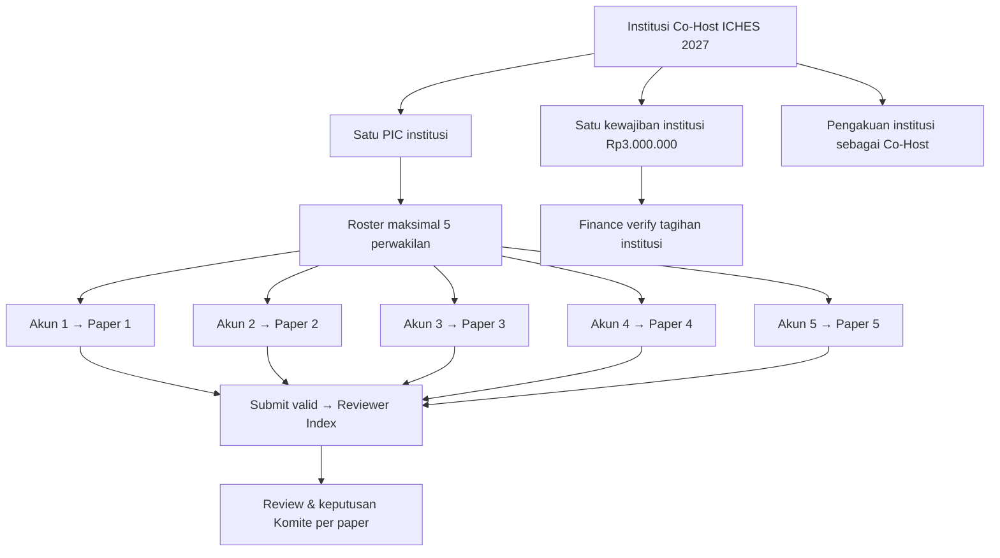
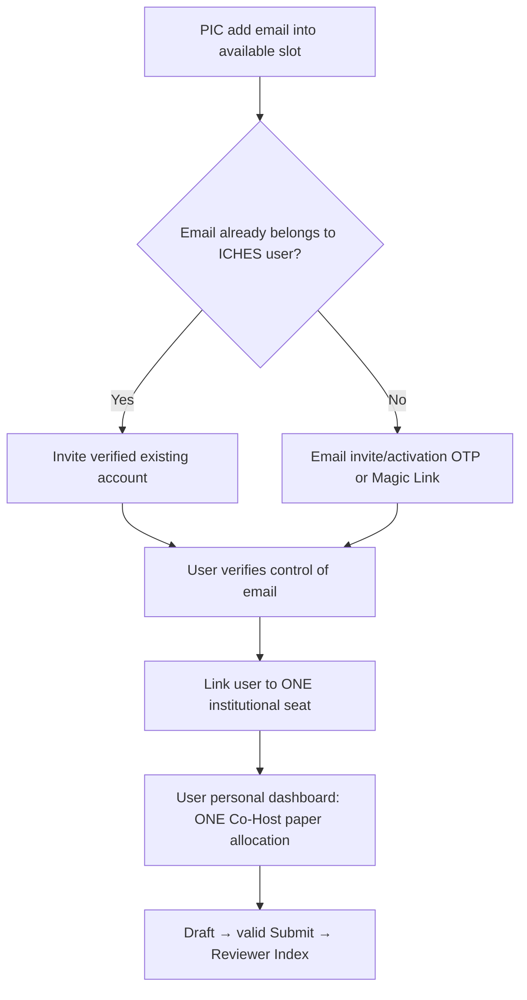

# 18B-04 — Field-Level CRUD Co-Host Institutions, PIC, Lima Perwakilan & Lima Paper

> **SUPERSEDES USULAN AKTIVASI LAMA · 27 OKTOBER 2026:** Registrasi Co-Host melahirkan **SATU invoice Rp3 juta/institusi; PIC wajib membayar dan menunggu Finance VERIFIED sebelum mengakses fitur roster/submit 5 paper sponsor.** Setelah aktif, lima paper sponsor **tidak memiliki invoice Conference/presenter pribadi tambahan**, bahkan setelah ACCEPT. Aturan lama yang menyebut gate pembayaran belum disepakati telah diganti keputusan ini. [18B-06 Finance](18B-06-CRUD-FINANCE-INVOICE-PEMBAYARAN-VERIFIKASI.md).

> **Tahap 18B · 27 Oktober 2026 · SPESIFIKASI UI & BISNIS (BELUM CODING).**  
> **FINAL dari pemilik produk:** **Rp3.000.000 / institusi / event** untuk jalur **paper International Conference**; **maksimal lima perwakilan dan lima paper**, masing-masing perwakilan mengelola **SATU** paper Co-Host melalui akunnya; institusi mendapatkan **pengakuan sebagai Co-Host ICHES 2027**.  
> **Paket Program Internasional Rp1.000.000/orang** untuk empat kegiatan bukan menu/add-on/tagihan Co-Host. Pembelian dilakukan tiap peserta melalui Dashboard pribadi.  
> **PENTING:** status `DISETUJUI` berlaku untuk ketentuan produk di atas. Nama field/halaman, metode undangan, alur approval, tenggat pembayaran institusi, penggantian paper, serta kapan logo ditayangkan adalah **USULAN/TERBUKA**, jangan dianggap sudah dikunci. Baca [register keputusan](09-KEPUTUSAN-DAN-ISU-TERBUKA.md).

## A. Alur operasional yang bisa dipaparkan kepada Warek I



**PIC bukan otomatis peserta kelima**: ia menggunakan salah satu slot hanya jika memang masuk roster perwakilan. **Status Co-Host/Finance tidak menyamakan lima paper dengan lima ACCEPT**. Reviewer, Komite, Moderator, dan penerbit sertifikat tetap menjalankan alur akademik normal. Jumlah co-author pada tiap paper tidak menambah/mengurangi jatah lima perwakilan.

## B. Peta menu dan pemilik aksi

```text
ADMIN → CO-HOST INSTITUTIONS
  CH-01  Co-Host Registry (list/search/filter)
  CH-02  Create / Edit Institution + Co-Host Registration
  CH-03  Institution Detail (tabs)
         ├─ Profile & Official Recognition
         ├─ PIC & Invitations
         ├─ Five Conference Members
         ├─ Five Paper Allocations
         ├─ Institutional Invoice (read status; Finance verifies)
         └─ Activity History / Audit
  CH-04  Co-Host Public Recognition (name/logo/status)
  CH-05  Co-Host Reports / Export

INSTITUTION WORKSPACE → PIC CO-HOST
  PIC-01 Institution Profile
  PIC-02 Conference Members (0/5–5/5) + Invite
  PIC-03 Paper Quota (0/5–5/5) + Public Academic Status
  PIC-04 Institutional Invoice Rp3.000.000 + Payment Proof
  PIC-05 Recognition Profile (name/logo request)

PERSONAL DASHBOARD → CO-HOST MEMBER
  My Conference Paper (one sponsored entitlement)
  My Abstract/Reviewer Decision/LoA/Full Paper/Session
  Paket Program Internasional Rp1.000.000 (hanya menu pribadi, bukan PIC)
```

**Status operasional menu dan role masih usulan 18A**. Admin mempunyai CRUD lintas institusi; PIC dibatasi pada institusinya. **Finance** memiliki pemeriksaan tagihan, sedangkan PIC hanya melihat/mengirim bukti institusinya. Admin dapat melihat data pembayaran berdasar izin, tetapi tidak boleh memalsukan `Verified` tanpa otorisasi Finance. **PIC tidak mendapat akses berkas PDF paper privat, confidential reviewer comments, nomor rekening pembayaran pribadi, atau pembelian paket Rp1 juta anggota.**

## C. CH-01 — Co-Host Registry

| Kolom | Isi dan pencarian | Aturan |
|---|---|---|
| Institution Code / Official Name | Identitas stabil/nama resmi | Filter/search nama, kode, kota, negara bila ada |
| PIC | Nama PIC yang aktif | PIC adalah user dengan institutional scope |
| Roster | `0/5`–`5/5` | Count daftar anggota yang menempati slot; undangan pending ikut mengisi slot |
| Paper Quota | `0/5`–`5/5` | Count jatah yang terhubung dengan paper, **bukan** count Accepted |
| Invoice | Rp3.000.000, 1 kewajiban untuk institusi/event | Status dari domain Finance, bukan hasil input manual bebas |
| Recognition | Draft / Pending Confirmation / Published (usulan status) | Nama/logo publik sesudah persetujuan yang sah |
| Registration | Draft / Submitted / Active / Suspended (usulan) | **Jangan samakan** status Co-Host dengan Finance Verified |
| Actions | View / Create / Edit / Disable / Export | Delete keras dilarang bila terkait paper, invoice, kehadiran |

**Filter/sort:** status registrasi, pembayaran, kuota terisi, status pengakuan, tanggal masuk, PIC. Pagination server-side dan ekspor berizin, bukan download seluruh data peserta oleh PIC.

## D. CH-02 — Form identitas institusi dan Co-Host Registration

| Field | Tipe | Perlu / validasi | Status |
|---|---|---|---|
| Institution Official Name | Text | Required; gunakan ejaan resmi dan hindari nama duplikat | USULAN teknis |
| Institution Code | Stable internal ID | Unik, bukan nama/slug yang dapat berubah | USULAN teknis |
| Abbreviation | Text | Optional, boleh mirip institusi lain, bukan kunci identitas | USULAN |
| Country / City | Selector/Text | Data lokasi institusi bila relevan untuk publikasi | USULAN |
| Official Contact | Email/telp institusi | Hanya pihak berizin | USULAN |
| Co-Host PIC | Existing/new User | Required untuk pengelolaan; **scope institusi** | USULAN alur assignment |
| Event | ICHES 2027 | Satu pendaftaran Co-Host aktif per `institution+event` | Konsekuensi integritas |
| Capacity Members | **5** | **FINAL kuota** sesuai keputusan acara; konfigurasi Admin tanpa boleh melampaui kebijakan diam-diam | FINAL |
| Sponsored Paper Quota | **5** | Satu per anggota; paper keenam tidak ditanggung | FINAL |
| Co-Host Fee | **IDR 3.000.000** | Satu institusi; snapshot saat invoice diterbitkan | FINAL |
| Institution Logo | Upload privat dahulu | Periksa MIME/size, izin penggunaan sebelum publish | USULAN |
| Recognition Name | Nama yang ditampilkan publik | Disetujui institusi dan Admin/panitia, bukan langsung atas input bebas | USULAN |
| Notes / Confirmation | Catatan status/penanggung jawab | Minimal, tidak perlu contract management engine | USULAN |

**Pencegahan institusi ganda:** nomor/kode internal dan pencarian nama membantu, tetapi sistem tetap menyediakan **review duplikasi manual** saat institusi memakai variasi ejaan. **Jangan** menggabungkan dua institusi otomatis berdasarkan kemiripan nama tanpa Admin. Perubahan data master tidak mengubah invoice historis/metadata paper yang sudah disubmit.

## E. CH-03/PIC-02 — Roster lima anggota dan undangan

**Rekomendasi UX:** lima slot tampil tetap pada PIC dan Admin, dengan posisi 1–5 untuk memudahkan pengawasan. Slot boleh kosong; satu PIC tidak otomatis memakai slot.

| Field | Fungsi |
|---|---|
| Seat No. | 1..5 dalam institusi-event; unik |
| Proposed Full Name | Nama yang diusulkan PIC (belum tentu nama akun akhir) |
| Email Invitation | Email tujuan undangan |
| Linked User ID | Diisi setelah login email terverifikasi; satu akun digunakan lintas kegiatan |
| Invitation Status | Not Invited / Invited / Activated / Revoked (usulan) |
| Paper Link | Kosong atau 1 paper yang memakai hak slot ini |
| Eligibility | Co-Host member pada event dan institusi ini |
| Actions | Invite / Resend / Cancel before activation / Replace under policy / View public progress |



**Penting:** ini **USULAN solusi penghubung**, bukan keputusan final metode undangan. Penguncian final tetap **5 user = 5 jatah paper**. Undangan pending boleh mencadangkan slot agar tidak terjadi 6 orang masuk. Validasi email dilakukan di backend, hindari menggunakan email mentah sebagai primary key user dan hindari reuse token invitation.

### Penanganan anggota/paper yang berubah (tidak diputuskan)

| Peristiwa | Rekomendasi, BUKAN kebijakan final |
|---|---|
| Salah ketik email sebelum undangan diaktifkan | PIC boleh koreksi/reissue undangan; slot tetap satu |
| Invite belum diterima sampai dekat batas pendaftaran | Admin/PIC dapat resend/cancel sesuai peraturan |
| Anggota sudah memiliki Draft tetapi belum Submitted | Penggantian harus meninjau status draft dan bukti kepemilikan slot |
| Anggota sudah Submitted/Reviewed/Accepted | **Admin/Komite** perlu proses koreksi berdasar alasan; jangan memindah paper otomatis ke akun baru |
| Paper Rejected / withdrawn | Penggunaan ulang hak satu paper **TERBUKA**, jangan otomatis mengembalikan jatah |
| Ada co-author sama pada dua paper | Tidak otomatis bentrok, selama sponsored submitting user dan slot paper berbeda |

## F. CH-03/PIC-03 — Paper Quota: identitas sponsor tidak mengubah akademik

| Data | Cara hitung / tampilan |
|---|---|
| Seat linked | User terverifikasi/berotorisasi pada institusi |
| Sponsored Paper | Maks. **satu paper** per seat, ID stabil |
| Institution quota | Maks. **lima paper**; tampil **3/5 Submitted** dan **4/5 Allocated** bila satu paper masih Draft |
| Paper Academic Status | Hanya status umum Draft/Submitted/Under Review/Accepted/Rejected/Presented sesuai fase dan izin |
| Submit Action | Hanya perwakilan dari **Dashboard paper pribadi**, bukan PIC mengirim lima paper |
| Reviewer/Decision | Sama persis dengan jalur Regular; tidak ada bypass karena sponsor |
| Sponsor vs Co-Authors | Seat dipakai oleh *submitting member*; co-author tambahan tidak mengambil seat |
| File/Review Privacy | PIC hanya kode/title/status minimum; PDF dan review privat tetap role akademik yang berizin |

**Rekomendasi integritas:** one `active sponsor paper allocation` per `institution-event-seat/user`; operasi pembuatan Draft dan tautan slot harus idempotent dan transaksional, agar dua tab/browser tidak menggunakan satu slot dua kali. Ketentuan perubahan/penarikan atau paper reguler tambahan **belum final**.

## G. CH-03/PIC-04 — Institutional Invoice (handoff ke Finance)

| Kolom/field | Aturan |
|---|---|
| Payer Type | **INSTITUTION**, bukan lima user personal |
| Payer Reference | Co-Host institution registration dan snapshot nama institusi |
| Item | **Co-Host ICHES 2027 — 5 Conference Members / 5 Papers** |
| Amount | **Rp3.000.000 satu kali / institusi-event** |
| Currency | IDR |
| Issue/Payment Deadline | **Belum diputuskan**; jika nanti ada, Admin CRUD |
| Payment Method | Transfer + upload proof + Finance verify adalah **baseline/usulan** yang telah didokumentasikan |
| Proof File & Revision | Hanya PIC institusi + Finance/Admin berizin |
| Status | Due / Proof Submitted / Verification / Verified / Correction Required (contoh) |
| Auditor | Finance actor, waktu, histori keputusan/verifikasi |

**Keputusan FINAL 27 Oktober:** invoice Co-Host dibuat pada registrasi institusi; **Finance VERIFIED wajib sebelum roster/submit jalur Co-Host aktif**. **Jangan membuat lima tagihan untuk lima paper atau meminta pembayaran presenter Co-Host secara personal per paper secara otomatis**. Jika panitia mengubah harga nanti, invoice lama **tidak ditulis ulang**.

**Batas lintas domain:** pembelian paket Rp1 juta salah satu anggota muncul pada **Personal Dashboard anggota** dan **Finance Personal Transactions**, **tidak** pada PIC-04 / Invoice Institusi. **Jangan menampilkan total gabungan Rp6 juta sebagai utang institusi**.

## H. CH-04/PIC-05 — Pengakuan institusi Co-Host

**FINAL secara bisnis:** institusi berhak diakui sebagai **Co-Host / mitra kolaborasi penyelenggara ICHES 2027**. **USULAN penyajian:** daftar Co-Hosting Institutions di situs resmi, nama/logo pada materi yang disetujui, atau surat konfirmasi; format dan izin masih terbuka.

| Field/aksi | Rekomendasi |
|---|---|
| Display Institution Name | Nama yang disetujui institusi dan panitia |
| Authorized Logo | File/logo terverifikasi izin penggunaannya |
| Website URL | Opsional dan divalidasi |
| Recognition Status | Pending confirmation / Approved / Published / Archived |
| Public Listing | Hanya item dengan status publikasi yang disetujui |
| Published At/By | Jejak keputusan agar pencantuman institusi tidak diubah sembarangan |
| Recognition Wording | “Co-Hosting Institution of ICHES 2027” atau redaksi yang disahkan Warek I |
| MoU Signed | **Bukan** otomatis bagian status ini |

Jangan menyatakan kampus telah menandatangani MoU hanya karena Co-Host. Pengakuan tidak otomatis memberi hak MoU/PKM/Upgrading/Destinasi kepada semua anggota.

## I. Hak akses dan pemisahan data

| Aksi | Admin | PIC Co-Host (own institution) | Member | Finance | Komite Akademik |
|---|---|---|---|---|---|
| CRUD registrasi institusi | ✓ | Usul/perbaiki own sesuai delegasi | — | View billing name | View sponsorship metadata bila relevan |
| CRUD roster max 5 | ✓ | ✓ own, sesuai aturan koreksi | View own seat | — | View linked author/paper |
| Link paper/jatah | Manage/correct authorized | View status minimum | Create own sponsored paper | — | Manage academic status saja |
| View institutional invoice/proof | ✓ sesuai permission | ✓ own | — (kecuali juga PIC) | ✓/verify | — |
| View member's personal Rp1 juta invoice | **Finance/otorisasi personal saja** | **—** | ✓ own | ✓ | — |
| Publish Co-Host name/logo | ✓/Content Editor delegated | Request/correct own | — | — | — |
| Change ACCEPT / Reviewer comments | Tidak via generic CRUD | — | — | — | **Komite authoritative** |

**Server wajib memeriksa `event_id + institution_id + role + ownership` pada tiap aksi**, bukan hanya menyembunyikan menu. Informasi roster/persona yang ditampilkan PIC harus dibatasi ke keperluan Conference, jangan memberikan akses identitas dokumen pribadi tak relevan.

## J. Wireframe konseptual (teks, belum UI aplikasi)

```text
PIC WORKSPACE — CO-HOST INSTITUTION
----------------------------------------------------
Universitas Mitra A               Co-Host ICHES 2027
Institutional Invoice              Rp3.000.000 (status Finance)
Members                            4 / 5 Seats
Paper Allocation                   3 / 5 Submitted
----------------------------------------------------
Seat   Representative   Account     Paper      Status
01     Dosen A          Active      ICHES-01   Under Review
02     Dosen B          Active      ICHES-03   Accepted
03     Dosen C          Active      ICHES-09   Submitted
04     Dosen D          Invited     -          Not Submitted
05     -                Empty       -          -
----------------------------------------------------
[Invite Member] [Institutional Invoice] [Recognition]
NO personal Rp1m package purchase/invoice in this workspace.
```

## K. Acceptance Criteria / UAT (rencana, bukan hasil tes)

| ID | Skenario | Hasil yang diharapkan |
|---|---|---|
| CH-01 | Admin membuat satu institusi Co-Host | Tercatat satu pendaftaran untuk event dan institusi |
| CH-02 | PIC mengisi email kelima | Roster penuh 5/5 |
| CH-03 | PIC mencoba menambah anggota keenam | Ditolak backend tanpa membuat slot/entitlement baru |
| CH-04 | PIC belum di roster perwakilan | PIC tidak otomatis memakai satu dari lima slot |
| CH-05 | PIC invite email yang sudah punya akun | Ditautkan ke user terverifikasi yang sama, bukan akun ganda (jika solusi invite dipilih) |
| CH-06 | Anggota Co-Host membuka Dashboard pribadi | Memiliki satu hak paper Co-Host pada institusinya |
| CH-07 | Anggota membuat paper Co-Host kedua | Ditolak sebagai paper sponsor kedua |
| CH-08 | Lima anggota mengirim lima paper | Lima Paper ID, masing-masing milik submitter berbeda |
| CH-09 | Paper Accepted milik anggota 1, paper Rejected milik anggota 2 | Keputusan terpisah, institusi tetap Co-Host sesuai statusnya |
| CH-10 | PIC klik invoice institusi | Tepat satu kewajiban Rp3 juta, bukan lima tagihan |
| CH-11 | Dua PIC/tab mencoba membuat invoice sama | Unik/idempotent, tidak terbit dua kewajiban aktif |
| CH-12 | Anggota 1 membeli Paket Internasional Rp1 juta | Tagihan pada akun anggota, **tidak menambah invoice institusi** |
| CH-13 | PIC mencoba membuka bukti pembayaran personal anggota | Server menolak |
| CH-14 | PIC mencoba membaca confidential Reviewer Comments anggota | Server menolak |
| CH-15 | Admin koreksi roster sesudah paper Submitted | Tidak overwrite/transfer paper historis secara diam-diam |
| CH-16 | Institusi tercatat Co-Host tetapi bukan MoU Signatory | Tidak dianggap “MoU Signed” |
| CH-17 | Logo diupload tetapi belum memperoleh izin/publikasi | Tidak tampil publik otomatis |
| CH-18 | Admin menonaktifkan institusi yang sudah punya invoice/paper | Soft archive/status change, transaksi dan paper tetap tercatat |

**UAT disusun sebagai rencana, belum dijalankan.** Nomor dan nama institusi pada contoh adalah fiktif.

## L. Hal yang masih perlu diputuskan

**KEPUTUSAN FINAL tidak dibuka lagi:** 5 member, 5 paper (1/anggota), Rp3 juta per institusi, nama institusi Co-Host, akademik normal, paket Rp1 juta dibeli individu secara terpisah. **TERBUKA:** penggantian paper Rejected/Withdrawn, mengganti anggota pasca-Submitted, bukti status Co-Host resmi dan waktu/logo publikasi, fasilitas Co-Host di luar paper, paper reguler tambahan di luar kuota. **SUDAH FINAL:** invoice saat registrasi, VERIFIED sebelum fitur aktif. **USULAN DESAIN:** Magic Link invite roster, kode institusi, tab/chip status, pencadangan slot Draft, otorisasi granular dan audit koreksi.

[Lihat 18B-05 — Paket pribadi/empat program](18B-05-CRUD-PAKET-INTERNASIONAL-DASHBOARD-PESERTA.md) · [18B-02 — Submission akademik](18B-02-CRUD-INTERNATIONAL-CONFERENCE-SUBMISSION.md) · [Peta Admin](17-ADMIN-CRUD-DAN-PENGATURAN-ACARA.md).
