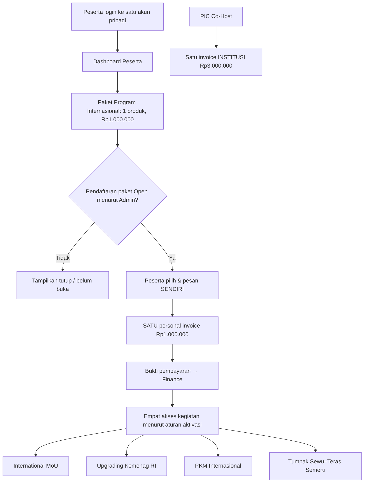
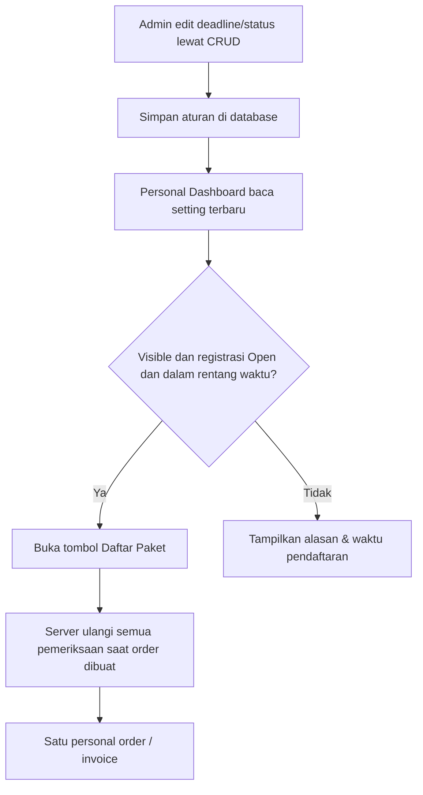

# 18B-05 — Field-Level CRUD Paket Program Internasional Rp1 Juta: Admin & Personal Dashboard

> **Tahap 18B · 27 Oktober 2026 · SPESIFIKASI LAYAR, BUKAN IMPLEMENTASI.**  
> **FINAL:** **Satu pembelian Rp1.000.000 per orang** melalui **Dashboard Peserta sendiri** memberi **empat akses sekaligus**: (1) International MoU, (2) Upgrading Kasubdit Penelitian-PKM Kemenag RI, (3) PKM Internasional, dan (4) Destinasi Internasional **Tumpak Sewu–Teras Semeru**. **Bukan empat biaya Rp1 juta, bukan add-on Co-Host Rp3 juta, dan bukan produk dalam panel PIC Co-Host.**  
> **FINAL:** **Admin dapat CRUD tanggal/jam batas akhir pendaftaran paket kapan diperlukan** tanpa coding/redeploy.  
> **TERBUKA:** waktu aktivasi hak terhadap status Finance VERIFIED, refund, tenggat pembayaran, kapasitas lapangan, detail hak transport/akomodasi/fasilitas, dan sertifikat program.  
> Konteks: [produk paket yang sudah disetujui](15-PAKET-INTERNASIONAL-DASHBOARD-PESERTA.md) · [TOR](10-ANALISIS-TOR-DAN-REBASELINE-2027.md) · [Admin CRUD](17-ADMIN-CRUD-DAN-PENGATURAN-ACARA.md) · [Co-Host 5 paper](18B-04-CRUD-COHOST-INSTITUSI-LIMA-PAPER.md).

## 1. Diagram pemisahan pembayaran yang harus jelas pada UI



**Tidak ada jalur dari paket pribadi menuju invoice Co-Host.** Jika anggota Co-Host ikut paket, akun pribadinya mendapat tagihan pribadi; PIC institusi tetap hanya melihat tagihan institusi Rp3 juta. Data keuangan dua domain boleh masuk rekap Finance global, tetapi **tidak** digabung menjadi kewajiban institusi.

**International MoU pada paket = hak mengakses kegiatan/sesi MoU**, **bukan** penetapan delegasi atau pihak yang menandatangani MoU; institusi/MoU PIC/signatory tetap workflow terpisah.

## 2. Peta halaman — domainnya terpisah dari Co-Host

```text
ADMIN / PARTICIPANTS & INTERNATIONAL PACKAGE
  PK-01  Package Settings (master 1 produk/ICHES 2027)
  PK-02  Registration Window & Status (editable open/close, start/deadline)
  PK-03  Personal Package Enrollments (list)
  PK-04  Enrollment Detail (one user, one order, one payment obligation)
  PK-05  Access / Activity Entitlements (4 items under 1 package)
  PK-06  Package Reports & Export (Finance cross-ref, no double count)

PERSONAL DASHBOARD
  U-PK-01 Package Offer Card
  U-PK-02 Review & Confirm Enrollment
  U-PK-03 My Package Invoice / Upload Proof
  U-PK-04 Four Activity Accesses / My Schedule
  U-PK-05 My Package Status / History

FINANCE WORKSPACE
  Personal Transactions / Proof Review / Verification
  (Financial workflow detail later; NOT inside PIC Co-Host)
```

**Kebijakan Admin CRUD terpusat sudah FINAL**. Penamaan menu, navigasi, pengelompokan PK-01/PK-02, tombol dan field adalah **USULAN UI**. Finance verification bukan CRUD `mark paid` yang dapat dimainkan operator/panitia mana pun.

## 3. PK-01 — Package Settings: satu produk, bukan empat item berbayar

| Field | Nilai/aksi | Sifat |
|---|---|---|
| Package Code | Stable code mis. `ICHES27-INTERNATIONAL` | USULAN teknis, satu produk unik per event |
| Name | Paket Program Internasional | Sudah disepakati istilah/konsep |
| Event | ICHES 2027 | One event package |
| Price | **IDR 1.000.000 per person** | **FINAL saat ini**; Admin CRUD harga untuk kebijakan baru, tidak rewrite invoice lama |
| Description | Copy publik yang menjelaskan satu paket/empat akses | Editable Admin |
| Benefit 1 | **International MoU** | **FINAL bagian dari paket**, tidak dijual Rp1 juta sendiri |
| Benefit 2 | **Upgrading Kasubdit Penelitian-PKM Kemenag RI** | **FINAL** |
| Benefit 3 | **PKM Internasional** | **FINAL** |
| Benefit 4 | **Destinasi Internasional: Tumpak Sewu–Teras Semeru** | **FINAL** |
| Registration Window | Start/Deadline tanggal-jam | **FINAL harus editable Admin** |
| Manual Registration Status | Open / Closed | USULAN pengendalian mudah |
| Visibility | Show/Hide card di Dashboard | USULAN, beda dari open/closed |
| Capacity | Optional participant limit | **TERBUKA** tidak boleh dibuat batas arbitrer |
| Terms & Conditions | Batas waktu, cancellation/refund, facility notes setelah disahkan | **TERBUKA** |
| FAQ / Contact | Bantuan pendaftaran, kontak resmi | USULAN konten Admin |

**Admin bebas mengelola data acara** melalui layar konfigurasi, tetapi **harga dan empat manfaat yang sudah disepakati tidak boleh berubah menjadi kebijakan baru tanpa keputusan penyelenggara**. Harga yang diubah setelah kebijakan resmi disahkan hanya berlaku untuk **order baru**, sedangkan `PersonalPackageOrder` lama menyimpan snapshot nilai/ketentuan saat dipesan.

**Satu paket = satu SKU**, bukan empat produk/program yang ditagih sendiri. Jadwal, peserta, dan absensi tiap kegiatan boleh dikelola pada modul program operasional masing-masing, namun bukan berarti tiap kegiatan punya `invoice` terpisah.

## 4. PK-02 — CRUD deadline dan Open/Closed

**Zona waktu acara yang direkomendasikan: Asia/Jakarta.** Tanggal aktual penutupan **belum ditetapkan dalam keputusan terbaru**; Admin akan mengisinya.

| Field | Jenis input | Perilaku |
|---|---|---|
| Opens At | DateTime, Asia/Jakarta | Menerima pendaftar baru mulai waktu ini jika status Open |
| **Deadline At** | DateTime, Asia/Jakarta | **Admin dapat mengubah kapan diperlukan** |
| Registration State | Open / Closed | Jika Closed, tolak registrasi baru walau deadline belum lewat |
| Public Visibility | Visible / Hidden | Jika hidden, penawaran tak muncul; **bukan** otomatis membatalkan user yang sudah mendaftar |
| Capacity (optional) | Number | Hanya bila kebijakan kuota ditetapkan |
| Save & Preview | Aksi Admin | Perlihatkan status efektif dan perkiraan waktu sesuai zona waktu |



**Pengaturan tanggal tidak boleh hanya di browser.** Server Laravel wajib mengecek konfigurasi **pada saat membuat enrollment/order**. Jika Admin menutup/memperpanjang deadline ketika user sedang membuka halaman, backend menegakkan status **terbaru**; tidak boleh menerima order baru hanya karena tombol masih terlihat.

**Peserta yang sudah memiliki enrollment/invoice** tetap dapat melihat status, bukti transfer, dan riwayat setelah deadline pendaftaran ditutup. **Deadline registrasi tidak otomatis menjadi tenggat upload bukti bayar** kecuali panitia menetapkan deadline pembayaran tersendiri. Perpanjangan deadline **tidak membuat order kedua** pada user yang sudah mendaftar.

**Full Paper Conference** tidak terkait tanggal paket ini. Aturan Academic ACCEPT announced membuka Full Paper tetap berlaku meski Paket Rp1 juta Closed.

## 5. PK-03 — Personal Package Enrollments (tabel Admin)

| Kolom | Tujuan | Filter |
|---|---|---|
| Enrollment Code | Identitas unik pendaftaran | Search |
| Participant | Nama/email personal, hanya kepada staf berwenang | Search; PII dibatasi |
| Conference/Co-Host Status | Referensi keikutsertaan bila perlu; **bukan dasar harga** | Filter opsional |
| Created At | Timestamp server | Rentang |
| Package Price Snapshot | Rp1.000.000 untuk order ini | Currency/amount |
| Payment Status | Unpaid / Proof Submitted / Under Review / Verified / Correction (contoh) | Filter |
| Access Status | Not Active / Active / Suspended (status tergantung keputusan aktivasi) | Filter |
| Activity Entitlements | Empat baris akses di detail, tanpa empat invoice | Lihat detail |
| Actions | View / Filter / Export authorized / Request correction | Tidak boleh mengubah bukti pembayaran atau hak secara sembarangan |

**Satu order aktif untuk satu orang/paket/event** adalah **usulan integritas** agar double-click, refresh halaman, atau dua tab tidak menciptakan tagihan ganda. Idempotency key dan unique constraint adalah solusi teknis yang direkomendasikan; jika order dibatalkan/refund, cara membuka pembelian ulang **belum ditetapkan**.

Tidak menampilkan `5 anggota Co-Host → lima paket Rp1 juta` secara otomatis. Bahkan peserta dari institusi Co-Host baru masuk daftar PK-03 bila **mereka sendiri memilih paket**.

## 6. PK-04 — Enrollment Detail / Personal Payment handoff

| Field/Tab | Isi |
|---|---|
| Account | `user_id`, nama/email peserta terverifikasi |
| Product Snapshot | Satu SKU, nama paket, empat benefit, price & currency |
| Enrollment Status | Started/Submitted/Cancelled jika diizinkan kebijakan |
| Invoice | **Satu personal invoice Rp1.000.000** dengan nomor/owner sendiri |
| Payment Evidence | Bukti bayar pribadi (private file) |
| Finance Verification | Verified/Correction Required dan siapa/kapan, sesuai otorisasi |
| Eligibility Snapshot | Status hak empat program, sumber paket dan perubahan |
| Audit/History | Activity actor, status, perubahan setting relevan |

**Batas lintas modul:** PersonalPackageInvoice selalu bertipe `PERSONAL`, pemilik akun individu, **tidak** berubah jadi `INSTITUTIONAL CO-HOST` hanya karena `user.institution_id` sama. Invoice Co-Host berada di modul Finance Institusi sebagai dokumen **lain**.

**Metode pembayaran transfer/bukti/manual Finance** mengikuti baseline dokumen terdahulu; detail nomor rekening, verifikasi, reversal/refund dan tanggal pembayaran masih harus diperjelas dalam tahap Finance. **Jangan mengklaim integrasi payment gateway aktif**.

## 7. PK-05 — Empat akses kegiatan / satu pembayaran

| Hak kegiatan dari SATU paket | Yang boleh ditampilkan di Dashboard | Yang TIDAK boleh disimpulkan |
|---|---|---|
| International MoU | Jadwal dan hak mengikuti rangkaian acara MoU | User bukan otomatis delegasi/signatory institusi |
| Upgrading Kasubdit Penelitian-PKM Kemenag RI | Jadwal, lokasi/link dan informasi sesi upgrading | Tidak otomatis ada sertifikat tersendiri |
| PKM Internasional | Lokasi, kelompok jika ditetapkan, kehadiran/layanan | Tidak otomatis hadir hanya karena bayar |
| Tumpak Sewu–Teras Semeru | Informasi studi destinasi, rombongan/titik kumpul ketika tersedia | Tidak otomatis termasuk hotel/transport jika belum ditetapkan |

**Satu produk dibayar sekali** tetapi status **entitled (hak ikut)**, **registered**, **attended/served** dan **signed (khusus institusi MoU)** harus terpisah. Semua program dapat memakai **personal QR yang sama**, sedangkan scan/absensi tetap per program/slot.

**Aktivasi:** secara operasional disarankan hak empat program menjadi `Active` **setelah Finance VERIFIED**, tetapi detail aktivasi resmi belum diputuskan. **Jangan mewarnai semua hak sebagai “Aktif” hanya karena user klik order**. Dashboard harus membedakan `Paket Dipilih`, `Pembayaran Dalam Pemeriksaan`, `Hak Program Aktif`, dan `Kehadiran`.

**Hak dari package tidak otomatis membuat registrasi institusional MoU.** PIC MoU, daftar delegasi terverifikasi, dan bukti penandatanganan tetap domain lain.

## 8. U-PK-01 sampai U-PK-05 — Dashboard Peserta: layar satu kartu

```text
ICHES 2027 / MY DASHBOARD
-------------------------------------------------------------
Paket Program Internasional            SATU PAKET Rp1.000.000
Termasuk:
  ✓ International MoU
  ✓ Upgrading Kasubdit Penelitian-PKM Kemenag RI
  ✓ PKM Internasional
  ✓ Destinasi Tumpak Sewu–Teras Semeru

Pendaftaran: [OPEN sampai (tanggal WIB yang diatur Admin)]
[Daftar Paket Program Internasional] ← hanya saat eligible

Setelah daftar:
  Status Enrollment : Menunggu Pembayaran / Dalam Pemeriksaan / ...
  Personal Invoice  : Rp1.000.000
  [Lihat Tagihan] [Unggah Bukti] [Riwayat]

Setelah hak aktif menurut kebijakan:
  [MoU] [Upgrading] [PKM] [Destinasi]
  Jadwal dan kehadiran masing-masing (bukan 4 kuitansi)
-------------------------------------------------------------
```

**U-PK-01 Offer Card:** tampilkan empat benefit dan **satu harga**, aturan tanggal/status dari Admin. **U-PK-02 Review & Confirm:** konfirmasi user atas satu paket, bukan empat pilihan harga. **U-PK-03 Invoice:** nomor tagihan pribadi, tujuan transfer resmi jika diumumkan, upload bukti dan status Finance. **U-PK-04 My Access:** informasi setiap program, status hak, jadwal dan kehadiran factual. **U-PK-05 History:** satu jejak order, bukti/correction dan perubahan status, aman terhadap refresh.

**Saat penawaran Closed:** pengunjung yang belum daftar melihat info penutupan; orang yang sudah punya enrollment **tetap melihat tagihannya**, tanpa tombol `Daftar` kedua. Jika admin memperpanjang, kartu berubah menjadi Open bagi yang belum daftar tanpa redeploy.

## 9. Matriks permission

| Tindakan | Admin | Finance | Program Coordinator (assigned) | User | PIC Co-Host |
|---|---|---|---|---|---|
| CRUD paket & deadline | ✓ | View yang dibutuhkan | View program sendiri | View publik | — dalam panel PIC |
| Enrollment baru personal | Inspect/authorized support | — | — | **CREATE OWN** | — sebagai PIC; bisa sebagai User sendiri |
| View personal invoice/proof | Sesuai permission | **VERIFY** | **Tidak** otomatis | **OWN** | **Tidak** untuk anggota lain |
| Aktivasi hak 4 program | Atur policy/authorized exception | Report verified | View rights program sendiri | View own | Tidak melalui Co-Host |
| Edit agenda kegiatan terkait | Admin | — | Scope program sendiri | View | — |
| Attendance/QR | Admin/assigned ops | — | Own program services | View own factual | Tidak otomatis |
| MoU signatory approval | Admin/Coordin. MoU berwenang | — | Hanya jika ditugaskan MoU | — | Tidak hanya karena Co-Host |

**Server-side authorization wajib** pada setiap endpoint/action, bukan hanya sidebar. Koordinator program tidak berhak membuka bukti pembayaran pribadi peserta hanya karena programnya termasuk dalam paket.

## 10. Integritas data minimal (konseptual, bukan migration)

| Entitas konseptual | Poin utama |
|---|---|
| `ProgramPackage` | Satu identitas paket untuk ICHES 2027, nama, harga saat ini, empat manfaat, status & jendela pendaftaran |
| `ProgramPackageEnrollment` | Owner `user_id`, `event_id`, `package_id`, waktu dan status; idempotent |
| `PersonalPackageInvoice` | Snapshot `Rp1.000.000 IDR` dan pemilik pribadi, status Finance |
| `PaymentEvidence` | File private, uploader, versi bukti, timestamp |
| `ActivityEntitlement` | Empat hak kegiatan terkait **satu** enrollment, status menurut policy |
| `ProgramAttendance` | Kehadiran yang benar-benar tercatat, per program/slot, terpisah entitlement |
| `PackageConfigAudit` | Actor Admin, before/after, timestamp, alasan perubahan kritis/deadline |

**Tidak** ada empat `PersonalPackageInvoice` untuk masing-masing aktivitas. Saat Admin mengubah tanggal atau tarif, order historis/invoice tidak ditulis ulang. Saat Finance menolak bukti, enrollment tidak otomatis dihapus dari akun; user perlu tindak lanjut sesuai kebijakan koreksi.

## 11. UAT paket mandiri, pembayaran tunggal, deadline CRUD (rencana saja)

| ID | Skenario | Expected |
|---|---|---|
| PK-01 | User bukan Co-Host buka dashboard | Melihat satu paket, satu harga Rp1 juta, empat benefit |
| PK-02 | Anggota Co-Host buka dashboard sendiri | Penawaran paket sama persis, tidak otomatis tertagih |
| PK-03 | PIC Co-Host buka workspace institusi | Tidak ada tombol/tagihan Paket Rp1 juta |
| PK-04 | User mendaftar paket sekali | Tepat satu enrollment personal dan satu invoice Rp1 juta |
| PK-05 | User menekan tombol daftar dua kali | Tidak muncul dua enrollment/invoice aktif |
| PK-06 | User menyegarkan halaman setelah daftar | Melihat order lama, bukan penawaran membeli ulang |
| PK-07 | Admin ubah deadline dari Backoffice | Server menerapkan batas baru pada **registrasi baru** tanpa deploy |
| PK-08 | Admin memajukan deadline ketika form user terbuka | Saat submit, server menolak order baru yang melewati deadline terbaru |
| PK-09 | Admin perpanjang deadline | User yang belum terdaftar dapat membeli lagi selama status Open |
| PK-10 | Status manual Closed meski belum deadline | Registrasi baru ditolak server |
| PK-11 | Paket Closed setelah user mendaftar | User masih dapat melihat tagihan dan histori enrollment |
| PK-12 | Admin hanya mengubah Important Date Conference | Tidak mengubah deadline paket |
| PK-13 | Admin mengubah tarif sesuai keputusan baru | Invoice historis tetap sesuai snapshot awal |
| PK-14 | User upload bukti pembayaran pribadi | Bukti hanya tampak pada user + Finance/Admin berizin |
| PK-15 | User membeli paket dan belum ada Finance VERIFIED | Empat hak **tidak dinyatakan final Active** tanpa policy aktivasi |
| PK-16 | Paket valid memberi akses kegiatan | Empat entitlement terkait **satu** enrollment, tidak empat invoice |
| PK-17 | User menghadiri PKM tetapi absen Destinasi | Kehadiran tercatat hanya untuk PKM, meski punya 4 hak |
| PK-18 | User membeli Paket MoU tanpa institusi signed | Tidak otomatis menjadi delegasi/signatory |
| PK-19 | Operator tidak berizin mengakses private invoice | Ditolak backend |
| PK-20 | Co-Host member membeli paket | Finance melihat satu transaksi PERSONAL; invoice INSTITUTIONAL tetap Rp3 juta |
| PK-21 | Admin menutup pendaftaran paket | Tidak mengunci Full Paper pada paper yang ACCEPT telah diumumkan |
| PK-22 | Pembayaran retry/upload bukti ulang | Tidak menghasilkan order kedua; bukti dapat dikoreksi menurut hak dan histori |
| PK-23 | Koordinator PKM lihat daftar peserta entitled | Hanya data minimum peserta program sendiri, tidak semua data Finance |
| PK-24 | Pendaftaran paket dari browser lain di akun sama | Backend menjaga satu enrollment aktif per user/paket/event (jika desain unique disetujui) |

**Semua UAT ini adalah rancangan; tidak ada tes yang sudah dijalankan.**

## 12. Handoff ke Tahap Finance & Payment Verification

Setelah spesifikasi 18B-04/05, modul Finance perlu menjawab dengan tegas:
1. **Satu invoice Co-Host INSTITUTIONAL Rp3 juta** yang dikelola PIC dan diverifikasi Finance.
2. **Satu invoice program PERSONAL Rp1 juta** yang dikelola user; berisi empat benefit tanpa empat pembayaran.
3. **Biaya presenter reguler** menurut mode/kategori TOR dan aturan **hanya sesudah ACCEPT**; jangan terbitkan tagihan presenter sebelum final ACCEPT announced.
4. Format nomor invoice, rekening penerima, metode transfer/proof, expiry payment (jika ada), penolakan bukti, refund, koreksi harga, dan rekap tidak double count.
5. Kapan satu atau empat entitlement aktif dan kaitan pembayaran dengan hak/QR, tanpa mencampur attendance dan MoU Signed.

**USULAN nama tahap berikutnya:** `18B-06 — Finance, Billing, Payment Proof & Verification`. Belum membangun payment gateway, rekening bank, aplikasi mobile, atau database.

## 13. Register status

- **DISETUJUI:** Rp1 juta/akun = satu paket empat program; user membeli sendiri dari Dashboard; Co-Host tidak menanggung paket; Admin CRUD deadline.
- **USULAN:** label menu PK/U-PK, satu SKU, status Open/Closed manual, batas satu enrollment aktif, struktur entitlement, idempotency, tampilan history, activation setelah Finance Verified.
- **TERBUKA:** batas pendaftaran yang sebenarnya, tenggat pembayaran, kapasitas/transport/akomodasi dan pelayanan lapangan, refund, sertifikat program, metode aktivasi hak.

[Co-Host field-level](18B-04-CRUD-COHOST-INSTITUSI-LIMA-PAPER.md) · [Paket dasar](15-PAKET-INTERNASIONAL-DASHBOARD-PESERTA.md) · [Register](09-KEPUTUSAN-DAN-ISU-TERBUKA.md) · [Presentasi Warek I](00-PRESENTASI-WAREK-I.md).
