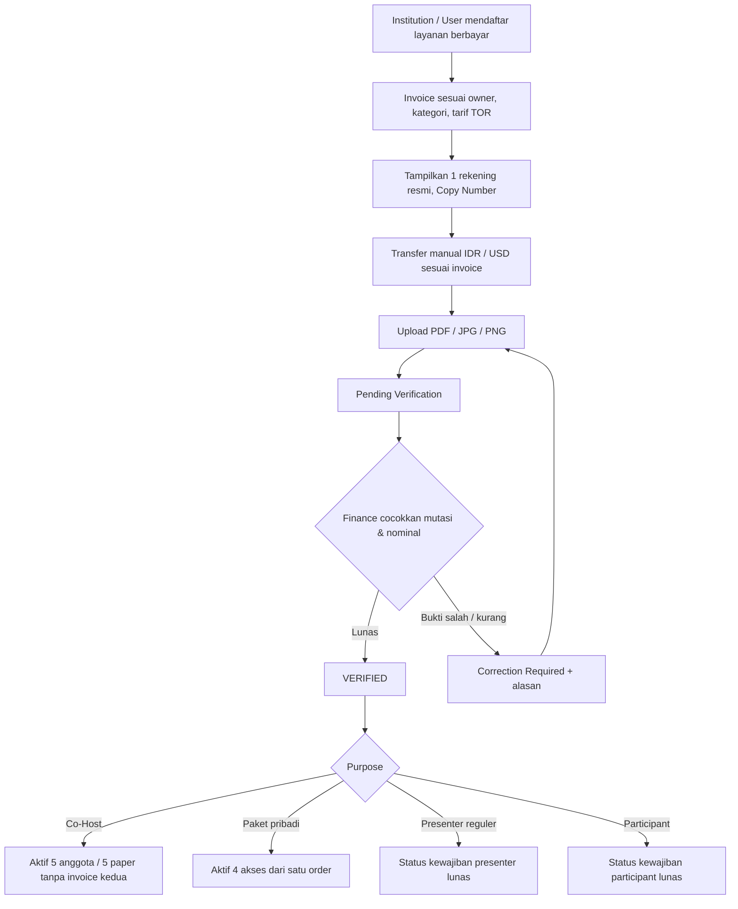
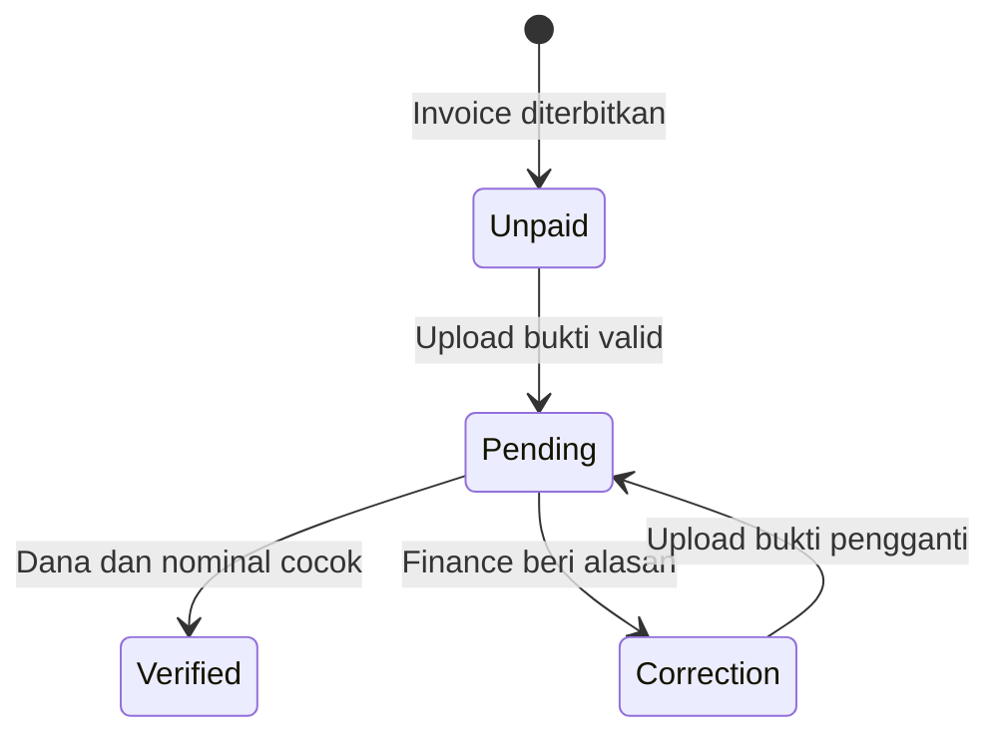

# 18B-06 — Finance & Payment Verification ICHES 2027

> **27 Oktober 2026 — FIELD-LEVEL BLUEPRINT, BUKAN APLIKASI YANG SUDAH BERJALAN.** Keputusan bisnis di bawah berasal dari diskusi pemilik produk. Nama layar, skema field, ukuran upload, dan detail teknis diberi status **USULAN**; keputusan belum tersedia diberi **TERBUKA**.
>
> Dokumen terkait: [Co-Host 18B-04](18B-04-CRUD-COHOST-INSTITUSI-LIMA-PAPER.md) · [Paket 18B-05](18B-05-CRUD-PAKET-INTERNASIONAL-DASHBOARD-PESERTA.md) · [Keputusan](09-KEPUTUSAN-DAN-ISU-TERBUKA.md) · [TOR](10-ANALISIS-TOR-DAN-REBASELINE-2027.md) · [Conference](18B-03-CRUD-REVIEW-DECISION-FULLPAPER-SESSION-DAN-UAT.md).

## 1. Prinsip Finance yang SUDAH DISETUJUI

1. **Satu rekening resmi penerima untuk seluruh ICHES**, diatur langsung **Superadmin** via Bank Settings tanpa approval kedua. **Bank belum dipilih:** kandidat BRI, BNI, Mandiri, BCA, BSI. Data rekening/SWIFT belum ada; tidak boleh diisi fiktif.
2. **Pembayaran transfer bank manual tanpa payment gateway.** Halaman invoice menampilkan nama bank, pemilik, nomor rekening **dengan tombol salin**, nominal dan kode invoice. Pembayar mengunggah bukti **JPG/JPEG/PNG/PDF**. Finance memeriksa *mutasi rekening*, bukan hanya mempercayai screenshot.
3. **WNI** tarif IDR untuk kategori nasional TOR; **WNA** tarif USD pada **kategori internasional TOR**, dibayar melalui transfer internasional **dalam USD**. **Seluruh biaya transfer internasional, termasuk bank pengirim, perantara dan penerima, menjadi kewajiban peserta**; panitia harus menerima nilai yang memenuhi invoice. Operasional USD pada bank terpilih harus dikonfirmasi sebelum go-live, khususnya bila rekening tujuan IDR.
4. **Co-Host:** satu invoice **Rp3.000.000 per institusi**, diterbitkan saat institusi mendaftar. PIC transfer dan upload bukti. **Baru setelah Finance VERIFIED, fitur Co-Host aktif:** roster hingga 5 perwakilan, masing-masing 1 jatah paper Conference. **Tidak ada tagihan Conference/presenter personal lain untuk kelima paper sponsor, termasuk setelah ACCEPT.** Kalau anggota mengambil program lain, itu menghasilkan tagihan **pribadi** yang berbeda.
5. **Paket Program Internasional:** satu invoice **Rp1.000.000 per orang**, dipesan sendiri pada Personal Dashboard. **Keempat hak** — hadir pada sesi International MoU, Upgrading Kemenag RI, International PKM, Destinasi Tumpak Sewu–Teras Semeru — **baru aktif setelah Finance VERIFIED**, bukan setelah unggah bukti. Hadir sesi MoU bukan hak tanda tangan.
6. **Presenter reguler non-Co-Host:** tidak ada invoice sebelum keputusan akhir ACCEPT **dipublikasikan kepada submitting author**. Setelah diumumkan, tagihan presenter diterbitkan; **Full Paper dan LoA dapat diakses sejak pengumuman ACCEPT tanpa menunggu Finance VERIFIED**. Pembayaran tidak menentukan keputusan akademik.
7. **Participant reguler:** registrasi dan pembayaran mengikuti kategori TOR yang tersedia; Finance memverifikasi. Status pembayaran bukan otomatis check-in, Presented, atau diterbitkannya sertifikat.

## 2. Empat jalur satu mesin Finance

| Tujuan | Pemilik kewajiban | Nilai invoice | Pemicu dan konsekuensi |
|---|---|---|---|
| Co-Host Conference | **Institution** | IDR 3.000.000 **sekali** | Registrasi institusi → bayar → **VERIFIED → fitur roster/5 paper aktif**; paper sponsor tidak ditagih lagi |
| Paket Internasional | **Person** | IDR 1.000.000 **sekali** | Order pribadi → bayar → **VERIFIED → 4 akses** |
| Presenter Conference reguler | Pembayar reguler sesuai kebijakan fee | Nasional onsite IDR 500.000, online IDR 250.000; internasional onsite USD 40, online USD 20 | Invoice baru setelah **ACCEPT diumumkan**; Full Paper tidak digate Finance |
| Participant Conference reguler | **Person** | Nasional onsite IDR 150.000; internasional online USD 10; mahasiswa onsite/online IDR 100.000 menurut TOR | Invoice sesuai kategori terdefinisi |

**Penting:** Co-Host dan Paket Internasional tetap **bertarif IDR** untuk institusi/peserta yang membelinya, termasuk jika terdapat anggota WNA. Jangan menciptakan harga USD baru bagi dua paket khusus ini. TOR tidak menuliskan tarif sejumlah kombinasi kategori, misalnya international participant onsite, national non-student participant online, international student; sistem **tidak boleh otomatis mengarang nominal**. Perlakuan satu presenter dengan beberapa paper juga masih membutuhkan keputusan sebelum auto-invoice.

## 3. Diagram end-to-end



**Tidak boleh:** (a) anggota Co-Host submit sebagai member sponsor sebelum pembayaran institusi VERIFIED, (b) Co-Host menghasilkan lima invoice personal, (c) paket Rp1 juta menghasilkan empat invoice program, (d) Full Paper digate Finance, (e) bukti upload dianggap VERIFIED otomatis.

## 4. Navigation/CRUD backoffice — USULAN UI minimal

```text
BACKOFFICE → FINANCE & PAYMENTS
 FIN-01   Overview & Pending Queue Summary
 FIN-02   All Invoices → Invoice Detail
 FIN-03   Payment Verification (ONE shared inbox)
 FIN-04   Financial Reports & Export
 FIN-05   Bank Settings [SUPERADMIN ONLY]

PIC CO-HOST → Institution Workspace
  One Institutional Invoice → transfer instructions → upload → status

PERSONAL DASHBOARD → My Payments
  Own package invoice / own regular presenter invoice / own participant invoice
  Detail → Copy Bank Number → Upload Proof → Status & correction notes
```

**FIN-01 Overview:** jumlah Unpaid, Pending, Correction Required, Verified; nominal invoiced dan verified **terpisah IDR/USD**, filter Co-Host/Personal/Presenter/Participant. Angka overview berasal dari invoice dan verifikasi sesungguhnya, bukan hasil mengalikan roster/akses program.

**FIN-02 All Invoices** — field minimum:

| Field | Deskripsi |
|---|---|
| Invoice ID/Code | Unik untuk event, contoh format `ICHES27-INV-0001` **USULAN** |
| Owner Type / ID | `institution` untuk Co-Host; `person` untuk lainnya |
| Source Reference | Co-Host registration, personal package order, published ACCEPT/paper, participant registration |
| Purpose | `cohost_conference`, `international_package`, `presenter_regular`, `participant_regular` |
| Fee Snapshot | Kategori TOR, mode, IDR/USD, nominal tetap pada saat invoice terbit |
| Target Bank Snapshot | Identitas rekening ketika invoice diterbitkan; perubahan rekening dicatat tanpa menghapus histori |
| Proof History | File privat, waktu, versi, catatan |
| Verified By / At | Petugas Finance dan waktu validasi, tidak boleh direkayasa UI |
| Status | Empat status sederhana (§7) |
| Due Date | **TERBUKA**, tidak boleh hardcode target tanggal TOR sebagai auto-void |

Daftar: cari kode/nama, filter kategori/status/mata uang, buka detail, ekspor sesuai izin. Invoice yang sudah VERIFIED tidak boleh diubah nominalnya diam-diam. Identitas invoice harus idempotent: klik ulang pendaftaran atau jaringan retry tidak membuat kewajiban yang sama dua kali. Refund/void/koreksi akuntansi ditunda sampai kebijakan panitia dipilih.

**FIN-03 Payment Verification:** satu inbox semua kategori, memperlihatkan invoice, nama pemilik, nominal+matauang, PDF/gambar bukti, referensi transfer bila tersedia, informasi transaksi bank, riwayat dan tombol **Verify** / **Request Correction**. Finance wajib mencocokkan mutasi bank; request correction **wajib alasan**. Bila uang belum ditemukan, jangan Verify. File pengganti tidak menghapus versi lama.

**FIN-04 Reports:** sumber invoice institution vs personal, fee category, nilai invoice, jumlah Verified, currency, waktu, operator Finance, referensi bank, dan export CSV/XLSX bila perlu. **Satu Co-Host Rp3 juta tidak dihitung 5x; satu paket Rp1 juta tidak dihitung 4x; invoice USD dan IDR tidak boleh dijumlah begitu saja.** Paket pribadi anggota Co-Host bukan utang institusi. Jika bank mengonversi USD ke IDR, simpan invoice USD dan nilai kredit bank IDR pada field berbeda; jangan bikin auto-FX tanpa kebijakan.

**FIN-05 Bank Settings (Superadmin):** satu record rekening resmi aktif berisi Bank Name (opsi BRI/BNI/Mandiri/BCA/BSI; belum dipilih), Account Number, Account Holder, SWIFT/BIC *jika relevan*, instruksi ID/EN, last-edit. Superadmin menyimpan perubahan **langsung, tanpa dual approval**; tetap ada validasi input, izin backend, riwayat perubahan sederhana. Finance read-only; peserta read-only. Tampilan invoice lama yang belum lunas harus menegaskan instruksi rekening terkini dengan histori rekening sebelumnya agar tidak membingungkan.

## 5. Form pembayaran untuk PIC dan peserta

```text
INVOICE                  ICHES27-INV-0001   [Unduh Invoice]
DESCRIPTION              Paket Program Internasional
TOTAL                    IDR 1.000.000
STATUS                   Unpaid
-------------------------------------------------
BANK                     [Berdasarkan setting Superadmin]
ACCOUNT HOLDER           [Diatur Superadmin]
ACCOUNT NUMBER           [Nomor rekening] [COPY]
SWIFT/BIC                [Jika international transfer]
NOTES                    Sertakan kode invoice saat transfer
-------------------------------------------------
TRANSFER DATE            [Opsional / usulan]
TRANSFER REFERENCE       [Opsional / usulan]
PAYMENT PROOF            [Upload JPG / JPEG / PNG / PDF]
                         [KIRIM BUKTI]
FINANCE NOTES            [Hanya ketika ada koreksi]
```

Hasil upload: **Pending Verification**, bukan Paid/Verified. Kalau **Correction Required**, tampilkan alasan Finance lalu *Upload Bukti Pengganti* pada invoice **sama**. Bukti hanya diakses pemilik invoice, Finance, dan Admin sesuai izin. **Jangan** meminta PIN/OTP/password bank atau menjadikan bukti sebagai tautan publik. Pemeriksaan file server (ekstensi + MIME + magic bytes), file private, pembatasan ukuran (contoh maksimal **5 MB, belum disetujui**) dan peringatan file berbahaya adalah **rekomendasi teknis**.

## 6. Verifikasi pembayaran asing: USD dan biaya seluruhnya pada peserta

- Invoice kategori internasional TOR tetap **USD 40 / USD 20 / USD 10**, sesuai tujuan; WNA mengirim USD. Biaya pengirim, perantara dan penerima ditanggung peserta. Halaman EN memberi instruksi memastikan *full invoice value* terpenuhi; opsi OUR/full-amount dapat disebut **jika tersedia**, namun Finance tetap harus cek kredit bank.
- Satu bank resmi baru dipilih nanti. Bila penerima memakai rekening IDR, bank dapat mengonversi dana masuk; **jangan** hitung kurs otomatis di website. Finance mencatat nilai USD dalam invoice, nilai USD pada instruksi/bukti pengirim, dan nilai/mata uang yang benar-benar dikreditkan menurut keterangan bank. Konfirmasi transfer internasional dari bank membantu menilai apakah kewajiban penuh terpenuhi.
- Jika pembayaran kurang karena biaya, status **belum Verified**. Cara pelunasan kekurangan, biaya top-up, keterlambatan, pembayaran lebih, pembayaran ganda, dan refund **TERBUKA**, sehingga UI cukup tandai tindak lanjut Finance dan alasan koreksi — bukan otomatis melunasi/merestrukturisasi tagihan.
- Sebelum go-live, penyelenggara perlu memastikan bank terpilih dapat menerima kiriman USD pada rekening dimaksud dan memastikan kepatuhan praktik invoice/transfer valas. **Mata uang tarif berdasarkan TOR bukan otomatis bukti semua mekanisme penerimaan telah disahkan bank/regulator.**

## 7. Empat status untuk peserta



| UI Status | Makna |
|---|---|
| **Unpaid** | Belum upload bukti |
| **Pending Verification** | Bukti sudah masuk, Finance belum sahkan |
| **Correction Required** | Finance meminta perbaikan/klarifikasi dengan alasan |
| **Verified** | Dana terkonfirmasi dan kewajiban terpenuhi |

Pembayaran ganda, refund, reversal, dan dokumen bermasalah dapat ditandai *exception internal* jika kelak kebijakannya disetujui; **tidak perlu menambah banyak status normal**. Aksi Verified, pergantian bukti, atau koreksi transaksi harus tercatat actor/time/reason seperlunya agar histori tidak dapat diubah diam-diam.

## 8. Hak akses (server-side)

| Aksi | Superadmin | Finance | PIC own institution | User own account |
|---|---|---|---|---|
| Kelola nomor rekening | **Ya, langsung** | Tidak | Tidak | Tidak |
| Lihat invoice dan bukti | Menurut izin Admin | Semua untuk verifikasi | **Hanya institusi sendiri** | **Hanya sendiri** |
| Upload bukti | Sesuai role pembayar | Review saja | **Invoice institusi sendiri** | **Invoice pribadi sendiri** |
| Verify / Request Correction | Jika memiliki izin Finance | **Ya** | Tidak | Tidak |
| Reports keseluruhan | Ya | Ya | Tidak | Tidak |

PIC **tidak** melihat pembelian Paket Rp1 juta, bukti bayar, atau invoice presenter pribadi anggota. Finance **tidak** berwenang membuat keputusan ACCEPT akademik. Moderator tetap pemegang fakta Presented.

## 9. Acceptance Criteria / UAT (30 skenario; hanya RENCANA)

| ID | Skenario | Ekspektasi |
|---|---|---|
| FIN-01 | Superadmin isi bank/nomor/pemilik | Tersimpan dan tampil di invoice |
| FIN-02 | Non-Superadmin ubah rekening | Ditolak backend |
| FIN-03 | Rekening diganti setelah invoice lama terbit | Riwayat lama utuh; instruksi terkini jelas |
| FIN-04 | Pembayar tekan Copy | Nomor rekening tepat tersalin |
| FIN-05 | Bukti JPG/PNG/PDF diunggah | Pending Verification, file privat |
| FIN-06 | File SVG/HTML menyamar PNG | Ditolak server |
| FIN-07 | User menebak URL/file invoice user lain | Ditolak backend |
| FIN-08 | PIC meminta invoice paket personal anggota | Ditolak backend |
| FIN-09 | Finance belum menemukan transaksi bank | Tidak dapat sahkan sebagai dana lunas |
| FIN-10 | Bukti rusak/tidak valid | Correction Required disertai alasan |
| FIN-11 | User upload ulang setelah Correction | Invoice sama, riwayat bukti lama ada |
| FIN-12 | Bank cocok dan nominal lunas | Verified + actor/waktu |
| FIN-13 | Dua Finance Verify bersamaan | Efek hanya sekali |
| FIN-14 | Institusi daftar Co-Host | Satu invoice Rp3 juta; fitur Co-Host belum aktif |
| FIN-15 | Co-Host hanya upload bukti (Pending) | Roster/paper sponsor belum aktif |
| FIN-16 | Finance Verified Co-Host | Roster maks. 5; 1 paper per anggota |
| FIN-17 | Lima paper Co-Host Accepted | Tidak ada invoice Conference/presenter tambahan |
| FIN-18 | Paper Co-Host Rejected | Tidak memicu refund otomatis |
| FIN-19 | Anggota Co-Host membeli paket pribadi | Invoice Rp1 juta milik user, bukan institusi |
| FIN-20 | Paket pribadi baru Pending | Empat hak belum aktif |
| FIN-21 | Paket pribadi Verified | Empat hak aktif dari satu order/invoice |
| FIN-22 | User paket double-click daftar | Tidak lahir dua invoice aktif |
| FIN-23 | Reviewer merekomendasikan ACCEPT | Invoice presenter belum terbit |
| FIN-24 | Komite ACCEPT internal tetapi belum publish | Invoice belum terbit; Full Paper belum unlock |
| FIN-25 | Komite publish ACCEPT presenter reguler | Invoice terbit dan Full Paper langsung unlock |
| FIN-26 | Presenter ACCEPT tetapi pembayaran Unpaid | Full Paper tetap bisa diunggah |
| FIN-27 | WNA presenter onsite/online | Invoice USD40 / USD20, tidak otomatis IDR |
| FIN-28 | Participant internasional online | Invoice USD10; tarif kombinasi lain tidak ditebak |
| FIN-29 | Transfer internasional kurang karena biaya bank | Tidak Verified; peserta wajib menanggung biaya |
| FIN-30 | Finance ekspor laporan | Co-Host 1x, Paket 1x; USD/IDR terpisah |

## 10. Register keputusan dan hal yang masih terbuka

**FINAL 27 Oktober 2026:** satu bank resmi dikelola langsung Superadmin; transfer manual dan upload JPG/JPEG/PNG/PDF; Finance memverifikasi rekening; invoice IDR/WNI nasional dan USD/WNA internasional kategori TOR; seluruh biaya transfer asing oleh peserta; Co-Host **pembayaran terverifikasi lebih dulu, baru fitur 5 paper**, tanpa tagihan Conference personal ulang; paket Rp1 juta personal **Verified baru 4 akses**; presenter reguler baru bayar setelah ACCEPT diumumkan, Full Paper tetap independen.

**HANDOFF TAHAP LANJUTAN:** [18B-07 — Penanganan Pembayaran Bermasalah & Rekonsiliasi Manual](18B-07-FINANCE-EXCEPTIONS-REKONSILIASI-DAN-UAT.md) berisi **usulan**, diagram operasional dan 28 skenario UAT. **Tidak** menetapkan refund, top-up, tenggat bayar atau izin tampil pada jadwal sebagai keputusan baru.

**BELUM FINAL:** bank/rek nomor/SWIFT, aturan penerimaan USD bila rekening IDR dan verifikasi kepatuhan, deadline bayar, tarif kombinasi di luar TOR, kebijakan kekurangan/kelebihan/duplikat/refund, aturan pembayaran satu presenter multi-paper, prasyarat jadwal presentasi reguler, format invoice/kuitansi final, maksimum ukuran file, dan beberapa detail UI. Jangan menciptakan approval berlapis/pembayaran ganda sebagai solusi default.

**PERLU DIBANGUN NANTI:** API invoice, penyimpanan bukti privat, role/policy server, idempotency, trigger hak VERIFIED, PDF invoice, laporan, test/UAT. **Dokumen ini sendiri tidak menjalankan fungsi tersebut.**

---

[Lihat README](../README.md) · [Decision Register](09-KEPUTUSAN-DAN-ISU-TERBUKA.md) · [Admin CRUD](17-ADMIN-CRUD-DAN-PENGATURAN-ACARA.md).
