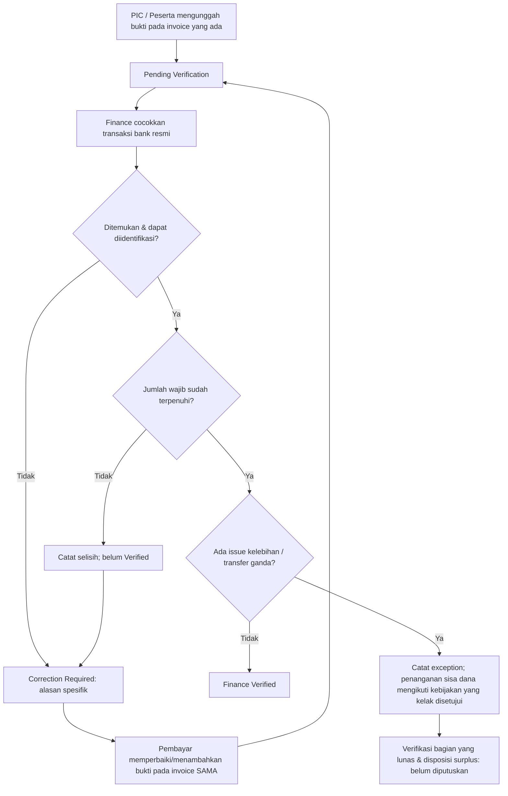
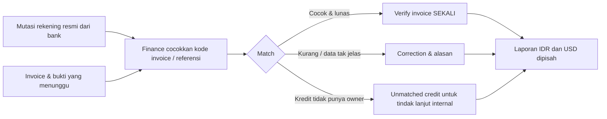

# 18B-07 — Payment Exceptions, Rekonsiliasi Manual & UAT Finance ICHES 2027

> **27 Oktober 2026 · Tahap desain lanjutan (BUKAN implementasi).**
>
> **Tujuan:** merancang penanganan pembayaran kurang, lebih, ganda, bukti salah, terlambat, permintaan refund, dan rekonsiliasi bank dengan **aliran kerja sesederhana mungkin**. Dokumen ini **tidak** menyatakan kebijakan refund, tenggat pelunasan atau cara pelunasan selisih telah disetujui. **Usulan tidak menjadi final hanya karena tertulis di dokumen atau diagram.**
>
> **Wajib mematuhi keputusan yang telah DISETUJUI:** satu rekening resmi dikelola langsung Superadmin (bank belum dipilih), transfer manual tanpa gateway, tombol Copy rekening, upload bukti JPG/JPEG/PNG/PDF, verifikasi Finance berdasarkan mutasi bank; invoice WNI kategori nasional IDR, WNA kategori internasional menurut TOR USD, biaya transfer internasional seluruhnya ditanggung pengirim. **Co-Host satu invoice Rp3.000.000/institusi baru mengaktifkan lima jatah anggota/paper setelah Finance VERIFIED, dan tidak pernah membuat invoice Conference kedua untuk kelima paper sponsor.** Paket Internasional satu invoice pribadi Rp1.000.000 mengaktifkan empat hak setelah VERIFIED. Presenter reguler ditagih sesudah final ACCEPT diumumkan, sedangkan Full Paper langsung terbuka pada ACCEPT diumumkan tanpa gate Finance.
>
> **Dokumen terkait:** [18B-06 — Invoice & Verification](18B-06-CRUD-FINANCE-INVOICE-PEMBAYARAN-VERIFIKASI.md) · [09 — Register Keputusan](09-KEPUTUSAN-DAN-ISU-TERBUKA.md) · [18B-04 — Co-Host](18B-04-CRUD-COHOST-INSTITUSI-LIMA-PAPER.md) · [18B-05 — Paket](18B-05-CRUD-PAKET-INTERNASIONAL-DASHBOARD-PESERTA.md) · [17 — Admin CRUD](17-ADMIN-CRUD-DAN-PENGATURAN-ACARA.md) · [10 — TOR/Tarif](10-ANALISIS-TOR-DAN-REBASELINE-2027.md).

## A. Prinsip desain sederhana: jangan membuat status dan modul baru berlebihan

**Yang sudah disepakati dan TETAP:** tampilan pembayar memakai empat status normal:
1. **Unpaid** — tagihan ada, bukti belum diterima;
2. **Pending Verification** — bukti dikirim, belum dibenarkan Finance;
3. **Correction Required** — Finance memberikan alasan dan meminta perbaikan/tindak lanjut;
4. **Verified** — Finance cocokkan mutasi dengan kewajiban bayar, lalu mengesahkan.

**USULAN:** satu **Payment Verification** inbox yang sudah dirancang pada 18B-06 ditambah **kolom Issue/Exception** internal, bukan membuat portal tambahan. Contoh issue internal: `unreadable_proof`, `not_found_in_bank`, `underpayment`, `overpayment`, `duplicate_transfer`, `refund_request`, `late_payment`, `international_fee_shortfall`. Issue dapat muncul bersamaan dengan status normal: `Pending Verification + Transfer not found`, atau setelah `Verified + Overpayment follow-up`. **Label issue bukan keputusan refund otomatis.**

**Jangan pernah:** menghapus bukti lama ketika dikoreksi; menggandakan invoice saat upload ulang; membebankan lima presenter invoice kepada satu Co-Host; mewajibkan pembayaran baru karena paper sponsor ACCEPT; mengunci Full Paper presenter reguler akibat masalah Finance; mengaktifkan empat akses paket/roster Co-Host sebelum Verified; atau menganggap bukti PDF/gambar sebagai transaksi bank yang sudah valid.

## B. Peta keputusan harian Finance

| Situasi | Status pada pembayar | Yang dilakukan Finance | Status kebijakan |
|---|---|---|---|
| Bukti tidak terbaca / salah rekening / dokumen tidak valid | **Correction Required** + alasan | Minta bukti baru, tetap invoice yang sama; simpan versi lama privat | **USULAN UI**, prosedur koreksi sejalan keputusan verifikasi |
| Bukti ada, transaksi belum terlihat pada mutasi | **Pending Verification** atau **Correction Required** bila perlu klarifikasi | Periksa lagi lalu hubungi pembayar melalui catatan pada invoice | **USULAN operasional**, bukan transaksi dianggap lunas |
| Uang masuk tetapi **kurang** | Belum **Verified**; **Correction Required** untuk tindak lanjut | Catat kekurangan dan referensi bank, tentukan pelunasan menurut kebijakan yang nanti disahkan | **KEWAJIBAN penuh telah disepakati**, mekanisme pelunasan **TERBUKA** |
| Transfer **lebih besar** dari invoice | Jangan buat invoice baru otomatis | Kaitkan transaksi ke invoice, tandai surplus; apakah invoice dapat Verified dengan surplus dan pengembalian sisa **TERBUKA** | **USULAN pencatatan**, bukan kebijakan refund |
| Dua kali transfer untuk kewajiban yang sama | Tampilkan issue **Duplicate Transfer** internal | Simpan kedua referensi; hak/pendapatan invoice tidak otomatis dihitung dua kali; tunggu penanganan surplus | **USULAN integritas**, refund **TERBUKA** |
| Transfer dari rekening pengirim berbeda | Tetap Pending sampai cocok | Cocokkan kode invoice, tanggal, nominal, referensi dan informasi bank; pengirim berbeda bukan bukti fraud otomatis | **USULAN prosedur verifikasi** |
| Invoice lewat tenggat pembayaran (jika nanti ditetapkan) | Tagihan/riwayat tetap terlihat | Aturan pemberitahuan/penutupan diputuskan Admin; jangan blokir Full Paper melalui Finance | **TERBUKA** tenggat & akibatnya |
| Minta refund sebelum/sesudah Verified | Tidak memalsukan Unpaid | Buat catatan permohonan, alasan, pertimbangan dan keputusan sesuai kebijakan refund yang belum final | **TERBUKA** eligibility dan eksekusi refund |
| Bank mutasi punya transfer tanpa kode invoice | Tidak serta-merta masuk status user | Tandai **Unmatched Bank Credit** internal untuk pencarian manual, tanpa mengarang pemilik | **USULAN rekonsiliasi** |
| WNA invoice USD dan bank tujuan mengkredit IDR | Belum Verified sampai dikonfirmasi | Rekam USD invoice/pengiriman serta kredit/konversi sesuai bukti resmi bank; **tanpa kurs otomatis** | **USULAN pencatatan; operasional bank TERBUKA** |

## C. Alur kasus: dari bukti hingga perbaikan tanpa invoice baru



**Contoh non-final:** WNI paket Rp1.000.000 mengirim Rp950.000 → Finance mencatat selisih Rp50.000 dan meminta tindak lanjut; **keempat hak paket masih terkunci**. Tidak ada invoice paket Rp50.000 otomatis. Jika panitia mengizinkan pembayaran susulan, sistem sebaiknya mengasosiasikan transaksi kedua ke **invoice asli**, bukan menganggap peserta memesan paket baru.

**Contoh WNA:** Presenter internasional onsite **USD40**, bank pengirim/koresponden/penerima mengenakan biaya, sehingga nilai yang dapat dikonfirmasi untuk pelunasan kurang. Biaya tetap menjadi tanggungan pengirim; **tidak boleh Verified** sebelum kewajiban penuh terpenuhi. Penentuan nilai ekivalen jika rekening penerima berupa IDR memerlukan informasi bank aktual dan kebijakan panitia, **bukan kurs API tersembunyi**.

## D. Wireframe kecil: hanya satu panel Finance

```text
BACKOFFICE / FINANCE / PAYMENT VERIFICATION
 [All] [Pending] [Correction Required] [Verified]        Search Invoice...

 Invoice ID       Pembayar        Amount      Status       Issue
 ICH-INV-001      Co-Host A       IDR 3jt     Pending      Proof unreadable
 ICH-INV-002      Personal B      IDR 1jt     Pending      Amount short
 ICH-INV-003      Presenter C     USD 40      Verified     —
 ICH-INV-004      Participant D   IDR 150k    Pending      Duplicate transfer

 [Open invoice] → Invoice Detail:
    - Jumlah invoice + currency + kategori + owner
    - Transfer reference(s), tanggal, nominal tercatat
    - Bukti versi 1/2, preview privat
    - Bank receipt / mutasi match information
    - Status normal [Unpaid/Pending/Correction/Verified]
    - Optional Issue Tag [mis. Underpayment]
    - Internal Notes dan alasan untuk pembayar
    [VERIFY]             [REQUEST CORRECTION] 
    [MARK FOR MANUAL FOLLOW-UP]   (USULAN, bukan tombol refund)
```

**Tidak diperlukan** approval berlapis, submodul penagihan otomatis, dompet digital, payment gateway, maupun integrasi banking API untuk MVP. Notifikasi sederhana pada Dashboard/my invoice cukup, dengan email informatif jika nanti dipilih. Hak akses tetap: Finance review/verify; PIC hanya own institutional invoice; user hanya own personal invoice; Superadmin mengatur bank; hanya pihak berwenang yang boleh melihat mutasi global.

## E. Usulan field minimal untuk audit dan pencocokan transaksi

| Entitas/objek konseptual | Field penting | Catatan |
|---|---|---|
| **Invoice** (sudah ada pada 18B-06) | `id`, `owner_type`, `owner_id`, `purpose`, `currency`, `amount_due`, `status`, `issued_at` | Jumlah snapshot tidak ditulis ulang saat tarif master berubah |
| **Proof Version** | `invoice_id`, `file_private_path`, `uploaded_by`, `uploaded_at`, `version`, `notes` | Append-only secara praktis; hanya pembayar berhak upload perbaikan |
| **Bank Credit/Receipt** (USULAN) | `bank_ref`, `posted_at`, `received_amount`, `currency`, `memo`, `source_document` | Dicatat dari mutasi resmi bank secara manual, bukan koneksi live ke rekening |
| **Bank Match** (USULAN) | `invoice_id`, `bank_credit_id`, `allocated_amount`, `matched_by`, `matched_at` | Cegah pemakaian satu transfer yang sama untuk meng-Verify dua invoice, kecuali suatu saat ada kebijakan pembagian pembayaran |
| **Finance Issue** (USULAN) | `invoice_id`, `issue_type`, `internal_note`, `payer_visible_reason`, `opened_at`, `resolved_at`, `resolved_by` | Satu kasus cukup; jangan bangun sistem tiket customer-service yang besar |
| **Refund Request** (HANYA bila kebijakan disahkan) | `invoice_id`, `requested_by`, `reason`, `decision`, `authorized_by`, `bank_refund_ref` | Belum ada hak refund otomatis; catatan bukan transfer keluar otomatis |

**USULAN pencocokan:** kode invoice sebagai referensi transfer disarankan, tetapi bank tidak selalu menampilkan memo secara lengkap. Jika referensi kurang, Finance boleh memakai kombinasi tanggal, nominal, nama pengirim dan dokumen bank, dengan alasan bila kasus ambigu. Peringatan kemiripan bukan auto-tolak pembayaran. Pemakaian satu bank-credit tidak boleh membenarkan dua invoice tanpa pencatatan alokasi yang jelas.

**USD/IDR:** simpan `invoice_currency=USD`, jumlah USD tagihan, valuta pada transfer, kurs resmi menurut dokumen bank bila disediakan, dan nilai yang dikreditkan dalam valuta rekening. Jangan membuat konversi realtime atau laporan total gabungan tanpa metodologi akuntansi yang disahkan.

## F. Rekonsiliasi harian: hanya pekerjaan Finance, bukan pekerjaan peserta



**Langkah sederhana Finance:** (1) buka mutasi rekening dari kanal bank resmi di luar ICHES, (2) buka antrean Pending, (3) cocokkan bank reference, amount dan invoice owner, (4) Verify bila sah/lunas atau beri Correction dengan alasan, (5) catat kejadian yang butuh tindak lanjut. **Tidak ada akses internet banking dari aplikasi ICHES.**

**USULAN laporan cukup punya empat bagian:** Invoices Outstanding, Invoices Verified, Cases Requiring Follow-up, dan Bank Credits Unmatched. Mata uang IDR/USD tampil sebagai kolom/subtotal terpisah. Nilai yang **Verified bukan otomatis sama dengan total dana masuk** jika terdapat biaya, lebih bayar, kredit belum teralokasi, atau konversi bank; rekap membedakan *invoice obligation* vs *confirmed bank receipts* agar tidak salah hitung. Tidak ada penggandaan pendapatan karena satu Co-Host memiliki lima paper atau satu paket memberi empat akses.

## G. Kapan hak diaktifkan dan apakah masalah uang memengaruhi akademik?

| Subdomain | Sudah final / harus tetap | Implikasi pada exception |
|---|---|---|
| **Co-Host** | Rp3 juta **Verified** dahulu baru fitur lima perwakilan/lima paper aktif. | Underpaid/Pending/Correction → **fitur sponsor tetap terkunci**. Sesudah Verified, keputusan akademik atas paper terpisah. |
| **Paket Internasional** | Rp1 juta personal **Verified** baru empat akses aktif. | Underpaid/Pending/Correction → **empat akses tetap terkunci**; QR pribadi tetap identitas, bukan izin program. |
| **Presenter reguler** | Invoice baru sesudah ACCEPT diumumkan; Full Paper langsung terbuka saat ACCEPT diumumkan. | Underpaid/Pending/Correction tidak mencabut LoA/Full Paper secara otomatis. **Kelayakan jadwal atau sesi presenter yang belum lunas masih TERBUKA.** |
| **Participant reguler** | Bayar sesuai kategori TOR dan Finance memverifikasi. | Status biaya tidak otomatis menjadi check-in/attendance; kriteria akses layanan yang belum ditetapkan tidak dibuat-buat. |

**Refund/reversal sesudah VERIFIED** adalah kasus kebijakan terpisah: tidak boleh diam-diam menghapus histori paper, keputusan ACCEPT, Presented, atau attendance. Jika kelak harus mengubah entitlement finansial, diperlukan aturan kelayakan dan mekanisme pembatalan yang jelas dari panitia. **Tidak ada aturan automatic revoke pada rancangan ini.**

## H. Refund, overpayment, keterlambatan: keputusan yang SENGAJA belum dikunci

| Kebijakan yang diperlukan | Opsi sederhana untuk dipertimbangkan — USULAN, BUKAN KEPUTUSAN |
|---|---|
| **Refund setelah pembayaran Verified** | Panitia bisa memilih *non-refundable*, *refund terbatas dengan alasan*, atau *case-by-case*. **Belum ada pilihan pengguna.** |
| **Pembayaran lebih / ganda** | Catat dana tambahan, cocokkan dengan invoice, lalu Finance mencatat instruksi penyelesaian yang disahkan; transfer pengembalian tetap dilakukan **di luar aplikasi** lewat bank resmi jika nanti disetujui. Tidak otomatis refund. |
| **Transfer kurang** | Pilih apakah mengizinkan **top-up ke invoice sama** hingga total terlunasi atau meminta transfer ulang dengan proses koreksi; **belum diputuskan**. |
| **Tenggat bayar** | Dapat dibuat Admin CRUD **terpisah** dari Abstract/Full Paper/Package Registration Deadline; bagaimana akibat keterlambatan, perpanjangan dan grace period **belum diputuskan**. |
| **Tidak membayar sampai acara** | Presenter reguler: apakah jadwal disembunyikan/dipertahankan/ditahan perlu persetujuan akademik-panitia. Tidak boleh membuat auto-Reject paper akademik hanya karena invoice unpaid. |
| **Pembayaran dari pihak ketiga** | Dapat dicocokkan oleh Finance bila cukup bukti dan tidak duplikat; verifikasi lebih rinci sesuai kebutuhan masih usulan. |
| **Kesalahan nominal USD akibat kurs bank** | Cek dokumen incoming remittance dari bank; aturan ekivalensi dan biaya masih perlu ditetapkan sebelum go-live. |

**Rekomendasi produk:** jangan membangun modul refund transfer online, payment gateway atau dua approval rekening. Bila refund diizinkan, untuk ICHES cukup catat keputusan dan bukti bank dari proses yang diselesaikan panitia di luar sistem. Ini **rekomendasi mekanisme**, bukan janji refund.

## I. UAT Tahap 18B-07 — 28 skenario yang DIRANCANG, bukan hasil uji

| ID | Skenario | Hasil yang diharapkan pada desain |
|---|---|---|
| EX-01 | Bukti PDF valid tetapi mutasi belum masuk | Tetap Pending; tidak auto-Verify |
| EX-02 | Bukti PNG buram | Correction Required + alasan, invoice tetap |
| EX-03 | Peserta upload pengganti setelah Correction | Versi terdahulu tetap ada, nomor invoice sama |
| EX-04 | File gambar meniru PDF / file rusak | Backend menolak sesuai validasi file 18B-06 |
| EX-05 | Transfer kurang Rp50.000 dari nominal paket | Belum Verified; empat hak tetap tidak aktif |
| EX-06 | Peserta membayar selisih pada invoice lama (jika top-up disetujui) | Tidak membuat order paket kedua; total transaksi dapat dicocokkan |
| EX-07 | WNA membayar USD 40 dengan potongan biaya | Belum Verified bila jumlah sah belum terpenuhi; biaya pada pengirim |
| EX-08 | Kredit WNA dikonversi bank USD ke IDR | Detail USD invoice dan IDR kredit dicatat terpisah dari dokumen bank |
| EX-09 | Transfer lebih Rp100.000 | Surplus dicatat, tidak menjadi order paket lain otomatis |
| EX-10 | Pembayar men-transfer dua kali | Kedua transaksi tercatat, hanya satu entitlement/order |
| EX-11 | Satu bank reference coba dipakai dua invoice tidak terkait | Sistem memperingatkan/menolak auto-verifikasi ganda |
| EX-12 | Dua bank credit punya nominal yang sama untuk dua peserta berbeda | Tidak otomatis dianggap transfer ganda tanpa identifikasi |
| EX-13 | Pembayar memakai rekening pihak ketiga | Finance bisa memeriksa manual; tidak auto-accept/tolak hanya karena nama |
| EX-14 | Bank transfer tanpa invoice reference | Masuk daftar Unmatched sampai ditemukan kecocokan |
| EX-15 | Finance salah memilih invoice pada mutasi | Koreksi tidak memalsukan Verified invoice lain; jejak tindakan dipertahankan |
| EX-16 | Co-Host belum Verified, ada isu bukti | Roster/submit paper sponsor terkunci |
| EX-17 | Co-Host telah Verified, lima paper Accept | Tidak terbit lima invoice Conference personal |
| EX-18 | Anggota Co-Host membeli paket pribadi | Transaksi/pelunasan milik user, bukan PIC/institusi |
| EX-19 | Paket personal status Correction | Empat akses tetap tidak aktif |
| EX-20 | Presenter reguler Accept announced tetapi belum bayar | Invoice muncul; Full Paper dan LoA tetap tersedia |
| EX-21 | Reviewer sekadar rekomendasi Accept | Belum ada invoice presenter |
| EX-22 | Paket pendaftaran ditutup sesudah user memesan | Invoice, upload koreksi dan histori user tetap tersedia |
| EX-23 | User menebak URL bukti orang lain | Ditolak server, tidak ada direct public file |
| EX-24 | PIC institusi membuka refund/request pribadi anggota | Ditolak server |
| EX-25 | Dua Finance verify bersamaan | Satu Verified + satu pencatatan efek hak |
| EX-26 | Request refund setelah Verified | Tidak auto menghapus paper atau entitlement; tampil case sesuai kebijakan ketika ditetapkan |
| EX-27 | Rekonsiliasi report IDR & USD | Tidak ada penjumlahan mata uang tanpa acuan kurs; Co-Host/Paket 1x |
| EX-28 | Bank receipt yang belum teridentifikasi | Tidak menambah penerimaan Verified invoice fiktif |

**UAT bersifat conditional** bila fitur kebijakan yang masih TERBUKA (refund, top-up, due date) akhirnya disahkan. Test dan backend belum dibuat.

## J. Hasil Tahap 18B-07 dan handoff

**Selesai didokumentasikan:** matriks exception, diagram alur koreksi dan rekonsiliasi, form/inbox yang sederhana, field konseptual bank-credit dan proof history, pemisahan laporan IDR/USD serta 28 skenario UAT. **Belum diimplementasikan.**

**DISETUJUI sebelumnya, bukan hasil keputusan baru:** mekanisme Finance dari 18B-06 dan gate hak Co-Host/Paket yang telah dipilih pemilik produk.

**HANYA USULAN:** issue tag dalam inbox, Unmatched Bank Credit internal, bank-credit match, versi file, ekspor kasus, refund request record, top-up pada invoice sama, due date manual CRUD, opsi non-refundable/refund terbatas/case-by-case.

**Masih memerlukan keputusan nyata sebelum coding final:** (a) bagaimana menangani **underpayment** (top-up atau transfer ulang), (b) kebijakan **refund/overpayment/duplicate transfer**, (c) **tenggat pembayaran dan efek terlambat** pada presenter reguler, (d) detail incoming USD dengan bank final dan kesesuaian praktik transaksi. Usulan desain tersebut jangan diam-diam menjadi aturan final.

**Rantai berikutnya (USULAN):** pengambilan keputusan sederhana atas kasus-kasus di atas, lalu Tahap 18B-08 dapat membahas **Invoice/PDF Receipt, notifikasi pembayaran dan handoff kelayakan registrasi** jika diperlukan, atau langsung masuk arsitektur implementasi Finance ketika kebijakan minimum sudah jelas.

---

[18B-06 Finance](18B-06-CRUD-FINANCE-INVOICE-PEMBAYARAN-VERIFIKASI.md) · [Register Keputusan](09-KEPUTUSAN-DAN-ISU-TERBUKA.md) · [Co-Host](18B-04-CRUD-COHOST-INSTITUSI-LIMA-PAPER.md) · [Paket Personal](18B-05-CRUD-PAKET-INTERNASIONAL-DASHBOARD-PESERTA.md) · [README](../README.md).

*Dokumentasi perencanaan ICHES 2027. Tidak ada rekening bank asli, pembayaran, refund, transaksi, UAT eksekusi, API bank, ataupun aplikasi terdeploy yang dibuat pada tahap ini.*
