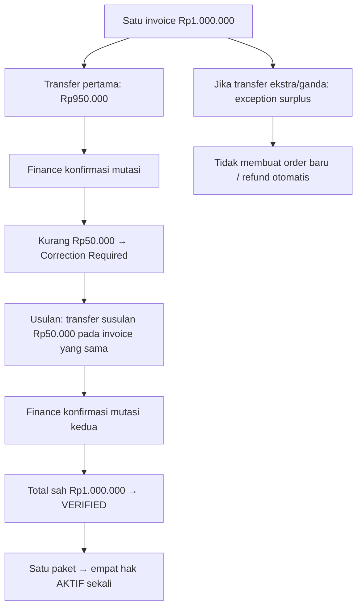

# 18B-07A — Draft Kebijakan Operasional: Pelunasan Kurang, Kelebihan/Refund, dan Tenggat

> **ICHES UNISYA 2027 · 27 Oktober 2026 · RANCANGAN KEBIJAKAN — BELUM KEPUTUSAN FINAL BAGI BUTIR BARU.**
>
> Dokumen ini menuntaskan **pilihan rancangan yang siap dipakai developer setelah disetujui pemilik produk/panitia**, tanpa menganggap kesediaan melanjutkan tahapan sebagai persetujuan atas tarif, refund, dan tenggat tertentu. **Aturan yang sudah diputuskan tetap FINAL**, sedangkan rincian baru di bawah berstatus **REKOMENDASI UNTUK DISETUJUI**.
>
> Rujukan: [18B-06 Finance](18B-06-CRUD-FINANCE-INVOICE-PEMBAYARAN-VERIFIKASI.md) · [18B-07 Exceptions](18B-07-FINANCE-EXCEPTIONS-REKONSILIASI-DAN-UAT.md) · [18B-08 Invoice & Notifikasi](18B-08-CRUD-INVOICE-BUKTI-LUNAS-NOTIFIKASI-DAN-UAT.md) · [Register Keputusan](09-KEPUTUSAN-DAN-ISU-TERBUKA.md).

## A. Fondasi yang FINAL dan tidak ditinjau ulang

- **Satu rekening resmi** (bank final belum dipilih), disunting langsung oleh Superadmin tanpa persetujuan berlapis.
- **Transfer manual**, salin nomor rekening, unggah **JPG/JPEG/PNG/PDF**, tanpa payment gateway, dan Finance memeriksa mutasi rekening resmi.
- **WNA pada kategori tarif internasional TOR** ditagih dalam USD dan transfer USD; **seluruh biaya transfer internasional ditanggung peserta**. Paket Co-Host Rp3 juta/institusi dan Paket Internasional Rp1 juta/orang tetap bernilai **IDR**.
- **Co-Host:** satu invoice **Rp3.000.000/institusi → Finance VERIFIED → fitur lima anggota/lima paper Conference aktif**. Kelima paper sponsor tidak ditagih biaya presenter Conference lagi walaupun ACCEPT. Program tambahan anggota dibeli pribadi.
- **Paket Internasional:** satu invoice **Rp1.000.000/orang → Finance VERIFIED → empat hak aktif**.
- **Presenter reguler:** tagihan hanya dibuat setelah final ACCEPT **diumumkan** kepada submitting author. **Full Paper/LoA tersedia sejak keputusan diumumkan**, tidak tergantung Finance VERIFIED. Participant reguler bayar menurut kategori TOR.

## B. Rekomendasi tunggal yang paling sederhana untuk tiga kasus kebijakan

| Pertanyaan | **Rekomendasi operasional** (BELUM FINAL) | Alasan & batas |
|---|---|---|
| **Transfer kurang** | **Pembayar boleh melunasi selisih pada INVOICE YANG SAMA** dengan transfer susulan dan bukti transfer tambahan. Finance mencatat beberapa penerimaan yang terhubung ke satu invoice; **Verified hanya setelah total pembayaran valid memenuhi tagihan**. | Tidak membuat order/invoice kedua, tidak mengaktifkan Co-Host/paket sebelum lunas. **Khusus WNA semua biaya transfer susulan tetap ditanggung pengirim.** |
| **Transfer lebih / dua kali** | Finance mencocokkan seluruh transaksi, menetapkan hanya **satu kewajiban invoice sebagai lunas**, lalu menandai **kelebihan dana sebagai kasus tindak lanjut**. Pengembalian kelebihan bila disetujui dilakukan **manual lewat bank di luar website** dan referensinya dicatat. | Tidak ada dua pendaftaran/hak akibat dua pembayaran. Penentuan pengembalian surplus memerlukan otorisasi dan kebijakan sederhana panitia; *tidak otomatis refund*. |
| **Refund karena pembatalan peserta** | **Ajukan permohonan, ditinjau panitia/Superadmin sesuai kebijakan acara (case-by-case sementara)**, bukan tombol otomatis mengembalikan uang. Bila pengembalian disetujui, Finance mencatat nominal, mata uang, tanggal dan bukti transfer keluar yang dilakukan di luar ICHES. | **Kelak panitia perlu memilih boleh/tidak dan kondisi hak refund**; jangan menciptakan janji refund, potongan tertentu, atau periode refund tanpa persetujuan. |
| **Tenggat pembayaran** | **Satu Payment Due Date yang dapat diedit Admin pada jenis invoice**, boleh kosong bila belum ditetapkan. Jika terlewati, munculkan label internal **Past Due** dan pemberitahuan, tetapi **invoice/riwayat tetap tersedia**; tidak otomatis dibatalkan. | Deadline bayar berbeda dari deadline abstract, Full Paper dan registrasi Paket. Apakah peserta terlambat masih boleh bayar, grace period, dan dampak terhadap jadwal presentasi **BELUM FINAL**. |

**Batas keputusan:** rekomendasi ini menawarkan solusi UX/teknis, **bukan** menetapkan hak hukum refund atau akibat gagal bayar. Sebelum implementasi aksi refund/revoke dan pengecualian jadwal presenter, panitia harus menyetujui aturan tertulis. **Tidak boleh hardcode kebijakan refund atau tanggal bayar dari TOR secara sepihak.**

## C. Aturan operasional yang disarankan (tanpa proses tambahan)

### C1. Underpayment / transfer susulan

1. Finance melihat **invoice asli** (misalnya Paket Program Rp1.000.000), bukti yang ada, dan mutasi bank.
2. Jika baru terkonfirmasi Rp950.000: catat **confirmed applied amount Rp950.000** dan **remaining Rp50.000**, invoice belum Verified, empat hak tetap terkunci.
3. Peserta melihat **Correction Required** serta pesan jelas tentang nominal yang kurang; peserta membayar sisa **pada rekening resmi yang sama** dan mengunggah **bukti transaksi susulan**.
4. Finance mencocokkan dua transaksi nyata, tanpa menggunakan satu mutasi untuk dua invoice sekaligus. Bila total memenuhi tagihan (dan kebijakan transfer susulan diadopsi), **VERIFIED sekali** dan hak aktif sesuai produk.
5. Bila salah satu bukti salah: minta koreksi pada invoice sama. Jangan hapus atau menimpa bukti sebelumnya.

**Contoh simulasi:** satu invoice Rp1 juta, dua transfer Rp950.000 + Rp50.000 = Rp1 juta lunas; jumlah **invoice tetap satu**, jumlah **order tetap satu**, empat akses **aktif satu kali**.

**Masih terbuka:** minimum biaya transfer internasional, apakah pengirim harus memakai OUR, cara menentukan nilai USD yang lunas pada rekening penerima IDR sesuai keterangan bank, dan apakah transfer susulan diperbolehkan setelah deadline.

### C2. Overpayment, duplicate bank transfer

- Jika bank menerima Rp1.100.000 untuk invoice Rp1.000.000, sistem tidak boleh membuat produk senilai Rp100.000 atau mengubah harga paket menjadi Rp1.100.000.
- Catat kewajiban **Rp1.000.000**, nilai kredit bank **Rp1.100.000**, dan **surplus Rp100.000** sebagai nilai yang perlu penyelesaian.
- Invoice dapat diusulkan menjadi Verified atas kewajiban pokok bila valid, sambil menjaga surplus sebagai exception terpisah; **perlakuan surplus ini memerlukan persetujuan kebijakan akuntansi panitia sebelum finalisasi**.
- Jika dua transfer penuh tiba, **satu kewajiban** terbayar; yang kedua tidak boleh menghasilkan lima jatah paper tambahan, hak paket kedua, atau dua tanda lunas.
- Pengembalian dana ke rekening pembayar, jika disetujui, dijalankan **di luar aplikasi** oleh pengelola rekening. Finance hanya mencatat keputusan, uang keluar sesungguhnya, waktu, nominal, dan referensi bank.
- **Bukan** keputusan untuk menahan otomatis uang kelebihan, tidak pula janji refund otomatis.

### C3. Refund pembatalan dan masalah setelah Verified

- Catat `refund_requested`, `reason`, tanggal, invoice owner, kondisi layanan yang sudah dipakai (bila relevan), dan bukti pendukung secukupnya.
- Tampilkan ke peserta hanya **permohonan diterima/dalam peninjauan/hasil keputusan** bila fitur ini disahkan; jangan labelkan sebagai hak pengembalian otomatis.
- Setelah panitia memilih kebijakan dan membuat keputusan, refund tidak boleh langsung menghapus status historis invoice Verified, review paper, LoA, Presented, check-in atau sertifikat. Perubahan hak layanan memerlukan kebijakan terpisah.
- Refund yang dilaksanakan **tidak memakai payment gateway**, hanya bukti bank transfer keluar dari rekening resmi.
- **Kebijakan pembatalan Co-Host setelah ada paper Submitted/Accepted, pembatalan Paket setelah aktivitas diakses, nominal potongan dan batas waktu refund belum ditentukan.**

### C4. Payment Due Date — terpisah untuk setiap kewajiban

**USULAN CRUD sederhana:**

| Setting | Nilai yang disarankan | Status |
|---|---|---|
| Due Date kategori Co-Host | **Kosong dulu** sampai panitia memutuskan; Admin dapat isi per invoice/kategori | USULAN |
| Due Date kategori Paket Internasional | **Kosong dulu**; tidak menyalin deadline pendaftaran menjadi deadline bayar | USULAN |
| Due Date Presenter reguler | **Kosong dulu**; invoice hanya sesudah ACCEPT dipublikasikan | USULAN |
| Due Date Participant reguler | **Kosong dulu** | USULAN |
| Time zone | `Asia/Jakarta` tersimpan jelas, untuk tampilan luar negeri boleh disajikan zona pengguna beserta acuan WIB | USULAN teknis |
| Late Status | **Past Due** sebagai label informasional tambahan, **bukan** status kelima pembayaran | USULAN |
| Manual close/extend | Superadmin/Admin berizin dapat mengubah settings tanpa redeploy; histori invoice tetap | USULAN |

Ketika melewati Due Date, **jangan otomatis**: membatalkan Co-Host yang sudah VERIFIED, menghapus paper, menjadikan ACCEPT = Rejected, mencabut Full Paper, atau mengubah seluruh akun menjadi terblokir.

**Masih perlu keputusan panitia:** pembayaran yang masuk setelah deadline masih diterima atau tidak, apakah presenter unpaid boleh masuk jadwal final / presentasi, dan kapan petugas harus menghubungi peserta.

## D. Diagram satu invoice, banyak catatan pembayaran tanpa double charge

## E. Aturan audit minimal dan batas hak

**Superadmin** mengelola satu rekening resmi langsung; **Finance** memverifikasi penerimaan dan mencatat kasus (Refund hanya jika kebijakannya nanti ditetapkan); **PIC** melihat satu invoice institusinya; **User** hanya invoice pribadinya. Tidak ada persetujuan dua orang untuk mengubah rekening. Tindakan sensitif seperti mengubah keputusan Verified, membetulkan alokasi mutasi, dan mengeluarkan uang refund tetap memerlukan **catatan siapa, kapan, alasan, dan referensi bank**.

**Jangan pernah menyimpan credential perbankan, PIN, OTP, atau akses internet banking dalam aplikasi.** Simpan bukti pembayaran dan referensi mutasi sebagai dokumen privat.

## F. Checklist keputusan minimum untuk disetujui di kemudian hari

| Butir | Rekomendasi siap dipilih | Keadaan |
|---|---|---|
| P-01: Underpayment | **Transfer susulan pada invoice sama; Verified setelah nilai lunas** | **DRAFT KEBIJAKAN, menunggu persetujuan eksplisit** |
| P-02: Surplus / double-transfer | **Satu invoice Verified sekali; kelebihan sebagai exception dan keputusan pengembalian manual** | **DRAFT, menunggu persetujuan** |
| P-03: Refund pembatalan | **Diperiksa per kasus dan diputuskan petugas berwenang; tanpa auto-refund** | **DRAFT, kelayakan refund belum dipilih** |
| P-04: Due Date | **Admin editable; boleh kosong; Past Due informasional; tanpa auto-cancel** | **DRAFT, deadline dan akibatnya belum final** |
| P-05: Presenter unpaid | **Jangan memblokir Full Paper/LoA; aturan masuk jadwal/presentasi belum final** | **Sebagian FINAL (Full Paper), sebagian TERBUKA** |
| P-06: USD settlement | **Bank-confirmed matching; biaya asing pada peserta; tanpa kurs otomatis** | **Prinsip FINAL, detail bank TERBUKA** |

**Tidak ada kebutuhan untuk membangun modul keuangan terpisah hanya untuk exception.** Seluruh kasus cukup pada invoice, antrean Finance, dan laporan yang sama.

## G. UAT kebijakan sederhana (16 skenario; rencana, bukan tes dijalankan)

| ID | Skenario | Ekspektasi |
|---|---|---|
| POL-01 | Tagihan paket Rp1 juta baru Rp950 ribu diterima | Tidak Verified; hak belum aktif |
| POL-02 | Transfer susulan Rp50 ribu jika opsi P-01 disetujui | Invoice sama, verified hanya sekali setelah konfirmasi |
| POL-03 | Transfer kedua sebenarnya belum diterima | Tidak bisa Verified berdasarkan bukti gambar saja |
| POL-04 | WNA kurang akibat biaya koresponden | Belum lunas; biaya tetap ditanggung pengirim |
| POL-05 | Transfer lebih Rp100 ribu | Invoice amount tetap; surplus tercatat terpisah |
| POL-06 | Dua transfer penuh | Satu invoice/produk/hak; kelebihan tidak diabaikan |
| POL-07 | Satu transfer dipakai dua invoice | Server cegah double-allocation tanpa proses jelas |
| POL-08 | Refund request belum disahkan kebijakannya | Tidak terjadi transfer otomatis / tidak menjanjikan refund |
| POL-09 | Permohonan refund setelah paper Accepted | Paper/LoA tetap historis; hak refund tidak diasumsikan |
| POL-10 | Panitia menyetujui refund dan petugas transfer di bank (jika kebijakan ditetapkan) | Bukti uang keluar/nominal/waktu dicatat, bukan hard-delete transaksi |
| POL-11 | Due date belum diset | Invoice tetap visible tanpa status overdue palsu |
| POL-12 | Due date berlalu | Informasi Past Due, tidak auto-batal paper/LoA |
| POL-13 | Admin memperpanjang due date | Aturan baru tercermin, histori tetap |
| POL-14 | Admin menutup pendaftaran Paket | User lama tetap lihat invoice; deadline bayar domain berbeda |
| POL-15 | Co-Host belum Verified walau lewat due date | Fitur Co-Host tetap belum aktif; tidak terbit lima invoice personal |
| POL-16 | Presenter Accepted, invoice unpaid/overdue | Full Paper tetap terbuka, scheduling mengikuti keputusan panitia nanti |

---

**Status:** 16 skenario UAT *dirancang*, tidak dijalankan. Dokumen ini tidak menetapkan bank, tanggal nyata, refund eligibility, grace period, kurs bank, biaya bank atau penerbitan hak baru.

[18B-07 Kasus Finance](18B-07-FINANCE-EXCEPTIONS-REKONSILIASI-DAN-UAT.md) · [18B-08 Dokumen & Notifikasi](18B-08-CRUD-INVOICE-BUKTI-LUNAS-NOTIFIKASI-DAN-UAT.md) · [Decision Register](09-KEPUTUSAN-DAN-ISU-TERBUKA.md).
