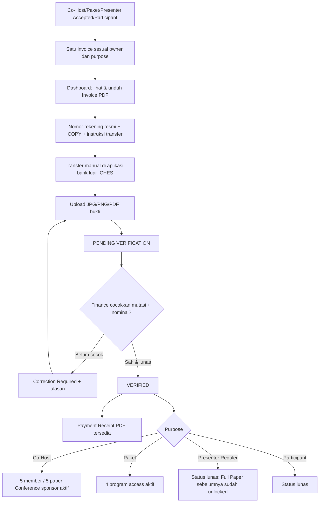
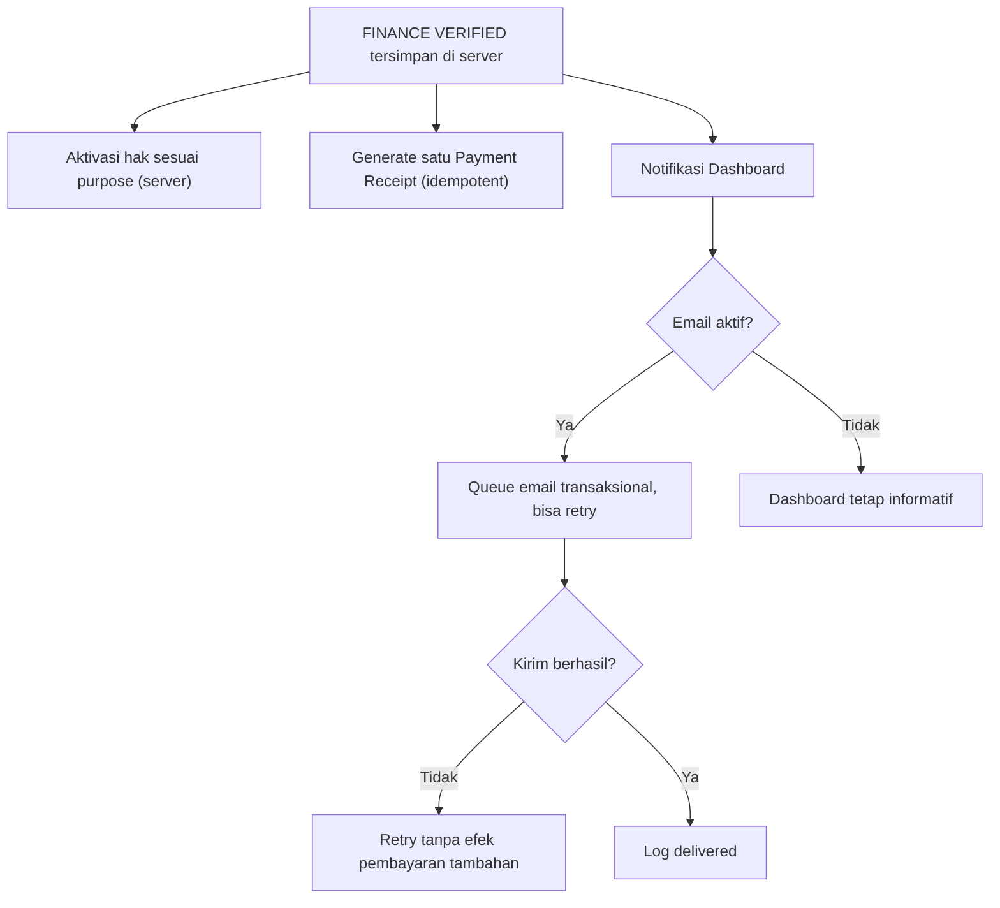

# 18B-08 — Invoice PDF, Bukti Lunas, Notifikasi & UAT ICHES 2027

> **27 Oktober 2026 · FIELD-LEVEL SPECIFICATION / NOT IMPLEMENTED.**
>
> **Status:** Finance core dari [18B-06](18B-06-CRUD-FINANCE-INVOICE-PEMBAYARAN-VERIFIKASI.md) adalah kebijakan yang **DISETUJUI**, sementara nama layar, format invoice/receipt, saluran notifikasi, template email, queue dan tabel di sini adalah **USULAN IMPLEMENTASI**. Refund, selisih bayar, dan tenggat mengikuti [draft kebijakan 18B-07A](18B-07A-DRAFT-KEBIJAKAN-PELUNASAN-REFUND-DAN-TENGGAT.md) dan **belum final**.
>
> **Tujuan:** satu pengalaman yang sederhana untuk pembayar: **Invoice (sebelum bayar) → Transfer manual & bukti → Finance Verified → Bukti Lunas**, dengan notifikasi yang jelas. Tidak membangun payment gateway, invoice pajak otomatis, uang elektronik, approval rekening berlapis, atau akun bayar terpisah.

## 1. TIGA istilah berbeda yang tidak boleh dicampur

| Dokumen/status | Dibuat oleh | Kapan tersedia | Mengapa penting |
|---|---|---|---|
| **Invoice / Tagihan** | Sistem ketika kewajiban muncul sesuai kategori | Sebelum transfer; dapat diunduh dalam PDF | Menyatakan kewajiban bayar, **BUKAN bukti sudah lunas** |
| **Bukti Transfer** | Pembayar (PIC untuk institusi atau user untuk dirinya sendiri) mengunggah JPG/JPEG/PNG/PDF | Setelah peserta transfer | Hanya **klaim pembayaran**, tidak menjamin rekening telah dikredit |
| **Bukti Lunas / Payment Receipt** | Sistem **berdasarkan keputusan Finance VERIFIED** | **Hanya setelah transaksi telah dicocokkan dan lunas** | Dokumen konfirmasi pelunasan, tidak sama dengan invoice, LoA, sertifikat, atau faktur pajak |

**Larangan keras:** membangkitkan bukti lunas saat upload bukti, mengubah watermark Unpaid menjadi Paid di PDF sebelum Verify, atau menjadikan presenter Accepted sebagai “Paid”.

**Pemisahan bisnis final:** Co-Host invoice **per institusi Rp3 juta**; setelah Verified **fitur lima anggota/lima paper aktif**, dan paper sponsornya tidak mempunyai tagihan Conference pribadi tambahan. Paket pribadi **Rp1 juta** (satu invoice, empat akses setelah Verified). Presenter reguler **tagihan hanya setelah ACCEPT diumumkan**, sedangkan LoA/Full Paper tidak menunggu Finance. Participant reguler sesuai kategori TOR. Invoice kategori WNA tertentu menggunakan USD, biaya transfer internasional pada peserta; tanpa FX otomatis dan tanpa mengarang tarif USD untuk Co-Host/Paket IDR.

## 2. Arsitektur pengalaman satu invoice



## 3. Peta layar minimal — tidak membuat aplikasi pembayaran baru

```text
BACKOFFICE → FINANCE & PAYMENTS
  FIN-01 Payment Overview (18B-06)
  FIN-02 All Invoices → Invoice Detail
  FIN-03 Payment Verification → Verify / Request Correction
  FIN-04 Reports & Export
  FIN-05 Bank Settings [Superadmin only]
  FIN-06 Document & Notification Settings [USULAN, bisa tab pada Finance Settings]
        - Logo/identitas ICHES dan footer PDF
        - Template teks invoice/payment receipt
        - Toggle in-app/email per jenis peristiwa
        - Histori notifikasi dan retry untuk kegagalan teknis
  FIN-07 Notifications Log [USULAN; boleh subtab pada detail invoice, bukan menu utama baru]

PIC CO-HOST / INSTITUTION WORKSPACE
  One Institutional Invoice Rp3.000.000
  [Copy Account] [Download Invoice PDF] [Upload Proof] [View Status]
  After Verified → [Download Payment Receipt] + [Manage 5 Members / 5 Papers]

PERSONAL DASHBOARD → MY PAYMENTS
  Personal Package Invoice / Regular Presenter (after published ACCEPT) / Participant
  [Copy Account] [Download Invoice PDF] [Upload Proof] [View Status]
  After Verified → [Download Payment Receipt]
```

**Prinsip kesederhanaan:** FIN-06/07 boleh berupa **tab kecil** pada Finance Settings dan Invoice Detail; jangan membuat petugas membuka banyak menu untuk memverifikasi satu transfer.

## 4. DOC-01 — PDF Invoice: field, isi, dan batas penerbitan

| Field | Sumber / aturan |
|---|---|
| Header | Logo dan identitas acara **The 6th International Conference on Humanity, Education, and Society (ICHES 2027)**; identitas resmi final di Admin CMS |
| Document Label | **INVOICE**; jangan memakai “PAID” sebelum VERIFIED |
| Invoice Number | Kode unik berurutan/acak (format **USULAN**, contoh `ICHES27-INV-000001`); tidak mengulang untuk order yang sama |
| Issued At | Zona waktu tertera jelas, misalnya WIB (`Asia/Jakarta`), dan snapshot saat terbit |
| Billed To | **Nama institusi** jika Co-Host, **nama person** untuk pembelian personal; PIC dapat dicantumkan sebagai contact, bukan debitur pribadi |
| Item Description | Co-Host Conference / International Package / Regular Presenter / Participant; rincian sesuai produk, **bukan 5 atau 4 fee berulang** |
| Line Amount & Total | IDR atau USD, nominal TOR/paket dan kategori/mode; snapshot saat invoice terbit |
| Bank Details | Nama bank, nomor rekening dan account holder resmi; **Copy** di web, pada PDF nomor ditampilkan, SWIFT/BIC bila bank internasional memerlukan |
| International Instructions | USD dan *all bank charges borne by sender*; jangan memperkirakan biaya bank yang belum diketahui |
| Payment Due | Hanya ditampilkan bila Admin telah **menetapkan** due date; jika belum, tampilkan “To be announced” / kosong, **jangan ciptakan tanggal** |
| Unique invoice linkage | ID internal aman dan rute Dashboard memerlukan login; nomor invoice publik bukan kunci akses bukti privat |
| Document Version | Jika dokumen pernah dicetak/diunduh, versi data dan snapshot jelas; perubahan detail rekening ditangani tanpa memalsukan file lama |

**Contoh isi PDF (placeholder; BUKAN bank/nomor sungguhan):**

```text
THE 6TH ICHES 2027
INVOICE                        ICHES27-INV-000001
Billed To: [Institution Name / Personal Account]
Product:   International Program Package — four activities
Amount:    IDR 1,000,000
Payment Status: UNPAID

PAY TO:
Bank:           [Official bank selected by Superadmin]
Account Number: [Official account number]
Account Holder: [Official account name]

Instruction: Transfer manually and upload the proof through your ICHES Dashboard.
This invoice is not proof of payment.
```

**Pembayaran Co-Host:** invoice hanya menagih **institusi Rp3 juta**; boleh menampilkan uraian benefit “maximum five conference representatives, one paper each”; jangan memuat lima tarif tambahan. **Paket pribadi:** “one package comprising four programs”; bukan empat line item yang masing-masing Rp1 juta. **Presenter reguler:** hanya boleh dibangkitkan setelah final ACCEPT dipublikasikan kepada author, bukan dari rekomendasi reviewer. **USD:** nilai USD tetap USD; jangan konversi otomatis ke IDR.

**Kewajiban fiskal:** istilah *Payment Receipt* di sini adalah bukti administrasi pembayaran ICHES, **bukan faktur pajak/e-faktur atau bukti potong pajak**. Kebutuhan kwitansi resmi, materai, NPWP, PPN/PPh, serta pejabat penandatangan harus ditentukan pihak keuangan/penyelenggara; jangan menciptakan aturan pajak atau membubuhkan tanda tangan pejabat fiktif.

## 5. DOC-02 — Payment Receipt PDF: hanya setelah VERIFIED

| Field | Aturan |
|---|---|
| Title | **PAYMENT RECEIPT / BUKTI LUNAS**; label Verified |
| Receipt Number | Unik, terhubung ke satu invoice; boleh contoh `ICHES27-RCP-000001` (**USULAN format**) |
| Related Invoice | Referensi invoice dan owner yang tepat, serta produk/kategori |
| Paid Amount / Currency | Nilai kewajiban yang sah sesuai invoice; biaya internasional dikelola terpisah, tidak digabung ke tarif TOR |
| Verified At / By | Tanggal/waktu dan petugas Finance; tampilan identitas petugas disesuaikan kebijakan publik |
| Payment Bank Reference | Referensi transaksi sesuai bank, dapat dibatasi/masking pada PDF peserta jika data sensitif |
| Header/footer | Identitas acara dan penjelasan receipt berdasarkan verifikasi Finance |
| Download | PIC hanya invoice institusinya; user hanya miliknya; Finance/Admin scoped |

**Teknis yang direkomendasikan:** saat pertama VERIFIED, receipt dibuat tepat sekali (*idempotent*, dengan unique invoice relation), disimpan sebagai dokumen stabil. Jika kesalahan administratif di kemudian hari dikoreksi, **jangan overwrite diam-diam**; buat revisi/void beralasan sesuai hak dan simpan versi terdahulu secara internal. Download ulang harus memberi dokumen sah yang sama, bukan nomor receipt berbeda setiap klik.

**Konsekuensi:** Verified Co-Host mengaktifkan lima fitur sponsor sekaligus; Verified Paket mengaktifkan empat entitlement sekaligus; tetapi **download receipt bukan** pemicu aktivasi — pemicunya perubahan server-side Finance ke Verified. Jika PDF generator/email sedang gagal, pembayaran dan hak peserta tetap benar dan receipt dapat dihasilkan ulang dari record Verified.

## 6. DOC-03 — Notification Center: event, audiens, dan isi

**USULAN kanal MVP:** notifikasi **dalam Dashboard** sebagai sumber informasi utama. **Email transaksional** sebagai pengingat/cermin status jika layanan email siap; **tanpa SMS berbayar/WhatsApp API/payment gateway**. Siapkan preferensi/aturan template bahasa EN/ID/AR bila website multi-bahasa, namun konten Arab/RTL perlu quality assurance saat implementasi. Tidak perlu minta nomor WhatsApp hanya untuk Finance.

| Event sistem | Penerima | Isi minimal | Status |
|---|---|---|---|
| Invoice Issued — Co-Host | PIC own institution | Invoice Rp3 juta, metode transfer manual, link ke Institution Workspace, fitur sponsor belum aktif | USULAN notifikasi; pemicu tagihan FINAL |
| Invoice Issued — Personal Package | User pemesan | Invoice Rp1 juta, satu paket empat kegiatan, link ke My Payments | USULAN |
| Invoice Issued — Presenter Regular | Submitting author/payer sesuai kebijakan | Sesudah ACCEPT dipublikasikan; invoice kategori, link bayar; ingatkan Full Paper terbuka | USULAN; gate keputusan FINAL |
| Invoice Issued — Participant | User | Ringkasan kewajiban sesuai kategori TOR | USULAN |
| Proof Uploaded | Pembayar + antrean Finance | “Bukti diterima, menunggu verifikasi” — **jangan menyebut lunas** | USULAN |
| Correction Required | Pembayar | Alasan ringkas, nominal yang perlu diklarifikasi bila tersedia, link upload ulang invoice sama | USULAN |
| Payment Verified | Pembayar | Konfirmasi lunas, tautan Bukti Lunas, hak Co-Host/Paket aktif sesuai produk | USULAN notifikasi; efek VERIFIED FINAL |
| Due Date Reminder | Pembayar dengan invoice unpaid/pending jika due date resmi diatur | Nominal dan batas WIB, instruksi bayar (tanpa menebak tanggal) | **NONAKTIF sampai due date/kebijakan disahkan** |
| Refund decision | Pembayar bila kebijakan dan kasus resmi disetujui | Status permohonan yang benar; **bukan janji uang telah dikembalikan bila belum ada transfer** | **NONAKTIF sampai kebijakan refund disahkan** |
| Payment Verified Co-Host entitlement | PIC; member boleh melihat info sponsor saat role/member aktif | PIC dapat mengelola roster, lima anggota tidak punya invoice Conference lagi | USULAN pesan; bukan tagihan ke member |

**Aturan penting:** setiap event menghasilkan maksimal **satu log per event-id + recipient + channel + template version**; jika server gagal mengirim email, retry tidak boleh menciptakan invoice baru, receipt baru, hak baru atau status Finance baru. Notifikasi harus merefleksikan status database yang resmi, dan tidak boleh mendahului commit Finance Verified.

## 7. Diagram notifikasi dengan sumber data yang benar



**USULAN implementasi:** simpan NotificationEvent setelah transaksi Finance Verified committed; background queue/outbox untuk PDF/email; kegagalan queue di-retry. Sistem tidak memblokir VERIFICATION yang sah hanya karena email provider down. Semua efek hak transaksi harus konsisten dengan status Verified dan dapat dipulihkan; tidak menjadikan email sebagai bukti uang masuk.

## 8. Naskah notifikasi siap implementasi (ID/EN)

**ID — Invoice Co-Host:**

> Tagihan Co-Host ICHES 2027 untuk [Nama Institusi] telah tersedia senilai **Rp3.000.000**. Silakan lakukan transfer ke rekening resmi yang tercantum di halaman invoice dan unggah bukti pembayaran. Fitur Co-Host untuk lima anggota/lima paper akan aktif setelah pembayaran diverifikasi Finance. Lima paper sponsor tidak memiliki tagihan Conference tambahan.

**EN — Invoice Co-Host:**

> Your ICHES 2027 Co-Host institutional invoice for [Institution Name] is available: **IDR 3,000,000**. Please transfer to the official bank account shown on the invoice and upload your payment proof. The five-member/five-paper Co-Host entitlement will be activated after Finance verification. No additional Conference presenter invoice will be issued for these sponsored papers.

**ID — Invoice Paket Internasional:**

> Anda telah mendaftar **satu Paket Program Internasional ICHES 2027 senilai Rp1.000.000** yang mencakup empat kegiatan. Silakan transfer dan unggah bukti. Hak mengikuti keempat program akan aktif setelah Finance menyatakan pembayaran **Verified**.

**EN — Invoice International Program Package:**

> Your **ICHES 2027 International Program Package invoice of IDR 1,000,000** covers four programs. Please transfer to the official bank account and upload your proof of payment. Access to all four activities will be activated only after Finance marks the payment as **Verified**.

**EN — WNA Presenter Regular Invoice (when published ACCEPT):**

> Your ICHES 2027 abstract has been accepted and the decision has been published. Your Conference presenter invoice of **[USD 20 or USD 40, according to the applicable TOR category]** is now available. All international bank transfer charges must be borne by the sender. You may submit your Full Paper after the acceptance announcement; Full Paper access does not depend on payment verification.

**ID — Proof Received:**

> Bukti transfer untuk invoice [Nomor Invoice] berhasil diterima. Status saat ini: **Pending Verification**. Pembayaran belum dinyatakan lunas sampai Finance mencocokkannya dengan rekening resmi.

**ID — Correction Required:**

> Finance membutuhkan perbaikan untuk invoice [Nomor Invoice]. Alasan: [Alasan Finance]. Silakan buka invoice yang sama dan unggah bukti pengganti atau ikuti instruksi yang tersedia.

**ID — Verified/Receipt:**

> Pembayaran invoice [Nomor Invoice] telah diverifikasi Finance. Status: **Verified**. Bukti Lunas tersedia di Dashboard Anda. Hak program akan aktif sesuai jenis pendaftaran Anda.

**Tidak boleh** memasukkan PIN/OTP/informasi sensitif ke email, menyisipkan URL unduh bukti privat tanpa auth, atau mencantumkan rekening bank hardcoded pada template email (ambil dari data resmi saat render). Placeholder harus diganti data nyata saat operasi, bukan dicetak secara literal kepada peserta.

## 9. CRUD Settings, permission dan reliabilitas

| Pengaturan USULAN | Siapa boleh ubah | Aturan |
|---|---|---|
| Logo/header/footer invoice/receipt | Superadmin / Admin berizin | Snapshot/versi dokumen; tidak merusak PDF lama |
| Bank info | **Superadmin ONLY** | Satu rekening resmi; ubah langsung, tanpa dual approval |
| Mail From/Reply-to resmi | Admin teknis berizin | Tidak gunakan alamat fiktif; konfigurasi saat deploy |
| Template ID/EN/AR dan kanal notification enabled | Admin berizin | Preview sebelum publish, hak cek scope |
| Due date reminder | Admin setelah kebijakan tenggat diputuskan | Tidak aktif default; jangan buat reminder tanggal palsu |
| Refund notifications | Finance/Admin jika refund policy diputuskan | Tidak aktif default; keputusan/pencairan harus dibedakan |
| Receipt correction/void | Finance berizin + kebijakan formal | Alasan dan riwayat, tanpa menghapus receipt asli diam-diam |
| Retry failed notification | Petugas teknis berizin / sistem | Retry tidak mengubah status pembayaran/hak |

**Visibility:**
- **PIC** melihat/unduh invoice dan payment receipt **institusinya sendiri**, tidak mendapat invoice personal anggota.
- **Peserta** melihat/unduh semua invoice dan receipt **milik akun sendiri** saja.
- **Finance** mengakses bukti, mutasi dan dokumen untuk verifikasi sesuai peran.
- **Reviewer/Moderator** tidak memperoleh akses raw bukti bank hanya karena menangani paper.
- **Invoice/receipt** bukan akses publik untuk enumerasi: halaman auth, signed short-lived link bila diperlukan, file privat, dan tidak menampilkan rincian bank pengirim sensitif.
- **Superadmin** memegang pengaturan rekening tanpa prosedur approval berlapis, tetap izin backend dan catatan perubahan dasar.

## 10. Handoff lintas domain dan kegagalan yang harus ditangani

| Peristiwa | Tindakan yang benar |
|---|---|
| Receipt PDF generator error, pembayaran Verified | Status tetap Verified, entitlement Co-Host/Paket aktif; unduh bisa retry |
| Email Payment Verified gagal | Dashboard menampilkan status resmi, email retry tanpa Verify ulang |
| Notification duplicate | Dedupe event/channel/recipient; tidak ada invoice/receipt/hak kedua |
| Admin mengganti rekening | Invoice historis tersimpan; UI pembayaran belum lunas menampilkan instruksi terkini secara jelas |
| Paket pendaftaran Closed setelah user order | User tetap melihat invoice, upload koreksi dan receipt; tidak dianggap bisa membuat order baru |
| Co-Host paper ACCEPT | Tidak ada invoice baru; keputusan akademik dan Full Paper berjalan biasa |
| Presenter regular ACCEPT internal belum diumumkan | Belum ada presenter invoice atau unlock Full Paper |
| Reviewer menyarankan ACCEPT | Belum ada presenter invoice |
| USD transfer dipotong biaya | Tidak Verified sampai kewajiban penuh telah dipastikan; biaya pada pengirim |
| Bank belum dipilih | Sistem tidak boleh menampilkan nomor rekening palsu atau mengklaim pembayaran siap berjalan |
| Refund/past due | Fitur otomatis tidak diaktifkan sebelum kebijakan panitia disetujui |

## 11. UAT 18B-08 (32 skenario desain, BELUM DIJALANKAN)

| ID | Skenario | Ekspektasi |
|---|---|---|
| DOC-01 | Co-Host institution register | Satu invoice institusi IDR 3 juta |
| DOC-02 | Lima anggota Co-Host muncul | Tidak ada lima invoice Conference personal |
| DOC-03 | Paper sponsor Co-Host ACCEPT | Tidak muncul presenter invoice kedua |
| DOC-04 | Co-Host invoice Pending | Belum ada roster/submit sponsor aktif |
| DOC-05 | Finance Verified invoice Co-Host | Fitur lima anggota/paper aktif sekali |
| DOC-06 | User memesan Paket Program Internasional | Satu invoice personal IDR 1 juta |
| DOC-07 | Paket invoice Verified | Empat hak aktif sekali |
| DOC-08 | Paket hanya upload proof | Hak belum aktif dan belum ada receipt |
| DOC-09 | Presenter reguler belum ACCEPT | Invoice belum ada |
| DOC-10 | Reviewer merekomendasi ACCEPT | Invoice belum ada |
| DOC-11 | Komite ACCEPT internal belum dipublish | Invoice belum ada, Full Paper masih terkunci |
| DOC-12 | ACCEPT resmi dipublish | Invoice presenter muncul, Full Paper terbuka |
| DOC-13 | Presenter unpaid setelah ACCEPT | Tetap dapat unggah Full Paper |
| DOC-14 | Participant nasional onsite | Invoice sesuai TOR IDR 150 ribu |
| DOC-15 | Presenter internasional onsite | Invoice USD 40, bukan IDR hasil FX otomatis |
| DOC-16 | Presenter internasional online | Invoice USD 20 |
| DOC-17 | Participant internasional online | Invoice USD 10 |
| DOC-18 | Co-Host/Paket WNA | Tetap invoiced IDR sesuai harga produk khusus, bukan USD karangan |
| DOC-19 | Superadmin belum mengatur rekening | Jangan tampilkan bank palsu/aksi transfer yang tidak lengkap |
| DOC-20 | Klik salin rekening | Nomor resmi tersalin persis |
| DOC-21 | Unduh invoice sebelum pembayaran | PDF tertulis INVOICE / Unpaid, bukan Bukti Lunas |
| DOC-22 | Upload bukti JPG/PNG/PDF | Status Pending, **tidak ada Payment Receipt** |
| DOC-23 | Finance mengajukan Correction | Alasan tampil dan koreksi tetap pada invoice sama |
| DOC-24 | Pembayaran Verified sah | Exactly one Payment Receipt bisa diunduh |
| DOC-25 | Download receipt berulang | Nomor dan dokumen stabil, tidak regenerasi nomor baru |
| DOC-26 | Dua worker membuat receipt bersamaan | Hanya satu receipt untuk satu invoice |
| DOC-27 | Receipt generator gagal sementara | Payment status/entitlement tidak rollback; retry tersedia |
| DOC-28 | Email provider gagal | Dashboard tetap memperlihatkan Verified dan receipt tersedia via retry |
| DOC-29 | Retry notifikasi | Tidak membuat pembayaran/hak/email duplikat per event |
| DOC-30 | PIC membuka receipt Paket Rp1 juta anggota | Ditolak backend |
| DOC-31 | User mencoba download invoice user lain | Ditolak backend, file tidak publik |
| DOC-32 | Admin mengubah due date/notification policy saat belum disetujui | Tidak mengaktifkan reminder/auto-cancel yang belum memiliki kebijakan |

**Catatan:** UAT 32 kasus ini melengkapi 30 FIN-01..30 pada 18B-06, 28 EX-01..28 pada 18B-07, dan 16 POL-01..16 pada 18B-07A. Seluruhnya **rencana UAT**, tidak ada test yang dijalankan.

## 12. Keputusan, usulan, dan kesiapan handoff

**DISETUJUI:** rekening tunggal dan akses Superadmin; transfer manual, proof JPG/PNG/PDF; Finance Verified; WNI/IDR, WNA/USD sesuai kategori TOR dengan biaya asing ditanggung peserta; Co-Host Rp3 juta/institusi → Verified → lima paper sponsor tanpa invoice Conference lanjutan; Paket personal Rp1 juta → Verified → empat akses; Presenter reguler invoice setelah ACCEPT diumumkan, Full Paper tidak menunggu bayar.

**USULAN DESAIN:** PDF invoice/receipt resmi, FIN-06/07 dapat berupa tab, format nomor unik, event-driven notification, email transaksional opsional, template bahasa, idempotency receipt/notif, private file, koreksi historis dan 32 UAT.

**TERBUKA:** bank/rekening/SWIFT final, perlakuan incoming USD bank nyata, pajak/kwitansi resmi, identitas tanda tangan, pengesahan format notifikasi, kelayakan dan penanganan refund, kebijakan top-up dan lebih bayar, due dates/akibat overdue, aturan pembayar presenter multi-paper, serta tarif tidak ada di TOR. Semua tetap harus diputuskan pemilik produk/panitia sebelum fitur tersebut diaktifkan untuk penggunaan nyata.

**Status proyek:** dokumen product/field/UAT, **belum coding, belum pengujian, belum pembayaran nyata**. Setelah kebijakan minimum disahkan, siap menjadi input implementasi backend Laravel + UI Dashboard Finance/Personal/PIC.

---

[README](../README.md) · [Draft Kebijakan 18B-07A](18B-07A-DRAFT-KEBIJAKAN-PELUNASAN-REFUND-DAN-TENGGAT.md) · [Exceptions 18B-07](18B-07-FINANCE-EXCEPTIONS-REKONSILIASI-DAN-UAT.md) · [Decision Register](09-KEPUTUSAN-DAN-ISU-TERBUKA.md).
