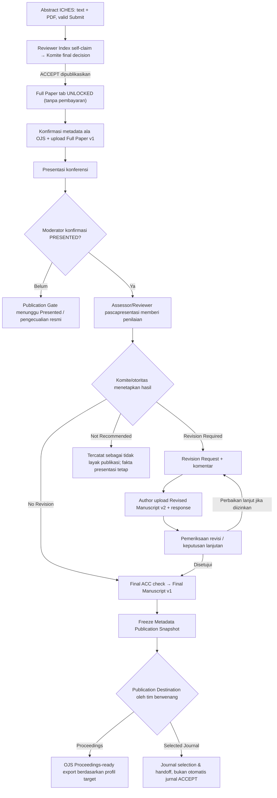
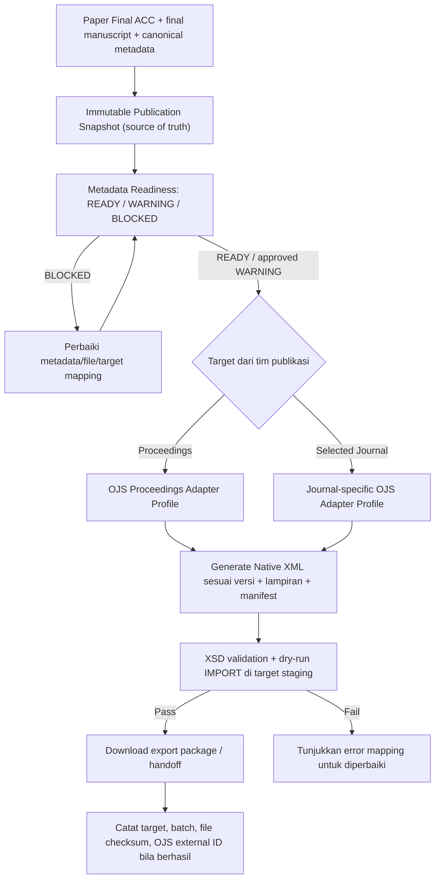

# 18B-09 — DRAFT Full Paper ala OJS, Penilaian Pascapresentasi, Revisi, dan Publikasi ICHES 2027

> **27 Oktober 2026 · DRAFT REKOMENDASI — MENUNGGU REVIEW USER, TIDAK FINAL, BELUM IMPLEMENTASI.**  
> **Permintaan terbaru:** **ABSTRACT tetap memakai alur ICHES yang sudah disetujui**; **FULL PAPER** memakai pengisian menyerupai OJS; setelah presentasi reviewer/penilai memberi evaluasi dan **revisi hanya jika diperlukan**; naskah final dapat disalurkan ke OJS Proceedings maupun jurnal mitra pilihan. **Sepuluh jurnal mitra** adalah kebutuhan pengguna untuk konfigurasi tujuan; **TOR asli tidak memberikan daftar nama atau angka “10 jurnal”**. Jangan membuat jurnal fiktif atau klaim jurnal pasti menerima.
>
> **Sumber repository lama (branch `develop`, gunakan sebagai referensi bukan menyalin konflik kebijakan):** [V1 Academic Review](https://github.com/akhmadafnan/international-conference-platform/blob/develop/docs/requirements/v1/V1_ACADEMIC_REVIEW_BASELINE.md), [V1 Publication](https://github.com/akhmadafnan/international-conference-platform/blob/develop/docs/requirements/v1/V1_PUBLICATION_BASELINE.md), [Scholarly Metadata Contract](https://github.com/akhmadafnan/international-conference-platform/blob/develop/docs/metadata/SUBMISSION_SCHOLARLY_METADATA_CONTRACT_V1.md), [Metadata Readiness](https://github.com/akhmadafnan/international-conference-platform/blob/develop/docs/metadata/METADATA_READINESS_RULES_V1.md), [OJS Adapter Contract](https://github.com/akhmadafnan/international-conference-platform/blob/develop/docs/metadata/OJS_CROSSREF_ADAPTER_CONTRACT_V1.md), [ERD V1](https://github.com/akhmadafnan/international-conference-platform/blob/develop/docs/architecture/ERD_V1.md).
>
> **Konflik penting:** repo lama V1 memiliki `ADMINISTRATIVE_SCREENING` pada abstrak dan model reviewer abstract yang berbeda; **jangan menghidupkannya kembali**. Keputusan ICHES terbaru: Abstract Text+PDF valid → langsung Reviewer Abstract Index self-claim; Komite mengumumkan final ACCEPT; Full Paper terbuka **tanpa gate Finance**. Terima hanya bagian metadata, penilaian pascapresentasi dan publication handoff yang relevan.
>
> **TOR asli:** [ringkasan TOR 2027](10-ANALISIS-TOR-DAN-REBASELINE-2027.md) menyebut prosiding ISBN/ISSN dan makalah terpilih untuk jurnal nasional/internasional, dengan tanggal prosiding sebagai target; TOR **tidak memuat nama sepuluh jurnal**. Jumlah dan daftar jurnal resmi menjadi data CRUD Admin yang akan dikonfirmasi panitia, **bukan hardcoded maupun klaim TOR**.
>
> **Rancangan database lanjutan:** [18C-01B DRAFT Publication & OJS Extension](18C-01B-DRAFT-FULLPAPER-PUBLICATION-ERD-DATA-DICTIONARY.md). Kedua dokumen ini **belum mengubah skema menjadi final**.

## 1. Dua pengalaman submission yang tidak dicampur

| Tahap | Model UI | Keputusan/gate |
|---|---|---|
| **Abstract Submission** | ICHES existing wizard: paper, author(s), Abstract Text, keywords, Abstract PDF, Submit | **FINAL sebelumnya:** validasi form+server → Submitted → reviewer index langsung, **tanpa administrative screening**; reviewer self-claim semua track, Komite memberi final keputusan |
| **Full Paper Submission** | **Usulan** UI menyerupai OJS: checklist, metadata ilmiah lengkap, upload berkas, review & confirm, history | Baru tersedia sesudah final **ACCEPT dipublikasikan** kepada submitting author; **tidak menunggu pembayaran** |
| **Penilaian pascapresentasi** | Reviewer/assessor sesi yang diberi tugas, formulir evaluasi artikel dan presentasi | Setelah presentasi yang sah, rekomendasi **NO REVISION / MINOR / MAJOR / NOT RECOMMENDED** (usulan mapping dari repo lama) |
| **Revisi (jika diminta)** | Form upload revised file, response to comments, history version | Hanya jika Komite/otoritas publikasi **mengeluarkan Revision Required** |
| **Tanpa revisi** | Versi full paper sebelumnya dapat maju ke penetapan final | **Tidak perlu upload berkas identik dua kali**; final check dan **Final ACC** tetap oleh pihak berwenang |
| **Handoff penerbitan** | Publication Queue (Proceedings atau Journal pilihan) | Setelah Presented + assessment selesai + revisi tuntas jika ada + Final ACC + metadata/file siap. Jurnal tujuan melakukan keputusan editorial sendiri |

**Abstract ACCEPT untuk presentasi ≠ Final ACC artikel untuk publikasi ≠ Accepted by Journal ≠ Published.** Satu `Paper ID` tetap digunakan dari abstract sampai publikasi.

## 2. Alur yang saya rekomendasikan (Mermaid)



**Tidak semua assessor harus menjadi reviewer abstrak.** Petugas yang mengevaluasi saat sesi dapat merupakan penilai pascapresentasi berbeda. Mereka tidak boleh mengubah fakta Presented (otoritas Moderator), invoice (otoritas Finance), atau keputusan Final ACC (otoritas Komite/Publikasi).

## 3. Rekomendasi bentuk UI Full Paper ala OJS (tidak menyalin OJS mentah)

```text
PERSONAL DASHBOARD → MY PAPERS → PAPER ICHES-XXXX
  Tab: Overview | Abstract Decision | Full Paper | Post-Presentation | Publication

  FULL PAPER — UNLOCKED WHEN ACCEPT IS PUBLISHED
    Step 1. Submission Checklist
       - originality/declaration, manuscript template (jika ditetapkan panitia)
       - language, relevant publication policy acknowledgment
    Step 2. Upload Files
       - manuscript (DOCX/ODT/PDF sesuai konfigurasi Admin)
       - supplementary/research instruments jika diperlukan
       - file type/role: Full Paper / Supplementary
    Step 3. Review / Complete Scholarly Metadata
       - title, subtitle, abstract, language, keywords
       - author order; one corresponding author
       - institutional affiliations, ORCID optional, country
       - references, optional DOI/URL per item
       - contact/consent policy as required
    Step 4. Review & Confirm
       - validate fields and files (server)
       - preview metadata / authorship / file checksum
       - [SUBMIT FULL PAPER]
    Step 5. History
       - Full Paper v1 / Revised v2... / Final selected version
       - evaluation notes and author response where authorized
```

**UX yang tidak merepotkan:** metadata dari Abstract Submission **sudah ditarik otomatis**. Penulis hanya **memeriksa/memperkaya** data publikasi, tidak mengetik judul, abstrak dan seluruh daftar penulis dari nol. Jika pascapresentasi **No Revision**, berkas Full Paper v1 yang sah **bisa dipilih sebagai final manuscript**; tidak perlu upload file yang sama sekali lagi.

**Pemisahan jenis berkas:** *manuscript working file* (misal DOCX) berbeda dari *final published PDF galley* pada OJS. File yang dapat diimpor ke OJS tergantung status dan profil OJS; jangan anggap DOCX upload = galley PDF siap terbit. Jenis file wajib, template, dan maksimum ukuran file tetap **Admin-configurable & MENUNGGU REVIEW**, bukan hardcode.

## 4. Kontrak metadata Full Paper yang disarankan dari repo lama

| Kelompok | Field | Gate/usulan |
|---|---|---|
| Manuskrip | Paper Code, Track, **scholarly primary language**, judul, subtitle opsional, abstrak ilmiah, keyword **per item berurutan** | Ambil dari Abstract; primary locale wajib, terjemahan ID/EN/AR opsional, tidak memaksa semuanya |
| Contributor | nama publik, nama depan/family dengan **dukungan mononim**, urutan penulis, corresponding author, email privat, country | Coauthor **tidak wajib punya akun User**; tepat satu corresponding author saat Submit |
| Affiliation | organisasi/institusi, country, subdivision fakultas/departemen opsional, ROR opsional | Institusi bukan fakultas; ROR tidak wajib |
| Identifikasi | ORCID URI bila tersedia (checksum/format valid), status autentikasi | ORCID kosong adalah WARNING, bukan blocker |
| Referensi | raw citation, urutan, DOI opsional, URL opsional | Simpan teks kutipan asli; tidak harus parsing sempurna sebelum submit jika panitia tidak mengharuskan |
| Files | role (`FULL_ARTICLE`, `REVISED_ARTICLE`, `PUBLICATION_FINAL`, `SUPPLEMENTARY`), version, mime, checksum, uploaded_by, timestamp | **Jangan overwrite berkas versi lama** |
| Declarations | originality/conflict/funding/ethics/rights, bila diwajibkan tujuan | Checklist harus berdasarkan ketentuan panitia/outlet yang ditetapkan; tidak mengarang keharusan jurnal |
| Production | final author order, approved manuscript version, publication destination & snapshot | Freeze ketika Finalize for Production; koreksi setelahnya buat snapshot baru, bukan silently mutate |

**Penting:** OJS-like adalah **pengalaman input dan kelengkapan metadata**, bukan membuat ulang seluruh 4-stage OJS editorial backend. ICHES tetap authoritative untuk abstrak, presentasi, Finance, assessment konferensi dan final eligibility; OJS tetap platform publikasi downstream.

## 5. Setelah PRESENTED: evaluasi, keputusan, dan revisi bersyarat

### A. Reviewer/Assessor Workspace — selama/acara atau sesudah sesi

**Form usulan:** paper+presenter+session, kriteria presentasi yang dapat diatur, kualitas/full paper feedback, keputusan **rekomendasi**:
- `NO_REVISION` — naskah layak langsung cek final;
- `MINOR_REVISION` — koreksi terbatas;
- `MAJOR_REVISION` — perbaikan substantif;
- `NOT_RECOMMENDED` — tidak disarankan lanjut publikasi.

Reviewer dapat menambahkan komentar untuk Author dan catatan internal, serta file review jika diperlukan. Form review tidak otomatis menerbitkan Final ACC. Untuk reviewer konferensi di sesi, penilaian dapat dicatat segera selama pelaksanaan; **gate final publication** tetap menunggu Presented yang sah.

### B. Komite/Publication Authority memberi keputusan

**Usulan keputusan formal:** `REVISION_REQUIRED`, `NO_REVISION_REQUIRED`, `NOT_RECOMMENDED_FOR_PUBLICATION`, `FINAL_ACC` (Final ACC hanya setelah pemeriksaan akhir; dapat menggunakan keputusan no-revision yang sama tahap operasional bila panitia memilih alur ringkas). Ini mencegah komentar reviewer langsung memaksa author mengunggah revisi tanpa keputusan berwenang.

**Saat Revision Required:** buat revision request yang terhubung paper + manuskrip versi yang dinilai; keterangan apa yang direvisi, reviewer notes, due date **jika ditentukan Admin**, dan file review. Penulis mengunggah v2 serta (USULAN) surat/tabel response to reviewers. Reviewer/Komite memeriksa v2, dapat memberi Final ACC atau revisi lanjutan **jika kebijakan mengizinkan**. Batas putaran revisi masih terbuka.

**Saat No Revision:** Final ACC setelah verifikasi completeness, pilih file versi terakhir yang sah; tidak ada pengunggahan ulang yang mubazir.

**Saat Not Recommended:** paper tetap historis Accepted untuk presentasi dan bila benar Presented, **tidak otomatis kehilangan sertifikat penulis** yang sesuai keputusan sebelumnya, juga tidak otomatis memicu refund. Jalur publikasi ditutup atau memerlukan keputusan korektif berwenang.

## 6. Publication Queue dan sepuluh jurnal pilihan — DRAFT

**Dua kategori tujuan publikasi:**

| Tujuan | Operasional | Yang tidak boleh diklaim |
|---|---|---|
| **Proceedings (OJS/proceedings target)** | Semua paper yang eligible secara kebijakan masuk antrean Proceedings, kecuali dipilih jalur lain oleh otoritas | Tidak otomatis dianggap terbit karena diekspor dari ICHES |
| **Selected Journal** | Tim/panitia publikasi memilih paper Final ACC, mencatat jurnal tujuan (satu dari **kandidat 10 jurnal pilihan** yang diisi Admin), menyiapkan handoff metadata+file kepada editor jurnal | **SELECTED_FOR_JOURNAL ≠ ACCEPTED_BY_JOURNAL** dan bukan janji publikasi |

**TOR asli** hanya menyebut output prosiding dan artikel terpilih nasional/internasional, serta jadwal jurnal menyesuaikan kebijakan tujuan. **Nama dan jumlah 10 jurnal tidak ada di sumber TOR yang ditemukan**; pengguna meminta daftar **10 jurnal tujuan**, sehingga Admin dapat mengisi maksimal sepuluh kandidat awal (angka dapat menjadi setting jika dibutuhkan), bukan sistem mengklaim mereka resmi mitra sebelum konfirmasi.

**Satu primary publication route per paper pada satu waktu** (rekomendasi untuk menghindari duplikasi publikasi): Default Proceedings; tim berwenang dapat override ke Selected Journal disertai alasan dan jejak. Jika jurnal menolak, ubah target melalui handoff berikutnya dengan histori lama utuh dan kontrol terhadap status penerbitan. **Tidak mengirim manuskrip yang sama simultan ke proceedings dan jurnal** tanpa persetujuan kebijakan publikasi/publisher, karena risiko etika publikasi ganda.

**Field outlet Admin:** nama jurnal/proceedings, jenis, URL, publisher, ISSN/eISSN bila diketahui, scope/track, status kerja sama (unconfirmed/confirmed), kontak editorial yang benar, OJS version, context/journal path, section mapping, supported locale, allowed file genre, target configuration, active status, remarks.

## 7. Export agar bisa diimpor OJS — target nyata, bukan janji format generik

**Rujukan PKP:** [Native XML schema OJS](https://github.com/pkp/ojs/blob/main/plugins/importexport/native/native.xsd) dan [PKP plugin Native XML](https://github.com/pkp/pkp-docs/blob/main/plugin-inventory/en/README.md); versinya harus disamakan dengan instalasi tujuan. Kode OJS Native XML menurunkan schema shared PKP; **satu XML untuk semua versi/semua jurnal tidak dijamin berhasil**. Adapter wajib punya profile.



**Rekomendasi isi paket ekspor:** satu batch per **target outlet + profile version**, dengan manifest CSV/JSON untuk audit, XML Native OJS yang sesuai versi target (jika adapter sudah lolos uji), file manuscript final dengan role yang tepat, checklist metadata, dan laporan validation. Alternatif fallback saat XML belum compatible: **metadata CSV/JSON + final files untuk assisted/manual entry**. **CSV tidak otomatis menjadi format yang dapat diimpor OJS Native XML**.

**Field mapping minimum:** scholarly language, title/subtitle, abstract, keywords, authors ordered, corresponding, email bila proses editorial membutuhkannya, affiliation, ORCID, references, submission files/genre, section, publication status yang benar, conference provenance jika support. **Jangan ekspor** pembayaran, informasi rekening, QR, reviewer identity/confidential comments, internal assessment scores, telephone, atau audit internal.

**Perbedaan target:** OJS Proceedings bisa berupa instalasi OJS yang dikelola untuk volume/proceedings; apakah artikel akan diimpor sebagai **unpublished submission** atau **published article/galley** harus dipilih profil target dan editorial workflow, **tidak otomatis mengklaim siap terbit**. OPS vs OJS juga tidak boleh diasumsikan saling kompatibel; pengguna menyebut OJS Proceedings, sehingga target perlu dicek aktual.

**Langkah UAT yang wajib sebelum menyebut “ready-to-import”:** (1) identifikasi versi OJS tujuan (mis. 3.3/3.4), (2) cek Native XML plugin & section/locale/author roles, (3) bangkitkan XML versi yang sesuai, (4) validasi XSD versi itu, (5) dry-run pada **staging** OJS yang cocok, (6) verifikasi di dashboard OJS bahwa metadata, semua authors, urutan, file dan state benar, (7) putuskan kebijakan dedup saat import ulang. Dokumen ini **belum menjalankan uji tersebut**.

**DOI, Crossref dan keputusan publikasi final** dikerjakan penerbit/OJS tujuan pada baseline accelerated V1, bukan platform konferensi mengklaim deposit Crossref otomatis. Catat OJS Submission ID, downstream status, DOI/URL kemudian sebagai **referensi eksternal**, bukan mengganti internal Paper ID.

## 8. Admin / Role Matrix yang sederhana

| Peran | Kewenangan di tahap ini |
|---|---|
| **Author/Submitting Author** | Buka Full Paper sesudah Published ACCEPT, konfirmasi metadata, unggah v1, jika Revision Required unggah v2/response; lihat status dan pesan yang boleh diakses |
| **Co-author** | Dimasukkan sebagai metadata penulis walau tanpa akun; akses editing bila memang diberi izin (belum otomatis) |
| **Reviewer/Assessor sesi** | Menilai paper/presentasi yang ditugaskan; komentar dan rekomendasi, bukan Final ACC |
| **Moderator** | Memastikan fakta Presented/No Show, bukan mengubah nilai editorial atau Finance |
| **Academic/Publication Committee** | Memberi keputusan Revision Required/No Revision/Final ACC/Not Recommended dan menyetujui publication eligibility |
| **Publication Team** | Mengelola kandidat journal/proceedings, metadata readiness, publication snapshot, export OJS profile, handoff dan status downstream |
| **Superadmin/Admin** | CRUD settings dan outlet, pengaturan deadline/status yang relevan, bukan menggantikan reviewer/publisher/OJS editorial |
| **Finance** | Bukti transfer/Verified terpisah; tidak menentukan Final ACC ataupun journal selection secara otomatis |

## 9. UAT rancangan tambahan (30 skenario, BELUM DIJALANKAN)

| ID | Skenario | Ekspektasi |
|---|---|---|
| FP-01 | Abstract Submit Text+PDF valid | Masuk Reviewer Index tanpa screening |
| FP-02 | Reviewer rekomendasikan Accept, Komite belum publish | Full Paper masih locked |
| FP-03 | Komite publish ACCEPT | Full Paper unlock tanpa cek Finance |
| FP-04 | Co-Host paper sudah disponsori | Full Paper tidak menciptakan invoice Conference kedua |
| FP-05 | Author buka Full Paper setelah Accepted | Metadata Abstract lama otomatis terisi |
| FP-06 | Author mengubah judul saat Full Paper | Perubahan terkontrol dan history tercatat, tidak mengubah snapshot lama diam-diam |
| FP-07 | Coauthor tak memiliki user login | Tetap sah dalam metadata/sertifikat |
| FP-08 | Author tanpa ORCID | Warning, bukan Blocked |
| FP-09 | ORCID salah format | Ditolak atau diminta koreksi |
| FP-10 | Nama satu kata/mononim | Tidak diciptakan surname palsu pada canonical record |
| FP-11 | Full Paper berkas baru | V1 tersimpan dengan role/version/checksum |
| FP-12 | User upload ulang versi revisi | V1 tetap bisa diaudit, V2 tersimpan |
| FP-13 | Author hanya bayar namun belum ACCEPT | Full Paper tetap locked |
| FP-14 | Reviewer presentasi bukan reviewer abstrak | Dapat diberi tugas assessment tersendiri |
| FP-15 | Check-in saja tanpa Presented | Belum memenuhi gate publication readiness |
| FP-16 | Moderator sah tandai Presented | Assessment pascapresentasi dapat diproses |
| FP-17 | Assessor pilih No Revision | Masuk final check tanpa upload file duplikat |
| FP-18 | Assessor pilih Minor/Major Revision | Author mendapat request resmi setelah keputusan authority |
| FP-19 | Penulis upload Revised Article v2 dan response | Version history utuh, request dapat diperiksa |
| FP-20 | Reviewer pilih Not Recommended | Tidak otomatis menyembunyikan Presented/sertifikat sah |
| FP-21 | Reviewer rekomendasi Final ACC langsung | Ditolak sebagai final decision; Komite berwenang |
| FP-22 | Metadata references tidak lengkap sesuai target | Readiness BLOCKED/WARNING dengan alasan |
| FP-23 | Final ACC belum ada | Tidak boleh export publication-ready |
| FP-24 | Final ACC + snapshot metadata lengkap | Boleh masuk Publication Queue |
| FP-25 | Paper journal selected | Status SELECTED, bukan ACCEPTED_BY_JOURNAL |
| FP-26 | Outlet journal belum diisi Admin | Tidak tampil nama jurnal fiktif |
| FP-27 | Paper dialihkan Proceedings ke Journal | Handoff audit dan primary route satu waktu |
| FP-28 | Adapter OJS beda versi dari target | Ekspor dinyatakan invalid/tidak ready-to-import |
| FP-29 | Native XML valid dan staging import berhasil | Metadata, author order, files, section dan state cocok |
| FP-30 | Duplicate export/import attempt | Idempotency/handoff tracking, tidak menghasilkan dua published article tanpa pemeriksaan |

**Jumlah skenario hanya UAT rancangan; tidak ada pengujian atau file ekspor XML aktual yang dibuat.** Hasil uji impor OJS tetap wajib dibuktikan.

## 10. Keputusan yang diminta berikutnya untuk review (tidak di-final-kan sekarang)

| ID | Rekomendasi saya | Status |
|---|---|---|
| PUB-R01 | **OJS-like Full Paper Wizard** dengan metadata prefill dari abstrak dan satu Paper ID, bukan clone OJS | **MENUNGGU REVIEW** |
| PUB-R02 | Setelah Presented: assessor memberi rekomendasi No/Minor/Major/Not Recommended; **Komite** memberi Final ACC/Revision decision | **MENUNGGU REVIEW** |
| PUB-R03 | **No Revision tidak perlu unggah ulang**, Revision Required membuat versi baru dengan response | **MENUNGGU REVIEW** |
| PUB-R04 | Default jalur publikasi **Proceedings**; Selected Journal via tim berwenang, tidak otomatis diterima jurnal | **MENUNGGU REVIEW** |
| PUB-R05 | **10 kandidat jurnal** masuk CRUD Admin sebagai tujuan yang akan dikonfirmasi, tidak mengarang nama atau menjanjikan semua terbit | **MENUNGGU REVIEW** |
| PUB-R06 | Metadata canonical/snapshot lalu adapter **OJS Native XML version-aware**, staging import test wajib; fallback metadata pack | **MENUNGGU REVIEW** |
| PUB-R07 | Dataset ilmiah dan revision history disimpan terpisah dari Finance/QR; export **tidak** membuka confidential review | **MENUNGGU REVIEW** |
| PUB-R08 | Pilihan file wajib (DOCX/PDF), batas revisi, tenggat, OJS versi/proceedings, journal list sebenarnya | **TERBUKA** |

**Kesimpulan:** alur baru penting karena menjadikan ICHES **pengelola seleksi & naskah hingga layak publikasi**, sedangkan **OJS/Jurnal melakukan proses editorial/penerbitan downstream**. Proposal ini tidak mengubah pembayaran, abstrak, ataupun sertifikat yang sudah disetujui.

[ERD Publication Extension 18C-01B](18C-01B-DRAFT-FULLPAPER-PUBLICATION-ERD-DATA-DICTIONARY.md) · [ERD utama 18C-01](18C-01-DRAFT-DATABASE-ARCHITECTURE-ERD.md) · [Register Keputusan](09-KEPUTUSAN-DAN-ISU-TERBUKA.md).
