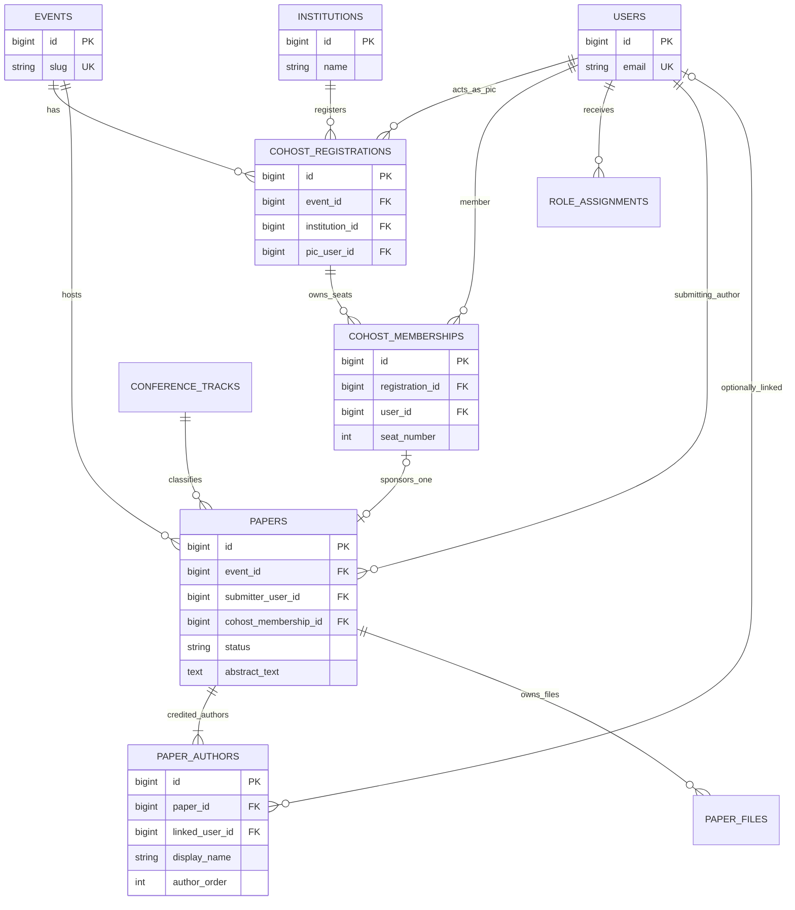
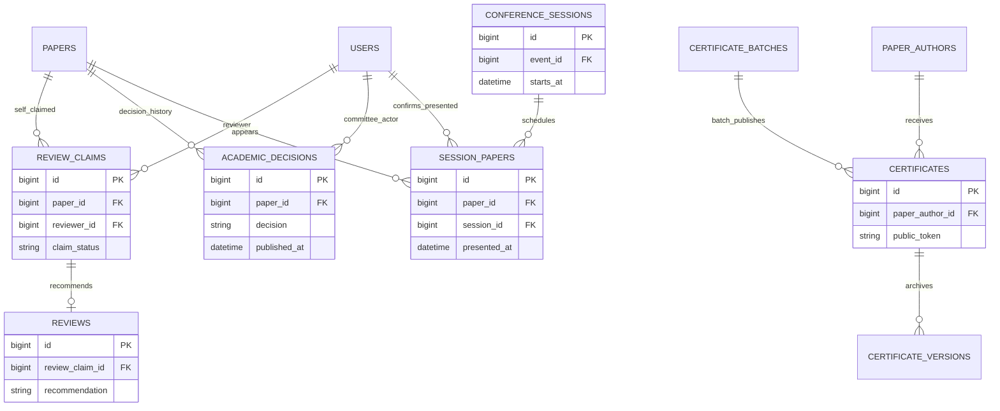
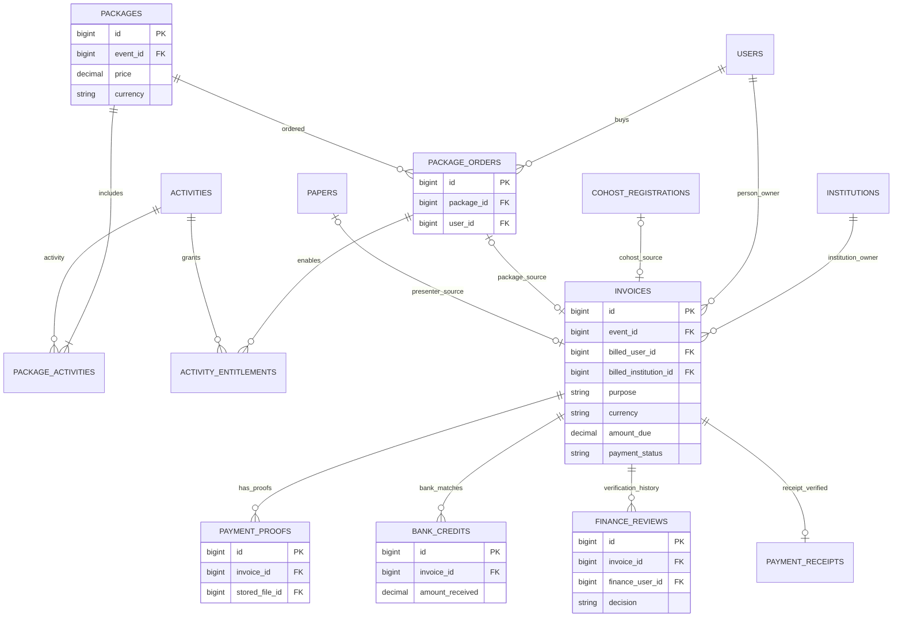
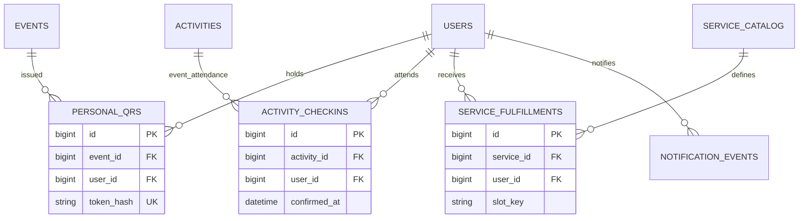
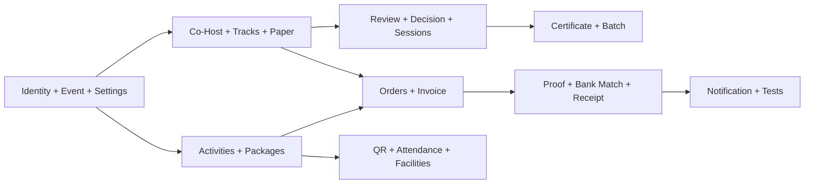

# 18C-01 — DRAFT Database Architecture & ERD ICHES UNISYA 2027

> **UPDATE REVIEW 27 OKTOBER 2026 — PENTING (TETAP DRAFT):** Pengguna menerima arah awal database, lalu menambahkan **Full Paper submission ala OJS** serta **penilaian pascapresentasi dengan revisi jika diperlukan**, Final ACC, ekspor OJS Proceedings dan jalur artikel terpilih ke **10 calon jurnal pilihan**. Ini membuat **38 kandidat tabel di dokumen ini sebagai BASELINE DRAFT**, **bukan daftar final yang sudah cukup**. Tambahan **15 kandidat tabel (total sementara hingga 53 untuk review)** dirinci pada [18C-01B](18C-01B-DRAFT-FULLPAPER-PUBLICATION-ERD-DATA-DICTIONARY.md). Workflow pada [18B-09](18B-09-DRAFT-FULLPAPER-OJS-LIKE-POSTPRESENTATION-PUBLICATION.md) merupakan usulan. **Tidak ada schema yang dikunci.**

> **STATUS: DRAFT REKOMENDASI · MENUNGGU REVIEW PENGGUNA · BELUM FINAL / BELUM CODING.**  
> **Tanggal:** 27 Oktober 2026. Desain tabel, relasi, index dan pilihan database di bawah adalah **usulan arsitektur**, bukan keputusan yang sudah dikunci. Ketentuan bisnis berlabel **DISETUJUI** berasal dari diskusi ICHES sebelumnya; aturan berlabel **TERBUKA** tidak boleh diberi default terselubung. Tidak ada migration, database, seeder, atau API yang dibuat.
>
> **Sumber:** [Register Keputusan](09-KEPUTUSAN-DAN-ISU-TERBUKA.md) · [TOR](10-ANALISIS-TOR-DAN-REBASELINE-2027.md) · [Role](18A-ROLE-PERMISSION-DAN-NAVIGASI-BACKOFFICE.md) · [Paper](18B-02-CRUD-INTERNATIONAL-CONFERENCE-SUBMISSION.md) · [Review/Sessions](18B-03-CRUD-REVIEW-DECISION-FULLPAPER-SESSION-DAN-UAT.md) · [Co-Host](18B-04-CRUD-COHOST-INSTITUSI-LIMA-PAPER.md) · [Paket](18B-05-CRUD-PAKET-INTERNASIONAL-DASHBOARD-PESERTA.md) · [Finance](18B-06-CRUD-FINANCE-INVOICE-PEMBAYARAN-VERIFIKASI.md) · [Kebijakan belum final](18B-07A-DRAFT-KEBIJAKAN-PELUNASAN-REFUND-DAN-TENGGAT.md) · [QR](05-QR-ABSENSI-DAN-FASILITAS.md) · [Sertifikat](06-SERTIFIKAT-PUBLIK.md).
>
> **Lampiran teknis:** [18C-01A — Data Dictionary, Constraints, Migration Plan & UAT](18C-01A-DRAFT-DATA-DICTIONARY-CONSTRAINTS-MIGRATIONS-UAT.md).

## 1. Rekomendasi awal: satu database relasional, bukan sistem yang dipecah-pecah

Saya merekomendasikan **satu database relasional untuk aplikasi Laravel ICHES 2027**, dengan pemisahan **domain pada model/service/policy**, bukan membuat database akademik, bank, QR, dan Co-Host yang saling berdiri sendiri. **PostgreSQL atau MySQL** keduanya kandidat; pilihan akhir bergantung lingkungan hosting dan penegakan constraint yang dibutuhkan. **PK BIGINT** di contoh ERD hanya notasi ilustratif, belum keputusan melawan ULID.

**Sengaja tidak dirancang sekarang:** payment gateway, integrasi internet banking, kurs otomatis, workflow engine abstrak, database per panitia, microservices, engine konflik jadwal, dan modul refund otomatis. Bisa ada modul scanner/keamanan lanjutan sesuai persetujuan tahap sebelumnya.

**Kebijakan bisnis yang wajib tetap:**
- **Satu user** dapat menjadi peserta/author/reviewer/PIC/Finance/moderator dengan role+scope, tanpa menggandakan akun.
- **Co-Host** satu invoice **Rp3.000.000/institusi** → **Finance VERIFIED dulu** → fitur lima anggota/lima paper Conference aktif. Setiap anggota satu sponsored paper melalui akun sendiri; **tidak terbit invoice presenter Conference lagi** untuk paper tersebut sesudah ACCEPT. Pembelian program lain = invoice personal terpisah.
- **Paket Program Internasional** satu invoice pribadi **Rp1.000.000** → Finance VERIFIED → empat akses MoU (hadir sesi, bukan signatory), Upgrading, PKM Internasional, dan Destinasi.
- **Presenter reguler** baru ditagih setelah final ACCEPT resmi **dipublikasikan** kepada author. **Full Paper/LoA** dibuka pada ACCEPT yang dipublikasikan tanpa memerlukan Finance VERIFIED.
- Abstract Text **dan** PDF wajib saat submit, kemudian langsung Reviewer Index tanpa administrative screening; reviewer self-claim semua track dengan pemeriksaan konflik; Komite Akademik memutuskan final.
- Moderator mengonfirmasi **paper Presented** terpisah dari check-in. Semua authors pada paper yang benar-benar Presented eligible untuk sertifikat, namun **panitia menerbitkan secara batch manual**.
- Satu rekening resmi diedit langsung Superadmin; transfer manual bukti JPG/PNG/PDF, Finance cocokkan mutasi; WNI kategori nasional IDR/WNA kategori internasional TOR USD dan semua biaya transfer asing ditanggung pengirim.

## 2. Inventory 38 tabel kandidat — DRAFT, boleh dikurangi/digabung saat review

| Domain | Kandidat tabel | Jumlah | Catatan |
|---|---|---:|---|
| Identitas dan pengaturan | `events`, `users`, `institutions`, `role_assignments`, `stored_files`, `event_settings` | 6 | Satu user dan event ICHES 2027 |
| Co-Host | `cohost_registrations`, `cohost_memberships` | 2 | Gate Finance Verified |
| International Conference | `conference_tracks`, `papers`, `paper_authors`, `paper_files`, `review_claims`, `reviews`, `academic_decisions`, `conference_sessions`, `session_papers` | 9 | Review dan academic history |
| Program dan paket | `activities`, `packages`, `package_activities`, `package_orders`, `activity_entitlements` | 5 | Empat hak / satu order |
| Finance | `fee_rates`, `bank_settings`, `invoices`, `payment_proofs`, `bank_credits`, `finance_reviews`, `payment_receipts` | 7 | Satu modul lintas empat jenis pembayaran |
| Participant, QR, layanan | `participant_registrations`, `personal_qrs`, `activity_checkins`, `service_catalog`, `service_fulfillments` | 5 | Identity ≠ entitlement ≠ attendance ≠ Presented |
| Sertifikat | `certificate_batches`, `certificates`, `certificate_versions` | 3 | Manually published, public verification |
| Notifikasi | `notification_events` | 1 | Dashboard first, email opsional |
| **Total** | **38 kandidat** | **38** | **Bukan 38 fitur wajib di MVP** |

Catatan: Laravel biasanya juga memerlukan tabel framework (sessions, cache, jobs, password reset token, migrations) dan mungkin permission eksternal. **Tidak dihitung dalam 38 tabel domain**; tergantung konfigurasi yang dipilih nanti. `mou_signatories`, `scanner_devices`, `scanner_sync_events`, dan refund ledger bisa ditambahkan **hanya jika kebijakannya disetujui**, bukan diam-diam masuk core.

## 3. ERD A — User, institusi, Co-Host, dan paper

**Penjelasan bisnis:** satu Co-Host terdaftar pada satu institusi/event. Setelah invoice institusi VERIFIED, PIC mengelola maksimal **seat 1–5**; tiap seat dimiliki **satu user**, tiap anggota boleh men-submit **satu paper sponsor** (bukan satu paper per co-author). `papers.cohost_membership_id` kosong untuk regular. PIC tidak otomatis mengisi salah satu seat. Mengganti anggota/paper Rejected setelah submission masih kebijakan **TERBUKA**; data historis tidak dihapus.

**Author tanpa akun:** `paper_authors` menyimpan snapshot nama, urutan, afiliasi, email sesuai kebutuhan akademik; `linked_user_id` boleh kosong sehingga coauthor tidak dipaksa membuat akun untuk bisa masuk daftar penulis atau menerima sertifikat publik.

## 4. ERD B — Reviewer, komite, sesi, sertifikat

**Status dan otoritas wajib dipisah:** valid `Submitted` masuk Index langsung; review recommendation tidak mem-publish keputusan. Full Paper unlock hanya ketika `academic_decisions.decision=ACCEPT` **dan** `published_at` ada (final publish ke author), bukan internal ACCEPT. Syarat jumlah reviewer **belum final**. Moderator memastikan `Presented`, tidak berasal dari scanner/attendance. Semua penulis paper Presented eligible, **batch panitia** tetap syarat penerbitan. Reissue versi sertifikat menjaga sejarah, dan QR sertifikat publik berbeda dari QR personal.

## 5. ERD C — Paket, Finance dan invoice tunggal lintas tujuan

**Relasi owner pada diagram bersifat alternatif, bukan dua pembayar sekaligus:** invoice harus memiliki **tepat satu** owner, `institution` **ATAU** `person`, dan **tepat satu** source of obligation (Co-Host Registration / Package Order / Published ACCEPT paper / Participant Registration). Rancangan detail memakai nullable foreign keys eksplisit dan validasi DB+backend, bukan referensi polimorfik bebas yang tidak bisa diperiksa FK.

**Pemisahan uang dan entitlement:**
- **Co-Host:** 1 invoice Rp3 juta/institusi, gate VERIFIED sebelum roster + lima paper; **0 invoice presenter reguler** untuk kelima paper sponsored.
- **Paket:** 1 order + 1 invoice Rp1 juta/user dengan empat `package_activities`; VERIFIED memberi empat entitlement sekali. Membeli tidak sama dengan menghadiri kegiatan; MoU attendance bukan signatory.
- **Presenter biasa:** invoice setelah ACCEPT resmi diumumkan, bukan reviewer rec. Full Paper tetap terbuka meski invoice Unpaid.
- **Finance:** proof JPG/PNG/PDF tidak membuat Verified; `bank_credits` bersumber mutasi yang dicek petugas; keputusan Finance pada `finance_reviews`; receipt resmi hanya setelah VERIFIED.
- **Currency:** tarif WNI/IDR & WNA/USD hanya pada kategori TOR yang sesuai; paket khusus Co-Host dan Rp1 juta tetap IDR. Jangan konversi USD ke IDR otomatis. Semua biaya transfer USD pada pengirim. Penanganan partial/top-up/refund masih DRAFT.

## 6. ERD D — QR, kehadiran, layanan

**Personal QR ≠ entitlement ≠ attendance ≠ Presented.** Identitas QR menunjuk akun; hak program/layanan diperiksa server; check-in mencatat hadir nyata, fulfillment mencatat layanan diserahkan, Presented hanya konfirmasi moderator pada paper. Satu QR personal tetap dapat dipakai lintas pos.

**Offline scanning** belum final native/PWA maupun strategi sinkronisasi. Jika disetujui, event offline Pending Sync tidak boleh masuk sebagai confirmed attendance/fulfillment sebelum server mengesahkan; dua perangkat sepenuhnya offline tidak mampu menjamin tidak ada pengambilan ganda secara langsung.

## 7. Aturan integritas utama yang saya rekomendasikan

| ID | Aturan konseptual | Keputusan bisnis terlindungi |
|---|---|---|
| DB-R01 | `UNIQUE(event_id,institution_id)` cohost_registrations | Satu invoice Co-Host per institusi/event |
| DB-R02 | Seat 1..5; unique(registration,seat_number) dan unique(registration,user_id) | Tidak ada kursi ke-6 |
| DB-R03 | `UNIQUE(papers.cohost_membership_id)` saat non-null; submitter cocok membership.user_id | Satu sponsored paper per wakil |
| DB-R04 | Backend/transaksi memeriksa Finance VERIFIED sebelum membuka roster/submit Co-Host | Co-Host bayar dahulu |
| DB-R05 | Satu package order aktif per (event,user,package); satu invoice source per order | Tidak membuat tagihan Rp1 juta ganda |
| DB-R06 | `UNIQUE(order_id,activity_id)` entitlement dan transisi VERIFIED idempotent | Empat akses sekali, bukan empat invoice |
| DB-R07 | Validasi abstract_text & valid PDF saat status Submitted, bukan saat Draft | Reviewer Index valid tanpa screening |
| DB-R08 | Reviewer self-claim atomic dan menolak reviewer yang merupakan listed author | Review tanpa konflik atau oversubscription |
| DB-R09 | Published ACCEPT menjadi satu-satunya unlock LoA/Full Paper | Finance & reviewer rec tidak menggantikannya |
| DB-R10 | Invoice presenter reguler hanya sesudah published ACCEPT, dan tidak pada paper sponsor Co-Host | Tidak charge sebelum ACCEPT atau double charge |
| DB-R11 | Bukti upload tidak sama dengan Verified; butuh mutasi dan aktor Finance | Pembayaran benar |
| DB-R12 | `UNIQUE(invoice_id)` payment_receipts, diterbitkan hanya setelah Verified | Satu bukti lunas sah |
| DB-R13 | Moderator Presented, bukan activity checkin; batch publish sertifikat semua authors eligible | Tidak salah menerbitkan sertifikat |
| DB-R14 | Token QR dan token sertifikat dibuat acak/opaque, dua domain berbeda | Tidak memaparkan identitas/hak |
| DB-R15 | Backend membatasi invoice proof ke owner, Finance dan admin berizin | PIC tidak melihat tagihan pribadi anggota |

**Foreign key/index/check diperlukan, tetapi tidak cukup:** gate VERIFY sebelum pemanfaatan lima seat atau empat akses tetap memerlukan pemeriksaan status dalam transaksi aplikasi; race/concurrent requests diuji. Jumlah reviewer, penggantian anggota/paper, pembayaran per presenter multi-paper, refund, deadline, bank USD, dan detail layanan belum boleh dijadikan constraint final sebelum keputusan terkait.

## 8. Usulan urutan migration (belum membuat file)

**Pilihan implementasi yang menunggu review:** database engine PostgreSQL/MySQL, bigint vs ULID, struktur `event_settings`, unique untuk record `active`, dan tahap realisasi tabel. Laravel 13+Inertia+Vue3+TypeScript tetap **arah stack produk**, bukan kode yang dijalankan oleh dokumen ini. Detail migration dependency dan kamus kolom ada pada [18C-01A](18C-01A-DRAFT-DATA-DICTIONARY-CONSTRAINTS-MIGRATIONS-UAT.md).

## 9. Review pertama yang saya usulkan untuk diskusi

| ID | Pilihan yang saya sarankan | Status |
|---|---|---|
| RV-01 | **Satu database relasional**, domain Laravel dipisah pada service/model/policy | **MENUNGGU REVIEW** |
| RV-02 | **Satu user** dengan role assignment; author snapshot boleh tidak punya akun | **MENUNGGU REVIEW** |
| RV-03 | **Satu invoices lintas tujuan**, dengan owner jenis institusi/pribadi dan source valid | **MENUNGGU REVIEW** |
| RV-04 | **Seat 1–5 + satu sponsored paper/member** dijaga DB dan backend VERIFIED | **MENUNGGU REVIEW** |
| RV-05 | **Paket punya empat activity entitlements** dari satu order Verified | **MENUNGGU REVIEW** |
| RV-06 | **QR, attendance, service fulfillment, dan Presented** terpisah | **MENUNGGU REVIEW** |
| RV-07 | **Bank proofs, bank credits, Finance reviews, receipts** dipisahkan ringan | **MENUNGGU REVIEW** |
| RV-08 | **PostgreSQL vs MySQL dan key strategy** diputuskan sesudah meninjau hosting | **MENUNGGU REVIEW** |

**Jangan salah baca:** yang “menunggu review” adalah **cara menyimpan dan menghubungkan data**, bukan mengulang negosiasi biaya/Co-Host/paket yang sudah disetujui.

> **STATUS REVIEW BERIKUTNYA (27 Okt 2026):** Pengguna menyatakan **arah desain ini “sudah oke” untuk dilanjutkan** dan mengizinkan tahap 18C-02. **ERD dan 38+15 kandidat tabel masih DRAFT, tidak otomatis final**. Handoff rancangan backend: [18C-02 Laravel Business Logic](18C-02-DRAFT-LARAVEL-BACKEND-ARCHITECTURE-BUSINESS-LOGIC.md).

## 10. Ringkasan status

**Catatan supersession DRAFT:** inventory 38 dan diagram di sini belum memodelkan penuh `paper_translations`, `paper_keywords`, `author_affiliations`, `paper_references`, version snapshots, `presentation_assessments`, revision request dan publication/outlet export. **Jangan menggunakan 38 tabel ini saja untuk membuat migration final.** Baca [18C-01B Publication Extension](18C-01B-DRAFT-FULLPAPER-PUBLICATION-ERD-DATA-DICTIONARY.md) sebelum mereview skema gabungan. Abstract Submission tidak berubah; Full Paper OJS-like/Pascapresentasi/Outlet hanya tambahan rancangan.

**DRAFT 18C-01** telah memetakan 38 kandidat tabel domain, empat ERD, invariants dan arah migration. **Belum ada finalisasi schema, SQL DDL, Laravel migration, database aktif, kode aplikasi atau UAT yang dijalankan.** Saran revisi pengguna akan menjadi dasar perubahan sebelum persetujuan implementasi.

[Data Dictionary & UAT 18C-01A](18C-01A-DRAFT-DATA-DICTIONARY-CONSTRAINTS-MIGRATIONS-UAT.md) · [Register Keputusan](09-KEPUTUSAN-DAN-ISU-TERBUKA.md) · [README](../README.md).
