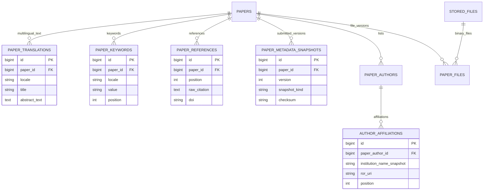
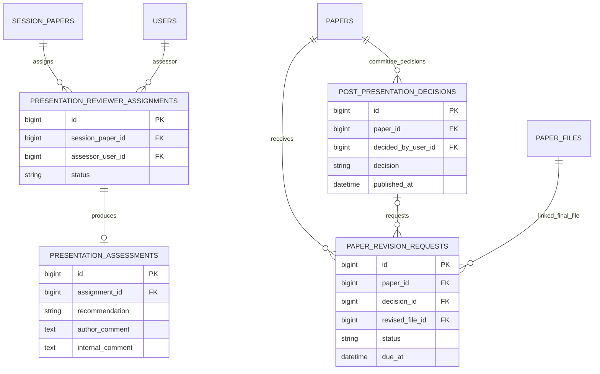
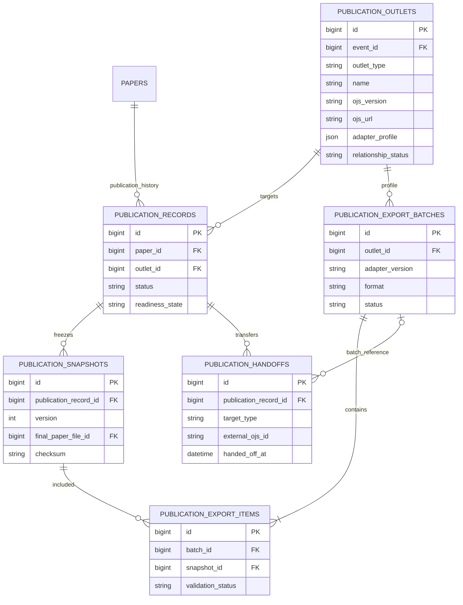
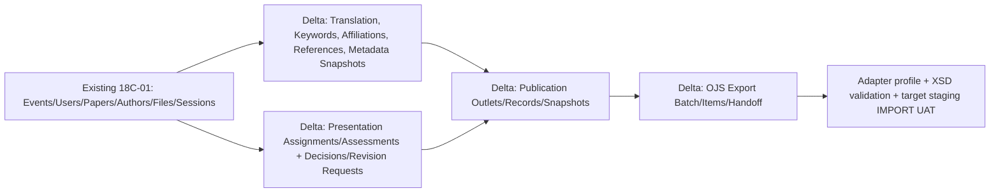

# 18C-01B — DRAFT ERD Extension: OJS-like Full Paper, Revision, Proceedings & Journal Handoff

> **27 Oktober 2026 · REKOMENDASI PERUBAHAN 18C-01 · BELUM FINAL / BELUM MIGRATION / BELUM CODING.**
>
> User menyetujui *arah dasar* 18C-01 namun menambahkan: **Abstract tetap seperti alur ICHES yang disepakati**, **Full Paper menyerupai OJS dalam input dan pengelolaan file/metadata**, **reviewer/assessor pascapresentasi dapat meminta revisi atau menyatakan tanpa revisi**, serta **ekspor ke OJS Proceedings dan seleksi ke sepuluh kandidat jurnal**. Rancangan ini menambah domain yang belum terurai penuh dalam 38 kandidat tabel semula, **tanpa mengunci penambahan tersebut**.
>
> **Dokumen pendamping:** [18B-09 — DRAFT Workflow Full Paper ala OJS](18B-09-DRAFT-FULLPAPER-OJS-LIKE-POSTPRESENTATION-PUBLICATION.md) · [18C-01 ERD semula (38 kandidat)](18C-01-DRAFT-DATABASE-ARCHITECTURE-ERD.md) · [18C-01A Kamus Data](18C-01A-DRAFT-DATA-DICTIONARY-CONSTRAINTS-MIGRATIONS-UAT.md) · [Keputusan](09-KEPUTUSAN-DAN-ISU-TERBUKA.md).
>
> **Sumber teknis repo lama:** [Scholarly Metadata Contract](https://github.com/akhmadafnan/international-conference-platform/blob/develop/docs/metadata/SUBMISSION_SCHOLARLY_METADATA_CONTRACT_V1.md) · [ERD old repo](https://github.com/akhmadafnan/international-conference-platform/blob/develop/docs/architecture/ERD_V1.md) · [Publication V1](https://github.com/akhmadafnan/international-conference-platform/blob/develop/docs/requirements/v1/V1_PUBLICATION_BASELINE.md) · [OJS profile contract](https://github.com/akhmadafnan/international-conference-platform/blob/develop/docs/metadata/OJS_CROSSREF_ADAPTER_CONTRACT_V1.md).
>
> **Penting:** TOR menyebut **prosiding dan artikel terpilih di jurnal**, tetapi tidak memuat **nama/daftar/angka 10 jurnal**. Angka 10 adalah kebutuhan daftar pilihan dari user, bukan fakta yang bisa dikutip sebagai rincian TOR. Isi nama jurnal baru ketika panitia menyampaikannya.

## 1. Audit gap: mengapa 18C-01 perlu direvisi

**38 tabel awal** sudah punya `papers`, `paper_authors`, `paper_files`, `review_claims`, `reviews`, `academic_decisions`, `session_papers`. Itu cukup sebagai **inti Abstract → ACCEPT → Full Paper unlock**, tetapi **belum mencukupi** untuk menyimpan:
1. Judul/abstrak multibahasa dan keyword per item dengan urutan/locale untuk import OJS.
2. Multi-affiliation, ORCID, mononim, references terurut, dan provenance metadata publikasi.
3. Reviewer/assessor penilai sesi konferensi yang bisa **berbeda** dari reviewer abstrak.
4. Keputusan No Revision/Revision Required, komentar reviewer, *response to reviewers*, dan pemeriksaan versi Revised Article.
5. Hak Final ACC sebelum masuk Publication Queue.
6. Tujuan Proceedings versus sepuluh jurnal pilihan sebagai **data konfigurasi**, bukan satu tabel per jurnal.
7. Snapshot publikasi final agar nama author/title/affiliation tidak berubah saat data profil user belakangan diedit.
8. Adapter OJS version-aware, batch XML+file, manifest dan catatan external OJS submission id serta status downstream.

**Rekomendasi:** **38 tabel DRAFT awal + 15 kandidat ekstensi = maksimum 53 kandidat dalam pembahasan**, **bukan keputusan untuk membuat 53 tabel**. Kita dapat menggabungkan beberapa entitas saat review. Detail `paper_authors`, `paper_files`, `academic_decisions`, `session_papers` dan `stored_files` yang sudah ada perlu **diperkaya**, bukan diduplikasi.

## 2. Inventaris 15 kandidat tambahan (semuanya DRAFT)

| No. | Usulan tabel baru | Fungsi | Batas alternatif penggabungan |
|---:|---|---|---|
| 01 | `paper_translations` | Title/subtitle/abstract per scholarly locale | Bisa digabung ke `papers` jika satu bahasa permanen; **tidak direkomendasikan untuk OJS multi-locale** |
| 02 | `paper_keywords` | Kata kunci terstruktur per locale/urutan | Bisa JSON, namun relasional lebih mudah validasi dan ekspor |
| 03 | `author_affiliations` | Multi-organisasi per author, snapshot institusi & ROR opsional | Dapat ditaruh snapshot JSON jika benar hanya satu per author |
| 04 | `paper_references` | Bibliografi berurutan raw citation + DOI/URL opsional | Bisa disimpan raw bibliography panjang, tetapi mapping OJS lebih sulit |
| 05 | `paper_metadata_snapshots` | Rekaman identitas/metadatanya pada Submit/versi revisi | Boleh memakai versi JSON pada event/history layer yang sama |
| 06 | `presentation_reviewer_assignments` | Penilai yang bertugas pada paper/slot saat konferensi | Bisa dijadikan `review_claims` bertipe stage bila satu review engine umum dipilih |
| 07 | `presentation_assessments` | Evaluasi paper dan presentasi, rekomendasi No/Minor/Major/Not Recommended | Bisa memakai `reviews` dengan stage, tetapi akses/otoritas harus terpisah |
| 08 | `post_presentation_decisions` | Keputusan Komite tentang revision/no revision/Final ACC/reject publication | Alternatif `academic_decisions` dengan decision_stage |
| 09 | `paper_revision_requests` | Catatan permintaan revisi, deadline jika ada, respons dan status | Bisa menautkan `paper_files` + assessment, tetapi workflow kurang jelas |
| 10 | `publication_outlets` | Proceedings + jurnal tujuan (mis. 10 kandidat) sebagai data Admin | Tabel **tunggal**, bukan 10 tabel |
| 11 | `publication_records` | Satu jalur utama publikasi aktif/paper dan status downstream | Perlu untuk journal selection dan publication history |
| 12 | `publication_snapshots` | Frozen final metadata+file setelah Final ACC | Lebih kuat jika terpisah dari snapshot abstrak |
| 13 | `publication_export_batches` | Kelompok hasil ekspor per outlet/OJS profile version | Diperlukan untuk ekspor massal teruji |
| 14 | `publication_export_items` | Hubungan batch ke tiap publication snapshot, validation error/hasil | Tidak cukup jika cuma satu JSON manifest besar |
| 15 | `publication_handoffs` | Berita acara transfer ke OJS/proceedings/journal dan external refs | Bisa digabung ke record jika hanya satu handoff, tapi perlu riwayat re-try |

**Catatan arsitektur:** 15 merupakan *kandidat logis*. Beberapa tabel boleh digabung atau ditunda sampai uji implementasi. Bukan berarti seluruh katalog harus ada pada MVP. Jika user meminta aplikasi sederhana, kita dapat menggabungkan 06+07 dengan engine existing dan 08 dengan academic decisions, **setelah** menguji batas akses/riwayat.

## 3. ERD A — canonical metadata OJS-like dan file version

### Kamus data terpilih + perubahan tabel existing

| Entitas | Usulan field inti | Constraint/gate |
|---|---|---|
| `paper_translations` | paper_id, locale, title, subtitle?, abstract_text | UNIQUE(paper_id,locale). Primary locale bisa `id/en/ar`, tidak wajib terjemahan ketiganya |
| `paper_keywords` | paper_id, locale, keyword, position | UNIQUE(paper_id,locale,position); count mengikuti Admin setting, **bukan hardcode** |
| `paper_references` | paper_id, position, raw_citation, doi?, url?, structured_json? | UNIQUE(paper_id,position). Raw citation wajib dipertahankan |
| `author_affiliations` | paper_author_id, institution_id?, institution_name_snapshot, ror_uri?, subdivision?, country?, position | UNIQUE(author_id,position); organisasi resmi vs fakultas/subdivision |
| `paper_metadata_snapshots` | paper_id, version, snapshot_kind, canonical_json, checksum, created_by, created_at | Unique per paper/kind/version; immutable, tidak mengikuti perubahan profil |
| **Existing `papers`** | primary_locale, metadata_version/current_fullpaper_file_id? dan status domain | Satu Paper ID dari abstrak ke Full Paper sampai publikasi; jangan menjadikan invoice syarat Full Paper |
| **Existing `paper_authors`** | display_name, given_name?, family_name?, single_name flag, corresponding, email private, country?, ORCID URI? + verification state?, author_order, optional linked_user_id | Coauthor tanpa akun sah; exactly one corresponding pada official submit |
| **Existing `paper_files`** | file_role ABSTRACT_PDF / FULL_ARTICLE / REVISED_ARTICLE / PUBLICATION_FINAL / SUPPLEMENTARY / REVIEW_RESPONSE; version_no, stored_file_id, uploaded_by, immutable_hash, supersedes_file_id? | V1 tidak pernah ditimpa oleh Revised v2; mime & size policy Admin |

**Author input saat Full Paper:** prefill dari abstract metadata yang sudah ada; hanya koreksi/perkaya informasi. OJS Native import adalah transformasi pada adapter, **bukan** alasan membuat `OJS_TITLE` atau `OJS_GIVENNAME` permanen yang menggantikan canonical fields.

## 4. ERD B — assess pascapresentasi dan revision decision

**Aturan:** Moderator mengonfirmasi `session_papers.presented_at`, sedangkan reviewer/assessor sesi mengisi assessment. Assessor tidak menetapkan Final ACC. `presentation_assessments.recommendation` berupa **NO_REVISION, MINOR_REVISION, MAJOR_REVISION, NOT_RECOMMENDED** (usulan label). Komite/Publication Authority menetapkan **Revision Required / No Revision / Final ACC / Not Recommended for Publication**. Jika revisi diminta, author mengunggah **Revised Article v2 + response**, bukan overwrite v1. Jika tanpa revisi, naskah v1 dapat menjadi final untuk Final ACC. Batas ronde revisi dan deadline masih **TERBUKA**, bukan default dua ronde/dua reviewer.

**Perlu diperbaiki saat review ERD fisik:** garis `PAPER_FILES -> PAPER_REVISION_REQUESTS` pada diagram hanya ilustrasi file revisi terpilih; permintaan revisi tanpa file v2 adalah keadaan valid, sehingga FK `revised_file_id` nullable dan rujuk `paper_files.id` ketika author selesai revisi. Sumber decision harus benar-benar berwenang. Jangan anggap modul abstract review yang berbeda sebagai pengganti assessment acara.

## 5. ERD C — journal destinations, publication snapshots, batch OJS export dan handoff

### Data dictionary dan ownership

| Entitas | Field inti | Aturan |
|---|---|---|
| `publication_outlets` | event_id, outlet_type PROCEEDINGS/JOURNAL, name, publisher?, ISSN/ISBN?, OJS URL?, OJS family/version?, section mapping?, file component mapping?, locales?, status confirmed/unconfirmed, active, profile_json | **Satu tabel yang menyimpan Proceedings + misalnya 10 jurnal sebagai BARIS**. Daftar 10 belum diterima dan belum disebut satu per satu dalam TOR |
| `publication_records` | paper_id, outlet_id, primary_path flag, status, readiness_state READY/WARNING/BLOCKED, selected_at/by, final_paper_file_id?, last_external_url? | **Satu publication route aktif per paper saat satu waktu**; rejected oleh jurnal dapat dipindah dengan histori |
| `publication_snapshots` | publication_record_id, version, metadata_json, final_paper_file_id, checksum, frozen_authors/order, finalized_by/at, supersedes? | Hanya Final ACC/ready authorized. **Tidak berubah** jika user mengubah nama/afiliasi profil |
| `publication_export_batches` | outlet_id, adapter_profile_version, format NATIVE_XML/METADATA_PACK, generated_file_id?, generated_by/at, validated_at?, target_ojs_version?, import_test_status, export_status | Batch hanya untuk **satu tujuan/profil**; XML OJS universal tidak dijanjikan |
| `publication_export_items` | batch_id, publication_snapshot_id, validation_status, error_codes_json?, manifest_entry_hash | UNIQUE(batch_id,snapshot_id), laporan per article sehingga satu paper bermasalah tidak menutup seluruh batch tanpa alasan |
| `publication_handoffs` | publication_record_id, batch_id?, handed_off_to, handed_off_by/at, external_ojs_submission_id?, downstream_status, external_url?, notes? | **SELECTED_FOR_JOURNAL bukan ACCEPTED_BY_JOURNAL**. Downstream OJS ID merupakan external ref, bukan primary key ICHES |

**XML Native OJS bukan sekadar mengekspor CSV:** pengguna menginginkan *langsung bisa diimpor*, maka perlu profile OJS target, XSD validation yang cocok, dan **staging import test pada versi jurnal/proceedings yang benar**. Jika belum lulus uji, ekspor hanya disebut *metadata package for assisted handoff*, bukan *ready-to-import*. Sampel resmi tersedia di [PKP OJS Native XML XSD](https://github.com/pkp/ojs/blob/main/plugins/importexport/native/native.xsd) dan PKP Native Plugin; versi target bisa berbeda dan harus diuji.

**Export contents:** metadata canonical (primary language/title/abstract/keywords/authors ordered/email hanya jika diperlukan OJS editorial/affiliation/ORCID/references), final article files, target mapping, manifest; **jangan** masukkan payment, bank, reviewer confidential notes, QR, presenter score atau audit. `DOI` / `OJS_SUBMISSION_ID` hasil downstream disimpan sebagai referensi, tidak mengubah Paper ID.

**Etika jurnal:** keputusan memilih jurnal bukan surat penerimaan. Selain itu, jangan serentak menerbitkan satu artikel pada prosiding dan jurnal tanpa pengaturan kebijakan dari penerbit dan izin penulis.

## 6. State machines yang dipisah (jangan jadi satu status superpanjang)

| Domain | Contoh lifecycle yang dapat disesuaikan |
|---|---|
| Abstract | DRAFT → SUBMITTED (langsung Reviewer Index) → REVIEW → FINAL_ACCEPT_DECIDED → **ACCEPT_PUBLISHED** |
| Full Paper | LOCKED → PENDING → SUBMITTED_V1 → (correction if necessary) → PRE_EVENT_VALIDATED |
| Presentation | SCHEDULED → **PRESENTED** atau NO_SHOW (Moderator) |
| Post-Presentation Assessment | ASSIGNED → SUBMITTED_RECOMMENDATION → COMMITTEE_DECISION |
| Revision | NOT_REQUIRED **atau** REQUIRED → AUTHOR_UPLOADED_V2 → CHECKED → RESOLVED |
| Final Academic Publication | AWAITING_CHECK → **FINAL_ACC** atau NOT_RECOMMENDED |
| Publication Destination | PROCEEDINGS_DEFAULT atau SELECTED_JOURNAL → READY/WARNING/BLOCKED → SNAPSHOT_FROZEN |
| Export/Handoff | PREPARED → PROFILE_VALIDATED → STAGING_IMPORT_TESTED → EXPORTED → HANDED_OFF → DOWNSTREAM_STATUS |
| Certificates | PAPER_PRESENTED → ALL_AUTHORS_ELIGIBLE → ADMIN_BATCH_ISSUE → PUBLIC_VERIFIABLE |

**Status NO_REVISION tidak langsung = PUBLISHED.** Penerbitan masih membutuhkan Final ACC, completeness, outlet, snapshot, export dan proses OJS/jurnal masing-masing.

## 7. Integritas dan indeks yang saya rekomendasikan

| ID | Guard / Constraint | Risiko |
|---|---|---|
| OJS-DB-01 | `UNIQUE(paper_translations.paper_id,locale)` | Tidak ada dua abstrak untuk locale yang sama |
| OJS-DB-02 | `UNIQUE(paper_keywords.paper_id,locale,position)` | Keyword order stabil |
| OJS-DB-03 | `UNIQUE(author_affiliations.paper_author_id,position)` | Afiliasi berurutan |
| OJS-DB-04 | `UNIQUE(paper_references.paper_id,position)` | Citations dapat diekspor urut |
| OJS-DB-05 | `UNIQUE(paper_metadata_snapshots.paper_id,snapshot_kind,version)` | Submitted evidence tidak overwritten |
| OJS-DB-06 | `UNIQUE(presentation_reviewer_assignments.session_paper_id,assessor_user_id)` | Asesor tidak double assignment |
| OJS-DB-07 | `UNIQUE(presentation_assessments.assignment_id)` untuk report current | Tidak double review tanpa histori |
| OJS-DB-08 | Revision request mengacu paper + decision sah; original/v2 file version dijaga | Request tidak berdiri tanpa otoritas |
| OJS-DB-09 | Final ACC decision hanya actor berwenang; setelah Presented + assessment/revision resolved | Tidak langsung publikasi dari reviewer feedback |
| OJS-DB-10 | Hanya satu **primary active** publication record per paper (implementasi DB-specific) | Hindari simultaneous duplicate publication |
| OJS-DB-11 | Publication snapshot immutable dengan checksum dan selected final file | Profil/author berubah tidak merusak export yang telah diberikan |
| OJS-DB-12 | `UNIQUE(batch_id,publication_snapshot_id)` | No duplicate XML articles dalam satu batch |
| OJS-DB-13 | Export batch target/outlet/adapter version konsisten; hasil import test dicatat | Versi OJS bukan asumsi |
| OJS-DB-14 | `publication_records.readiness` BLOCKED melarang tanda **Ready-to-import** | Jangan ekspor file tidak lengkap sebagai siap impor |
| OJS-DB-15 | OJS/journal external submission ID unik dalam konteks outlet bila tersedia | Mencegah handoff ganda tanpa histori |

**Untuk database 38 kandidat awal:** `paper_files` tetap menjadi satu sistem file-version untuk Abstract PDF, Full Paper v1, Revised Article v2, optional supplementary, final file. **Tidak** membuat akun baru atau Paper ID baru saat unggah revisi. Semua event `published_at` memiliki actor/time dan histori.

## 8. Migration delta dan implementation boundary — DRAFT

**Urutan usulan:** setelah `papers` dan `paper_authors` ada, buat metadata delta; setelah `session_papers`, buat presentation assessment delta; setelah Final ACC workflow disepakati, buat publication outlet/record/snapshot; setelah format ekspor OJS nyata diketahui, buat export batches/items/handoffs.

**MVP minimum yang saya sarankan sebelum plugin OJS diuji:** Full Paper form OJS-like+versioning; post-presentation assessment+conditional revision; Final ACC; publikasi outlet selection; publication snapshot; **assisted metadata export**. Fitur Native XML **Ready-to-import** hanya boleh diklaim setelah lulus uji pada instalasi OJS tujuan. Jangan membangun integrasi API/auto-deposit DOI di awal.

## 9. UAT extension (24 skenario usulan; belum dijalankan)

| ID | Skenario | Hasil yang harus terbukti setelah implementasi |
|---|---|---|
| PUBDB-01 | Paper Abstract Accepted published | Satu Paper ID dan Full Paper dibuka, tanpa Finance gate |
| PUBDB-02 | Form Full Paper dibuka | Metadata judul/abstrak/author dari abstract sudah prefilled |
| PUBDB-03 | Metadata berisi lebih dari satu locale | Disimpan terpisah, primary locale tidak tertimpa |
| PUBDB-04 | Keywords disusun ulang | Urutan tersimpan dan dapat diekspor |
| PUBDB-05 | Contributor single-name | Tidak dipaksa surname fiktif pada canonical |
| PUBDB-06 | Contributor tanpa User account | Tetap ada sebagai coauthor metadata |
| PUBDB-07 | Contributor punya dua afiliasi | Kedua afiliasi tersimpan berurutan |
| PUBDB-08 | ORCID kosong | Tidak BLOCKED hanya karena ORCID |
| PUBDB-09 | References raw + DOI opsional | Original raw citation tidak hilang |
| PUBDB-10 | Full Paper v1 dan Revisi v2 | File version v1 tidak overwritten |
| PUBDB-11 | Penilai sesi bukan reviewer abstrak | Assignment terpisah tanpa konflik role |
| PUBDB-12 | Moderator belum konfirmasi Presented | Belum publication ready |
| PUBDB-13 | Reviewer rekomendasikan NO_REVISION | Naskah v1 tetap utuh dan Final Check tersedia |
| PUBDB-14 | Reviewer rekomendasikan MAJOR_REVISION | Tidak langsung jadi Final ACC; butuh committee decision |
| PUBDB-15 | Committee Revision Required | Ada permintaan resmi & author bisa upload v2 |
| PUBDB-16 | Penulis unggah response & v2 | Revision request terhubung versi baru |
| PUBDB-17 | Committee Final ACC | Publication snapshot boleh di-freeze setelah readiness valid |
| PUBDB-18 | User edit profile setelah snapshot | Snapshot nama/author order tidak berubah |
| PUBDB-19 | Outlet 10 jurnal belum diisi | Tidak ada jurnal fiktif di dropdown |
| PUBDB-20 | Jurnal dipilih untuk handoff | Status SELECTED tidak = ACCEPTED_BY_JOURNAL |
| PUBDB-21 | Publication path diubah outlet | Histori lama tetap, primary active satu |
| PUBDB-22 | OJS profile 3.3 vs 3.4 | Generator memakai schema/section mapping sesuai target |
| PUBDB-23 | XML gagal XSD atau staging import | Tidak boleh label Ready-to-import |
| PUBDB-24 | XML lulus staging import & handoff | Authors, locale, keywords, final file, section, target ID terlacak |

**UAT ini hanya rencana; belum ada database, XML ekspor, atau pengujian OJS aktual.**

## 10. Alternatif penyederhanaan sebelum Anda menyetujui desain

**Pilihan S — ringkas:** gunakan `reviews` existing yang diperluas dengan `stage=ABSTRACT|POST_PRESENTATION`; gunakan `academic_decisions` existing dengan `stage` (ABSTRACT|PUBLICATION); simpan revision request sebagai versi yang terhubung ke decision. Ini berpotensi mengurangi 15 tabel ekstensi, **tetapi** harus ada policy ketat agar reviewer abstrak tidak otomatis bisa membaca assessment pascapresentasi atau metadata publikasi.

**Pilihan T — terpisah jelas (default rekomendasi):** dedicated `presentation_assessments`, `post_presentation_decisions`, `paper_revision_requests` agar alur dan role lebih jelas, tanpa membuat workflow engine OJS lengkap.

Saya cenderung menggunakan **T hanya untuk penilaian pascapresentasi** dan menggunakan table canonical metadata+publication profile yang telah terbukti dari repo lama, tetapi **masih MENUNGGU REVIEW**. Pengguna bebas meminta pengurangan tabel setelah melihat fitur.

## 11. Review decisions (semua BELUM FINAL)

| Kode | Usulan yang harus diperiksa bersama user |
|---|---|
| D-PUB-01 | Full Paper upload DOCX/ODT/PDF mana yang wajib, berapa maksimal ukuran, versi final galley disiapkan siapa |
| D-PUB-02 | Review pascapresentasi: siapa assessor, berapa orang tiap paper, rubrik, kapan deadline |
| D-PUB-03 | No Revision langsung Final Check (tanpa upload ulang), Revision Required unggah v2+response |
| D-PUB-04 | Komite yang berwenang membuat Final ACC dan memutuskan jalur publikasi |
| D-PUB-05 | Proceedings default, Selected Journal override dan aturan eksklusivitas jalur |
| D-PUB-06 | Daftar nyata **10 jurnal calon tujuan**, status kerja sama, OJS masing-masing |
| D-PUB-07 | Target **OJS Proceedings** sebenarnya memakai versi 3.3/3.4/yang lain dan izin Native XML Import |
| D-PUB-08 | 38+15 kandidat menjadi berapa tabel fisik setelah penggabungan yang disepakati |
| D-PUB-09 | Format export XML Native OJS per profile, pemaketan file final, staging UAT dan penamaan Ready-to-import |
| D-PUB-10 | Batas perbaikan metadata sesudah Final ACC, surat pilihan jurnal dan persetujuan penulis |

**Keputusan bisnis sebelumnya tentang Abstract, Co-Host, Finance, QR, sertifikat tidak diubah.** Hanya data+workflow Full Paper/Pascapresentasi/Publishing yang diajukan untuk review.

---

[Workflow DRAFT 18B-09](18B-09-DRAFT-FULLPAPER-OJS-LIKE-POSTPRESENTATION-PUBLICATION.md) · [18C-01 Awal](18C-01-DRAFT-DATABASE-ARCHITECTURE-ERD.md) · [18C-01A Data Dictionary](18C-01A-DRAFT-DATA-DICTIONARY-CONSTRAINTS-MIGRATIONS-UAT.md) · [README](../README.md).
