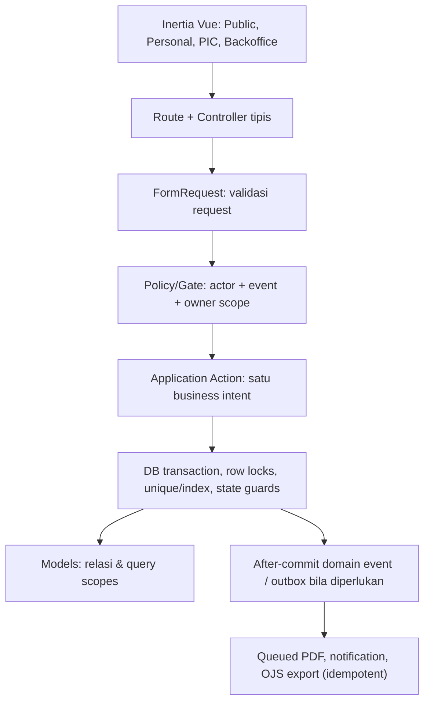
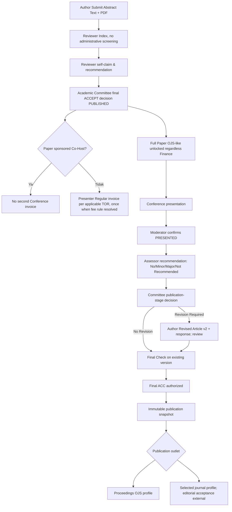
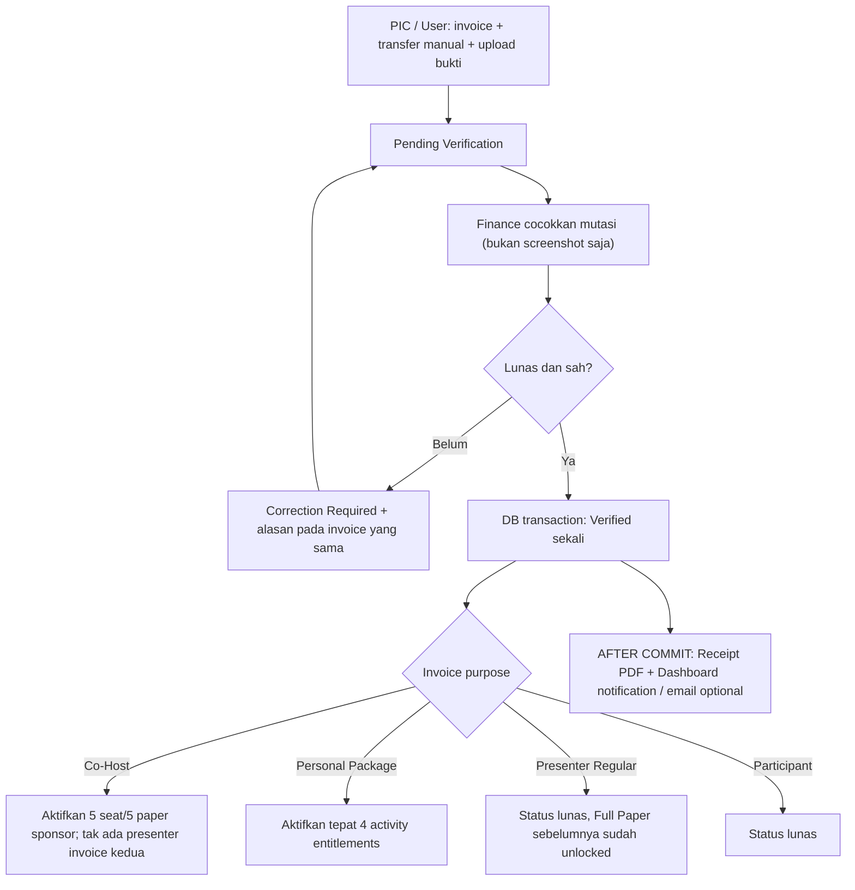

# 18C-02 — DRAFT Laravel Backend Architecture & Business Logic ICHES UNISYA 2027

> **HANDOFF LANJUTAN 27 OKTOBER 2026 (DRAFT):** [18C-03 Security Architecture](18C-03-DRAFT-AUTHENTICATION-RBAC-SECURITY-ARCHITECTURE.md) dan [18C-03A Permission Matrix + 52 UAT](18C-03A-DRAFT-PERMISSION-MATRIX-SECURITY-UAT.md) merinci session login, resource policies, event/institution/paper/finance scope, private file/download dan publication export. **Tidak mengubah 18C-02 menjadi final dan tidak mengotorisasi coding.**

> **27 Oktober 2026 · REKOMENDASI UNTUK REVIEW · BELUM FINAL · BELUM CODING.**
>
> **Latar keputusan:** pengguna menyatakan rancangan 18C-01 dan tambahan Full Paper/OJS secara garis besar sudah **OKE dan layak dilanjutkan**. Ini **persetujuan arah**, bukan penetapan 53 tabel fisik, MySQL/PostgreSQL, UUIDv7/BIGINT, jumlah reviewer, profil OJS maupun ketentuan refund sebagai FINAL.
>
> **Target:** rancangan backend Laravel 13 untuk satu ICHES 2027 web application, bukan integrasi nyata ataupun aplikasi yang berjalan. Tidak ada perubahan source, migration, deployment, pengujian, upload berkas atau transfer bank.
>
> **Rujukan keputusan baru:** [18C-01 ERD](18C-01-DRAFT-DATABASE-ARCHITECTURE-ERD.md) · [18C-01A Data Dictionary](18C-01A-DRAFT-DATA-DICTIONARY-CONSTRAINTS-MIGRATIONS-UAT.md) · [18C-01B Publication ERD Extension](18C-01B-DRAFT-FULLPAPER-PUBLICATION-ERD-DATA-DICTIONARY.md) · [18B-09 OJS-like Full Paper](18B-09-DRAFT-FULLPAPER-OJS-LIKE-POSTPRESENTATION-PUBLICATION.md) · [18B-06 Finance](18B-06-CRUD-FINANCE-INVOICE-PEMBAYARAN-VERIFIKASI.md) · [Register Keputusan](09-KEPUTUSAN-DAN-ISU-TERBUKA.md).
>
> **Rujukan repo lama sebagai acuan teknis, BUKAN aturan produk terbaru:** [Implementation Conventions](https://github.com/akhmadafnan/international-conference-platform/blob/develop/docs/architecture/IMPLEMENTATION_CONVENTIONS_V1.md) dan [Current State](https://github.com/akhmadafnan/international-conference-platform/blob/develop/docs/ai-context/CURRENT_STATE.md). Repo lama sudah mempunyai fondasi Laravel 13, Inertia Vue, MySQL, UUIDv7, Spatie roles/activitylog, auth dan Phase 02 Registration+Payment; **tidak berarti repo baru sudah menjalankan kode tersebut**, dan aturan lama Abstract Administrative Screening **tidak boleh dibawa kembali**.
>
> **Referensi framework terverifikasi:** [Laravel 13 Authorization](https://laravel.com/framework/docs/13.x/authorization), [Database Transactions](https://laravel.com/framework/docs/database), [Queues / afterCommit](https://laravel.com/framework/docs/queues).

## 1. Keputusan desain yang sudah dijadikan kebutuhan produk

| Area | Invariant bisnis **DITERIMA** | Jangan diterjemahkan keliru |
|---|---|---|
| Akun | **Satu akun**, dapat berperan sebagai presenter, PIC, anggota, reviewer, Finance, moderator dsb. | Tidak perlu akun Co-Host dan akun presenter terpisah |
| Abstract | **Text + PDF wajib; valid Submit langsung Reviewer Abstract Index**, self-claim reviewer lintas track tanpa admin screening; rekomendasi reviewer ≠ keputusan Komite | Jangan menyalin `ADMINISTRATIVE_SCREENING` repo lama |
| Full Paper | **Dibuka saat final ACCEPT dipublikasikan**, terlepas dari pembayaran; metadata/input menyerupai OJS dan berkas versioned | Jangan gate dengan Finance Verified |
| Post-event | Moderator mengonfirmasi **Presented**; assessor/reviewer penilaian artikel saat/pascaacara; **No Revision** tanpa upload ulang, **Revision Required** → versi baru → Final ACC berwenang | Presented, recommendation, Final ACC dan publikasi adalah status berbeda |
| Co-Host | **Satu invoice Rp3 juta per institusi** → Finance VERIFIED → fitur **5 anggota/5 paper Conference** aktif; lima paper sponsor **tidak pernah** ditagih presenter reguler lagi | Jangan mengeluarkan lima personal invoice |
| Paket | **Satu invoice pribadi Rp1 juta** → Finance VERIFIED → empat hak program aktif; PIC tidak memegang invoice pribadi anggota | Jangan memecah menjadi empat invoice |
| Bank | **Satu rekening resmi** diedit langsung Superadmin; transfer manual/bukti JPG, PNG, PDF; Finance cocokkan mutasi; WNA tarif internasional TOR bayar USD dan biaya transfer asing pada pengirim | Upload foto bukan Verified; jangan gateway/FX otomatis |
| QR | Satu QR personal lintas layanan; check-in layanan berbeda dari konfirmasi Presented; offline sync belum final | QR/token tidak otomatis memberikan hak |
| Sertifikat | Paper Presented membuat **semua listed authors eligible**, tetapi panitia **menerbitkan per individu atau batch** secara eksplisit | Jangan terbit otomatis setelah QR atau ACCEPT |
| Publikasi | OJS-style canonical metadata → Final ACC → frozen publication snapshot → Proceedings **atau** Journal terpilih; adapter OJS sesuai versi target | Jangan mengklaim Selected for Journal = Accepted by Journal atau XML universal |

**TOR** hanya menjanjikan tujuan luaran prosiding dan artikel terpilih ke jurnal; **10 pilihan jurnal adalah kebutuhan konfigurasi yang diajukan pengguna**, bukan daftar nama/angka yang ditemukan pada TOR. Panitia menentukan jurnal aktual.

## 2. Pendekatan: modular monolith, tanpa microservices

**Rekomendasi default untuk disetujui:** satu aplikasi Laravel + Inertia/Vue 3/TS dan satu database relasional, dengan batas domain jelas. Hindari repository abstraction berlapis, event bus eksternal, API microservices, dan queue infrastructure rumit sebelum perlu.



**Konvensi dari repo lama yang relevan:** `Route → Controller → FormRequest → Policy/Gate → Action → Model → Persistence/Audit`. Vue tidak memutuskan kebenaran Finance, academic review, kuota Co-Host, atau entitlement. Action bukan pembungkus kosong `Model::create`; khusus transaksi multi-record dan perubahan status penting.

**Yang belum final:** MySQL vs PostgreSQL dan PK BIGINT vs UUIDv7. Repo lama memakai MySQL + UUIDv7 yang telah diuji di repo lamanya; **saya merekomendasikan mempertimbangkan reuse** demi mengurangi risiko integrasi, tetapi tidak diam-diam memilihnya di schema baru. Laravel vendor packages, queue backend dan deployment environment perlu dicek saat implementation approval.

## 3. Struktur direktori Laravel yang diusulkan

```text
app/
  Actions/
    Identity/
    Conference/             # SubmitAbstract, ClaimReview, PublishAbstractDecision
    FullPaper/              # SubmitFullPaper, SubmitRevision
    Presentation/           # ConfirmPresented, SubmitPresentationAssessment
    Publication/            # FinalAcc, FinalizeSnapshot, SelectOutlet, GenerateOjsExport, RecordHandoff
    CoHost/                 # RegisterInstitution, ActivateSeats, LinkMember, SubmitSponsoredPaper
    Programs/               # PurchasePackage, ActivateEntitlements
    Finance/                # IssueInvoice, RecordBankCredit, VerifyPayment, RequestCorrection
    Operations/             # ConfirmCheckin, FulfillService
    Certificates/           # IssueBatch, ReissueCertificate
  Http/
    Controllers/            # Thin controllers grouped by web/backoffice/role
    Requests/               # One typed FormRequest per consequential action
  Models/                   # Current 18C-01/01B DRAFT entities, not yet created
  Policies/                 # Paper, Review, Invoice, CoHost, Package, Publication, Files, Certificates
  Enums/                    # Small backed enums in PHP when helpful; DB schema still flexible
  Events/                   # PublishedAccept, PaymentVerified, PresentedConfirmed, FinalAccGranted
  Jobs/                     # GenerateReceipt, SendNotice, BuildOjsExport, GenerateCertificates
  Support/
    ScholarlyMetadata/      # normalized locale/ORCID/author order/readiness
    Ojs/                    # destination-specific adapters + validators
    Files/                  # private storage, checksums, download authorization
    Audit/                  # typed audit helpers
resources/js/
  Pages/                    # Inertia route entries
  Features/                 # Conference, Finance, CoHost, Publication, QR
  Components/               # Shared primitives, separate from domain logic
tests/
  Feature/                  # API/HTTP authorization, lifecycle & cross-role flows
  Unit/                     # Data mapping, status, metadata readiness and validation
```

**Namespacing belum final.** Bisa gunakan `app/Domains/*` atau `app/Actions/*` menurut gaya implementasi yang disetujui. Pilih satu konsisten; **jangan membangun dua parallel architectures**.

## 4. Boundary per modul: owner data, Actions, otoritas

| Modul | Action penting (contoh nama) | Otoritas server, efeknya |
|---|---|---|
| **Identity/Settings** | `UpdateEventSettings`, `AssignScopedRole` | Superadmin/Admin berizin; PIC/Finance tidak boleh mengubah pengaturan global di luar scoped role |
| **Conference/Abstract** | `SaveAbstractDraft`, `SubmitAbstract`, `ClaimAbstractReview`, `SubmitAbstractReview`, `PublishAbstractDecision` | Text+PDF valid langsung index; claim reviewer atomic dan menolak review paper sendiri/coauthor; Komite publish ACCEPT |
| **Full Paper** | `SubmitFullPaper`, `CorrectScholarlyMetadata`, `UploadRevisedManuscript` | Published ACCEPT sudah cukup untuk buka Full Paper; canonical metadata dan file versi lama tidak ditimpa |
| **Presentation** | `SchedulePaper`, `ConfirmPresented`, `AssignPresentationAssessor`, `RecordAssessment` | Moderator menentukan Presented; assessor menilai, **tidak** memalsukan Presented/Finance |
| **Publication** | `DecideRevisionRequirement`, `GrantFinalAcc`, `EvaluateMetadataReadiness`, `SelectPublicationOutlet`, `FreezePublicationSnapshot`, `BuildOjsExportBatch`, `RecordHandoff` | Decision berwenang dan setelah Presented; jurnal/Proceedings hanya **destinasi**; status selected ≠ journal accepted |
| **Co-Host** | `CreateInstitutionRegistration`, `ManageFiveSeats`, `SubmitSponsoredPaper` | Gate invoice institusi VERIFIED; 5 seat; satu sponsor paper per seat; **bukan 5 invoice presenter** |
| **Package/Activities** | `PlacePackageOrder`, `ActivatePackageAccess` | 1 order personal + 1 invoice; 4 entitlement hanya setelah Finance VERIFIED |
| **Finance** | `IssueInvoice`, `SubmitProof`, `RecordBankCredit`, `VerifyInvoicePayment`, `RequirePaymentCorrection` | Finance verified berdasarkan mutasi bank; satu rekening resmi Superadmin; receipt sesudah verified |
| **QR/Service** | `IssuePersonalQr`, `ConfirmActivityCheckin`, `ConfirmServiceFulfillment` | Akses layanan diverifikasi server, idempotent per slot; offline pending != confirmed |
| **Certificates** | `PrepareEligibleAuthors`, `IssueCertificateBatch`, `ReissueCertificate` | Hanya setelah Presented dan aksi terotorisasi; semua penulis eligible |
| **Notifications** | `NotifyInvoiceIssued`, `NotifyCorrection`, `NotifyVerified`, `NotifyRevisionRequired` | Informasi sesuai source-of-truth; email gagal tidak mengubah state bisnis |

**Usulan penyederhanaan:** pada MVP jangan buat action terpisah untuk update field kecil biasa; CRUD umum cukup Controller+FormRequest+Policy, sedangkan bisnis konsekuensial gunakan Action transactional.

## 5. Diagram workflow core — satu tindakan lintas domain tidak mengacaukan fakta



**PENTING:** `NO_REVISION` dari assessor **bukan Final ACC otomatis**. `Revision Required` harus jadi keputusan resmi pihak berwenang; reviewer hanya merekomendasikan. Manuscript v1 tidak ditimpa saat membuat Revised v2. *Publication export* tidak terbuka sampai Presented + assessment + applicable revision resolved + Final ACC + readiness.

**Pendaftaran peserta/pembayaran** bukan gate untuk Abstract Submit dalam versi produk baru jika keputusan sebelumnya tidak memintanya; satu-satunya gate Co-Host adalah saat fitur sponsor dan package entitlement activated after Verified. Jangan menyalin gate bayar-dulu repo lama.

## 6. Kontrak server-side untuk perubahan penting

| Action | Preconditions | Atomic writes | Sesudah commit |
|---|---|---|---|
| `SubmitAbstract` | user dan author valid, text+PDF dan track/form valid | submitted_at, protected snapshot, file reference, status SUBMITTED | notifikasi reviewer index (jika dipilih) |
| `ClaimAbstractReview` | role reviewer, paper SUBMITTED, no author conflict, capacity rule **configurable** | claim once, reserve atomic slot | update inbox |
| `PublishAbstractDecision` | Academic Committee, keputusan final ACCEPT sudah diputuskan | publish timestamp, unlock via predicate, record decision; regular presenter invoice **hanya** sesuai aturan charge dan idempotency | LoA/notification job |
| `RegisterCoHost` | valid institute, event dan PIC | cohost reg + one institutional invoice | instruksi bayar |
| `ManageCoHostSeat` | institutional invoice VERIFIED, PIC scoped, 1..5 | occupy/replace seat under lock, avoid duplicate | invite member if policy allows |
| `OrderPackage` | logged user, package open, not duplicate | one order+one personal invoice | billing notice |
| `VerifyInvoicePayment` | Finance authorized, bank credit matched, amount sufficient (kebijakan pelunasan khusus masih pending) | invoice VERIFIED once, finance history, Co-Host/Package entitlement exactly once | payment receipt PDF + notifications; queued AFTER COMMIT |
| `SubmitFullPaper` | published ACCEPT, valid OJS-like metadata, file, ownership | metadata version, file FULL_ARTICLE version 1, status | dashboard/status |
| `ConfirmPresented` | authorized Moderator scoped session | presented_at, confirmed_by exactly once | unlock post-event assessment processing |
| `RecordPresentationAssessment` | assigned assessor/reviewer, paper/slot valid | scores/feedback/advisory recommendation | send to Committee when complete |
| `DecideRevision` | Committee auth + required assessments/presented | revision request or no-revision decision with reason and timestamps | author notification (if Revision Required) |
| `SubmitRevision` | active revision request, authorized corresponding/submitting author | new immutable paper file version + response; close/advance request | review inbox |
| `GrantFinalAcc` | Presented, assessment done, revisions resolved if any, publication integrity valid | Final ACC decision and selected final-file ref | readiness evaluation |
| `FreezePublicationSnapshot` | Final ACC + canonical metadata READY or allowed warning, target selected | snapshot version+checksum+final file, immutable | queue export eligibility |
| `BuildOjsExportBatch` | outlet OJS profile configured and target mapping valid | export batch+items+status and manifest ref | XML/file work in job; staging validation before claiming Ready-to-import |
| `RecordOjsHandoff` | snapshot/export validated, authorized Publication Team | target, refs, handed_off_by/time, downstream state | publication log, not automatic Accepted/PUBLISHED |
| `IssueCertificateBatch` | eligible authors from actually PRESENTED papers, staff issue explicitly | one certificate each intended recipient + batch history | PDF generation/QR verification |

**Idempotency** yang saya sarankan: `UNIQUE(invoice business source)`, `UNIQUE(cohost registration,seat)`, `UNIQUE(sponsor membership on paper)`, `UNIQUE(package_order,activity entitlement)`, `UNIQUE(receipt.invoice_id)`, `UNIQUE(certificate target/type or issuance intent)`, `UNIQUE(export batch+snapshot)`. Unique index DB dikombinasikan transaksi/lock; jangan hanya disable tombol UI.

**Fee unresolved:** presenter multi-paper, refund/top-up/overpayment/due date dan bank USD reconciliation tidak boleh diberi default bisnis baru hanya agar Action terlihat lengkap. Jika kategori tidak terdaftar di TOR, tampilkan needs-configuration, **jangan charge angka karangan**.

## 7. State machine per domain, jangan satu kolom status global

| Domain | Contoh state | Pemilik transisi |
|---|---|---|
| Abstract | DRAFT → SUBMITTED → UNDER_REVIEW → FINAL_DECISION → ACCEPT_PUBLISHED/OTHER | author, reviewer advisory, Academic Committee |
| Full Paper | LOCKED → OPEN → DRAFT → SUBMITTED_V1 → VERSIONED_CORRECTION | author sesuai published ACCEPT |
| Presentation | SCHEDULED → PRESENTED/NO_SHOW | moderator/session authority |
| Post-presentation | ASSESSMENT_PENDING → ASSESSED → NO_REVISION/REVISION_REQUIRED/NOT_RECOMMENDED | assessor recommendation; Committee decision |
| Revision | REQUESTED → AUTHOR_SUBMITTED_V2 → CHECKED → RESOLVED | author, reviewer/Committee |
| Publication | FINAL_ACC → METADATA_READY → SNAPSHOT_FROZEN → PROCEEDINGS/JOURNAL_HANDOFF → downstream status | Committee/Publication Team, OJS external editor |
| Finance | UNPAID → PENDING_VERIFICATION → CORRECTION_REQUIRED/VERIFIED | owner uploads; Finance verifies |
| Co-Host | REGISTERED_UNPAID → invoice VERIFIED → FIVE_SEATS_ENABLED | Finance-gated server predicate |
| Package | ORDER_UNPAID → invoice VERIFIED → FOUR_ENTITLEMENTS_ENABLED | Finance-gated server predicate |
| Certificates | ELIGIBLE → ISSUED (manual or batch) → REISSUED/REVOKED | authorized certificate staff |

Semua state dan transisi adalah **kontrak desain sementara**, bukan ENUM database final. Jangan buat `publication=accepted` hanya karena abstract accepted atau invoice paid. Tidak perlu user menghadapi status teknis belasan istilah; UI cukup memperlihatkan label operasional yang mudah dipahami.

## 8. Authorization: bukan hanya menus tersembunyi

| Actor | Boleh | Harus ditolak server |
|---|---|---|
| Superadmin | full event CRUD, **bank_settings langsung**, role assignment | Tidak ada approval dua lapis untuk rekening |
| Admin | CRUD agenda/track/deadline/outlet pada permission yang diberikan | Tidak otomatis mengubah Finance Verified/presented/history |
| Co-Host PIC | own institutional invoice, paid-gated roster 1..5, paper sponsor status yang sah | Invoice pribadi member atau milik institusi lain |
| User/Author | own invoice, own draft, own full paper setelah published ACCEPT, revisi saat request | Read/modify paper user lain dan reviewer private notes |
| Reviewer Abstract | claim eligible abstract, submit recommendation | Self/coauthor claim, Final ACCEPT publish |
| Reviewer/Assessor Presentation | assigned presentation assessment | Mengubah Moderator Presented, Final ACC, Finance |
| Academic/Publication Committee | publish academic decision, revision decision, Final ACC | Mutasi rekening/verified Finance |
| Finance | match bank credit, verify/correct invoices, receipt record | Write academic decision, approve paper published |
| Moderator | schedule-scope confirm Presented | Auto-generate published certificates |
| Publication Team | outlet/profile, snapshot/export/handoff | Claim jurnal menerima paper tanpa downstream evidence |
| Scanner | authorized check-in/service per scope | Mengambil hak di luar aktivitas/jadwal/layanan |
| Public | limited event info, verify certificate token | Bukti bank, email author, reviewer comments, QR raw token |

**Disarankan Laravel Policy per resource plus Gate for coarse abilities**, dan check `event_id`, owner, institution scope, author membership, role assignment **di backend pada setiap request/attachment download**, bukan hanya menu Vue. Reviewer paper juga wajib COI dengan listed authors; jika coauthor tanpa akun, perbandingan email/identitas yang bisa diketahui perlu verifikasi agar tidak lolos karena user_id null.

## 9. Upload, canonical scholarly metadata, versioning & ekspor OJS

**File & metadata authority:**
- `paper_files` dan private `stored_files`: Abstract PDF, Full Article v1, Revised Article v2, response to reviewers, final manuscript, supplement jika diizinkan; setiap versi punya immutable path, file type, checksum, uploader, timestamp.
- `paper_authors` + `author_affiliations`, `paper_translations`, `paper_keywords`, `paper_references`: canonical metadata, **bukan** kolom XML khusus OJS yang mencemari database.
- ORCID opsional dan tervalidasi bila diisi; mononim didukung; ROR opsional, struktur afiliasi organisasi dipisah dari fakultas; coauthor tanpa akun tetap valid.
- Freeze `publication_snapshots` setelah Final ACC & readiness; profile edit di kemudian hari **tidak** mengubah data yang sudah diekspor.
- `publication_outlets`: default proceedings dan **hingga sepuluh calon jurnal** yang dapat diisi Admin dengan informasi benar serta status kerja sama; tidak membuat daftar jurnal fiktif.
- `publication_export_batches/items/handoffs`: satu target outlet + OJS profile version per batch; berkas/XML dari adapter target, manifest+errors, review hasil import pada staging.
- Native XML OJS **tidak dijamin universal**; bila profil target tidak didukung, sediakan metadata JSON/CSV dan dokumen final untuk assisted/manual handoff, **tidak dilabel ready-to-import**.

**Rekomendasi adapter:**
```text
CanonicalPublicationSnapshot (immutable)
    -> PublicationReadinessValidator (READY/WARNING/BLOCKED)
    -> OjsTargetProfile (version, context, locale, section, file genre)
    -> AdapterInterface (per supported OJS family)
    -> XML+file package builder
    -> version-specific XSD validation
    -> staging import verification (manual evidence)
    -> authorized handoff record
```

**Review notes rahasia, bank, QR, skor presentasi, daftar hak fasilitas tidak ikut diekspor.** `SELECTED_FOR_JOURNAL` bukan `ACCEPTED_BY_JOURNAL`. OJS/Publisher mengatur downstream editorial acceptance, DOI, Crossref dan PUBLISHED.

## 10. Finance & entitlement: transaksi server yang sangat sederhana



Tidak ada gateway, automated FX, multi-approval rekening, atau integrasi perbankan. Invoice satu rekening Superadmin, currency snapshot (USD sesuai TOR untuk kategori internasional, Co-Host/Paket IDR). **Terkait refund, underpayment, surplus dan deadline, gunakan draft 18B-07A sebagai opsi untuk disepakati kelak**, bukan hardcoded otomatis.

**Penerimaan bank** dan penerbitan receipt harus idempotent; bila PDF/email gagal, transaksi Verified dan hak peserta tetap sah, lalu job dapat diulang aman. Laravel mendukung `DB::transaction` dan job `afterCommit` untuk mencegah job mengakses data yang belum committed.

## 11. Event, queue dan reliabilitas (MVP ringan)

| Peristiwa durable | Tindakan in-transaction | AfterCommit / async idempotent |
|---|---|---|
| Abstract ACCEPT published | Update decision + published_at; gate Full Paper via status | LoA/author notification |
| Invoice Issued | Insert satu invoice snapshot | In-app notice dan email bila siap |
| Proof Submitted | Insert file/record, status Pending | Notifikasi Finance queue |
| Payment Verified | Finance history + invoice VERIFIED + entitlements source of truth | Payment Receipt PDF/email/dashboard notification |
| Presented Confirmed | Mark moderator confirmation | Alert assessor jika dibutuhkan |
| Revision Required | Publish request author + linked current version | Notifikasi author |
| Final ACC | Record ACC and current final version | Publication readiness checks |
| Snapshot Frozen | Immutable scholarly snapshot | Prepare export eligible listing |
| Export Batch Created | Batch+items+target version | Build XML/files and validation (retry-safe) |
| Certificate Batch Issued | Record issued recipients once | PDF build/notification; retry-safe |

**Pilihan queue:** database queue Laravel untuk MVP jika volume kecil (usulan, perlu verifikasi deployment), Redis bisa dipilih jika infrastruktur ada. Jangan wajibkan Horizon, Kafka, RabbitMQ atau paid provider sejak awal. Email provider belum dipilih. Gunakan after-commit event dispatch dan idempotent job; histori proses penting tetap ada di tabel domain, bukan hanya di log queue yang mungkin dibersihkan.

## 12. Pemetaan route & Inertia UI (hanya daftar endpoint konseptual)

| UI / Area | Aksi server (verb konseptual) | Batas |
|---|---|---|
| `/dashboard/papers` | List own papers, save draft, submit abstract | Actor+owner scope |
| `/dashboard/papers/{paper}/full-paper` | Read/prefill scholarly metadata, submit full article, see versions | Published ACCEPT; **tidak cek Finance gate** |
| `/dashboard/papers/{paper}/revision` | Download reviewer instructions, upload v2+response | Hanya ketika Revision Required |
| `/dashboard/payments` | Own invoice, copy bank details, upload proof, receipt after Verified | Personal invoices only |
| `/institution/cohost` | Own institutional invoice, roster after Verified | PIC scoped; private member invoices never visible |
| `/backoffice/reviewer/abstract-index` | Browse across tracks, claim, review | COI/claim gate |
| `/backoffice/academic/decisions` | Publish ACCEPT and decisions | Committee only |
| `/backoffice/sessions` | CRUD schedule, Moderator Presented | Scoped session staff |
| `/backoffice/presentation-assessments` | Assigned assessments, notes, recommendations | Assessor and Publication/Academic Committee appropriately |
| `/backoffice/publication` | Final ACC, readiness, outlets, export batches, handoffs | Publication Team / Committee scoped |
| `/backoffice/finance` | Bank credit matches, verify/correction, reports | Finance permission; bank setting Superadmin only |
| `/scanner` | Check-in/fulfillment based on QR and service scope | Scanner Operator |
| `/verify/certificates/{token}` | Public certificate validity | No sensitive data |

**Nama URL bukan keputusan API final.** Inertia handles normal web UI; server can add narrow JSON APIs specifically for scanner sync/export if required, but avoid duplicate REST-only frontend architecture. Document upload uses validation, mime sniffing, size limits configured, private storage, and signed short-lived download URLs **only** after resource policy passes.

## 13. Planned tests and UAT — 40 skenario, BELUM DIEKSEKUSI

| ID | Test intent | Harus terbukti |
|---|---|---|
| BE-01 | Abstract valid Text+PDF | Submit muncul langsung Reviewer Index, no screening |
| BE-02 | Abstract tanpa PDF | Tidak Submitted |
| BE-03 | Reviewer dari track lain claim | Sah jika authorization, no COI dan slot cukup |
| BE-04 | Reviewer author/coauthor claim | Ditolak |
| BE-05 | Dua reviewer claim slot terakhir concurrently | Tidak oversubscribed |
| BE-06 | Reviewer recommend ACCEPT | Tidak membuka Full Paper |
| BE-07 | Committee internal ACCEPT belum publish | Tidak unlock/invoice |
| BE-08 | Committee publishes ACCEPT regular | Full Paper unlock dan presenter invoice sekali sesuai tarif yang berlaku |
| BE-09 | Regular presenter invoice Unpaid | Full Paper tetap terbuka |
| BE-10 | Co-Host paper ACCEPT | Tidak membuat presenter invoice kedua |
| BE-11 | Co-Host belum verified membuat seat | Ditolak |
| BE-12 | Co-Host VERIFIED | Bisa memakai maksimal 5 seat |
| BE-13 | Double-click seat sama | Hanya satu seat aktif |
| BE-14 | Member sponsor submit dua paper | Kedua ditolak kecuali satu yang pertama |
| BE-15 | Coauthor sponsor bukan member | Tidak menghabiskan seat |
| BE-16 | Paket pribadi order double-click | Satu invoice dan satu order |
| BE-17 | Paket hanya proof Pending | Empat hak masih terkunci |
| BE-18 | Paket Verified | Empat hak tepat sekali |
| BE-19 | Retry Finance Verified | Tidak menggandakan receipt, entitlement atau invoice |
| BE-20 | Proof JPG/PDF file invalid | Tolak payload sesuai validasi |
| BE-21 | PIC download invoice user member | 403 |
| BE-22 | Reviewer download bank proof | 403 |
| BE-23 | Moderator confirms Presented | Status event terpisah dari attendance |
| BE-24 | QR attendance without Moderator | Tidak mark paper Presented |
| BE-25 | Assessor recommendation NO_REVISION | Dapat final check tanpa upload ulang |
| BE-26 | Assessor recommendation MINOR/MAJOR | Tidak otomatis membuat Final ACC |
| BE-27 | Committee Revision Required | Author bisa lihat alasan dan upload versi revisi |
| BE-28 | Author Revised Article v2 | V1 tetap immutable |
| BE-29 | Wrong author uploads v2 | 403 |
| BE-30 | Committee Final ACC tanpa Presented/assessment sah | Ditolak kecuali exception resmi yang disetujui |
| BE-31 | Missing scholarly required field | Readiness BLOCKED dengan alasan |
| BE-32 | ORCID kosong tapi optional | WARNING, bukan BLOCKED |
| BE-33 | User profile diubah setelah snapshot | Publication snapshot tidak berubah |
| BE-34 | Selected Journal (dari pilihan Admin) | Bukan status accepted by journal |
| BE-35 | OJS profile version mismatch | Cannot label Ready-to-import |
| BE-36 | XML export validation/staging fail | Status ERROR, tidak di-handoff sebagai compatible |
| BE-37 | Export retry same batch | Manifest/row tidak duplikat |
| BE-38 | Certificate author Presented semua eligible | Tidak otomatis issued tanpa staff |
| BE-39 | Staff batch issue certificate | Satu nomor per intended author, verifikasi publik valid |
| BE-40 | Bank Superadmin update | Tidak butuh dual approval, Finance non-superadmin tidak punya hak |

Test ini **rencana**. Tidak ada PHPUnit/Pest dijalankan, tidak ada UAT staging OJS, tidak ada integrasi bank, tidak ada data peserta produksi yang diakses.

## 14. Urutan implementasi vertikal **USULAN**, belum ada GO untuk coding

| Slice | Prioritas | Kenapa dikerjakan pada urutan itu |
|---|---|---|
| **S0 Foundation** | Pertama | Pilih DB engine/PK, auth/role policies, event scope, storage privat; evaluasi reuse source lama tanpa memaksakan workflow lama |
| **S1 Conference Abstract** | Kedua | Submit Text+PDF valid tanpa screening, reviewer claim, keputusan ACCEPT dipublikasikan |
| **S2 Co-Host/Finance/Paket** | Ketiga | Gate Verified, invoice tunggal, 5 seat/paper sponsor, empat entitlement paket |
| **S3 Full Paper OJS-like** | Keempat | Metadata canonical prefill, author affiliation, references, file versions |
| **S4 Session/Assessment/Revision** | Kelima | Moderator Presented, penilaian dan revisi bersyarat sampai Final ACC |
| **S5 Publication OJS & Journal** | Keenam | Outlet settings, freeze snapshot, OJS-adapter profile/validation, assisted handoff |
| **S6 QR, Certificate, End-to-End** | Ketujuh | Check-in/fulfillment, sertifikat per author batch, reports dan simulasi menyeluruh |

Ini urutan modul prioritas, **bukan estimasi tanggal/waktu**. Ketergantungan antar-slice dapat diuji dengan fixture/fake sehingga tim bisa menyiapkan frontend secara paralel. Belum membuat issue/sprint/branch/coding.

## 15. Hal terbuka yang tidak saya jadikan aturan palsu

1. **DB engine** MySQL vs PostgreSQL, PK UUIDv7/BIGINT/ULID; repo lama MySQL+UUIDv7 sudah memiliki implementasi tetapi repo baru belum. Pertimbangkan reuse setelah product rebaseline.
2. **Reviewer count/assessment assessor count**, kriteria scoring, apakah reviewer presentasi sama dengan reviewer abstrak, dan batas putaran revisi.
3. **File wajib Full Paper (DOCX/PDF/ODT)**, template, ukuran maksimum, supplementary, author consent, tenggat revisi.
4. **Daftar 10 jurnal sebenarnya**, konfirmasi kemitraan, scope, alur editorial dan versi OJS masing-masing; target OJS Proceedings & section/locale mapping.
5. **Refund/top-up/surplus/tenggat**, kebijakan presenter multi-paper, kategori tidak tercantum TOR; bank/SWIFT nyata dan USD incoming.
6. **Mode scanner offline** native/PWA dan strategi konflik serta server synchronization.
7. **Kebijakan pemindahan naskah** antara proceedings/jurnal setelah ditolak, risiko publikasi ganda, dan syarat persetujuan penulis.
8. **Menyederhanakan 38+15 kandidat tabel** sebelum migration; schema tidak otomatis menjadi 53 tabel.
9. **Deployment/SMTP/queue/storage/OJS staging**, semua ditentukan saat implementation readiness.

## 16. Review Gate 18C-02 dan tahap berikutnya

**Keputusan arah yang sudah diterima:** struktur ICHES sebagai satu aplikasi, abstract tetap alur lama yang baru disepakati, Full Paper metadata ala OJS, assessment pasca-Presented dengan revisi bila diperlukan, export/handoff Proceedings maupun jurnal sebagai target, Finance dan Co-Host sederhana.

**Rekomendasi teknis tahap ini yang masih DRAFT:** pola Action/Policy, struktur folder, daftar endpoints, pendekatan idempotency/event/queue, pemetaan domain dan *implementation slices*. **Tidak otomatis disahkan** sampai pengguna menerima/revisi.

**Berikutnya bila disetujui:** **18C-03 — Authentication, Role Permissions, Security & Publication/Finance Privacy** atau jika pengguna ingin penghematan waktu **implementation readiness review** untuk memilih DB engine/PK dan menyederhanakan tabel sebelum migration. Dalam kedua kasus **coding tetap memerlukan GO eksplisit**.

---

[18C-01 Database DRAFT](18C-01-DRAFT-DATABASE-ARCHITECTURE-ERD.md) · [18C-01B Publication DRAFT](18C-01B-DRAFT-FULLPAPER-PUBLICATION-ERD-DATA-DICTIONARY.md) · [Register](09-KEPUTUSAN-DAN-ISU-TERBUKA.md) · [README](../README.md).
