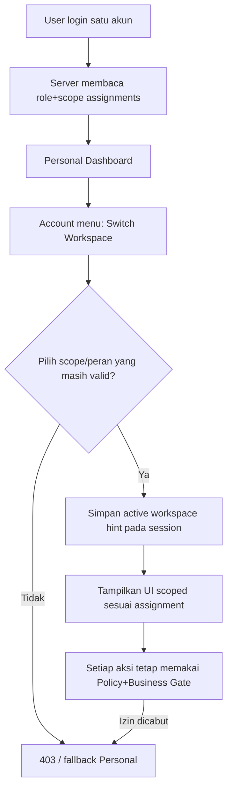

# 18C-03B — DRAFT Switch Role / Workspace & Switch User (Admin Support)

> **STATUS PEMBARUAN 28 OKTOBER 2026:** pemilik produk menjawab **“saya setujui”** terhadap ringkasan usulan 18C-03B. **Arah Switch Workspace/Role (akun sendiri) dan Superadmin View as User read-only diterima untuk rancangan**. **Belum ada izin full impersonation/mutation**, delegasi ke Admin biasa, pemilihan TTL support mode, atau implementasi aplikasi. Frontend terinci di [18C-04](18C-04-DRAFT-FRONTEND-DASHBOARD-ARCHITECTURE-UX.md) dan [18C-04A](18C-04A-DRAFT-SCREEN-INVENTORY-COMPONENTS-INTERACTION-UAT.md).

> **28 Oktober 2026 — TAMBAHAN PERMINTAAN PEMILIK PRODUK · DRAFT UNTUK REVIEW · BUKAN CODING.**
>
> **Masukan user:** “Kan setiap user bisa memiliki role berbagai macam, nanti tolong dibantu pada tampilan backend admin ada fitur switch akun. sehingga mempermudah nantinya.”
>
> **Interpretasi desain yang direkomendasikan, untuk dikoreksi jika maksud berbeda:** (A) **Switch Role/Workspace** bagi satu orang dengan beberapa peran; (B) **Switch User / View as User** sebagai alat bantuan dan simulasi khusus Admin yang memang diberi izin. Keduanya tampil dari konteks Admin tanpa membuat akun ganda. **Fitur A merupakan makna yang paling dekat dengan alasan ‘setiap user bisa memiliki role berbagai macam’. Fitur B adalah opsi tambahan yang perlu penegasan kewenangan sebelum diimplementasikan.**
>
> **Status:** permintaan UX agar ada *switch akun* **DITERIMA sebagai requirement**, detail implementasi dua mode, mode impersonation, dan batas kewenangan masih **REKOMENDASI, BELUM FINAL**.
>
> [18C-03 Security](18C-03-DRAFT-AUTHENTICATION-RBAC-SECURITY-ARCHITECTURE.md) · [18C-03A Permission Matrix](18C-03A-DRAFT-PERMISSION-MATRIX-SECURITY-UAT.md) · [18A Role & Navigation](18A-ROLE-PERMISSION-DAN-NAVIGASI-BACKOFFICE.md) · [18C-02 Laravel Backend](18C-02-DRAFT-LARAVEL-BACKEND-ARCHITECTURE-BUSINESS-LOGIC.md) · [Register Keputusan](09-KEPUTUSAN-DAN-ISU-TERBUKA.md).

## 1. Dua kebutuhan yang sebaiknya diberi nama berbeda

| Fitur | Siapa | Apa yang terjadi | Apa yang TIDAK terjadi |
|---|---|---|---|
| **Switch Role / Workspace (utama)** | Semua user yang memiliki lebih dari satu ruang kerja/peran | Memilih Personal, Admin, Reviewer, Moderator, Finance, Publication atau Institution Workspace dari akun sendiri | **Tidak logout, tidak mengganti user_id, tidak menambah role atau memperoleh hak baru** |
| **Switch User / View as User (opsi Admin)** | Superadmin secara bawaan; Event Admin **hanya bila diberi izin khusus** (usulan, bukan keputusan) | Membuka **pratinjau aman** tampilan akun peserta/author/PIC/reviewer tertentu untuk membantu dukungan atau simulasi | **Bukan** login memakai password user, bukan pemberian peran sementara, **bukan** akses transaksi sensitif untuk bertindak atas nama user |

**Keputusan bisnis tidak berubah:** satu User multi-role; Co-Host Rp3 juta institusi dan 5 seat baru aktif setelah Finance VERIFIED; lima paper sponsor tak menerima invoice presenter kedua; Paket Rp1 juta pribadi, 4 entitlement setelah Verified; Full Paper setelah Published ACCEPT tanpa Finance gate; reviewer hanya recommendation, Committee menentukan ACCEPT/Final ACC, Moderator menentukan Presented, Finance menentukan Verified.

**Prinsip:** Beralih workspace **tidak boleh menjadi mekanisme role escalation**. Switch User harus diperlakukan sebagai kemampuan privileged support/impersonation, bukan tombol yang tersedia untuk seluruh Admin tanpa pembatasan.

## 2. Rancangan UI — satu dropdown yang mudah dipahami

### A. Header setiap Dashboard (multi-role account)

~~~text
HEADER — ICHES 2027
[ICHES]                            [Notifications] [Avatar / Account ▾]

ACCOUNT MENU
  Signed in as: user@institution.example

  SWITCH WORKSPACE
  ✓ Admin Backoffice
    Personal Dashboard
    Reviewer Workspace                   [jika role Reviewer eligible]
    Moderator Sessions                   [jika assigned]
    Institution Workspace — Institution A [jika PIC scoped]
    Finance                              [jika role Finance]
    Publication Workspace                [jika role Publication]

  Switch User / View As User              [HANYA jika privilege support]
  My Profile
  Logout
~~~

Workspace dipilih melalui daftar yang **dibuat server** berdasarkan assigned role/scope + event dan status account; label tidak berasal dari text yang bisa dikirim frontend. Jika satu orang PIC di dua institusi yang memang berizin, tampilkan dua pilihan dengan nama institusi dan indikator event. Jika suatu assignment dicabut, entri hilang dan active workspace fallback ke Personal; request berikutnya harus tetap ditolak jika sudah tak berizin.

**Rekomendasi:** pada desktop pemilih ada di avatar kanan atas + badge kecil konteks aktif; pada mobile ada di area akun sidebar. Tidak perlu membuat login ulang, menambahkan tab sebanyak semua role, atau mengkloning account. **Jangan menampilkan role sensitif kepada publik**.

### B. Admin → Users & Roles → View As User (jika opsi B disetujui)

~~~text
BACKOFFICE / USERS & ROLES
Search name / email ...   [role] [event] [status]

Name          Account status      Assigned Roles           Action
User A        Active              Author                   [View as User]
User B        Active              PIC Co-Host + Reviewer   [View as User]
User C        Active              Participant              [View as User]

ADMIN SUPPORT VIEW
Target: User B
Purpose: [Select support reason or write explanation] [START VIEW]

BANNER DURING VIEW:
  Viewing as User B · Support Read-only · [Exit & Return to Admin]

VISIBLE:
  Dashboard overview, navigation & eligibility labels, user-facing status
PROTECTED:
  No Finance Verified / bank settings / ACCEPT / Presented / Final ACC /
  certificate publish / refund / OJS export or any destructive state change
~~~

**Wajib ada ‘Exit / Return’ yang jelas** pada seluruh halaman, berbeda warna/teks dari mode normal. Jika admin beralih ke halaman sensitif, tampilkan info “Aksi tidak tersedia dalam mode bantuan” alih-alih diam-diam melakukan aksi atas nama user. Masuk ulang ke mode sendiri ketika time-limit terlampaui.

## 3. Switch Role/Workspace — alur tanpa impersonation

**Implementasi DRAFT yang aman:**
- \`users.id\` **tetap sama** untuk role switch. \`active_workspace\` hanyalah preferensi sesi/antarmuka, **bukan penyimpan hak**.
- Target workspace yang bisa dipilih berasal dari role assignments **saat ini**, bukan input role string dari browser.
- Backend memeriksa **actor + action + event + record ownership + business state** pada setiap request, bahkan jika UI salah menampilkan menu.
- Staff yang merangkap reviewer dan author tidak boleh me-review paper sendiri; switching tidak menghapus COI.
- Staff yang merangkap PIC Co-Host dan purchaser Paket pribadi: Institution Workspace **tidak** memperlihatkan invoice pribadi anggota/PIC yang bukan kewajiban institusi. **Paket pribadi PIC sendiri** tampil pada Personal Dashboard.
- Role assignment dibatalkan oleh Admin → opsi hilang. Bahkan bila masih ada tab lama, request disaring backend.
- Event edition future-proof: workspace membawa konteks event terpercaya; tidak menjadi akses event lain.

## 4. Switch User / View as User — desain aman, bukan login sebagai user sungguhan

**Default usulan:** **read-only support preview**, bukan impersonation penuh yang dapat melakukan pembayaran, upload naskah, menilai reviewer, atau mengekspor file. Alasan: kebutuhan “mempermudah” dapat dicapai dengan menguji navigasi dan status tanpa mempertaruhkan integritas akademik/keuangan.

**Syarat sebelum memulai (DRAFT):**
1. Petugas benar-benar punya \`support.view_as_user\` privilege eksplisit (usulan bawaan **Superadmin** saja; delegasi ke Event Admin perlu keputusan); **tidak** terbuka untuk setiap Admin.
2. Petugas yang masuk punya session aktif dan menjalani re-auth/step-up bila kebijakan staff sensitive disetujui; target **active account**, terdaftar dalam event/scope yang boleh didukung petugas.
3. Berikan **reason** yang wajib (contoh: simulasi dashboard, bantu peserta menemukan menu, pemecahan masalah peran).
4. Session view bersifat **singkat, scoped**, dengan waktu berakhir configurable; contoh \`15 menit\` untuk diskusi, **belum angka yang disetujui**. Cegah *nested impersonation* dan privilege switch pada target staf istimewa.
5. Jangan memegang password, OTP, token recovery, atau QR secret target.

**Sesi view harus menyimpan dua identitas yang berbeda dan tidak menyembunyikan siapa aktor sebenarnya:**
- \`real_actor_id\`: admin yang sudah terautentikasi.
- \`view_target_user_id\`: user yang tampilannya disimulasikan.
- \`mode=support_readonly\`: preview, tidak ada pergantian \`Auth::user()\` biasa secara diam-diam.
- \`reason\`, \`started_at\`, \`expires_at\`, \`ended_at\`, \`event_scope\`, \`session_binding\`.

**Desain implementation recommendation:** gunakan **separate view-context** pada backend, bukan mengganti principal utama Auth menjadi target untuk request yang dapat mengubah database. Server mengambil projection Dashboard yang diizinkan untuk target sebagai **data preview**, tetap mengaudit admin asli. Jika library impersonation tersedia, harus dinilai terhadap model dua identitas dan denylist tindakan sensitif; jangan langsung memasang plugin tanpa audit.

**Tidak boleh dalam Support View (deny by default):**
- Create/update/delete submission, abstract, Full Paper, revision file, author metadata atau upload proof (semua mutasi).
- Finance Verify, Correction Required, refund, bank settings, tarif, role assignment.
- Reviewer claim/recommendation, Academic Committee publish ACCEPT, Moderator Presented, assessor decision, Publication Final ACC, selected journal, OJS export/handoff.
- QR service fulfill/check-in, certificate batch issue/reissue/revoke.
- Download file sensitif seperti bukti bank, invoice file berisi data pengirim, private fullpaper/reviewer notes, OJS confidential export. **Daftar status dan metadata minimum saja** untuk dukungan.
- Mengubah password/email/MFA target, mengunduh personal QR token, membuat API token atau reset token.
- Beralih dari support preview ke Admin Backoffice milik target (khususnya target Finance/Superadmin) atau memulai support view bertingkat.

**Jika nantinya panitia benar-benar membutuhkan “Act as User” yang bisa mengubah data:** itu **fitur berbeda yang harus mendapat approval terpisah** beserta *allowlist* tindakan tidak sensitif, actor attribution, pemberitahuan/audit, dan mekanisme pembatalan yang jelas. **Jangan menyamakan support-readonly dengan sesi admin yang berubah menjadi user lain.**

## 5. Route/policy proposal

| Endpoint konseptual (belum tersedia) | Auth & check | Efek |
|---|---|---|
| \`GET /me/workspaces\` | Auth + role/scoped assignments | Daftar workspace yang boleh dipilih user |
| \`POST /me/active-workspace\` | Auth + confirm selected assignment/event scope | Update preference session saja, **user id tetap** |
| \`GET /backoffice/users\` | Assigned Admin/User Management permission | Cari peserta yang ada dalam event scope |
| \`POST /backoffice/support-view/start\` | **support.view_as_user** + scoped target + required reason + no nested view | Record audit support session; restricted read-only projection |
| \`GET /backoffice/support-view/{context}/dashboard\` | Actor+context+target+expiry+scope | Preview minimal subject data, no direct private files |
| \`POST /backoffice/support-view/stop\` | Actor = original real_actor | End audit; return own Admin UI |
| \`POST/PUT/PATCH/DELETE\` pada target under view | Global \`deny_on_support_view\` | **403**; tidak ada perubahan data |

**Jangan hanya mengganti user pada frontend Vue dan mengirim request ke personal routes dengan user_id target:** hal itu mengundang IDOR dan permission escalation. Laravel Policies dan middleware tetap authoritative. Metode server harus memeriksa session/CSRF dan meregenerasi session identifier bila transisi konteks privileged memungkinkan session fixation. [Laravel 13 session regeneration](https://laravel.com/framework/docs/session/config) dan [authorization policies](https://laravel.com/framework/docs/13.x/authorization).

## 6. Ancaman khusus dan kontrol

| Ancaman | Mitigasi yang direkomendasikan |
|---|---|
| Admin support menyamar sebagai peserta dan mengirim data | Read-only projection + deny all write routes; bukan \`Auth::login($target)\` |
| Admin berpindah ke Superadmin/Finance target lalu mendapat hak finansial | Target staff privileged dilarang secara default, target role tidak pernah menjadi permission actor |
| Bug cache role/event setelah Switch Workspace | Role scope dicek pada tiap request; invalidasi preference bila assignment dicabut |
| Session view tanpa batas | Expiry berjangka pendek, explicit exit, no nested view, session binding |
| Admin melihat file bank/akademik reviewer tanpa alasan | Minimal preview redaction; file download endpoints tetap memakai original actor dan policy |
| Dukungan memakai identitas user asli secara tersembunyi | Real actor & target selalu ditampilkan di banner dan audit |
| Admin membaca data seluruh event lain | Cek event scope + target membership sebelum view |
| Banyak user admin memakai akun bersama | Akun admin individu, alasan wajib, audit event start/stop |
| Notifikasi dan email terkirim atas aksi yang tidak dilakukan user | Tidak ada writes in view, jadi tidak ada business event |

**Audit event yang disarankan:** \`support_view.started\`, \`support_view.ended\`, \`support_view.expired\`, \`support_view.denied\`, actor id, target id, event scope, reason, timestamps, request id, tanpa password/raw token/file pribadi. Log support tidak boleh dianggap consent user terhadap perubahan finansial/akademik.

## 7. Data model minimal (belum migration)

**Switch Role/Workspace** tidak perlu tabel baru: simpan \`active_workspace_id/role_key\` sebagai *session preference*, dihitung ulang dari role assignments. Jika pengguna lebih suka last-used persisted preference, opsional kolom profil yang tidak memberi hak baru.

**Support Read-only View** disarankan punya catatan **\`admin_support_sessions\` (opsional satu tabel audit)**:
\`id\`, \`real_actor_user_id\`, \`target_user_id\`, \`event_id\`, \`reason\`, \`mode\`, \`started_at\`, \`expires_at\`, \`ended_at\`, \`end_reason\`, \`session_hash\`.
Cukup satu tabel, bukan role baru per user dan bukan tabel untuk setiap workspace. Record tidak berisi kredensial target.

**Jika audit log existing dapat menampung tipe session events dengan integritas yang sama**, tabel khusus ini bisa dihilangkan. **Tidak menambah otomatis 53 kandidat tabel** pada ERD 18C-01B sebelum user memilih rancangan.

## 8. Integrasi ke Tahap 18C-04 (Front-end Architecture)

| Area UI | Tampilan/interaction yang harus masuk rancangan |
|---|---|
| **Admin topbar** | Avatar → Account Menu → Switch Workspace, active context label dan shortcut kembali |
| **Personal Dashboard** | Jika satu orang juga staff/PIC: avatar dropdown menunjukkan Admin/Institution/Reviewer options |
| **Institution Workspace** | Identitas institusi jelas, pilih antara institusi yang benar-benar ditugaskan; bukan mengedit ID di URL |
| **User Management Backoffice** | Opsional View as User untuk Superadmin (dengan reason modal dan read-only banner) |
| **Support View layout** | Banner persistent nama target + real actor, warna pembeda, expiry, tombol Exit; tombol aksi mutasi hilang dan route juga ditolak |
| **Mobile** | Switch Workspace di sheet/menu akun; Support View tetap read-only dengan banner |
| **Help text** | “Beralih Workspace” = masih akun Anda. “Lihat sebagai User” = dukungan petugas, bukan penggantian kepemilikan data |

**Gunakan Inter/Sora, ivory #F7F6F1, forest #164734, dark #17211C, gold #B79A5B, shadcn-vue, Lucide**, sesuai identitas frontend ICHES. Jangan membuat dua dashboard berbeda untuk satu role dengan username/password masing-masing.

## 9. UAT rancangan — 22 skenario baru, belum dites

| ID | Kondisi | Expected |
|---|---|---|
| SW-01 | User hanya peserta | Hanya Personal Workspace |
| SW-02 | User juga Reviewer | Personal + Reviewer options |
| SW-03 | User juga PIC institusi A | Institution A muncul, institusi B tidak |
| SW-04 | Satu user PIC A dan PIC B (jika benar di-assign) | Bisa pilih masing-masing scope yang sah |
| SW-05 | Pilih Reviewer Workspace | \`user_id\` tetap sama, tidak login ulang |
| SW-06 | Role Reviewer dicabut saat workspace aktif | Request berikutnya ditolak, menu fallback Personal |
| SW-07 | User memanipulasi workspace id menjadi role Finance | Tidak memperoleh Finance access |
| SW-08 | Reviewer juga author menilai paper miliknya sendiri | COI tetap ditolak meskipun ganti workspace |
| SW-09 | PIC menampilkan Paket pribadi anggota | Tetap tidak tersedia di Institution Workspace |
| SW-10 | PIC sendiri membeli Paket personal | Hanya invoice di Personal, tidak di Co-Host Invoice |
| SW-11 | Event Admin biasa tanpa grant support membuka View as | Ditolak |
| SW-12 | Superadmin support membuka User A dengan reason valid | Preview read-only muncul dan audit start tercatat |
| SW-13 | View As tanpa reason | Ditolak |
| SW-14 | Support View meluncurkan mode nested target B | Ditolak |
| SW-15 | View As menuju akun Finance/Superadmin lain | Ditolak default |
| SW-16 | Support View mencoba Verify bank invoice | 403, no mutation |
| SW-17 | Support View mencoba Publish ACCEPT / Final ACC | 403, no mutation |
| SW-18 | Support View mencoba upload Full Paper/Revision | 403, file tetap utuh |
| SW-19 | Support View mencoba mengunduh private proof/reviewer notes | Ditolak atau redacted |
| SW-20 | Support View expired | Kembali ke actor asli; tidak tetap target |
| SW-21 | Admin klik Exit | Kembali Admin session dengan actor asli, audit end |
| SW-22 | Simulasi role switch via browser URL/API mutation | Backend tetap cek actual role/owner/state, bukan UI hint |

Seluruh UAT bersifat **rencana** dan tidak menyatakan implementasi sudah aman. Posisi terkait support preview harus ditinjau kebijakan privasi institusi sebelum go-live.

## 10. Pilihan untuk review user — BELUM FINAL

**KOREKSI STATUS:** SW-D01 (Switch Workspace) dan **arah default** SW-D02 (Superadmin View as User **read-only**) telah **diterima oleh user** pada 28 Oktober 2026. **Rincian teknis** tentang form reason, TTL, audit table, role delegasi dan exact UX/permission masih DRAFT. SW-D03 (full Act As User) **TIDAK** diterima. Tahap 18C-04 telah mengakomodasi kedua fitur dalam frontend draft. [Frontend 18C-04](18C-04-DRAFT-FRONTEND-DASHBOARD-ARCHITECTURE-UX.md).

| Pilihan | Rekomendasi saya | Status |
|---|---|---|
| SW-D01 | **Switch Workspace** satu akun multi-role tersedia pada topbar seluruh area setelah login | **REKOMENDASI KUAT sebagai inti kebutuhan user** |
| SW-D02 | **Switch User** untuk bantuan panitia, default **Superadmin-only / read-only** dengan alasan dan audit; delegasi khusus jika diizinkan | **USULAN KEAMANAN, perlu keputusan scope** |
| SW-D03 | Pengubahan data atas nama user bukan bagian dari Support View; bila perlu \`Act As User\` full memerlukan spesifikasi dan persetujuan baru | **BELUM DISETUJUI, tidak otomatis dibangun** |
| SW-D04 | Preferensi workspace cukup session, \`admin_support_sessions\` boleh opsional jika audit log existing memadai | **USULAN DB, belum migration** |
| SW-D05 | Tahap 18C-04 harus memuat dropdown Switch Workspace dan (jika diterima) User Management Support View | **USULAN HANDOFF UI** |

**Permintaan “Switch Akun” dicatat sebagai kebutuhan desain.** Yang masih perlu ditentukan hanya apakah admin menghendaki **beralih di antara peran miliknya**, atau juga **melihat akun orang lain untuk bantuan**. Rancangan ini mengakomodasi keduanya tanpa menyamakan otorisasi.

---

[18C-03 Security](18C-03-DRAFT-AUTHENTICATION-RBAC-SECURITY-ARCHITECTURE.md) · [18C-03A Security UAT](18C-03A-DRAFT-PERMISSION-MATRIX-SECURITY-UAT.md) · [Register Keputusan](09-KEPUTUSAN-DAN-ISU-TERBUKA.md) · [README](../README.md).
