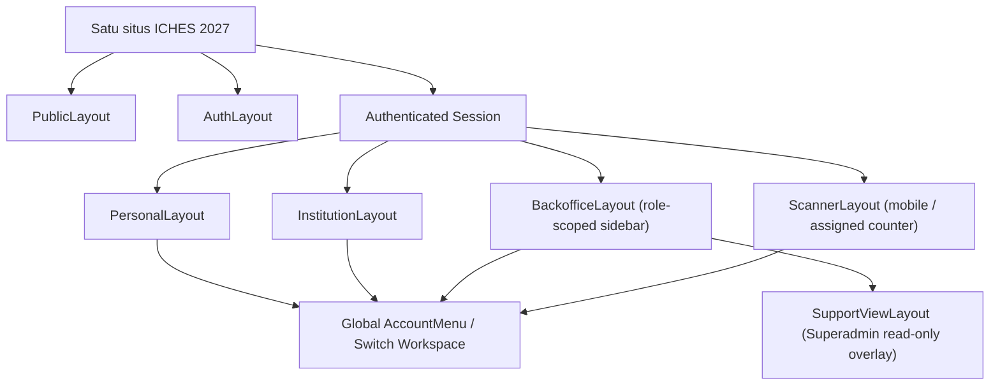
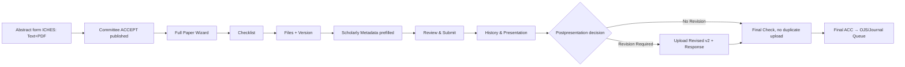
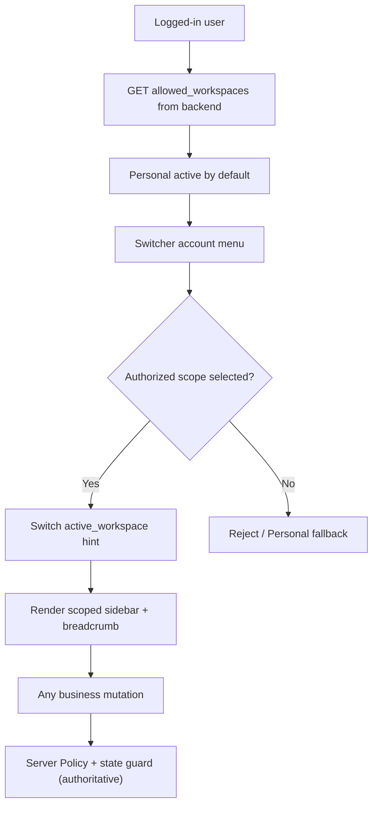

# 18C-04 — DRAFT Frontend, Dashboard Architecture & UX ICHES 2027

> **28 Oktober 2026 · DRAFT REKOMENDASI · MENUNGGU REVIEW PENGGUNA · BELUM CODING / BELUM FINAL.**
>
> **Landasan:** pengguna telah menerima kelanjutan [18C-03B — Switch Role/Workspace & Admin Support View](18C-03B-DRAFT-SWITCH-ROLE-WORKSPACE-AND-USER.md); kita lanjut ke UI ICHES dengan **satu user multi-role**, *role switching* tanpa logout, dan **opsi View as User hanya READ-ONLY untuk dukungan Superadmin**. Detail layar, route, desain, aturan interaksi dan permission UI tetap **DRAFT implementasi**, dapat direvisi. Tidak membuat frontend code atau deploy.
>
> **Pendamping:** [18C-04A — Screen Inventory, Form States & UAT](18C-04A-DRAFT-SCREEN-INVENTORY-COMPONENTS-INTERACTION-UAT.md).  
> **Rujukan produk:** [18A Role/Nav](18A-ROLE-PERMISSION-DAN-NAVIGASI-BACKOFFICE.md) · [18C-02 Backend](18C-02-DRAFT-LARAVEL-BACKEND-ARCHITECTURE-BUSINESS-LOGIC.md) · [18C-03 Security](18C-03-DRAFT-AUTHENTICATION-RBAC-SECURITY-ARCHITECTURE.md) · [18C-03B Switch](18C-03B-DRAFT-SWITCH-ROLE-WORKSPACE-AND-USER.md) · [18B-09 Full Paper OJS-like](18B-09-DRAFT-FULLPAPER-OJS-LIKE-POSTPRESENTATION-PUBLICATION.md) · [18B-06 Finance](18B-06-CRUD-FINANCE-INVOICE-PEMBAYARAN-VERIFIKASI.md) · [18B-05 Paket Internasional](18B-05-CRUD-PAKET-INTERNASIONAL-DASHBOARD-PESERTA.md) · [18B-04 Co-Host](18B-04-CRUD-COHOST-INSTITUSI-LIMA-PAPER.md) · [09 Keputusan](09-KEPUTUSAN-DAN-ISU-TERBUKA.md).
>
> **Acuan UI eksternal yang dicek 28 Okt 2026:** [shadcn-vue Sidebar](https://www.shadcn-vue.com/docs/components/sidebar) dan [shadcn-vue RTL](https://www.shadcn-vue.com/docs/rtl). RTL memang didukung, namun **sidebar/pagination/calendar dan portal dropdown masih memerlukan QA nyata**. Rencana Vue I18n/Inertia tidak berarti versi paket telah dipilih atau pengujian bundle telah dilakukan.

## 1. Keputusan produk yang HARUS terlihat benar di frontend

| Prinsip yang sudah disepakati | Konsekuensi tampilan |
|---|---|
| Satu user dapat berperan ganda | **Satu login + Account Menu / Switch Workspace**, bukan login berulang atau user_id berubah |
| Switch Role/Workspace, View as User READ-ONLY | Switch antarroll milik sendiri, dan **Superadmin support preview read-only** dengan alasan, banner dan Exit; admin lain hanya jika kemudian didelegasikan secara sah |
| Conference Abstract Text+PDF, tanpa screening | Form abstrak simpel, valid Submit langsung Reviewer Index; jangan hadirkan tahap “Administrative Screening” pasca-submit |
| Final ACCEPT **published** | Full Paper OJS-like tersedia langsung; tidak menunggu invoice Presenter reguler Verified |
| Full Paper ala OJS | Wizard **Checklist → Files → Metadata (prefilled) → Review & Submit → History**; versi revisi jika diperlukan |
| Setelah Presented | Assessor memberikan rekomendasi, Committee memutuskan No Revision / Revision Required dan Final ACC; tidak dianggap Published otomatis |
| Co-Host Rp3 juta/institusi | **Satu institutional invoice**, lima seat/lima sponsored papers baru aktif **setelah Finance VERIFIED**, tanpa tagihan Presenter kedua walau paper ACCEPT |
| Paket Internasional Rp1 juta pribadi | **Satu personal invoice** mengaktifkan empat kegiatan setelah VERIFIED; jangan masuk menu tagihan PIC |
| Finance manual | Invoice ≠ bukti transfer ≠ Bukti Lunas; Finance yang cocokkan mutasi, status Verified baru receipt |
| QR, Presenter, Sertifikat | QR identitas/check-in **bukan** Presented; Presented oleh Moderator; semua listed authors eligible dan sertifikat di-issue manual/batch |
| Publication | Proceeding OJS profile dan 10 *kandidat* jurnal CRUD Admin; Selected for Journal ≠ Accepted by Journal; XML Native baru “ready” setelah target staging test |

**Kebijakan yang masih terbuka:** refund/top-up/tenggat bayar dan akibatnya; WNA incoming USD bank final; aturan presenter multi-paper; jumlah assessor/ronde revisi; file Full Paper wajib; 10 jurnal aktual/OJS versions; scanner offline; auth metode/MFA. **Jangan desain tombol yang berjanji refund otomatis, bayar dulu untuk Full Paper, atau jurnal sudah menerima.**

## 2. Sistem desain ICHES — konsisten dengan identitas yang telah ditetapkan

| Token/elemen | Baseline arah desain (bukan hasil mockup implementasi) |
|---|---|
| Brand | “The 6th International Conference on Humanity, Education, and Society (ICHES 2027)”; aksen identitas **H oranye→gold**; jangan membuat logo baru secara sembarangan |
| Color | Ivory `#F7F6F1` background; Forest `#164734` primary; Near Black `#17211C` text; Gold `#B79A5B` accent |
| Font | **Inter** body + **Sora** display; untuk bahasa Arab pilih fallback Arabic yang sungguh mendukung glyph/harakat dan diuji, bukan memaksa Sora |
| Stack | Laravel 13, Inertia, Vue 3, TypeScript, Tailwind CSS 4, shadcn-vue, Vue I18n, Lucide, Vite — **arah teknologi telah dipilih**, versi dependency final diperiksa saat setup |
| Arah layout | Editorial premium, lega, akademik, grid teratur; fokus konten/submission; **tanpa carousel** |
| Iconography | Lucide dengan label teks, tidak ikon saja untuk aksi penting; RTL hanya flip ikon arah, bukan logo |
| Header | Public: brand, menu ringkas, language switch EN/ID/AR, Login/Register atau Dashboard. Authenticated: breadcrumb, notifications, **Account/Workspace Switcher** |
| CTA | “Submit Abstract” saat pendaftaran buka; ketika COMING SOON atau Closed tampil sesuai state Admin, **jangan menciptakan informasi/tanggal** |
| Feedback | Status jelas, helper text dan empty/error/success; finance VERIFIED harus berbeda dari “bukti telah diunggah” |
| Accessibility | Navigasi keyboard, focus visible, label form, target sentuh layak, contrast dicek pada kombinasi forest/gold/ivory; jangan menggunakan warna saja sebagai status |
| Responsive | Desktop 2-column workspace, tablet sidebar collapsible, mobile offcanvas/sheet + single-column forms dan cards untuk tabel panjang |

**Usulan token CSS untuk desain teknis** adalah penurunan warna di atas, bukan hardcoded 70 komponen berbeda. Warna tambahan (error/success/border/muted) berasal dari semantic tokens shadcn-vue yang perlu diuji kontras. Dashboard **tidak harus serba hijau**; forest terutama untuk identitas, navigasi dan CTA penting.

## 3. Arsitektur halaman: enam Shell / Layout, satu aplikasi



| Layout | Sasaran utama | Navigasi |
|---|---|---|
| `PublicLayout` | calon presenter, mitra, peserta umum, SEO | sticky responsive header, anchors, footer, EN/ID/AR |
| `AuthLayout` | login/registration/reset | layout minimal, brand, guest-only form, tanpa menampakkan data privat |
| `PersonalLayout` | semua login user | Dashboard, My Papers, My Payments, International Package, QR, Certificates, Profile |
| `InstitutionLayout` | PIC institusi yang berwenang | Institution Overview, Institutional Invoice, **Manage 5 Seats** (setelah verified), Sponsored Papers summary |
| `BackofficeLayout` | Admin, Reviewer, Finance, Moderator, Publication, program staff | sidebar groups **difilter per role/scope**, search/filter, per-workflow actions |
| `ScannerLayout` | operator layanan mobilitas tinggi | scanner-first, assigned service, hasil check-in, sync state, tanpa menu kompleks |
| `SupportViewLayout` | Superadmin troubleshooting (setelah diberi izin) | persistent banner target + actor, **read-only**, Exit; tidak punya route mutasi |

**Layout bukan hak akses**: backend tetap memvalidasi Resource Policy dan Business Gate. “Beralih Workspace” hanya preferensi konteks UI, `user_id` tetap sama. Dalam “Lihat Sebagai User”, admin asli tetap actor, target hanya proyeksi data aman; **bukan Auth::login(target)**.

## 4. Sitemap publik — R02 dipertahankan, CMS mengendalikan status

```text
PUBLIC ICHES 2027
  Header: Identity H, Home | About | Journey | Speakers | Partners | Schedule/Programs | FAQ
          EN / ID / AR | Login | Register or Dashboard
  Home:
    Hero: COMING SOON (selama CMS mode prelaunch) / CFP saat disetujui Admin
    Countdown ke event/agenda yang benar-benar dipilih Admin, tanpa fiktif date
    About ICHES & Theme
    Submission Journey: Abstract → Academic Review → ACCEPT → Full Paper → Presented → Revision/No Revision → Publication
    Speakers (data CMS, no invented person/affiliation)
    Programs: Conference; International MoU session; Upgrading; International PKM; Destinations
    Partners / Co-Host logos (hanya yang telah berizin/publikasinya aktif)
    CTA: Submit Abstract / Register sesuai fase dan akses
    Footer (contact, policies, help, institutional identity)
  Internal public pages / contextual pages (usulan, tidak semua menu header):
    About; Call for Papers; Tracks; Important Dates; Program Details
    Speakers; Organizing Committee; Partners/Co-Host; Fees & Payment Guide
    Publication/Proceedings & Selected Journal Policy
    Contact/FAQ; Conference Policies; Public Certificate Verification
```

**Penting:** “COMING SOON” adalah fase desain baseline, **bukan kondisi publik permanen**. Admin CRUD CMS menentukan kapan CFP/Submission Journey dan CTA bisa aktif; backend tetap memverifikasi deadline. Countdown target berbasis event_setting dan WIB; tanggal/event tidak ditebak. Situs tiga bahasa, AR right-to-left termasuk footer, dialog, tabel. **Jangan menggunakan auto-translate sebagai konten resmi tanpa review bahasa.**

## 5. Menu personal yang saya rekomendasikan (ringkas)

~~~text
PERSONAL DASHBOARD
 Overview
 My Conference Papers
   └─ Abstract Draft / Submitted / Decision / Full Paper / Revisions / Publication Status
 My Payments
   ├─ Regular Presenter invoice (hanya setelah ACCEPT diumumkan)
   ├─ Personal Participant invoice (jika relevan)
   └─ International Package invoice pribadi
 International Program Package
   └─ Satu paket Rp1 juta / 4 activities; access after VERIFIED
 My QR & Check-ins
 My Certificates
 Notifications
 Profile & Security
 Account Menu: Switch Workspace (if assigned)
~~~

**Overview bukan daftar semua tabel:** tampilkan yang relevan menurut keikutsertaan user: current paper state, latest payment, QR, next assigned program dan notifications. **Jangan menagih paper sponsor Co-Host lagi** di My Payments. Jika ada paper regular lain dengan tagihan, hanya yang **benar-benar sesuai kebijakan** yang ditampilkan.

**Empty state yang penting:** user baru tanpa paper → “Submit Abstract” jika open; reviewer juga author → My Papers tetap milik sendiri, bukan daftar claims; invoice belum ada → bukan “Belum bayar” palsu. “Upload Full Paper” muncul segera saat final ACCEPT published, sekalipun invoice Unpaid.

## 6. Institution Workspace: satu institusi, satu tagihan, lima slot

~~~text
INSTITUTION WORKSPACE   Institution A / ICHES 2027
  Overview — Co-Host status & payment state
  Institutional Invoice — ONE Rp3.000.000
     [View Invoice] [Copy Bank Account] [Upload Payment Proof]
     Pending / Correction Required / Verified
  IF VERIFIED:
     Manage Representatives (Seat 01–05)
     Invite / Link Personal Accounts (invitation mechanics still draft)
     Sponsored Papers Summary (max one paper per member)
     Institutional Recognition / Logo workflow (CMS approved)
  IF NOT VERIFIED:
     Invoice and verification guidance only
     Manage Seats & Sponsored Submission LOCKED
  SWITCH BACK:
     Personal Dashboard (PIC's own papers / Package Rp1m, if purchased)
~~~

**Jangan** menaruh “Buy International Package for members”, lima invoice personal, tautan bukti pribadi anggota, atau reviewer notes privat di Institution Workspace. Jika PIC mengelola lebih dari satu institusi yang benar-benar ditugaskan, ganti konteks institusi di Switch Workspace dengan penanda institusi jelas. Penggantian anggota sesudah submit/Rejected masih **kebijakan terbuka**, sehingga UI tidak memberikan tombol reassign otomatis.

## 7. Backoffice: satu shell, menu kondisional menurut tugas

| Grup/area | Menu UI rekomendasi | Actor yang melihat/bertindak |
|---|---|---|
| **Command Center** | Overview, Tasks & Alerts, Event Snapshot | Admin berizin; tidak semua orang melihat seluruh data sensitif |
| **Conference** | Settings & 8 Tracks, Abstract Submissions, Reviewer Index/Claims, Academic Decisions, Full Paper Status | Admin, reviewer (own tools), Committee |
| **Event Execution** | Sessions & Rooms, Moderator Check-in/Presented, Assessor Reviews | Moderator/Program/Committee sesuai assignment |
| **Publication** | Revision Queue, Final ACC, Metadata Readiness, Outlets (Proceedings + 10 Journal candidates), OJS Export & Handoff | Publication Team/Committee; OJS profiles Admin berizin |
| **Co-Host & Partners** | Institutions, Registrations, Verified benefits, Recognition/Logo approvals | Admin/PIC scope, Finance financial section only |
| **Finance & Payments** | Overview, All Invoices, Payment Verification, Reports; **Bank Settings hanya Superadmin** | Finance; role lain tidak melihat data bank restricted |
| **International Programs** | Packages, Activities, Registrations, Entitlements, MoU Participation, PKM/Trips | Program Coordinator/Admin |
| **Operations** | QR & Check-ins, Counter/Services, Fulfillments, Scanner Operators, Certificates | Service Coordinator/Scanner/Certificate Officer sesuai tugas |
| **Administration** | Users & Roles, CMS, Deadlines, Templates, Audit (scoped), Settings | Superadmin/Event Admin berizin |
| **Helpdesk/Support** | View as User (Read-only) | **Superadmin** sebagai default yang disetujui; delegasi Admin lain butuh izin eksplisit |

**Tidak semua grup muncul kepada semua staff.** Reviewer melihat workspace reviewer yang ringkas, Finance melihat Finance, Moderator melihat Sessions, Scanner langsung scanner-first. **Satu panel Admin pusat** berarti kesamaan identitas desain dan layanan CRUD, **bukan** semua Admin memiliki izin mencatat uang, ACCEPT, Presented atau mengubah rekening.

### Wireframe desktop Backoffice (tekstual, bukan UI yang sudah hidup)

~~~text
┌────────────────────────────────────────────────────────────────────┐
│ ICHES 2027 | Event 2027     Breadcrumb               🔔 [Avatar ▾] │
├─────────────────┬──────────────────────────────────────────────────┤
│ Sidebar         │ Overview / [Scoped Workspace]                    │
│                 │                                                  │
│ Home            │ [Pending Tasks] [Submissions] [Invoices]         │
│ Conference      │ [Assigned Sessions] / selected KPI, by permission│
│ Academic        │                                                  │
│ Publication     │ Search/Filter [Status ▼] [Export if permitted]    │
│ Co-Host         │                                                  │
│ Finance         │ [Table with owner-safe columns & pagination]     │
│ Programs        │ [Open details]  [Authorized primary action]      │
│ Operations      │                                                  │
│ Users & Settings│ Empty/Error/Loading/Success/Permission states     │
│                 │                                                  │
├─────────────────┴──────────────────────────────────────────────────┤
│ Account ▾: Switch Personal / Reviewer / PIC / Finance / Admin      │
└────────────────────────────────────────────────────────────────────┘
~~~

**Desain bukan dekoratif:** tiap daftar punya search, filter, status, pagination, action tepat, empty state dan alasan penolakan yang dapat dipahami. Detail invoice/academic review harus lebih informatif daripada grafik ramai.

## 8. Switch Workspace dan View as User — DISERTAKAN, tetap dua mode berbeda

**A. Switch Workspace:** tersedia di avatar/topbar pada setiap halaman login; daftar berasal dari server `allowed_workspaces`. Ketika user memilih “Reviewer”, UI berpindah tanpa logout, user ID dan sesi tetap sama. Saat assignment dicabut, backend menolak tindakan dan fallback ke Personal. Konteks role dipresentasikan jelas pada header dan breadcrumb.

**B. View as User:** dari `Backoffice → Users & Roles → View as User`, default **Superadmin-only, read-only** sesuai persetujuan pengguna atas usulan 18C-03B. Minta alasan; tampilkan banner permanen “Viewing as [target] / Read-only / Return to Admin”; batasi masa sesi (durasi final belum dipilih), tak bisa nested target, tak boleh membuka private file, QR secret, Finance evidence, atau mengubah state akademik/keuangan.

~~~text
SUPPORT READ-ONLY MODE
[Viewing as Participant A] [Admin: current real actor]
Reason: Dashboard assistance  |  Session expiry: [based on config]
[EXIT VIEW — RETURN TO MY ADMIN ACCOUNT]
Main: personal dashboard status projection / allowed navigation only
[ALL POST/PUT/PATCH/DELETE DENIED; private downloads DENIED]
~~~

**Tidak melakukan full impersonation**; backend tidak mengubah `Auth::user()` ke target. Bila di kemudian hari dibutuhkan “Admin bertindak sebagai peserta”, itu fitur **baru dengan persetujuan dan izin terbatas**, bukan efek otomatis dari switcher.

## 9. Full Paper UI ala OJS, namun Abstract tidak dibuat ribet



**Full Paper form sections:** checklist sesuai kebijakan (belum semua ditentukan), upload manuscript (format DOCX/PDF menunggu keputusan), metadata scholarly locale/title/abstract/keyword, authors ordered incl. mononim/ORCID optional/affiliations, references raw+DOI optional, review summary, submit confirmation, file/version history. Prefill dari Abstract; author tak mengetik ulang. Reviewer/Assessor memberi rekomendasi; Committee-lah yang menetapkan Revision Required/No Revision/Final ACC.

**Jika No Revision:** author tidak wajib upload file identik lagi. **Jika Revision Required:** tampilkan daftar catatan dan uploader v2 + response; versi lama tetap tersedia sesuai izin. *Selected Journal* bukan *Accepted by Journal*. Ekspor OJS Native XML **baru boleh berlabel ready-to-import setelah profil versi target + staging import test lulus**.

## 10. Finance screens dan status yang tidak boleh rancu

| Invoice state | Copy yang ditampilkan | CTA yang relevan |
|---|---|---|
| `Unpaid` | “Tagihan tersedia” / “Transfer ke rekening resmi dan unggah bukti” | View/Download Invoice, Copy Account, Upload Proof |
| `Pending Verification` | “Bukti diterima, menunggu Finance memeriksa mutasi bank” | View proof/status, upload tambahan bila ketentuan mengizinkan |
| `Correction Required` | “Perbaiki bukti atau tindak lanjuti alasan Finance” | Read reason, upload corrected proof **di invoice sama** |
| `Verified` | “Pembayaran terverifikasi” | Download Payment Receipt; Co-Host/Package benefits unlocked |

**Receipt hanya setelah Verified**; transfer bukti PDF tidak otomatis melunasi. Finance dashboard bukan portal payment gateway, punya queue verification, bank match, Correction dengan alasan, laporan IDR/USD terpisah. Setting rekening bank **hanya Superadmin**; Finance dapat melihat informasi yang diperlukan.

**Refund, overpayment, underpayment dan tenggat:** fitur yang belum final hanya ditampilkan dalam UX sebagai kebutuhan *manual follow-up* tanpa menjanjikan refund atau auto-penalti. **Teks belum ada kebijakan resmi tidak otomatis dibuat-buat.**

## 11. Adaptif mobile, tablet, desktop dan AR RTL

| Kondisi | Rekomendasi |
|---|---|
| Mobile kecil | 1 kolom, offcanvas account & sidebar, tab overflow scrollable, primary CTA sticky hanya jika tidak menutupi isi |
| Tablet | Sidebar icon/collapsible, table horizontal-scroll dengan sticky key columns bila aman, wizards tanpa dua kolom |
| Desktop | Sidebar persistent, content max-width yang nyaman, filter di header table, detail panels |
| Arab `ar` | Document `lang=ar`, `dir=rtl`; logical CSS `start/end`, sidebar berbalik sesuai direction; numerals/IDs/DOI/IBAN tetap `dir=ltr` bila berupa data teknis |
| EN/ID | `dir=ltr`; gunakan teks yang sudah disetujui terjemahannya, jangan mengarang data institusi/speaker |
| Forms | Label di atas kontrol, validation error dekat field, notifikasi di area yang dapat dibaca pembaca layar |
| Dialogs | Focus trap, Escape, confirmation untuk tindakan permanen; rekening/Final ACC tidak boleh diputuskan melalui modal dekoratif |
| Tables | Paginated server-side, filter query yang terjaga saat pindah halaman, empty/error/loading, export hanya untuk role berizin |
| QR mobile | Scanner assigned counter fullscreen; offline sync khusus jika solusi offline dipilih, jangan klaim offline siap pada fase frontend |

**Cek RTL khusus:** shadcn-vue RTL membantu logical classes, namun komponen seperti **Sidebar, Pagination, Calendar, Dropdown/Popover portalled content** harus diuji lebih lanjut; format tanggal WIB dan angka mata uang perlu tepat. Referensi: https://www.shadcn-vue.com/docs/rtl dan https://www.shadcn-vue.com/docs/components/sidebar.

**Tidak perlu carousel**, tidak menggunakan nested navigasi besar untuk mobile, dan bukan satu halaman dashboard yang memuat data semua divisi.

## 12. Struktur Vue/TS/Inertia yang direkomendasikan (bukan source code)

~~~text
resources/js/
  app.ts
  i18n/
    index.ts
    messages/en.json
    messages/id.json
    messages/ar.json
  layouts/
    PublicLayout.vue
    AuthLayout.vue
    PersonalLayout.vue
    InstitutionLayout.vue
    BackofficeLayout.vue
    ScannerLayout.vue
    SupportViewLayout.vue
  components/
    brand/ConferenceBrand.vue
    navigation/PublicHeader.vue
    navigation/WorkspaceSwitcher.vue
    navigation/AccountMenu.vue
    navigation/ResponsiveSidebar.vue
    navigation/LanguageSwitcher.vue
    states/StatusBadge.vue
    states/EmptyState.vue
    states/PermissionState.vue
    states/AsyncState.vue
    files/PrivateFilePicker.vue
    data/DataTable.vue
    notifications/NotificationCenter.vue
    support/SupportViewBanner.vue
  features/
    conference/AbstractForm/
    conference/FullPaperWizard/
    academic/ReviewWorkspace/
    presentation/ModeratorSession/
    publication/RevisionQueue/
    publication/OjsExportQueue/
    cohost/InstitutionWorkspace/
    finance/InvoiceDetail/
    finance/PaymentVerification/
    programs/PackageCheckout/
    operations/Scanner/
    certificates/CertificateBatches/
  pages/
    public/
    auth/
    personal/
    institution/
    backoffice/
    scanner/
  types/
    auth.ts
    navigation.ts
    conference.ts
    finance.ts
    publication.ts
~~~

**Catatan teknis penting:** Inertia server memberi shared props minimal: `auth.user_public_fields`, `allowed_workspaces`, `active_workspace`, `event`, `locale`, `notifications_unread`, dan `support_view_active`. Jangan men-serialize Eloquent User/Invoice/Paper penuh; jangan membawa rekening internal, reviewer notes, atau QR secret ke shared props. Inertia form state dipakai untuk errors/progress, tetapi **server** adalah sumber kebenaran state/permission.

**Component policy:** desain komponen shared untuk input, status, datatable, file picker; **domain-specific business gating tidak ditanam di generic Button**. Misalnya `canSubmitFullPaper` dari backend policy, bukan hanya `invoice.verified` di Vue.

## 13. Katalog kondisi dan feedback untuk setiap halaman

Setiap fitur utama harus punya **enam keadaan**: (1) loading/skeleton, (2) data tersedia, (3) empty/first use, (4) validation error, (5) action success, (6) forbidden/expired/no longer available. Untuk Finance tambah `Pending/Correction/Verified`; Full Paper tambah `Locked by unpublished ACCEPT`, `Open`, `Revision Required`; Co-Host tambah `Verified gate`; Scanner tambah `No entitlement`, `Already confirmed`, `Pending Sync jika offline kelak`.

**Pesan khusus**:
- “Full Paper belum tersedia karena keputusan ACCEPT belum diumumkan,” **bukan** “belum bayar”.
- “Pembayaran menunggu verifikasi Finance,” **bukan** “Lunas” setelah upload screenshot.
- “Institution Workspace tersedia setelah pembayaran Co-Host terverifikasi.”
- “Paper terpilih untuk diajukan ke jurnal,” **bukan** “Artikel sudah diterima jurnal.”
- “Penilaian menyatakan tidak perlu revisi” **bukan** “Proceedings telah menerbitkan artikel”.
- “Mode bantuan: hanya melihat,” **bukan** “Anda sedang login sebagai peserta”.

## 14. Responsive navigation & navigation guard



**User with no role** only has Personal Workspace. Staff member who is Reviewer+PIC+Finance can switch to assigned spaces, **but role combination does not grant access to other institution or other user's private personal invoice**. If switcher role revoked, return to allowed context with message, do not keep stale menu as authorization proof.

## 15. UI handoff dan review gate

| Review key | Rekomendasi | Status |
|---|---|---|
| UI-01 | **One coherent design system** 6 shells + Support View overlay; tidak 7 aplikasi berbeda | **DRAFT MENUNGGU REVIEW** |
| UI-02 | Public Hero COMING SOON controlled by CMS; sections About/Journey/Speakers/Partners, no carousel | **DRAFT implementasi baseline yang sudah dipilih** |
| UI-03 | Personal Dashboard ringan dengan My Papers, My Payments, Package, QR, Certificates | **DRAFT** |
| UI-04 | PIC Institution Workspace: satu invoice, 5 seats hanya setelah Verified | **BUSINESS FINAL, UI DRAFT** |
| UI-05 | Account Switcher global + Superadmin View as User **read-only** | **ARAH FITUR DITERIMA, desain UI DRAFT** |
| UI-06 | Backoffice role-scoped, bukan semua menu untuk semua staff | **DRAFT** |
| UI-07 | Full Paper wizard OJS-like + No Revision/Revision Required dan publication handoff | **ARAH FITUR DITERIMA, detail UI DRAFT** |
| UI-08 | EN/ID/AR RTL, responsive mobile-first pada scanner, accessible forms/tables | **DRAFT acceptance** |
| UI-09 | Exact routes, components, screen-level validation, states dan 60 UAT ada di 18C-04A | **DRAFT, belum dijalankan** |
| UI-10 | Setelah review → **18C-05 Implementation Readiness / MVP Slices**, lalu GO coding eksplisit | **USULAN** |

**Tidak ada prototype Vue yang diklaim telah dijalankan**, dan tidak menyebut 18C-04 final sebelum Anda review. Diagram/wireframe teks adalah **panduan interaksi**, bukan screenshot aplikasi.

---

[18C-04A Screen Inventory & UAT](18C-04A-DRAFT-SCREEN-INVENTORY-COMPONENTS-INTERACTION-UAT.md) · [Switch Workspace](18C-03B-DRAFT-SWITCH-ROLE-WORKSPACE-AND-USER.md) · [README](../README.md) · [Register Keputusan](09-KEPUTUSAN-DAN-ISU-TERBUKA.md).
