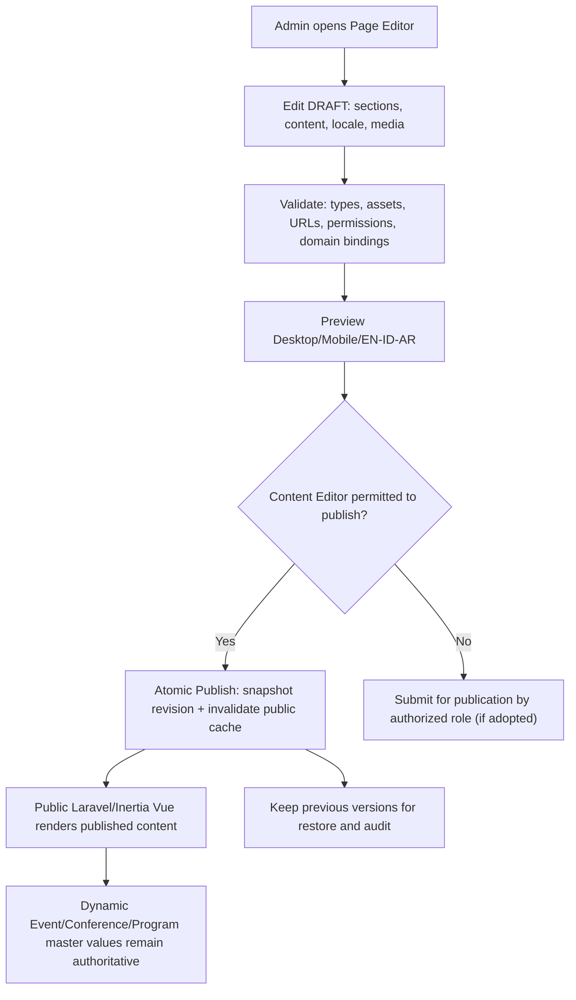

# 18C-04D — DRAFT Visual CMS, Flexible Component Library & Editing Contracts

> **28 Oktober 2026 · REKOMENDASI FLEKSIBEL · TIDAK FINAL · BELUM CODING.**  
> Pemilik produk menetapkan **arah Academic Editorial** untuk public frontend tetapi secara eksplisit meminta **komponen frontend jangan dikunci**; pengguna menginginkan kemampuan mengedit website publik melalui **Admin Backoffice**, tidak perlu developer untuk perubahan konten dan komposisi rutin.
>
> **Arah solusi:** *structured visual CMS* yang **fleksibel dalam komponen, tata letak, urutan, konten, dan visibility**, dengan **design system guardrails** untuk konsistensi, keamanan, dan aksesibilitas. Ini hanya proposal. **Bukan keputusan bahwa hanya komponen tertentu yang boleh digunakan secara permanen.**
>
> [18C-04C Homepage Wireframe Desktop/Mobile](18C-04C-DRAFT-HOMEPAGE-WIREFRAME-DESKTOP-MOBILE.md) · [18C-04B Arah Academic Editorial](18C-04B-DRAFT-PUBLIC-FRONTEND-ACADEMIC-EDITORIAL-CMS.md) · [18C-04 Frontend](18C-04-DRAFT-FRONTEND-DASHBOARD-ARCHITECTURE-UX.md) · [18C-03 Security](18C-03-DRAFT-AUTHENTICATION-RBAC-SECURITY-ARCHITECTURE.md) · [17 Admin CRUD](17-ADMIN-CRUD-DAN-PENGATURAN-ACARA.md) · [Register](09-KEPUTUSAN-DAN-ISU-TERBUKA.md).

## 1. Batasan yang tepat: CMS bukan code editor, tetapi komponen juga tidak boleh dikunci

**Empat lapisan pengelolaan yang saya rekomendasikan:**

| Lapisan | Admin dapat lakukan | Catatan |
|---|---|---|
| **A. Konten** | Edit headline, subheadline, paragraph, CTA label/link, gambar, alt text, kutipan, metadata SEO, translations | Editor nonteknis; tanpa deploy |
| **B. Struktur halaman** | Susun urutan sections, aktif/nonaktif, tambah/hapus dari pustaka, buat page baru dari komponen yang ada | Tanpa deploy; preview sebelum publish |
| **C. Varian visual** | Pilih layout preset untuk tiap section (split, centered, photo-led, list/timeline, grid), alignment, media placement, background semantic preset, text width | **Opsional yang boleh diperluas berdasarkan masukan user**, bukan daftar “terkunci” |
| **D. Komponen benar-benar baru** | Admin bisa **mengajukan/menyetujui desain baru**; developer kemudian menambah renderer/editor baru sekali | Tetap butuh coding untuk kemampuan yang sama sekali belum didukung; tidak menjanjikan no-code absolut |

**Fleksibilitas tidak berarti** user harus diberi text field raw JavaScript, inline style bebas, upload SVG/script pihak asing, atau kemampuan bypass pengaturan Finance. Batas keselamatan dan konsistensi desain **bukan** kunci estetika.

**Prinsip perubahan:** pengguna boleh menolak seluruh opsi di pustaka dan meminta pola baru sebelum disetujui, tanpa kita mengklaim preset yang sudah dirancang tidak boleh diubah.

## 2. CMS Admin navigation — DRAFT, bukan halaman yang telah dibangun

~~~text
BACKOFFICE → WEBSITE
  Overview (public state & unpublished changes)
  Pages
    Home
    About
    Call for Papers
    Programs
    Publication & Proceedings
    Speakers/Partners
    FAQ & Contact
    [Add Page]
  Components / Sections
    Library & Add Section
    Reorder / Hide / Duplicate Section
    Change Layout Variant
    Content & Media Fields
  Navigation
    Main menu | Footer | Language switcher
  Media Library
    Images / approved logos / PDFs / alt text / crop settings
  Translations
    EN | ID | AR (review status)
  SEO & Sharing
    Metadata / OG image / canonical
  Publishing
    Draft | Preview | Scheduled? (only if user wants) | Published | Restore Version
  Activity Log
    Who changed/published which section
~~~

**Perizinan:** Content Editor dapat mengedit draft dan bagian website sesuai grant; **hak Publish** merupakan izin yang dapat dipisah (usulan). Tidak otomatis punya izin mengubah bank resmi, Verified Finance, keputusan Academic, Moderator Presented, atau publication Final ACC.

## 3. Katalog awal 12 blok yang tidak “locked” (DRAFT)

| Key proposal | Nama section | Alternatif yang dapat dicoba | Isi editable / data source |
|---|---|---|---|
| `hero` | Hero Conference | Split, Type-first, Image-led, simple editorial | Headline/subtitle/status/photo/CTA; status pendaftaran dari master event |
| `event_facts` | Event Essentials | Inline facts, narrow band, bordered info | Date/location/mode dari Event Master, admin mengatur style/visibility |
| `editorial_copy` | About/Manifesto | Split copy, centered copy, photo+copy | Rich text terkontrol, approved photo |
| `submission_journey` | Journey | Numbered list, vertical timeline, compact sequence | Langkah dari konfigurasi informasi, stage/gates akademik tidak berubah |
| `program_feature` | Programs | Hero panel + list, editorial rows, 2-column grid | Program data dari master; custom intro/photo CTA |
| `conference_tracks` | Tracks | Typography list, grouped topics, 2-column grid | **8 tracks dari Conference Master**, bukan copy manual |
| `speaker_gallery` | Speakers | Editorial profile, portrait grid, hide until public | Speaker data hanya setelah CMS permission |
| `partner_list` | Partners | Logo row, grouped by type, editorial link list | Logo approved, country/source, order |
| `publication_path` | Proceedings & Selected Journal | Two editorial columns, prose+FAQ, dedicated page CTA | Hanya confirmed outlets/status; journal selected ≠ accepted |
| `document_library` | Downloads | Compact list, resource list, callout | Template, guide, PDFs yang publik |
| `cta_panel` | Call to Action | Plain bordered, editorial dark panel, inline CTA | CTA state dari event; submit tidak boleh payment-before-ACCEPT |
| `faq_contact` | FAQ & Contact | Accordion, categorized questions, minimal text block | CMS text, verified official contact |

**12 adalah titik awal untuk diskusi, bukan batas maksimal, bukan kewajiban semua muncul di homepage**, dan tidak berarti 12 tabel database. Komponen dapat digunakan pada banyak halaman; tidak semua tampil dengan layout yang sama. Bila satu blok tidak dibutuhkan, hapus; bila ada ide baru, tambah; bila dua blok tumpang tindih, gabung saat review.

## 4. Editor pengalaman pengguna — sketsa yang dapat direvisi

~~~text
┌────────────────────────────────────────────────────────────────────────┐
│ Admin > Website > Pages > Home       EN/ID/AR  [Preview]  [Publish]   │
├─────────────────────────┬──────────────────────────────────────────────┤
│ SECTIONS                │ LIVE PREVIEW (desktop | tablet | mobile)      │
│                         │                                              │
│ ≡ Hero [visible]        │    ICHES 2027                                │
│   Layout: Split        │    ISLAMIC VALUES ...                         │
│   [Edit] [Variant]      │    ...                                       │
│ ≡ Facts [visible]       │                                              │
│ ≡ About [visible]       │   Preview only, unpublished until publish    │
│ ≡ Journey [visible]     │                                              │
│ ≡ Programs [visible]    │                                              │
│ ≡ Speakers [hidden]     │                                              │
│ ≡ Publication [visible] │                                              │
│ ≡ Footer [visible]      │                                              │
│                         │                                              │
│ [+ Add Section]         │                                              │
└─────────────────────────┴──────────────────────────────────────────────┘
  On edit: dynamic typed fields below/side, not arbitrary code injection
  [Save Draft] [View Revision History] [Restore Draft]
~~~

**Draft/Pub contract:** perubahan di editor tidak memengaruhi publik sampai publish. Preview harus bertindak sebagai **sandbox read-only public rendering** dari draft, bukan membuka draft ke search engines. Jika item baru ditambahkan tetapi belum diterjemahkan ke AR, ditampilkan status missing translation, bukan otomatis membuat teks Arab fiktif. Publish dapat diblokir ketika data penting publik belum lengkap sesuai aturan panitia yang disepakati.

**Pilihan UI masih terbuka:** split editor/preview vs drawer vs full-page visual builder, drag-and-drop vs tombol Move Up/Down, preview drawer vs new tab, variasi blok dan kontrol media. Semuanya harus diuji usability di mobile dan oleh Admin non-developer.

## 5. Page lifecycle, data contract, dan referensi domain

**Jangan menyalin business data ke rich text:**
- Tanggal submission, countdown, event location, attendance mode → Event/Conference Settings.
- Conference Tracks → Track master.
- Speaker bio/photo → Speaker CMS master with approval; mungkin CMS module sendiri.
- Paket Rp1 juta & Co-Host Rp3 juta → Fees/Packages/CoHost data master, bukan field manual untuk mengubah tarif.
- Registrations/open-closed/status Full Paper → server business state.
- Proceedings/journal status → Publication Outlets master, tidak secara otomatis dianggap publisher acceptance.

**Contoh semantic render contract (bukan code final):**
~~~text
Page {
  slug, locale_or_i18n_refs, published_revision_id
}
Section {
  page_id, component_key, variant_key, order, visible,
  content_localized_fields, media_refs, domain_binding_refs, design_preset
}
SectionRenderer {
  known component_key only; validated typed content;
  domain binding resolves against authoritative master;
  SEO/canonical/RTL/accessibility applied by system
}
~~~

**Keamanan:** Server memutuskan siapa yang boleh publish; HTML hasil rich-text disanitasi/allowlist, media private/public dibedakan, tidak boleh arbitrary file path atau script/CSS dari CMS. Resource public yang diindeks search hanya revisi Published, preview draft tidak diumumkan.

## 6. Data architecture tambahan untuk review, bukan tabel yang dikunci

| Kandidat tabel logis | Isi | Bisa digabung? |
|---|---|---|
| `cms_pages` | slug, template_kind, status, page metadata | Mungkin tetap berdiri |
| `cms_page_revisions` | version, page snapshot, actor, published_at | Dapat memuat seluruh section snapshot JSON untuk kesederhanaan |
| `cms_sections` | component_key, order, visible, layout_variant, bindings | Jika menyimpan snapshot JSON di revision, bisa berupa dokumen terstruktur, bukan tabel per section |
| `cms_translations` | locale + keys + content status | Alternatif JSON per section atau tabel terpisah |
| `cms_media` | owner, asset path, alt/caption, focal point/crop, publication usage | Dapat memakai `stored_files` dengan metadata media |
| `cms_navigation` | header/footer menu config | Alternatif `event_settings` dengan validasi |
| `cms_publish_events` | actor/time/target revision, rollback history | Dapat disimpan dalam audit yang ada |

**Tidak perlu menambah tujuh tabel** tanpa evaluasi 38+15 kandidat database yang sudah ada. **Jangan** mengubah dokumen ERD final dengan asumsi angka tabel menjadi 60. Pilihan minimal (pages + revisions JSON + stored_files + nav settings) dapat cukup untuk MVP, **perlu review saat 18C-05**.

## 7. Content governance dan perlindungan mutu visual

**Batas yang direkomendasikan, masih untuk review:**
1. **Tipografi dan palet semantik** dari design system; Admin dapat memilih varian tetapi tidak mengacak tiap komponen.
2. **Image quality**: foto autentik berhak guna, alt text, crop mobile/desktop yang layak; dilarang tampilkan pembicara/mitra belum resmi.
3. **Readability**: maksimum lebar teks nyaman, tidak menaruh teks akademik utama di atas foto ramai.
4. **Accessibility/RTL**: label, keyboard focus, responsive, Arabic arah yang benar; grafik dekoratif bukan satu-satunya informasi.
5. **No AI slop**: tidak mengulang card grid secara mekanis, tidak memproduksi statistik/quotes palsu, CTA tidak menyesatkan.
6. **Editorial review**: versi konten sebelum/selesai publish dapat dilihat; siapa yang publish dapat ditelusuri.
7. **Sumber data tunggal**: tarif/deadline/decision bukan konten bebas milik CMS editor.

**Jika user ingin mengubah font/warna global/komposisi di luar preset**, itu boleh menjadi kebutuhan komponen baru melalui review. **Tidak diartikan sebagai larangan permanen**. Hanya script injection, privilege bypass, dan ketidakbenaran data yang dibatasi.

## 8. UAT rencana tambahan: 28 skenario, BELUM DIJALANKAN

| ID | Skenario | Kriteria penerimaan |
|---|---|---|
| CMS-T01 | Content Editor mengubah headline Hero pada draft | Homepage live tidak berubah sebelum Publish |
| CMS-T02 | Admin menambah section baru dari library | Section tampil di draft preview, bukan publik |
| CMS-T03 | Admin mematikan Speakers section | Tidak terlihat publik setelah publish |
| CMS-T04 | Admin mengubah urutan program dan About | Order setelah publish sesuai editor dan tetap responsif |
| CMS-T05 | Admin memilih hero H-02 setelah H-01 | Layout berubah hanya setelah publish dan sesuai varian sah |
| CMS-T06 | Admin ingin section jenis baru di luar library | Tidak mengarang komponen; masuk permintaan desain baru |
| CMS-T07 | Content Editor tanpa publish permission klik Publish | Ditolak server |
| CMS-T08 | Publish authority menerbitkan revisi baru | Versi baru aktif, audit actor/time tersedia |
| CMS-T09 | Admin rollback ke versi sebelumnya | Publik menampilkan versi yang dipilih, riwayat tidak hilang |
| CMS-T10 | Preview draft tanpa login dengan URL ditebak | Ditolak/non-indexed sesuai policy |
| CMS-T11 | Ubah teks Indonesia tanpa terjemahan Arab | AR tetap fallback/penanda sesuai kebijakan, tidak auto-translate |
| CMS-T12 | Arabic page preview | RTL layout, font fallback dan navigation benar |
| CMS-T13 | Mobile hero image crop | Focal point aman, judul tetap terbaca |
| CMS-T14 | CMS upload SVG/HTML berisi script | Ditolak atau sanitasi sesuai kebijakan media |
| CMS-T15 | CMS memasukkan rich text script/iframe liar | Tidak tereksekusi, sanitizer benar |
| CMS-T16 | CMS mengatur tarif Co-Host teks manual berbeda | Dynamic fee binding tetap sumber resmi, perbedaan dicegah |
| CMS-T17 | CMS mengubah tanggal deadline tampilan tanpa master | Tidak mengubah backend submission gate |
| CMS-T18 | Admin mengubah submission date pada master | Public facts dan CTA memperbarui sesuai state |
| CMS-T19 | Speakers belum official public | Tidak muncul foto/nama fiktif |
| CMS-T20 | Partner logo belum ada izin tampil | Tidak tampil |
| CMS-T21 | Jurnal hanya selected for handoff | Tidak tertulis accepted/published otomatis |
| CMS-T22 | CSS global diinput sebagai text CMS | Ditolak oleh typed fields |
| CMS-T23 | Foto resolusi kecil | Validasi kualitas/peringatan agar tidak tampak buram |
| CMS-T24 | CTA dalam COMING SOON | Tidak memaksa payment-before-accept atau submit saat portal closed |
| CMS-T25 | CMS editor mengubah URL menu | URL aman/valid dan tidak mengubah permission |
| CMS-T26 | Reorder sections dengan keyboard | Dapat digunakan tanpa drag-and-drop mouse |
| CMS-T27 | Broken media/upload gagal | Draft tetap utuh, error ditampilkan |
| CMS-T28 | Cache invalidation saat Publish | Halaman publik menampilkan revision yang diterbitkan |

**28 UAT adalah acceptance plan**, bukan klaim sistem sudah diuji. Bagian foto/branding/responsive dan kebijakan terjemahan perlu diawasi dalam review visual selain pengujian teknis.

## 9. Review checklist pengguna: komponen tetap terbuka

| ID | Proposal untuk dipilih/diubah | Status |
|---|---|---|
| CMS-R01 | Blok dinamis + layout presets, **tetap bisa menambah varian/jenis komponen baru** berdasarkan permintaan | **DRAFT** |
| CMS-R02 | Dapat tambah/sembunyikan/duplikasi/urut section dan mengganti variant melalui Backoffice | **DRAFT** |
| CMS-R03 | Editing 3 bahasa, media, SEO, navigasi, footer, preview desktop/mobile dan publish versioning | **DRAFT** |
| CMS-R04 | Content Editor vs Publisher role terpisah (bila benar diperlukan, jangan mempersulit) | **DRAFT** |
| CMS-R05 | Minimal schema pages+revisions JSON+media, bukan wajib tujuh tabel | **DRAFT** |
| CMS-R06 | Anti-slop guardrails secara visual, bukan larangan merevisi selera pengguna | **DRAFT** |
| CMS-R07 | Sumber data Conference/Finance/Programs/Publication master, bukan copy teks mudah inkonsisten | **KRITERIA INTEGRITAS MENGIKUTI KEBIJAKAN PRODUK** |

**Konsekuensi dari permintaan pengguna:** *semua variasi komponen frontend tetap bisa digodok* sampai pengguna memilihnya, dan pemilihan Academic Editorial **bukan keputusan mengunci daftar/warna pemakaian, bentuk hero, section, atau page builder implementation**.

---

[18C-04C Homepage Wireframes](18C-04C-DRAFT-HOMEPAGE-WIREFRAME-DESKTOP-MOBILE.md) · [18C-04B Academic Editorial](18C-04B-DRAFT-PUBLIC-FRONTEND-ACADEMIC-EDITORIAL-CMS.md) · [Register](09-KEPUTUSAN-DAN-ISU-TERBUKA.md).
