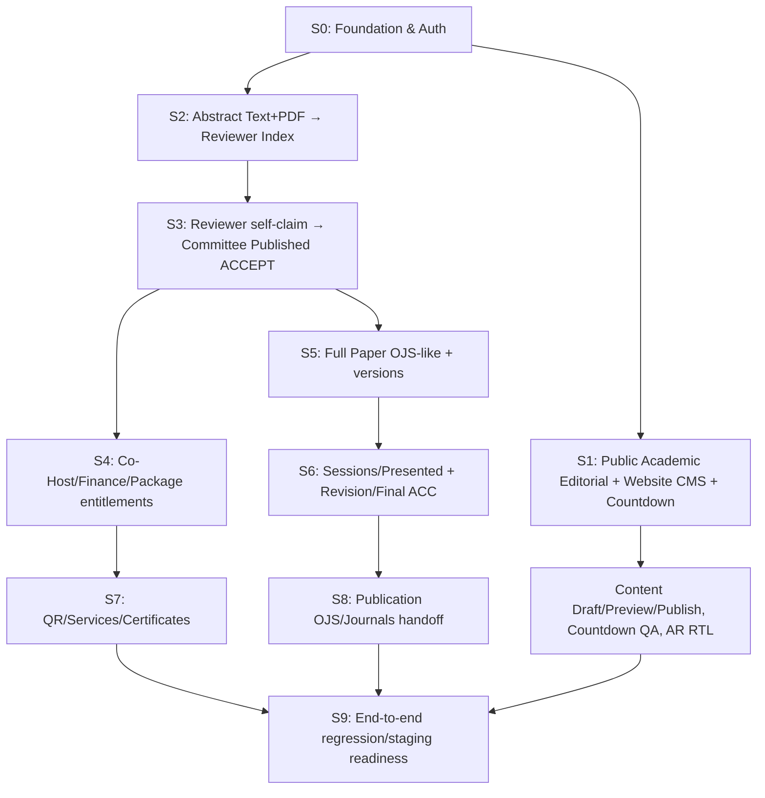

# 18C-05 — DRAFT Implementation Readiness, Architecture Decisions & GO/NO-GO Gates

> **28 Oktober 2026 · DRAFT REKOMENDASI UNTUK REVIEW · BELUM FINAL · BELUM ADA GO CODING.**
>
> **Persetujuan user terbaru:** “Okey saya menyetujui. silahkan lanjut ke pekerjaan berikutnya.” Diartikan sebagai **GO melanjutkan audit/rencana 18C-05**, **bukan** persetujuan menulis source aplikasi, memilih database secara final, menerbitkan publik, atau migrasi data. **Tidak membuat kode Laravel/Vue, migrasi, container, akun, payment, CMS, countdown, atau deploy.**
>
> **Dokumen pendamping:** [18C-05A audit reuse & gap repository](18C-05A-DRAFT-REUSE-AUDIT-AND-MIGRATION-PLAN.md) · [18C-05B urutan slice, risks, gates & UAT](18C-05B-DRAFT-MVP-SLICES-EXIT-GATES-AND-UAT.md) · [18C-04E AICIS/Countdown/CMS/Skill](18C-04E-AICIS-FEATURES-COUNTDOWN-CMS-AND-AGENT-SKILL.md) · [18C-01/01B ERD](18C-01-DRAFT-DATABASE-ARCHITECTURE-ERD.md) · [18C-02 Backend](18C-02-DRAFT-LARAVEL-BACKEND-ARCHITECTURE-BUSINESS-LOGIC.md) · [18C-03 Security](18C-03-DRAFT-AUTHENTICATION-RBAC-SECURITY-ARCHITECTURE.md) · [Register Keputusan](09-KEPUTUSAN-DAN-ISU-TERBUKA.md).
>
> **Acuan framework publik:** [Laravel 13 Release Notes / PHP minimum](https://laravel.com/framework/docs/releases), [Laravel 13 Vue Starter Kit](https://laravel.com/framework/docs/starter-kits), [Laravel 13 Deployment](https://laravel.com/framework/docs/deployment), [Laravel Frontend / Inertia](https://laravel.com/framework/docs/13.x/frontend). Laravel 13 mensyaratkan PHP minimum **8.3** menurut dokumentasi resmi; **PHP 8.4 sebagai target** adalah rekomendasi untuk konsistensi dengan fondasi repo lama, **belum cek environment hosting**.

## 1. Ringkasan audit keadaan nyata

| Objek yang diaudit | Temuan terverifikasi dari GitHub 28 Okt | Implikasi |
|---|---|---|
| **`akhmadafnan/iches-unisya`, `main`** | **50 file, seluruhnya Markdown/agent skill/dokumentasi; tidak ada `composer.json`, `package.json`, `app/`, `routes/`, `database/migrations/`, atau `resources/js/`** | Ini **blueprint repository**, bukan aplikasi Laravel yang dapat dijalankan. Semua hasil uji pada dokumen adalah **rencana** |
| **`akhmadafnan/international-conference-platform`, `develop`** | Ada Laravel code nyata: `composer.json`, Vue TS, migrasi, Models, Auth, PHP Policies, Phase 02 Registration/Payment, dan automated tests | Ada fondasi untuk **selective reuse** dengan audit, bukan seluruh produk ICHES baru yang siap dipindahkan |
| **Status repo lama** | README lama masih menyebut Phase 02 *IN PROGRESS*, tetapi `docs/ai-context/CURRENT_STATE.md` menyebut **Phase 02 CLOSED_GREEN/INTEGRATED** sampai 6 Okt 2026 | Catat mismatch dokumentasi status; jangan klaim semua fitur setelah Phase 02 selesai. Gunakan **source code actual + test runtime ulang** sebagai bukti, bukan satu README |
| **Kebutuhan ICHES baru** | Co-Host institusi, presenter-after-Published-ACCEPT, Paket 4 aktivitas, Full Paper OJS-like, pascapresentasi/revision, Publication OJS, editable CMS/countdown | Sebagian besar adalah **domain baru atau perubahan mendasar** dari flow registrasi/pembayaran lama |
| **Agent Skill** | Sudah ada `.agents/skills/iches-public-frontend/SKILL.md`, tiga reference files, `AGENTS.md` | Siap menjadi **instruksi untuk AI coding agent** setelah GO; bukan bukti agent telah membangun atau Skill sudah auto-detected semua IDE |

**Batas kepastian audit:** ini pembacaan remote GitHub branch tree dan isi file, **bukan menjalankan Composer, artisan migrate, npm build, phpunit/Pest, Playwright, MySQL, ataupun staging**. Klaim GREEN pada repository lama adalah **bukti yang dilaporkan dalam dokumen repo lama**, belum direproduksi di target baru.

## 2. Rekomendasi arsitektur: satu Laravel modular monolith, satu frontend stack

**Tidak mengusulkan** microservices, Next.js public site terpisah, WordPress kedua, authentication server lain, atau dua database untuk CMS dan konferensi. Seluruh UI dibangun dalam **Laravel 13 + Inertia + Vue 3 + TS + Tailwind 4 + shadcn-vue + Vue I18n EN/ID/AR RTL + Lucide**, dengan:
- **Public site**: original *Academic Editorial*; AICIS referensi fitur, bukan clone visual.
- **Backoffice**: shadcn-vue + role-scoped menu; **Website CMS** menjadi domain penuh, bukan halaman konfigurasi teks statis.
- **Personal, Institution/PIC, Reviewer, Moderator, Publication, Finance, Scanner**: shared auth, distinct scoped layouts.
- **Backend**: `Routes → Controller → FormRequest → Policy/Gate → Action → DB Transaction → afterCommit Jobs`, sumber benar untuk status.
- **Portable AI Skill**: first-pass desain frontend modern+clean dan CMS **tanpa meminta persetujuan setiap hero/card/section**, seluruh komponen masih bisa user revisi.

**Arah stack** telah dipilih dalam desain. **Kunci versi dependency, pilihan host, pilihan DB, konfigurasi PK dan strategi code reuse masih review gate.** SSR Inertia untuk SEO halaman publik dinilai saat host sudah diketahui; bila proses SSR tidak bisa dijalankan, rencanakan alternatif rendering/SEO yang teruji alih-alih mengklaim SSR production siap.

## 3. Decision gate: rekomendasi yang perlu satu kali persetujuan sebelum coding

| Kode | Aspek | Rekomendasi saya | Alternatif / risikonya | Status |
|---|---|---|---|---|
| **RD-01** | **Repository canonical** | **`akhmadafnan/iches-unisya` tetap project target; audit dan migrasikan fondasi lama secara selektif pada branch fitur** | Menjadikan repo lama sebagai canonical akan membawa aturan bisnis lama yang berbeda dan sulit dibedakan | **REKOMENDASI, belum locked** |
| **RD-02** | Runtime | Laravel 13 dengan PHP **8.4 target** (Laravel min 8.3), Node toolchain konsisten lockfile | Host tidak mendukung → cari versi kompatibel dulu, jangan deploy gagal | **DRAFT, cek hosting** |
| **RD-03** | DB engine | **MySQL** bila hosting mendukung InnoDB, transactions, indexes, JSON dan versi yang didukung; karena fondasi lama MySQL | PostgreSQL tetap layak, tetapi reuse kode/migrasi perlu perubahan, hindari tanpa alasan | **DRAFT, bukan engine final** |
| **RD-04** | Primary key | **UUIDv7 first-class IDs** seperti fondasi lama, konsisten semua FK/morph/permission | BIGINT lebih sederhana pada beberapa modul, tetapi mix key strategis perlu audit | **DRAFT, tidak mengubah 38+15 ERD sepihak** |
| **RD-05** | Authorization | Laravel Policies + edition/event scoped Spatie Permission (reuse reviewed foundation); domain owner/institution/session/outlet tetap FK/scope | Menerima old permission semata cukup event scope → data PIC bocor | **DRAFT security implementation** |
| **RD-06** | Login | Laravel session + email/password + verified email/reset, satu akun multi-role; Staff MFA dievaluasi | Magic Link full passwordless masih opsi; SMTP menjadi dependency | **DRAFT, prioritas MVP** |
| **RD-07** | Role Switch | **Switch Workspace same user**; Superadmin Support View **read-only** dengan audit + original actor tetap | Full impersonation tidak termasuk persetujuan | **KEBUTUHAN disetujui, teknik DRAFT** |
| **RD-08** | CMS architecture | **Laravel structured blocks / versioned pages**, extensible renderer registry dan media; data master dibind, bukan diduplikasi | Free-form arbitrary JS/CSS berisiko XSS/kekacauan visual | **FUNGSI wajib, implementasi DRAFT** |
| **RD-09** | Countdown | **Wajib**; Event Master `starts_at` ber-offset/Asia-Jakarta, CMS ubah display/label/position; D/H/M/S timer | **Jam mulai belum diputuskan**; jangan hitung menuju 00:00 tanpa data resmi | **FUNGSI wajib, hour & UX DRAFT** |
| **RD-10** | Queue/files | Database queue/cache/session untuk MVP jika hosting layak; `stored_files` private, media publik terpisah; afterCommit idempotent | Redis/object storage bisa ditambah sesuai kapasitas; backup & restore wajib | **DRAFT operasional** |
| **RD-11** | OJS handoff | Canonical metadata + immutable final snapshot + adapter profile sesuai versi OJS, test staging sebelum klaim import-ready | Jangan buat XML universal atau menetapkan 10 nama jurnal tanpa data | **KEBUTUHAN diterima, target/adapter DRAFT** |
| **RD-12** | QR/offline | Siapkan entitlement/scan server-side sejak MVP; tentukan native/PWA/offline sebagai slice berbeda | Menjanjikan offline global single-use tanpa sinkronisasi adalah keliru | **MODE IMPLEMENTASI TERBUKA** |
| **RD-13** | Domain Finance | **Buat ulang/ubah verify berdasarkan mutasi bank**, satu invoice per entitlement source dan state sesuai keputusan | `VerifyPaymentAction` repo lama mengandalkan active proof, **tidak memverifikasi bank mutation**, sehingga tidak boleh dipakai as-is | **NON-NEGOTIABLE BUSINESS** |
| **RD-14** | Deployment | Dev → test/staging → production, CI tests + test data sintetis, protected secrets/backup, TLS | Tidak ada bukti host/SSH/db/SMTP/permissions siap; jangan klaim deploy | **DRAFT operasional** |

**Rekomendasi bundel untuk menghemat diskusi:** saya sarankan RD-01 sampai RD-08 sebagai **default usulan**, dengan RD-09/11/12 tetap menunggu input operasional. User dapat menyetujui satu bundel sekaligus atau revisi butir tertentu. **Belum saya anggap disetujui hanya karena pengguna berkata “lanjut”.**

## 4. Kebutuhan bisnis yang tidak boleh diubah agar cepat coding

1. **Abstract:** Abstract Text + Abstract PDF wajib; valid Submit → Reviewer Abstract Index, self-claim reviewer tanpa administrative screening. Reviewer hanya rekomendasi; Academic Committee publish final ACCEPT.
2. **Full Paper:** OJS-like metadata, author/affiliations/references/file versions; **unlock setelah final ACCEPT dipublikasikan tanpa Finance gate**; Full Paper v1 tetap ada ketika Revision v2.
3. **Pascapresentasi:** Moderator confirms Presented, assessor memberi rekomendasi, Committee menetapkan No Revision/Revision Required dan Final ACC; bukan otomatis Published.
4. **Co-Host:** Rp3.000.000 **per institusi**, invoice tunggal, setelah verified dapat 5 representative seats dan 5 sponsored Conference papers, **tanpa 5 invoice personal regular**.
5. **International Package:** Rp1.000.000 per orang, invoice personal tunggal, setelah Verified unlock empat program, bukan empat invoice.
6. **Finance:** transfer manual ke satu rekening resmi Superadmin; status Unpaid/Pending Verification/Correction Required/Verified; Finance mengecek mutasi nyata. Receipt only after Verified; bank fees foreign sender dan USD reporting mengikuti kebijakan TOR.
7. **User & security:** satu user multi-role, scope owner/event/institution/session; Switch Workspace tidak mengganti user; Superadmin View As User read-only.
8. **Publication:** Proceedings dan jurnal tujuan (10 kandidat diminta user tapi daftar tidak tersedia di TOR), OJS target-specific export setelah Final ACC; selected bukan journal acceptance.
9. **QR & certificate:** QR/check-in/Presented terpisah; semua author pada paper Presented eligible, penerbitan sertifikat melalui aksi panitia.
10. **Public UX/CMS:** original modern Academic Editorial, **countdown wajib**, feature coverage AICIS, **setiap konten dan struktur halaman rutin dapat diubah dari Backoffice Website CMS**; tanpa carousel, bukan AI-slop.

**Semua kebijakan pembiayaan yang masih terbuka** (refund/top-up/surplus/late, tagihan presenter multi-paper, kategori yang tidak tercantum TOR) **tetap open**, bukan disederhanakan dengan mengarang angka.

## 5. Data model readiness — 38 + 15 = 53 kandidat BUKAN 53 migrations

Dari [18C-01](18C-01-DRAFT-DATABASE-ARCHITECTURE-ERD.md) terdapat **38 entitas kandidat**, [18C-01B](18C-01B-DRAFT-FULLPAPER-PUBLICATION-ERD-DATA-DICTIONARY.md) menambah **15 kandidat** Full Paper/Publication. CMS mengusulkan beberapa entitas logis lagi di [18C-04D](18C-04D-DRAFT-VISUAL-CMS-BLOCK-LIBRARY-EDITING-CONTRACT.md). **Tidak otomatis menjadi 60 tabel**, dan sebagian besar dapat digabung atau diwujudkan sebagai versioned JSON pada tabel CMS sesuai tradeoff.

### Rekomendasi konsolidasi

| Klaster | Entitas inti | Gabung / tunda dengan catatan |
|---|---|---|
| Identity/Auth/Edition | users, role/permission pivots, conference edition/events, stored_files/audit | Reuse fondasi jika migration/test cocok; bukan menambah user per role |
| Conference | papers, paper_authors, paper_files, academic decisions, reviewer claims/reviews | Reviewer recommendation vs Committee published decision **tetap logis berbeda**, boleh share review engine bila policy stage aman |
| Scholarly metadata | translations, keywords, references, affiliations, metadata/file snapshots | Hindari duplikasi `papers.title` tanpa canonical source; version history **wajib** |
| Presentation & revision | session_papers, presentation assessment/assignment, revision request, post-event Committee decision | Bisa memperluas `reviews`/`academic_decisions` dengan `stage` jika audit/access aman; sebelum merge perlu testing |
| Publication/OJS | outlets, records, snapshots, export batches/items, handoffs | Outlet rows untuk jurnal, **bukan 10 tabel**. Export bisa fase sesudah Final ACC namun kontrak snapshot disiapkan lebih awal |
| Co-Host/Package | institutions, cohost enrollments/seats, personal package purchase, activity entitlements | Ownership personal vs institutional **tidak boleh digabung jadi akses tak scoped** |
| Finance | invoices, proofs, bank credits/matches, payment history/adjustments, receipts | Hindari invoice per paper sponsor/per kegiatan paket; bank actual credit matching wajib |
| Operations | QR passes, attendance, scanned services, certificate batches | Offline event queue bisa fase lanjut; satu confirmed fulfillment per right |
| **Website CMS (tambahan)** | pages, immutable published revisions with typed sections, public media linkage, nav/global settings | Pertimbangkan **minimal 2 entitas + stored_files + settings/audit** sebagai usulan, tidak buat tujuh tabel otomatis |

**Deliverable sebelum migrate:** (1) canonical table map dengan keputusan keep/merge/phase, (2) FK/unique/idempotency/owner rules, (3) migration ordered per vertical slice, (4) synthetic test fixtures, (5) forward+rollback plan. **Jangan membuat migration 53 tabel sekaligus sebelum role/authorization dan source-of-truth disepakati.**

## 6. Frontend/CMS *bukan* fase dekorasi terakhir

Saya menyarankan **Website CMS dan Public Homepage dibuat pada slice awal**, bukan menunggu seluruh Finance+Publication selesai. Alasannya: CFP dan public awareness membutuhkan situs yang bisa dikelola panitia; countdown wajib dan perlu diuji dari Admin.

**Urutan tersebut berbasis dependency, bukan jadwal kaku**. Beberapa UI dibuat paralel memakai fixtures/mocks, tetapi server authorization harus nyata sebelum live. **Web public + abstract intake perlu diprioritaskan**, karena TOR memiliki window Abstract Submission **1–20 Desember 2026**, sedangkan konferensi utama **5 Januari 2027** dan rangkaian hari kedua **6 Januari 2027**. Waktu publik harus berupa setting Admin dan dapat direvisi panitia; tidak ada estimasi/jaminan tanggal delivery dalam dokumen ini.

Lihat [18C-05B Slices & Exit Gates](18C-05B-DRAFT-MVP-SLICES-EXIT-GATES-AND-UAT.md) untuk definition-of-done dan tes lintas modul.

## 7. Environment minimum & bukti yang harus ada

| Item | Diperlukan sebelum GO implementasi / deployment |
|---|---|
| PHP/Composer | Versi hosting/runner terverifikasi kompatibel Laravel 13, ext PHP tersedia (official min 8.3; target 8.4 usulan) |
| Node/package manager | Node build/runtime sesuai Vite/Inertia/SSR yang dipilih; lockfile konsisten, CI build berjalan |
| Database | MySQL/PostgreSQL yang benar tersedia, transaksi/FK/JSON/migrations berhasil di staging bersih |
| Storage | private file permission+quota, public CMS media access, upload MIME/size limits, backup+restore plan |
| Security | APP_KEY/SMTP credentials/env bukan di repo, HTTPS domain, least-privilege service user, rate limits, role Policies |
| Session/queue/scheduler | Server-side session persistence, queue worker availability, scheduler/cron jika dipakai, async receipts/notices |
| SEO/SSR | Domain resmi, hosting support SSR worker atau fallback yang diuji; sitemap/published page HTML |
| OJS testing | Versi/profile & staging Native XML plugin sebelum label ready-to-import |
| Finance bank | Satu bank official & mutasi verification procedure; jangan invent rekening atau claim realtime bank integration |
| Event metadata | Event starts_at resmi (jam belum ada), timezone Asia/Jakarta; tanpa jam jangan jalankan countdown palsu |
| Media/assets | Logo UNISYA/ICHES versi resmi, foto venue/Lumajang berizin, speaker/partner consent |
| Operational account | Superadmin individu, test fixtures synthetic, no prod email/member imported without consent & backup |

**Saat ini belum ada akses terverifikasi ke host produksi, DB engine, SMTP, domain, API perbankan, OJS staging, ataupun foto resmi dalam audit ini.** Perencanaan deployment tidak boleh disamakan dengan telah memperoleh kredensial.

## 8. Quality gates dan peran AI

**Skill untuk AI developer:** `/.agents/skills/iches-public-frontend/SKILL.md`, dengan design direction, CMS contract dan quality gates. `AGENTS.md` sudah memberi reading order. AI boleh membuat komposisi frontend secara end-to-end, lalu **owner merevisi**; jangan minta approval satu per satu section.

**Prasyarat implementasi tiap PR/slice:**
- Ada scope/acceptance tests, permission boundaries, documented migration diff.
- PHPUnit/Pest/Feature tests dijalankan, bukan diklaim PASS karena ditulis.
- TypeScript/vue-tsc, frontend lint/build, Playwright/screenshot desktop+mobile+AR bila environment mendukung, dan code/security scanning nyata.
- Private uploads, IDOR, cross-institution roles dan mutation financial/academic terverifikasi.
- Countdown fake-clock test benar sebelum/tepat/sesudah waktu; CMS publish/draft/cache/rollback test.
- Happy path tidak boleh menghilangkan no-payment-gate Full Paper atau anti-double-charge Co-Host/Package.
- UAT yang belum dieksekusi **berstatus PLANNED**, bukan PASS.

## 9. Risiko jadwal dan pendekatan rilisan bertahap

**Risiko utama:** ruang lingkup seluruh konferensi jauh lebih besar dari public website; window abstrak **1 Desember 2026** relatif dekat dengan 28 Oktober. Prioritas defensif:
- **Minimum public launch slice**: CMS pages/hero/valid event info, countdown behaviour (aktif ketika jam resmi ada), CFP/track, authentic assets, login/register, safe preview/publish.
- **Abstract intake launch slice**: submit Text+PDF, author metadata, reviewer index, security/COI/validation, deadlines dari Admin, email-notice fallback.
- **Operational following slices**: reviewer decisions, Finance/Co-Host/Package, Full Paper, post-event, QR, OJS adapters/Journal handoff dengan gates terpisah.
- Jika suatu slice belum lulus, **jangan menampilkannya sebagai aktif** pada navigasi/CTA publik. Gunakan penanda informatif, bukan error kosong atau transaksi setengah jadi.

**Tanpa tanggal/timeline fiktif:** setiap gate membutuhkan bukti nyata dan persetujuan keputusan bisnis yang bersangkutan; rescope boleh dilakukan, bukan mengklaim seluruh sistem siap pada hari tertentu hanya berdasar blueprint.

## 10. Definisi Ready vs Not Ready

| Gate | Syarat READY | Status 28 Okt 2026 |
|---|---|---|
| **R0 Product Direction** | Business invariants & frontend/CMS/countdown jelas | **SUBSTANTIALLY READY**; beberapa finance/journal/QR policy open |
| **R1 Repo & Reuse** | Canonical project confirmed; selective reuse plan; no secrets/data leak | **PLAN READY / implementation decision pending** |
| **R2 Technical Stack/DB** | DB engine/PK/runtime/version/hosting selected, schema freeze *per slice* | **PENDING DECISIONS** |
| **R3 Feature Slice Contract** | API/policies/data constraints/UAT/DoD for S0, S1, S2 approved | **DRAFT READY FOR REVIEW** |
| **R4 AI UX/CMS Skill** | Skill & criteria available, visual direction selected, components revisable | **DOCUMENTED / NOT EXECUTED** |
| **R5 Launch Ops** | Domain/SSL, SMTP, storage, backups, queue/cron, start time, assets verified | **NOT VERIFIED** |
| **R6 Coding Authorization** | User explicitly grants implementation go/scope/branch | **NOT GRANTED IN THIS STEP** |
| **R7 Runtime & Staging** | Migrations/build/tests/screenshots/real UAT pass, operator acceptance | **NOT STARTED** |

**Tidak ada alasan untuk menyebut “implementation ready to deploy” saat R2/R5/R6/R7 belum terpenuhi.** Namun rencana implementasi kini cukup matang untuk dimintakan persetujuan sebagai paket, tanpa diskusi visual komponen satu per satu.

## 11. Poin review terakhir yang benar-benar memengaruhi coding

- **Pengelolaan repo**: tetap membangun di `akhmadafnan/iches-unisya` dengan port selective foundation dari repo lama (disarankan), **bukan menimpa isi repo baru tanpa histori**.
- **DB/PK**: default rekomendasi **MySQL + UUIDv7** demi reuse; jika hosting membatasi, evaluasi lagi.
- **Auth**: default rekomendasi **Laravel email/password session + verified email**, satu user multi-role; MFA staff setelah opsi diputuskan.
- **Deployment target**: kesiapan hosting dan domain perlu diketahui sebelum komitmen setup.
- **Countdown official start hour**: dari panitia/Admin; belum ditentukan, website harus jujur tanpa jam palsu.
- **OJS outlet dan Finance edge cases**: boleh diputuskan pada slice terkait, **tidak otomatis memblokir pembangunan CMS/Abstract** asalkan data schema tidak melanggar kebutuhan masa depan.

**Status tahap ini: DRAFT REVIEW**, bukan perubahan kebijakan produk baru. Tahap lanjutan yang disarankan sesudah review adalah **implementation start packet**: memilih satu repo + DB/PK/runtime, membuka branch S0 dan menjalankan fondasi hanya jika user memberi **GO CODING** secara eksplisit.

---

[18C-05A Reuse & Migration Gap](18C-05A-DRAFT-REUSE-AUDIT-AND-MIGRATION-PLAN.md) · [18C-05B MVP Roadmap & Gates](18C-05B-DRAFT-MVP-SLICES-EXIT-GATES-AND-UAT.md) · [Agent Skill](../.agents/skills/iches-public-frontend/SKILL.md) · [Decision Register](09-KEPUTUSAN-DAN-ISU-TERBUKA.md).
